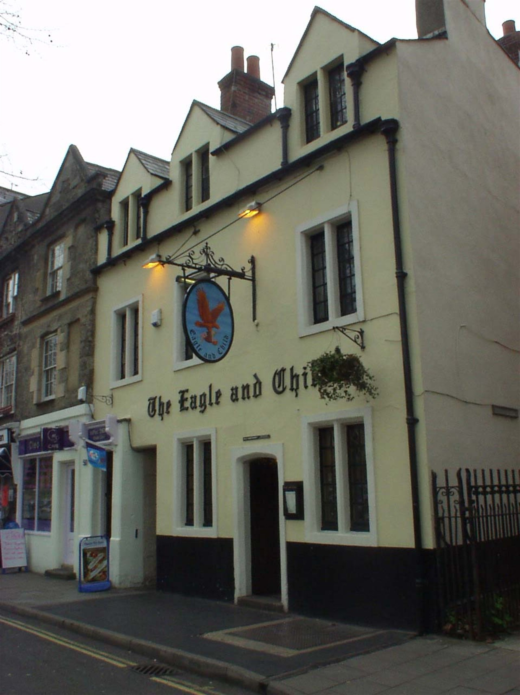

# 鹰与孩童酒馆

圣吉尔斯街 49 号现在更像一处需要读门牌的建筑：门前没有排队的人，也没有酒保在擦杯子。鹰与孩童酒馆自 2020 年 3 月起关闭，2023 年由 Ellison Institute of Technology（EIT）买下，2025 年获准按修复方案改造。它仍然是牛津文学地图上最常被指认的地点之一，但“文学地标”和“正在营业的酒馆”在这里已经不是同一件事。

图：鹰与孩童酒馆。图片：MPerel at English Wikipedia，Public domain，via Wikimedia Commons（[原图页面](https://commons.wikimedia.org/wiki/File:The_Eagle_and_Child.jpg)）。

## 1684–2025：鹰与孩童酒馆的历史节点
圣吉尔斯街是一条宽阔的林荫道，北端接近 St John's College，南端通向 Ashmolean 博物馆与市中心。鹰与孩童酒馆的建筑被列为 Grade II；圣约翰学院在 2023 年 10 月的新闻稿中说，酒馆最早在 1684 年作为啤酒馆营业。CAMRA 的记录也把 1684 年作为“首次有啤酒馆记录”的年份，并指出前部两个小 snugs 可能保留了那时的空间格局。EIT 在 2025 年的修复说明中则写“built around 1840”，这很可能指现存临街建筑或主要立面，而不是否定 1684 年的经营记录。把“首次记录”“现存建筑年代”和“文学聚会年代”分开，才不会把三种时间混成一句话。

20 世纪，托尔金、C.S. 刘易斯、Hugo Dyson 等 Inklings 成员常在这里聚会，地点是后部的 Rabbit Room；常客把酒馆叫作 “Bird and Baby”。聚会通常发生在周二午餐时段，从 1930 年代延续到 1960 年代初期。需要强调的是，Inklings 在这里讨论作品是历史事实，但“某部作品就在这张桌子上写完”一类说法往往被后人放大；酒馆的意义在于提供了一个可以持续争论的日常空间，而不是某一件圣物。

2020 年 3 月，疫情让酒馆关门；此后它长期空置。2023 年 10 月，圣约翰学院把建筑出售给 EIT，并宣布计划在改造后重新作为酒馆开放。2025 年 10 月，规划许可与登录建筑许可获批，EIT 任命 Foster + Partners 主导修复，Donald Insall Associates 负责遗产顾问。这个所有权变化解释了为什么今天的页面必须同时写“历史”和“工程状态”：它已经从学院持有的酒馆，变成研究机构街区计划的一部分。

## 空间与酒单

目前的答案是：没有酒单，也没有营业空间。建筑内部有两间历史客厅（parlours）与著名的 Rabbit Room；修复方案提出保留这些空间的温度，恢复第三间客厅，在后部增加餐厅并重新连接花园，同时把隔壁 50–51 St Giles' 改成供应咖啡与烘焙的 café，楼上则作为 EIT 学者、员工与研究员的工作与会议空间。换句话说，未来的鹰与孩童不会只是一间传统酒馆，而是“酒馆 + 咖啡 + 花园 + 机构社交空间”的复合体。

这也意味着，网上能查到的旧菜单、旧价格与旧营业时间都已经失效。把修复效果图当成现状，或把“Rabbit Room 将保留”理解成“现在可以进去坐”，都会失望。建筑的价值在临街立面、内部隔间与文学记忆；酒单要等重新开业后才会重新存在。

## 怎么喝

在闭馆期，这里没有“怎么喝”的标准答案。可行的做法是把行程改成“看建筑 + 去别处喝”：沿圣吉尔斯街往南走到 Lamb & Flag，或进入 Jericho 一带的酒馆；这些地方仍在营业，也更能提供正常的牛津酒馆体验。若你专为 Inklings 来，可以把鹰与孩童当作步行线上的一个停顿点，读门牌、看立面，再继续走，而不是把它当作当天的饮酒目的地。

未来重新开业后，点单逻辑大概率会变：如果由机构运营，菜单可能同时服务游客、学生与 EIT 人员，价格与营业时间也会更接近“全天候目的地”而不是传统酒馆。第一次去仍然建议先看官方公告与菜单，不要按 2019 年的攻略点酒。

## 鹰与孩童酒馆的地址与营业安排
地址是 49 St Giles', Oxford OX1 3LU, United Kingdom。从牛津车站步行约 900 米（12–15 分钟），也可乘公交到 St Giles 一线；周边是 St John's College、Ashmolean 博物馆与 Oxford University Press。最近的火车站是 Oxford（Great Western Railway 与 CrossCountry），从站前广场步行穿过 Castle Street 与 Broad Street 即可到达 St Giles'。

当前没有营业时间、菜单、价格、预订渠道或着装要求可写：建筑自 2020 年 3 月起关闭，CAMRA 在 2025 年 11 月的记录仍将其列为长期关闭；2026 年 9 月《Oxford Clarion》引述业主说法称，围挡内的整体修复正在进行，目标是在 2027 年重新开业，但当时仍未给出确切日期。门票/预约：作为修复中的建筑，不对外售票，也不接受酒馆订位；只能在公共人行道上看外观，不能进入围挡。交通：公交 2、2A、S3 等沿 St Giles' 与 Magdalen Street 设站。页面核验日期 2026-11-08；营业状态、价格与预约以官方渠道为准，出发前请查 EIT 公告、CAMRA 记录或现场告示。

如果你需要“今天就能喝酒”的地方，这页不适合作为行程主点；如果你关心建筑与文学史，外观仍值得看，但应把停留时间控制在十分钟左右，并避开施工围挡。

## 礼仪与常见误区

不要敲门、不要试图从侧门进入，也不要跨过围挡拍照。它现在是修复中的登录建筑，不是对公众开放的遗迹。第二个误区是把 Inklings 的聚会细节当成可精确复原的场景：他们确实在 Rabbit Room 聚会，但具体座位、点了什么、每次谈了什么，并没有完整记录。第三个误区是把“关闭”理解成“废弃”：建筑有明确的业主与修复方案，未来仍可能作为酒馆开放。

还要注意，这是一处学院与机构所有的物业，周边是居民与学院建筑；在门口长时间聚集、大声讲解或直播，会打扰邻居。若带团，提前确认是否允许在公共人行道上停留。最后，别把“Bird and Baby”这个昵称当成正式店名去导航，地图上仍以 The Eagle and Child 为准。

## 牛津的周边街区
从 St Giles 北端出发，可以先看 St John's College 的建筑，再往南到 Ashmolean 博物馆（免费，适合雨天），继续走到 Broad Street 与 Oxford University Press。若想喝酒，沿 St Giles 往南的 Lamb & Flag 是更实际的选择；再往西进入 Jericho，有更多小酒馆与餐馆。把鹰与孩童放在这条步行线的起点或中点，而不是终点，能让行程更顺。

## 同城酒馆与延伸阅读
这里曾经供应的啤酒属于更广的[啤酒](ref:beer)风格家族；把它放回[酒吧与城市](ref:pub-and-city)的脉络，更容易理解这类空间的待客方式。

补充阅读：[柴郡奶酪酒馆](ref:c-extra-1)、[A Ginjinha](ref:c-extra-2)、[À la Mort Subite](ref:c-extra-3)。

相关条目：[啤酒](ref:beer)、[认识一座城，从一间酒馆开始](ref:pub-and-city)、[柴郡奶酪酒馆](ref:c-extra-1)。

**关键事实。**

| 项目 | 内容 |
| --- | --- |
| 一句话定位 | 牛津圣吉尔斯街的历史酒馆，以“Inklings”文学小组（托尔金、C.S.刘易斯等）的聚会地闻名；2020 年起关闭，2025 年获准修复，现址暂无酒馆服务 |
| 地址 | 49 St Giles', Oxford OX1 3LU, United Kingdom |
| 城市/国家 | 牛津 / 英国 |
| 营业状态 | 已停业 |
