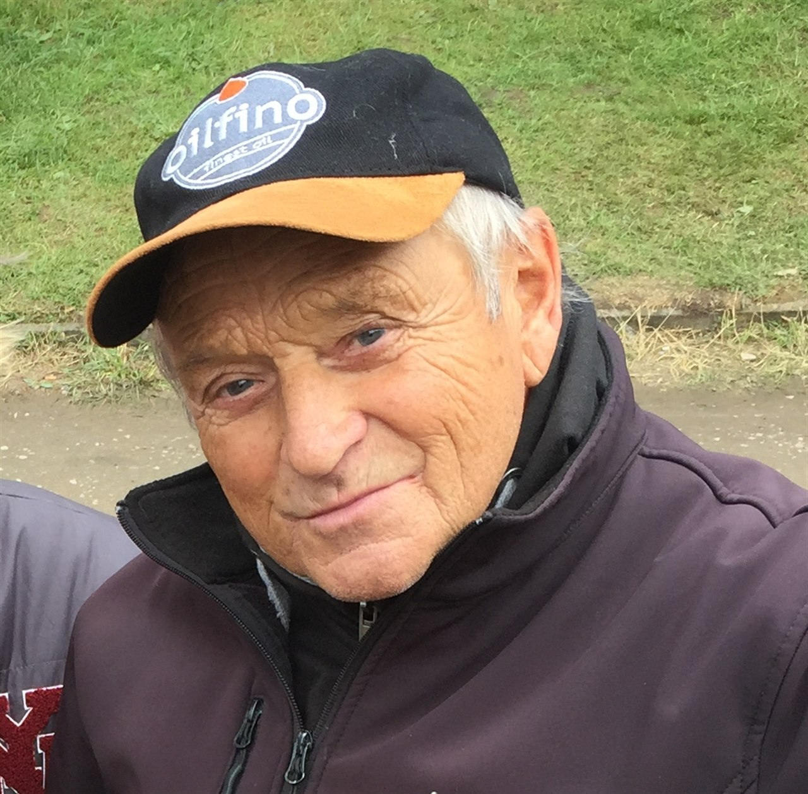

# 伊贡·米勒酒庄

伊贡·米勒酒庄（Weingut Egon Müller - Scharzhof）在德国萨尔河谷的维尔廷根，庄园名为沙兹霍夫（Scharzhof）。它的名字几乎等同于沙兹霍夫山（Scharzhofberg）：一片南向陡坡、蓝板岩与老藤，加上极低的产量，让这里的雷司令成为许多酒单上的“参照物”。与那些设有游客中心的酒庄不同，沙兹霍夫更像一座私人庄园——官方页面只给出地名与邮箱，抵达前必须自行确认。

图：伊贡·米勒酒庄。图片：KarleHorn，CC BY 3.0，via Wikimedia Commons（[原图页面](https://commons.wikimedia.org/wiki/File:Egon_Mueller_2018.jpg)）。

## 沙兹霍夫：萨尔河谷的一座庄园

沙兹霍夫位于维尔廷根村外的坡脚，周围是萨尔河支流切割出的狭窄河谷。萨尔是摩泽尔的支流，气候比中摩泽尔更冷，成熟期更晚；这里的雷司令酸度更利、果味更收，酒体也更紧。庄园本身并不大，建筑群围绕旧宅与酒窖展开，外观低调，和“世界级甜酒”的名声形成反差。

官方联系页写明“Weingut Egon Müller - Scharzhof, Wiltingen / Saar”，并给出邮箱 egon@egon-mueller.de；没有街道门牌、没有固定参观时间。地址栏里补上的 54459 来自公开地理资料，导航时以“Scharzhof, Wiltingen”为准。坐标以官方渠道为准。

## 1797 年以来的一个家族

酒庄官网首页只有一句“Since 1797, one family”，这句话就是它的自我介绍。家族自 1797 年起持有沙兹霍夫，历经多代，今天的经营者仍以米勒家族的名义出现。与许多被大集团收购的历史名庄相比，这种连续性本身就是风格的一部分：酒窖里的决策不需要向外部品牌组合妥协，年份差异可以被保留下来。

连续性也意味着保守。酒庄不追逐新风格，酒标与包装长期保持简洁；对外沟通少，价格却由市场与拍卖推高。理解这一点，就不会期待一个“讲解型”的游客体验——这里更像一个仍在运转的家族产业，而不是为参观设计的展馆。

对访客而言，这种保守还有一层实际含义：酒庄没有为游客铺设的动线，也没有纪念品商店式的入口。你看到的是住宅、酒窖与仓库，能进入哪些区域取决于接待者；这也是为什么预约邮件里要写清目的——买酒、品鉴还是同行拜访，接待方式会不同。

## 沙兹霍夫山：南向陡坡与蓝板岩

沙兹霍夫山是萨尔最著名的葡萄园之一，坡向朝南，能最大限度接收日照；土壤以蓝板岩为主，风化后形成薄层碎石，排水快、升温快，迫使根系向下扎。陡坡让机械难以进入，采摘与搬运依赖人工，产量因此被压得很低。老藤在这里不是营销词，而是稳定风味的前提。

同一座山的不同位置也有差异：坡上更陡、土层更薄，酒更紧；坡脚土层稍厚，果味更开。酒庄的沙兹霍夫山系列通常按 Prädikat 分级，而不是按小地块拆分；这与中摩泽尔一些酒庄的做法不同，也让“山”成为一个整体品牌。

## 雷司令的糖与酸：从 Kabinett 到 TBA

伊贡·米勒的酒单覆盖从 Kabinett 到 Trockenbeerenauslese（TBA）的完整序列。Kabinett 轻，酸度明亮，适合年轻时喝；Spätlese 更熟，甜感与酒体都上升；Auslese 开始挑果，贵腐比例因年份而异；Beerenauslese 与 TBA 则依赖贵腐与逐粒挑选，产量极低，常以拍卖形式进入市场。

这套序列的关键不是“越甜越好”，而是酸度与糖度的平衡。萨尔的冷凉气候给雷司令保留了高酸，即使 TBA 的糖度极高，入口仍有清晰的骨架；如果没有这层酸度，甜酒会显得腻。喝 TBA 时不妨先闻蜂蜜、杏干与柑橘皮，再看口中的酸度是否把甜度托住。

## 酒单、年份与拍卖

酒庄的产品线以雷司令为主，按沙兹霍夫山与 Wiltinger Braune Kupp 等地块区分，再按 Prädikat 分级。不同年份的差异在萨尔非常明显：冷年份酸度高、酒体轻，熟年份果味更足、贵腐更易出现。收藏者常关注拍卖批次，因为 TBA 与部分 Auslese 只通过拍卖或配额流通，普通零售渠道很难见到。

购买时要注意来源与储存。甜酒对温度与光线敏感，长途运输后的状态可能与酒庄试饮不同；老年份的 TBA 还可能出现颜色加深与香气变化，这不一定代表损坏，但需要更谨慎的判断。若只是入门，先买 Kabinett 或 Spätlese，比直接追 TBA 更实际。

另一个实际问题是配额：热门年份的沙兹霍夫山酒款常需要通过熟悉的酒商或拍卖渠道获取，临时在零售店寻找往往只剩少量。若计划收藏，先确认来源、运输与保险，再谈价格；甜酒的瓶型与封口也会影响长期储存，不要只看年份。

## 到访方式与预约确认

地址是 Scharzhof, 54459 Wiltingen, Germany；官方页面只提供邮箱，没有参观预约入口。若希望到访，应提前用邮件说明人数、日期、目的与是否开车，并等待回复；不要假设酒庄随时接待散客。采收期、拍卖前后与周末通常更忙，回复可能更慢。

即使获得接待，也应把品鉴控制在少量，开车的人全程吐酒。萨尔河谷的乡道窄、弯多，夜间照明有限；从维尔廷根回特里尔或卢森堡都需要时间。若不打算买酒，事先说明，避免把拜访变成销售压力。酒庄的接待能力有限，旺季更应提早联系；临时改期也要尽早告知，这是对家族酒庄最基本的尊重。

相关条目：[雷司令](ref:riesling)。

酒庄的拍卖与配额体系会影响市场流通，不是所有年份都能在常规渠道买到；参观与购买都要先确认官方渠道，别把二手市场的报价当成酒庄定价。

## 另见

- [摩泽尔产区](ref:mosel)：萨尔作为支流产区的气候与地块差异。
- [雷司令](ref:riesling)：高酸、贵腐与陈年潜力。
- [白葡萄酒](ref:white-wine)与[橡木桶陈年](ref:oak-ageing)：理解发酵与陈年容器。

开放时间、预约与价格以官方渠道为准，页面核验日期 2026-11-09。

补充阅读：[葡萄酒](ref:c-extra-1)。

对照阅读：[摩泽尔](ref:mosel)、[白葡萄酒](ref:white-wine)。

**关键事实。**

| 项目 | 内容 |
| --- | --- |
| 一句话定位 | 德国萨尔河谷维尔廷根沙兹霍夫的一座家族酒庄，自 1797 年起由同一家族经营，以沙兹霍夫山蓝板岩陡坡的雷司令与极高浓度的贵腐甜酒闻名；官方页面只提供联系渠道，参观须先确认 |
| 地址 | Scharzhof, 54459 Wiltingen, Germany |
| 城市/国家 | 维尔廷根 / 德国 |
| 营业状态 | 待核验 |
| 官网 | egon-mueller.de |

**来源与边界。** 本页关于「伊贡·米勒酒庄」的关键事实，主要由以下来源交叉核对：Weingut Egon Müller - Scharzhof（Scharzhof、Wiltingen/Saar 所在地与联系邮箱；页面未列出参观时段，故营业状态标为 unknown）、Verband Deutscher Prädikatsweingüter（酒庄的 VDP 成员身份与摩泽尔/萨尔产区归属）、Deutsches Weininstitut（德国 Prädikat 分级与雷司令产区的官方说明）等 4 条来源。产品、地址或营业状态变化较快时，以 egon-mueller.de 的最新页面为准；价格、批次与状态会变，涉及这些字段时以页面所列来源的最新版本为准。正文为项目自写，来源只作核验，不复制原文。

## 相关图像

图：雷司令。图片：No machine-readable author provided. T.o.m.~commonswiki assumed (based on copyright claims).，CC BY-SA 3.0，via Wikimedia Commons（[原图页面](https://commons.wikimedia.org/wiki/File:Riesling_grapes_leaves.jpg)）。关联图像：伊贡·米勒酒庄。
