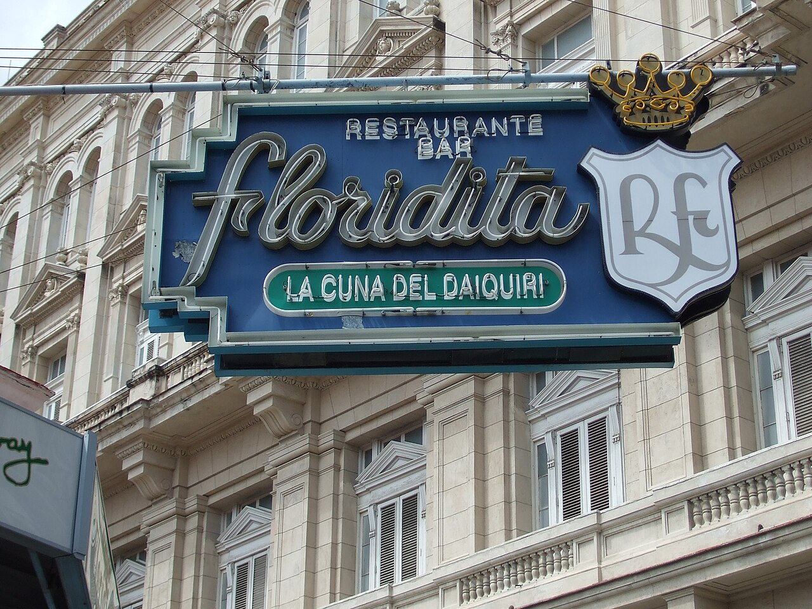

# 小佛罗里达酒馆

小佛罗里达酒馆（El Floridita）在哈瓦那老城 Obispo 街与 Monserrate 街的街角，门牌 Calle Obispo 557，1817 年以“La Piña de Plata”（银菠萝）的名字开业。它被称为“代基里摇篮”：1914 年开始在店里工作的加泰罗尼亚调酒师康斯坦丁诺·里巴拉伊瓜·韦尔特（Constantino Ribalaigua Vert，人称 Constante）在 1931 年做出冷冻代基里，后来把这间店变成了朗姆鸡尾酒的学校。海明威从 1932 年起成为常客，今天店里仍为他保留着吧台尽头的位置与一尊真人大小的铜像。

图：小佛罗里达酒馆。图片：Haydn Blackey，CC BY-SA 2.0，via Wikimedia Commons（[原图页面](https://commons.wikimedia.org/wiki/File:Floridita_Bar-Restaurant,_Havana.jpg)）。

## 1817 年：小佛罗里达酒馆的关键起点
这间店 1817 年开业，地址基本没有搬动；早期是典型的小酒馆，十九世纪哈瓦那人在这里围着酒杯聊天。名称演变有不同版本：哈瓦那市政府页面说 1898–1902 年间改称“La Florida”，民间简称 Floridita；店方官网则说“El Floridita”这个名字从 1914 年沿用至今。两种说法不必强行统一，重要的是它一直是一间“街角酒吧”，而不是后来才被包装出来的主题店。Constante 1914 年进店当服务员，1918 年买下店铺；他把新鲜果汁、朗姆与冰打发成冷冻代基里，也让“cantinero”（调酒师）成为一套师徒传统。1950 年代，美国《Esquire》杂志把它列入世界最著名酒吧之一；1991 年店面修复；2003 年，雕塑家何塞·维拉·索贝隆（José Villa Soberón）为海明威制作了真人大小的铜像，放在他当年常站的位置。

## 空间与酒单

店内的装饰偏英式俱乐部风格：长吧台、镜面、红色调、墙上挂满照片与旧物，现场常有乐队演奏。它同时是酒吧与海鲜餐厅：吧台区适合喝鸡尾酒，餐区供应古巴式海鲜与简餐。招牌是冷冻代基里（daiquirí frappé），口感冰爽、酸甜；海明威常喝的是“Papa Doble”，也叫 Hemingway Special——双倍朗姆、西柚汁、少糖或无糖，比标准代基里更干、更烈。店里也供应其他朗姆鸡尾酒，但不要期待一份现代调酒实验室式的创意菜单；它的价值在于历史技法与固定风格。

## 第一次来怎么点

第一次来，先点一杯标准冷冻代基里，感受冰沙质地与酸甜平衡；如果喜欢更干、更烈的版本，再点 Papa Doble。怕甜可以请调酒师减少糖浆，但不要要求“完全无糖还保持原配方”，那会改变杯型与平衡。想吃饭就移步餐区，点海鲜或古巴家常菜，不要站在吧台中间等位。白天开门后与傍晚前相对宽松；正餐时段和旅行团到达时非常拥挤。不要把“海明威喝了多少杯”当成挑战，也不要要求店员复刻某本传记里的配方。

## 小佛罗里达酒馆的地址与营业安排
地址：Calle Obispo 557, esq. Monserrate, La Habana Vieja, La Habana 10100, Cuba；坐标 23.13734, -82.35733，就在 Obispo 与 Monserrate 街角。从 Plaza de Armas、哈瓦那大教堂与 Obispo 步行街都可步行到达；从中央公园或 Vedado 打车约 5–10 分钟。官网标注每日 12:00–01:00，电话 +53 7 867 1300，页面核验日期 2026-11-08。入口不设门票，消费按酒水与餐食计价；公开信息有限，菜单标价、最低消费与是否接受预订均未核验，节假日与临时调整以官方渠道为准。吧台与餐区分开，正餐时段和旅行团到达时非常拥挤；建议开门后不久或傍晚前到。着装 casual 即可，不必正装；现场音乐通常需要给小费。支付方式（现金、外币、银行卡）变化较快，出发前确认，别假定信用卡一定可用。「小佛罗里达酒馆」的开放时间、价格与预约，以[官网](https://www.barfloridita.com/)的公开页面为准；核验日期为 2026-11-08，临时调整以官网当日公告为准。

## 礼仪与常见误区

海明威铜像是店里的纪念物，不是拍照道具：不要跨过吧台、不要坐在雕像腿上，也不要为了合影堵住通道。拍乐队前先问一句，演奏结束后给小费是礼貌。点单时不要用“Hemingway”代替具体酒名；如果你想要的是 Papa Doble，就说这个名字，或说明“双倍朗姆、少糖”。最大的误区是把“海明威同款”当成唯一正宗配方：Papa Doble 是特定版本，冷冻代基里也经过多次调整；品牌叙事不等于历史唯一版本。另一个误区是把这里当成安静的本地酒吧；它从很早就是游客与名人聚集的场所，音乐与人群是体验的一部分。

冷冻代基里是酒吧的招牌变体，不等于传统代基里配方；点单时要说明要冷冻版还是摇和版。

海明威常喝的是不加糖的冷冻代基里变体，酒吧配方与家庭版并不相同；点单时要说明甜度。

## 什么情况不适合来

如果你想要安静谈话、预算有限、讨厌现场音乐与旅行团，或者期待现代鸡尾酒的实验性菜单，这里都不合适。空间在高峰时段拥挤，行动不便者建议先确认入口与座位动线。对酒精浓度敏感的人要小心 Papa Doble 的双倍朗姆；它不是“更淡的版本”。若你只想喝一杯本地人日常的朗姆酒，老城内外还有更小、更安静的酒吧可选。

## 从小佛罗里达酒馆延伸到半途小酒馆
出门就是 Obispo 步行街，往北到 Plaza de Armas 与 Castillo de la Real Fuerza，往南到哈瓦那大教堂与 Cathedral Square；革命博物馆与 Malecón 也在步行或短程打车范围内。它与[半途小酒馆](ref:bodeguita)相距不远，步行约十分钟，可以安排成“代基里 + 莫吉托”的半日对照：先在小佛罗里达看长吧台与铜像，再去半途看窄墙与签名。若时间只够一家，想喝代基里与看海明威遗迹就选这里；想喝莫吉托与吃家常菜就选半途。

## 同城酒馆与延伸阅读
要理解这类酒吧在城市中的位置，可以读[酒吧与城市](ref:pub-and-city)；它也比较了咖啡馆、pub 与 beer hall 的差别。想了解这杯酒的配方与变体，读[代基里](ref:daiquiri)；想了解基底酒，读[朗姆酒](ref:rum)；想看哈瓦那另一间以莫吉托闻名的老店，读[半途小酒馆](ref:bodeguita)。

对照阅读：[认识一座城，从一间酒馆开始](ref:pub-and-city)、[朗姆酒](ref:rum)。

相关条目：[代基里](ref:daiquiri)。

**关键事实。**

| 项目 | 内容 |
| --- | --- |
| 一句话定位 | 哈瓦那老城的传奇酒吧，1817 年创立，以海明威、冷冻代基里和海鲜吧闻名 |
| 地址 | Calle Obispo 557, esq. Monserrate, La Habana Vieja, La Habana 10100, Cuba |
| 城市/国家 | 哈瓦那 / 古巴 |
| 营业状态 | 已核验营业 |
| 官网 | barfloridita.com |

**来源与边界。** 本页关于「小佛罗里达酒馆」的关键事实，主要由以下来源交叉核对：El Floridita（创立时间、地址与海明威相关历史；1817 年创立、Constante 与冷冻代基里、海明威到访、2003 年铜像与营业时间）、Oxford University Press（提供关于代基里与哈瓦那酒吧文化的条目）、Gobierno Provincial de La Habana（Obispo 与 Monserrate 街角位置、名称演变、Constante 与“代基里摇篮”说法）等 6 条来源。产品、地址或营业状态变化较快时，以 barfloridita.com 的最新页面为准；价格、批次与状态会变，涉及这些字段时以页面所列来源的最新版本为准。正文为项目自写，来源只作核验，不复制原文。
