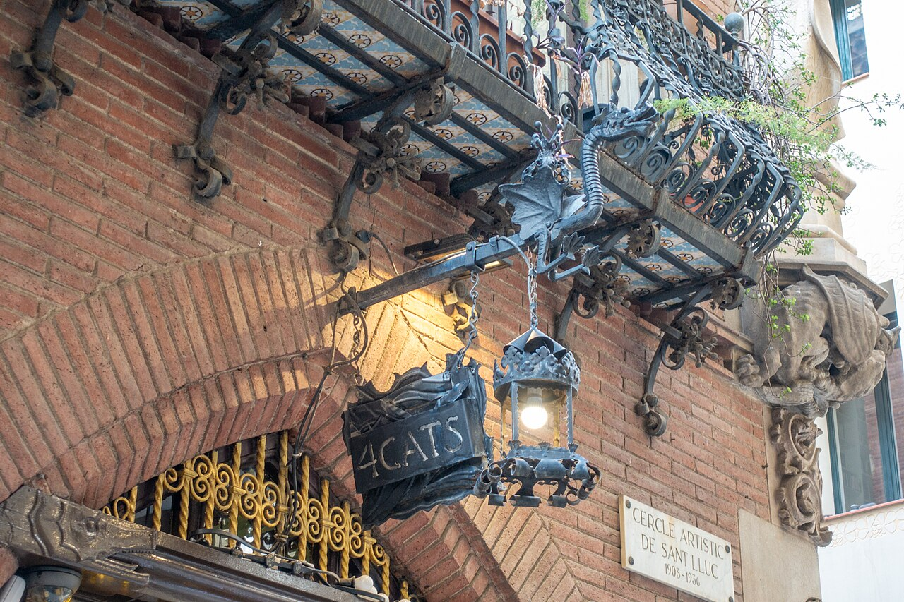

# 四猫咖啡馆

从巴塞罗那主教座堂旁的小巷拐进 Carrer de Montsió，会看到一栋尖顶、砖石立面、带现代主义铁艺的窄楼；底层就是 Els Quatre Gats。门口挂着“4 GATS”的招牌，里面是深色木饰、镜面、海报与一盏盏 brass 灯。它不像兰布拉大道上的游客咖啡馆那样喧闹，而像一间“按了暂停键”的 1900 年酒馆：菜单、墙饰、桌椅都在提醒你，这里曾经是加泰罗尼亚现代主义的据点。

图：Els Quatre Gats 的砖墙立面、铁艺灯笼与“4 GATS”招牌，Carrer de Montsió 3。图片：Kent Wang from Barcelona, Spain，CC BY-SA 2.0，via Wikimedia Commons（[原图页面](https://commons.wikimedia.org/wiki/File:Els_Quatre_Gats_(52057359477).jpg)）。

## 1897 年：四猫咖啡馆的关键起点
Els Quatre Gats 于 1897 年 6 月 12 日开幕。发起人是 Miquel Utrillo、Ramon Casas 与 Santiago Rusiñol，资金来自 Manuel Girona，日常主持者是 Pere Romeu。它位于建筑师 Puig i Cadafalch 设计的 Casa Martí 底层；这栋楼本身是加泰罗尼亚现代主义的代表作，尖顶、砖石、铁艺与彩窗都带着 1900 年前后的风格。

店名来自加泰罗尼亚俗语“¡Seréis cuatro gatos!”——直译“你们不过是四只猫”，意思是“你们没几个人/成不了气候”。据说这句话是 Casas 或 Rusiñol 对一群常客的调侃，后来被反过来用作店名。它模仿巴黎蒙马特的 Le Chat Noir：有歌舞、有展览、有杂志，也有深夜的文学争论。

咖啡馆不只是喝酒的地方。它办音乐会、中国影戏、木偶戏、文学晚会与画展；出版《Quatre Gats》《Pèl & Ploma》《Forma》等刊物。毕加索在 1899 年开始频繁出入，1900 年 2 月在店内举办首次公开画展（店方年表把首次个展记在 1899 年，资料之间有差异）；他还为菜单画过封面。1903 年，咖啡馆因债务关闭，店面一度改成纺织仓库；1980 年代末重新作为餐厅开放，1989 年起由 Josep Maria Ferré 经营。2008 年，Woody Allen 在这里拍摄《Vicky Cristina Barcelona》。

把 Els Quatre Gats 放回 1900 年前后的巴塞罗那，会更清楚它的位置：老城正在拆改，Eixample 在扩张，年轻画家与作家在咖啡馆、杂志与展览之间建立网络。它不只是一个店名，而是加泰罗尼亚现代主义的一套“基础设施”：出版、展览、音乐与争论都在同一栋楼里发生。今天的菜单与装饰服务的是当代客人，但空间仍保留那种“前厅谈事、后厅吃饭、角落看报”的分区感。

## 空间与酒单

现在的 Els Quatre Gats 仍保留着“酒馆 + 餐厅”的双重身份。底层有吧台、木桌、镜面、老海报与钢琴；墙上挂着 Casas 与 Rusiñol 时代的复制品与照片；楼上与角落有更安静的桌位。空间不大，天花板不高，灯光偏暖，适合慢慢吃饭、听琴或看窗外老城的小巷。

菜单是加泰罗尼亚传统菜与“现代主义风格”的混合：烤蔬菜、番茄面包、海鲜、烤肉、炖菜、crema catalana 与巧克力；酒单有本地葡萄酒、cava、啤酒与鸡尾酒。它不是“只喝咖啡”的咖啡馆，正餐时段以吃饭为主；下午可以点咖啡、cava 或甜点。

## 怎么喝

中午或晚上适合点加泰罗尼亚炖菜、烤肉或海鲜，配一杯 Penedès 白葡萄酒或 cava；番茄面包与烤蔬菜适合清淡的白酒。下午可以点一杯咖啡、cava 或甜点，坐在吧台或窗边看老城。若只想喝一杯，避开正餐高峰，问服务生吧台是否有位。

不要期待“毕加索同款座位”或固定讲解；店里没有把每一张桌子都标成文物。想了解历史，读墙上的海报与官网，或把这里作为“毕加索/现代主义”步行路线的一站。

## 四猫咖啡馆的地址与营业安排
- 地址：Carrer de Montsió 3, 08002 Barcelona。
- 营业：周二至周六 11:00–24:00；周日 12:00–17:00；周一休息。
- 交通：地铁 3 号线 Liceu 或 1 号线 Catalunya；近 Urquinaona。
- 预订：正餐建议预订；下午咖啡与酒吧通常可以直接到店。
- 价格：正餐人均中等偏高；咖啡与甜点相对轻。
- 提示：老城小巷窄，门口常有人拍照；用餐时不要挡住邻桌与通道。建议从 Via Laietana 一侧步行进入，避免拖行李走石板路。

## 礼仪与常见误区

第一，不要把“四只猫”理解成“猫主题咖啡馆”；店名是俗语，不是动物。第二，不要把它当成“毕加索博物馆分馆”；这里是营业中的餐厅，毕加索的关联是历史与装饰，不是展览。第三，不要把 1897 年开幕与 1903 年关闭之间的所有活动都当成“天天有”；音乐会、展览与刊物是那个时期的节目，今天的活动以店方公告为准。第四，不要用“现代主义”概括所有装饰；现在的空间经过修复与重做，原件与复制品混在一起。第五，不要在钢琴演奏时大声谈话；若有人在弹琴，压低声音是基本礼貌。

四猫咖啡馆的现代主义与毕加索故事属于历史层，今天的菜单与空间已经变化；把这里当成博物馆式朝圣地，会忽略它仍在营业、需要按咖啡馆礼仪使用的事实，高峰时段尤其如此。

## 从四猫咖啡馆延伸到马杰斯蒂克咖啡馆
从 Els Quatre Gats 出来，往南两分钟是巴塞罗那主教座堂与老城小巷，往东是 Via Laietana 与 Mercat de Santa Caterina，往西是 Passeig de Gràcia 与 Casa Batlló。可以排成：主教座堂 → Els Quatre Gats 午餐 → Picasso Museum（Carrer Montcada）→ Santa Maria del Mar → 海边。若走现代主义路线，往北到 Casa Batlló、La Pedrera 与 Casa Vicens。

相关条目：[马杰斯蒂克咖啡馆](ref:majestic)。

**关键事实。**

| 项目 | 内容 |
| --- | --- |
| 一句话定位 | 巴塞罗那 Montsió 街 3 号的 Els Quatre Gats，1897 年 6 月 12 日开幕，由 Ramon Casas、Santiago Rusiñol 与 Miquel Utrillo 发起、Manuel Girona 出资、Pere Romeu 主持；店名来自加泰罗尼亚俗语“你们不过是四只猫”，是加泰罗尼亚现代主义与毕加索早期生涯的关键场… |
| 地址 | Carrer de Montsió 3, 08002 Barcelona, Spain |
| 城市/国家 | 巴塞罗那 / 西班牙 |
| 营业状态 | 已核验营业 |
| 官网 | 4gats.com |

**来源与边界。** 本页关于「四猫咖啡馆」的关键事实，主要由以下来源交叉核对：Els Quatre Gats（1897 年 6 月 12 日开幕、发起人、Pere Romeu、Casa Martí、店名俗语、活动、出版物、毕加索、1903 年关闭与 1980 年代重开；Carrer de Montsió 3 地址与周二至周日营业时间）、Museu Picasso de Barcelona（毕加索与 Els Quatre Gats 的关系、1899–1900 年出入与在店内展出）、Ruta del Modernisme（Puig i Cadafalch 设计的 Casa Martí、现代主义建筑背景与 1897 年开幕）。产品、地址或营业状态变化较快时，以 4gats.com 的最新页面为准；价格、批次与状态会变，涉及这些字段时以页面所列来源的最新版本为准。正文为项目自写，来源只作核验，不复制原文。

## 参考资料
- 店方历史页：<https://4gats.com/es/historia/>，用于核对 1897 年 6 月 12 日、发起人、Pere Romeu、店名俗语、活动、出版物、毕加索与 1903 年关闭。
- 店方联系页：<https://4gats.com/contacte/>，用于核对地址与营业时间。
- 毕加索博物馆条目：<https://museupicassobcn.cat/en/whats-on/discover-online/drawings-picasso-portraits-quatre-gats>，用于核对毕加索与店的关系。
- Ruta del Modernisme 的 Casa Martí 条目：<https://rutadelmodernisme.com/ficha/casa-marti-els-quatre-gats-es/>，用于核对 Puig i Cadafalch 与建筑背景。
- 同批的 `place:casa-labra`、`place:cafe-majestic` 可以对照南欧历史咖啡馆/酒馆的不同类型。
- 相关条目：[拉布拉之家](ref:labra)、[马杰斯蒂克咖啡馆](ref:majestic)、[巴黎丽兹 Hemingway 酒吧](ref:hemingway)、[花神咖啡馆（威尼斯）](ref:florian)、[和平咖啡馆](ref:paix)

对照阅读：[拉布拉之家](ref:labra)、[丽兹海明威酒吧](ref:hemingway)。
