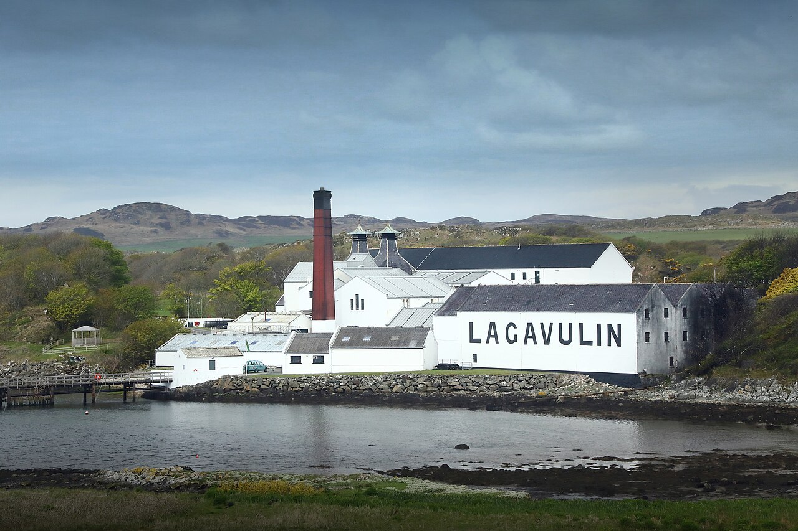

# 雇员专属酒吧

雇员专属酒吧在纽约西村哈德逊街 510 号，介于 Christopher Street 与 West 10th Street 之间。它 2004 年开业，是纽约 2000 年代鸡尾酒复兴的代表之一：门面借用了占卜店的视觉，里面却是一间高能量、以经典鸡尾酒和通宵餐食闻名的酒吧。名字“Employees Only”字面是“仅限员工”，实际它欢迎所有客人；这块招牌更像一个玩笑，而不是门禁。

图：栏目配图。摄影：见原图页。署名：Charlie Marshall，CC BY 2.0，来自 项目图库（类别配图）（[来源](https://commons.wikimedia.org/wiki/File:2019-05-05_Lagavulin_Distillery.jpg)）。这张照片仅为场所栏目配图，不是雇员专属酒吧的门店或场馆实拍。

## 2004 年：雇员专属酒吧的关键起点
酒吧于 2004 年开业，The 50 的简介说它“从开业那天起就是经典”，并把它的贡献概括为：给隐藏式酒吧注入了热闹、好玩的性格，而不是只做安静的秘密空间。这个判断解释了它为什么能在纽约那一代 speakeasy 里站稳：它没有把“隐蔽”做成排他，而是把“隐蔽”做成进入后的反差。

二十年后，它仍在榜单上：2025 年 The World's 50 Best Bars 列第 95，2026 年 North America's 50 Best Bars 列第 45；The 50 还提到它曾连续十年留在世界榜单。它的门面常被描述为“psychic 的霓虹灯”或“占卜师坐在前窗”，Time Out 把它写作“占卜师在前窗迎接客人”：门口先给你一个算命店的印象，进门后才是吧台与餐厅。这个设定是装饰与叙事，不是真的占卜服务。

## 空间与酒单

室内是 Art Deco 风格，吧台呈弧形，空间前段热闹、后段是用餐区。调酒师穿白色制服，站在吧台后高高地操作，常用 free-pouring（不量杯直接倒）的方式出杯；这让出杯速度快，也让整间店有一种“表演正在进行”的感觉。它不是安静聊天的酒吧，音乐、笑声与吧台动作会同时发生。

酒单的核心是经典鸡尾酒。The 50 明确写到店里每天要搅出大量“signature martinis and Manhattans”，也就是马天尼与曼哈顿；此外还有 West Side，用迈耶柠檬浸泡的伏特加、鲜柠檬汁、薄荷与 Perrier 调制，属于清爽型长饮。喜欢纯饮的人可以看稀有威士忌单。食物不是附属品：手切生牛肉塔塔、辣香肠 cavatelli、烤梨 burrata 与肋眼都出现在 The 50 的简介里；Time Out 还提到打烊时会给留下来的客人一碗免费鸡汤，The 50 则把它写作 off-menu 的“Sober Up Soup”。

价格按 The 50 的标注，平均每杯鸡尾酒约 17 美元；Time Out 把整体价位标为四档中的第二档，并给出主菜均价约 22 美元。这个价位在纽约属于中高档，但没有到“只可远观”的程度。

## 怎么喝/点什么

第一次来，先点一杯 Manhattan 或 Martini，直接检验这家店的基本功；如果不想喝烈酒，可以点 West Side，酸甜与薄荷会让它更容易入口。想吃饭就坐后段或桌位，想感受吧台节奏就尽量坐吧台附近；两种体验在同一间店里，但音量与停留时间不同。

点单时不用背配方，告诉调酒师你想要的方向：偏干、偏甜、偏苦，或者“清爽一点、不要太烈”。店里以经典款为主，复杂的实验性调酒不是它的强项；高峰时也不适合要求一杯需要十分钟装饰的酒。食物分量不小，生牛肉塔塔适合两人分食；如果只想喝酒，点一份小食即可，不要把整张菜单点满。打烊前的鸡汤是这家店的彩蛋，但别为了它硬撑到凌晨。

## 雇员专属酒吧的地址与营业安排
地址是 510 Hudson Street, New York, NY 10014, USA，位于西村，介于 Christopher Street 与 West 10th Street 之间；坐标 40.73343, -74.00615，取自官方 Location 页内嵌 Directions 链接的坐标参数。地铁 1 号线到 Christopher Street–Sheridan Square 站，步行约 3 分钟；A、C、E、B、D、F、M 线到 West 4th Street–Washington Square 站，步行约 6–8 分钟；新泽西方向的 NJ PATH 也可到 Christopher Street 站，官方位置页列出了这些线路。Time Out 列出的营业时间是每日 18:00–次日 04:00，属于纽约少见的深夜酒吧；官方页面未逐条列出时段，节假日与私人活动会调整，出发前请以官方渠道确认。`operating_status` 为 `verified`，表示官方页面与位置页在 2026-11-08 仍正常、未见停业或易主公告；这不等于任何时段都无需等位。

没有门票，消费即点酒。正餐与吧台入座规则随时段调整：桌位建议提前订，吧台通常先到先得，满座时在门口等位。价格按 The 50 的平均杯价约 17 美元，另加税与小费；Time Out 把整体价位标为四档中的第二档，主菜均价约 22 美元。官方没有列硬性着装要求，smart casual 即可；深夜排队时外面可能很冷，带一件外套比穿得正式更重要。「雇员专属酒吧」的开放时间、价格与预约，以[官网](https://www.employeesonlynyc.com/)的公开页面为准；核验日期为 2026-11-08，临时调整以官网当日公告为准。

## 礼仪与常见误区

第一，这里不是“安静的隐藏酒吧”。它的卖点之一是热闹：音乐、吧台动作与人群音量都属于体验的一部分；想要低声谈话的人，应该选后段桌位或换一家店。第二，门面的 psychic 招牌是布景，不要真的敲门问卜，也不要把占卜师当成酒吧的迎宾。

第三，不要因为名字叫“Employees Only”就以为只接待员工；它是店名，不是会员制。第四，吧台前的位置是给点酒的人，不要长时间占着拍“秘密入口”。第五，正餐与酒吧的规则不同：想吃手切塔塔或肋眼，最好订桌；只想喝一杯，直接排队更实际。最后，小费按纽约习惯给，账单可能已含大桌服务费；深夜离开时保持安静，西村是住宅区。

## 纽约的周边街区
从酒吧往东走几分钟是 Christopher Park 与 Stonewall Inn，再往南是 Washington Square Park；往西到 Hudson River Park 看河，往北走约十五分钟可到 High Line 与 Meatpacking。地铁 1 号线与 West 4th Street 站都在步行范围内。路线可以这样安排：下午在 Washington Square 与 Bleecker Street 逛店，傍晚到 Employees Only 吃一顿简餐，深夜再去 Stonewall 或沿 Hudson 走一段。若想把纽约的“老酒馆”与“新 speakeasy”放在一起，可以白天去白马酒馆，晚上回到这里；两者相隔约十分钟步行，气质却完全不同。

## 同城酒吧与延伸阅读
雇员专属酒吧适合与白马酒馆对照：一个把 2000 年代的经典鸡尾酒复兴做成高能量空间，另一个把 20 世纪的文学酒馆记忆保留在旧吧台里。若想继续看“隐蔽式酒吧”的另一种做法，可以读同城的麦克索利老麦酒馆——它不隐藏入口，却用极窄的酒单制造类似的仪式感。

## 同城酒吧与延伸阅读
- [皮特酒馆](ref:petes-tavern)
- [古典](ref:old-fashioned)
- [认识一座城，从一间酒馆开始](ref:pub-and-city)

补充阅读：[A Ginjinha](ref:c-extra-1)、[À la Mort Subite](ref:c-extra-2)。

对照阅读：[皮特酒馆](ref:petes-tavern)、[认识一座城，从一间酒馆开始](ref:pub-and-city)。

相关条目：[古典](ref:old-fashioned)。

**关键事实。**

| 项目 | 内容 |
| --- | --- |
| 一句话定位 | 纽约西村 2004 年开业的 speakeasy 风格鸡尾酒吧，以白制服调酒师、马天尼与曼哈顿、通宵餐食和“Psychic”门面闻名 |
| 地址 | 510 Hudson Street, New York, NY 10014, USA |
| 城市/国家 | 纽约 / 美国 |
| 营业状态 | 已核验营业 |
| 官网 | employeesonlynyc.com |
