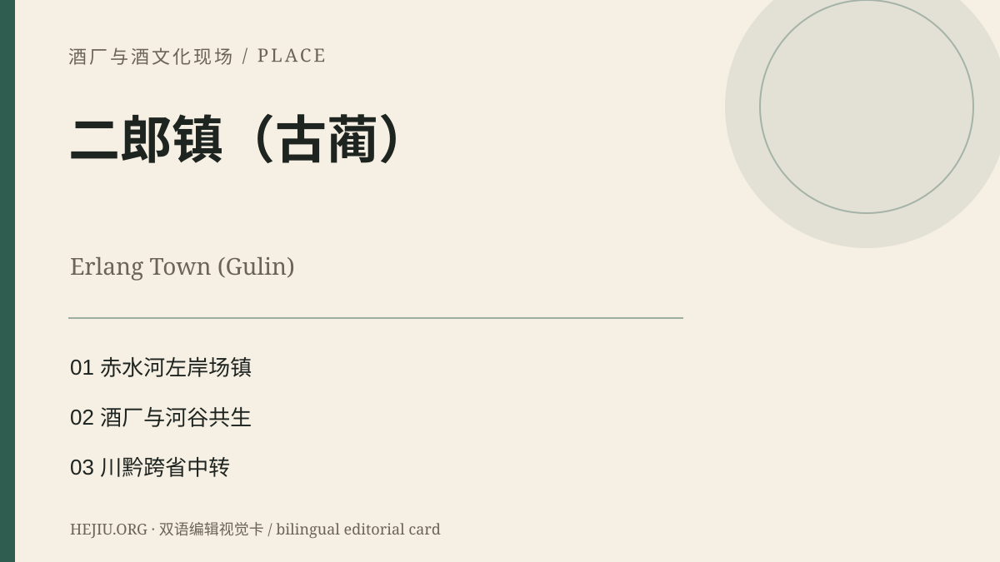

# 二郎镇（古蔺）

二郎镇常被当成“郎酒庄园所在的镇”，但镇本身也值得理解：一条赤水河把四川与贵州分开，山坡上是厂区与场镇，河边是运输与跨省通道。这里没有一条完整的仿古旅游街，住宿、吃饭与班车都围绕酒厂和本地生活运转。把二郎镇当成中转站而不是景点，反而能安排得更顺：住一晚、吃一顿、看清河谷与厂区的关系，再决定往习水还是回泸州。

图：二郎镇（古蔺）专属双语视觉卡。项目自制双语视觉卡，用于识别主题，不是现场照片。

> **先给结论**
> **适合谁：** 走川黔酒旅、需要在中途住一晚的人；适合与郎酒庄园、习酒镇、土城串线。
> **不适合谁：** 期待完整古镇街区与连续商铺的人；二郎镇是酒业场镇，不是景区。
> **一句话：** 把它当中转站：住、吃、看河谷，不要把“镇”当成“园”。

## 镇与庄园不是一回事

二郎镇是行政区与生活场镇，郎酒庄园是其中的酒业接待与参观空间。镇上有学校、卫生院、菜市场、小餐馆与本地住宅，也有酒厂的宿舍、班车与货运；庄园则有独立的门禁、预约与住宿体系。游客容易把“到二郎镇”理解成“到郎酒庄园”，结果订了镇上的房却进不了庄园，或者买了庄园套餐却没时间逛镇。先确认你住在哪一侧、要去哪个门、是否需要接驳，再把镇上的吃饭与散步放在空档里。

## 赤水河两岸的空间

赤水河在二郎镇这一段切出窄谷，四川侧山坡更陡，贵州侧习水方向也有酒厂与场镇。看地形时注意三件事：河面与公路的高差、厂区如何沿坡布置、跨省桥在哪里。酱香型白酒的生产需要水源、曲房、窖池与仓储，河谷的湿热与风向会影响制曲和堆积，但不要把“河谷气候”说成唯一原因。傍晚在允许的公共路段看河与厂区灯光，不要下到河滩或进入未开放码头；雨季水位涨得快，远离边坡与施工区。

## 怎么到、怎么走

二郎镇通常从泸州、叙永或贵州习水方向进入，山路弯多，雨天雾大，自驾要留足时间；班车班次少，出发前查实时信息。若从泸州过来，建议白天进山，不要安排在深夜；若从习水过河，确认桥与导航是否绕行。镇内步行即可，但坡道多，拖行李箱不方便。把二郎镇作为中转：第一天下午到，住一晚，第二天早上进庄园或过河去习水，比当天往返泸州稳得多。

## 住与吃

镇上的住宿以本地宾馆与小店为主，庄园住宿则是另一套预约体系；旺季、周末与酒厂接待日会紧张，提前确认房型、热水、停车与取消规则。吃饭可以试古蔺麻辣鸡、赤水河鱼、豆花、腊肉与山野菜，口味偏重，点菜时先说辣度。小餐馆营业时间随本地作息，晚上不要太晚找饭。买酒不要在路边接“内部渠道”，去官方店或授权店；带酒上车注意颠簸与后备箱温度，夏天不要把酒长期放在暴晒的车里。

## 和习水、古蔺串线

二郎镇最适合串成“古蔺—二郎—习水—土城”的川黔酒旅：四川侧看郎酒庄园与古蔺县城，过河到贵州侧看习酒镇与土城古镇，再往遵义或泸州返程。两天一夜是底线，三天更从容。跨省路线要确认桥梁、班车与导航，雨季注意封路。若只留半天，就在镇上吃饭、看河谷与厂区外观，不要把庄园、习酒和土城都塞进来；山路会把每个点都压成十分钟。

## 把二郎镇当成“山路上的停顿”

到二郎镇不要急着打卡。放下行李，先在镇上走一圈，看菜市场、学校、酒厂班车与河边通道，理解这个镇为什么围绕酒厂生长；傍晚在允许的公共路段看河谷，不要下河滩；第二天早上再进庄园或过河。若你只有一顿饭的时间，就选一家本地小馆，点辣度可控的家常菜，问清招牌菜与分量，不要把“网红推荐”当成唯一标准。住店时确认第二天能不能早起退房、有没有早餐、叫车是否方便，这些细节比多拍一张照片更影响川黔酒旅的体验。如果第二天要过河，前一晚把身份证、行李和班车时间放在一起；镇上取现和药店不多，水和常用药提前补。山路夜间不要徒步，雨后不要靠近施工边坡；把大件行李寄存在住宿点，轻装过河。到镇后先问清第二天最早一班车，住店收据保留到退房，前台电话记下来；不要为拍照站在公路弯道，庄园接驳是否到镇中心，订房时问清。提前准备。再确认。

## 出发前核对

- 确认住镇内还是庄园
- 白天进山，避免深夜到达
- 雨季远离河滩与边坡
- 镇上吃饭先问辣度与营业时间
- 过河前确认桥与班车
- 坡道多，行李尽量轻
- 订房确认热水与停车
- 不要下河滩或进入未开放码头

## 这一页的边界与下一步

二郎镇的价值不只在郎酒庄园。它位于赤水河谷，镇区、渡口、老街和酒厂共同构成一个“因酒与盐路而兴”的空间；只看庄园会错过镇子的日常生活。镇区步行范围不大，但坡道多，雨后路面滑，带行李箱要预留时间。

从古蔺、习水或茅台方向进入都要走盘山路，班车班次有限，打车价格弹性大。若不自驾，提前问清返程车辆，别把行程压在天黑前。镇区餐饮以本地小馆为主，旺季和节假日接待能力紧张。

这一页不把二郎镇写成“必须打卡”的景区。它适合作为赤水河路线的一站，与习水、土城或茅台组合；若时间紧，优先确认庄园预约，再决定镇区停留长度。

## 参考资料

- 古蔺县人民政府 — 行政区划与人口 — https://www.gulin.gov.cn/mlgl/zjgl/hzqhyrk（古蔺县人民政府，核对 2026-11-25）
- 泸州市人民政府 — https://www.luzhou.gov.cn/（泸州市人民政府，核对 2026-11-25）
- 郎酒 — 郎酒集团 — https://www.langjiu.cn/（四川郎酒集团有限责任公司，核对 2026-11-25）
- GB/T 2260-2007 中华人民共和国行政区划代码（国家标准化管理委员会，核对 2026-11-25）

相关条目：[郎酒庄园](ref:estate)、[古蔺郎酒路线](ref:route)、[贵州省](ref:region)、[中国](ref:regioncn)、[酱香型白酒](ref:style)、[郎酒](ref:brand)、[第一次喝白酒怎么选](ref:guide)、[中国酒史纲](ref:history)。

## 相关图像

图：贵州省。图片：Huangdan2060，CC BY 3.0，via Wikimedia Commons（[原图页面](https://commons.wikimedia.org/wiki/File:Huangguoshu_Waterfall_in_October_2020,_Picture12.jpg)）。关联图像：二郎镇（古蔺）。
