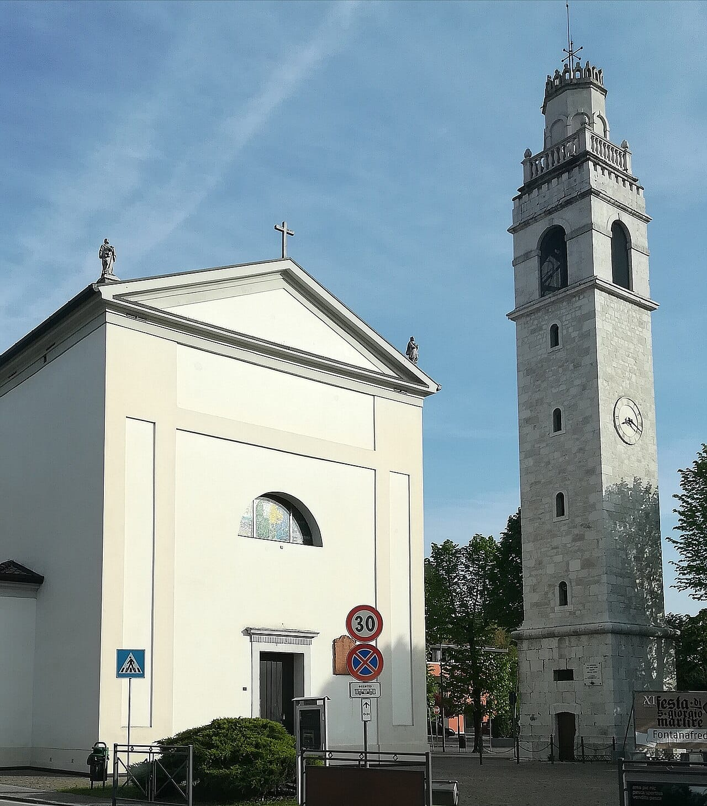

# 丰塔纳弗雷达酒庄

丰塔纳弗雷达（Fontanafredda）在塞拉伦加达尔巴，是巴罗洛产区里少数能把“王室故事”“大规模有机种植”和“可参观的村庄”放在同一条动线上的酒庄。它的官方叙述把起点定在 1858 年：意大利首位国王维托里奥·埃马努埃莱二世与罗莎·韦尔切拉纳的爱情故事，后来变成一片产业。今天这里的葡萄园约 120 公顷，全部获有机认证，酒窖参观则通过“叙述村”（Villaggio Narrante）统一接待。

图：丰塔纳弗雷达酒庄。图片：Marchetto da Trieste，CC BY-SA 4.0，via Wikimedia Commons（[原图页面](https://commons.wikimedia.org/wiki/File:Fontanafredda_-_chiesa_parrocchiale.jpg)）。

## 国王与罗西娜的 1858 年

酒庄官方把 1858 年写成品牌元年，并把创立者写成意大利首位国王。这个故事在酒庄首页反复出现：国王与罗莎·韦尔切拉纳的关系、随后建立的农业与酿酒产业，构成一个比“某家族几代传承”更戏剧化的起点。历史叙述归历史叙述，酒的质量仍要看园地与管理；但这个故事解释了为什么酒庄的建筑群像一个小型领地，而不只是一座酒厂。

对访客来说，重要的一点是：这里不是“王室故居”式的博物馆，而是仍在运转的生产与接待复合体。历史建筑、酒窖、餐厅、住宿与体验产品分布在同一个村里，步行即可串起来。把它当作一个“目的地”而不是“路过的一站”，才对得起它的规模。

## 塞拉伦加达尔巴的坡地

塞拉伦加达尔巴位于巴罗洛产区的东部，以结构更强、单宁更硬的巴罗洛著称。村名里的“Serralunga”与长条山脊有关，葡萄园多朝南或东南，海拔与坡度变化大。丰塔纳弗雷达的园地分布在村内及周边，土壤以石灰岩与泥灰岩为主，排水快，根系要扎得深。这样的条件让内比奥罗成熟较慢，也保留了酸度。

酒庄官方强调 120 公顷有机认证葡萄园，这在巴罗洛产区里属于较大规模。大面积有机管理并不容易：病害压力、产量控制与劳动力都要重新安排。参观时可以看到不同地块的标识与分区，理解“同一村庄、不同坡向”如何造成风格差异。别把“塞拉伦加”当成一个味道，它更像一组结构倾向。

## 从内比奥罗到巴罗洛

[内比奥罗](ref:nebbiolo)晚熟、单宁高、颜色偏石榴红，香气从玫瑰、红果到焦油、甘草。巴罗洛的[法定产区](ref:appellation)要求纯酿内比奥罗，最低陈年三年，其中一年半在橡木桶；五年后才能标 Riserva。丰塔纳弗雷达的产品线覆盖不同村庄与园地，从入门巴罗洛到单一园与珍藏，价格与陈年潜力差别很大。

[橡木](ref:oak)在这里的角色不是“加香草”，而是结构管理。大桶保留果香与单宁骨架，小桶加快软化并增加烘烤气息；不同容积与烘烤程度的组合，决定酒在年轻时是否可饮。参观酒窖时，注意桶的尺寸、年份与排列方式，比记住“法国桶还是斯拉沃尼亚桶”更有用。真正的判断标准是：这款酒现在喝，还是再等五年。

## 叙述村：把酒窖变成一条路线

“Villaggio Narrante”是酒庄对外的接待品牌，直译是“会讲故事的村庄”。它把历史建筑、葡萄园、酒窖、餐厅与住宿串成若干条体验路线：有的只走历史酒窖与品鉴，有的加入葡萄园步行，有的包含餐酒搭配。官方参观页列出多款产品，时长与内容不同，预约时应看清包含哪些环节、是否含品鉴、是否接待儿童。

这类“村庄式”接待的好处是动线清楚，坏处是容易变成主题公园。想避开人流，选工作日上午的第一场；想认真看酒窖，选包含历史酒窖与橡木桶陈年区的产品，而不是只含品鉴的短体验。参观时不要触摸桶架、阀门与管道，发酵区的地面可能湿滑，穿防滑鞋更安全。

## 酒单与两组对照

第一组对照是“村庄级 vs 单一园”。村庄级巴罗洛展示塞拉伦加的总体结构，单一园则把某一坡向的个性放大；同年份横向比较，比跨年份比较更容易理解园地差异。第二组对照是“巴罗洛 vs 朗格其他红葡萄酒”。酒庄也做巴贝拉、多尔切托与内比奥罗以外的酒款，这些酒更早可饮，适合在餐桌上建立参照。

如果你已经去过[嘉雅](ref:gaja)，这里的对照会更有意思：嘉雅以单园与品牌辨识度著称，丰塔纳弗雷达以规模、历史叙事与村庄式接待见长。两者都在巴罗洛/巴巴莱斯科体系内，却给出不同的“名庄”样本。不要用一家的风格去否定另一家，先看它们各自把资源投在哪里。

## 预约、到达与季节

地址是 Via Alba 15, 12050 Serralunga d'Alba (CN)，电话 +39 0173 626 111。参观通过 Villaggio Narrante 的页面预约，官方联系页给出邮箱 info@fontanafredda.it；具体场次、时长与价格以预约页面为准。从阿尔巴开车约十五分钟，从都灵约一小时多；公共交通可到阿尔巴，再换出租车或区域巴士，但酒庄在坡地上，步行进入并不轻松。

季节上，春季与秋季最舒服，九月到十月是采收期，酒窖与葡萄园都最忙，预约要更早。冬季村里安静，部分体验产品可能缩减；夏季午后炎热，葡萄园没有遮阴。开车的人不要饮酒，朗格的乡村道路窄且弯多，夜间照明差；指定司机或包车更稳妥。开放时间、预约与价格以官方渠道为准，本页核验日期 2026-11-09，坐标以官方渠道为准。

对照阅读：[内比奥罗](ref:nebbiolo)、[橡木桶陈酿](ref:oak)。

相关条目：[原产地命名（appellation）](ref:appellation)。

**关键事实。**

| 项目 | 内容 |
| --- | --- |
| 一句话定位 | 塞拉伦加达尔巴的巴罗洛名庄，1858 年由意大利首位国王维托里奥·埃马努埃莱二世创立；拥有 120 公顷有机葡萄园与“叙述村”，酒窖参观通过 Villaggio Narrante 预约 |
| 地址 | Via Alba 15, 12050 Serralunga d'Alba (CN), Italy |
| 城市/国家 | 塞拉伦加达尔巴 / 意大利 |
| 营业状态 | 已核验营业 |
| 官网 | fontanafredda.it |

**来源与边界。** 本页关于「丰塔纳弗雷达酒庄」的关键事实，主要由以下来源交叉核对：Fontanafredda（Via Alba 15 地址、电话 +39 0173 626 111、酒窖参观入口与联系邮箱；1858 年由意大利首位国王创立、120 公顷有机认证、巴罗洛与朗格葡萄酒定位）、Fontanafredda / Villaggio Narrante（酒窖参观产品、历史酒窖路线与预约方式）、Consorzio di Tutela Barolo Barbaresco Alba Langhe e Dogliani（巴罗洛 11 个市镇、内比奥罗纯酿、三年陈年含一年半橡木桶与 Riserva 五年规则）。产品、地址或营业状态变化较快时，以 fontanafredda.it 的最新页面为准；价格、批次与状态会变，涉及这些字段时以页面所列来源的最新版本为准。正文为项目自写，来源只作核验，不复制原文。

## 参考资料

- [Fontanafredda 联系页](https://www.fontanafredda.it/contatti/)：Via Alba 15 地址、电话、参观入口与邮箱。
- [Fontanafredda 英文首页](https://www.fontanafredda.it/en/)：1858 年创立、120 公顷有机葡萄园与酒庄定位。
- [Villaggio Narrante 酒窖参观](https://www.villaggionarrante.it/cantine/visite-in-cantina/)：参观产品、历史酒窖路线与预约。
- [Barolo DOCG — 朗格产区协会](https://www.langhevini.it/le-denominazioni-tutelate-dal-consorzio/barolo-docg/)：11 个市镇、陈年与 Riserva 规则。

补充阅读：[皮埃蒙特](ref:c-extra-1)。

## 相关图像

图：Piedmont vineyard in autumn。图片：Giorgio Montersino，CC BY-SA 2.0，via Wikimedia Commons（[原图页面](https://commons.wikimedia.org/w/index.php?curid=5816942)）。关联图像：丰塔纳弗雷达酒庄。
