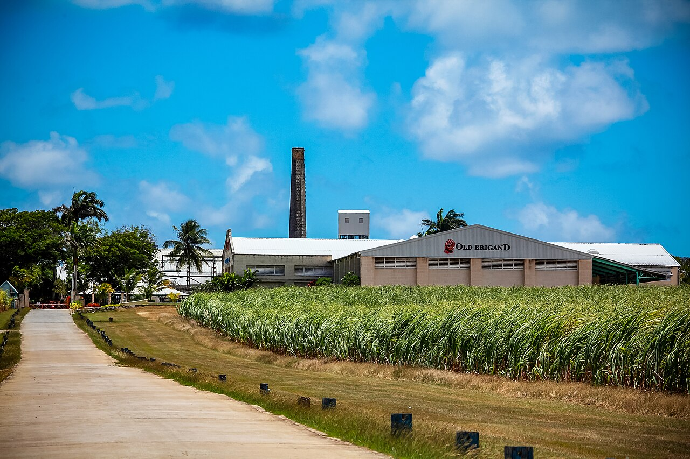

# 四方朗姆酒厂

四方朗姆酒厂（Foursquare Rum Distillery）在巴巴多斯东南部圣菲利普教区的四路镇（Four Roads），建在一座旧糖厂与旧庄园的场地上。它与芒特盖的参访逻辑相反：没有必须预约的团队导览，也没有被包装成“品牌朝圣”的动线，工作日直接走进去，沿着厂区地面上的脚印与说明牌自助参观，最后在品鉴室点酒。酒厂由 R.L. Seale 家族经营，1996 年在旧糖厂址重启，今天以壶式与双柱式蒸馏、热带陈年，以及“不添加糖与色素”的主张闻名。

图：四方朗姆酒厂。图片：Unknown author Unknown author，CC BY 2.5，via Wikimedia Commons（[原图页面](https://commons.wikimedia.org/wiki/File:Foursquare_Rum_Distillery.jpg)）。

## 四路镇：一座还在运转的旧糖厂

地址是 Foursquare Rum Distillery, Four Roads, Saint Philip, Barbados，位于岛东南，离布里奇顿与南岸旅游区都有一段距离。官方参访说明写得很直白：最方便的方式是乘出租车；从奥伊斯廷斯一带过来约 13 公里、20 分钟车程。想省钱的旅行者可以先坐巴士到六路镇（Six Roads），再步行约 1.6 公里到四路镇，但乡道不宽、日照强，不建议在傍晚或雨天勉强步行。

导航可搜“Foursquare Rum Distillery, St. Philip, Barbados”，入口在厂区访客停车场；不要把 GPS 点设到甘蔗田。厂区工作日开放，周末与银行假日不开放；它不是全天候景区，午休与生产安排可能影响可进入区域。到访前先看官方参访页，确认当天是否接待散客；如果只想买酒，品鉴室与商店通常比生产区更灵活。

## 1996 年重启与 Seale 家族

这片场地的制糖历史可以追溯到 1636 年，糖厂一直运转到 1984 年；1996 年，R.L. Seale 家族在旧糖厂址建立了今天的蒸馏厂。家族的朗姆酒贸易史可追溯到 1820 年，理察·西尔（Richard Seale）是第四代经营者；1993 年，公司收购了拥有 Doorly's 与 Old Brigand 等品牌的 Alleyne Arthur's，为后来的产品线打下基础。1996 年因此不是“品牌诞生”的年份，而是“把贸易商的经验落到一座新蒸馏厂”的年份。

这段历史解释了四方为什么既像工厂又像家族企业：它保留了旧糖厂的建筑与设备，也保留了贸易商对酒款、定价与出口的判断。参观时可以看到旧糖厂的机械与说明牌，但它们不是布景，而是场地历史的一部分。把 1636、1984 与 1996 三个年份连起来，比只记“1996 年成立”更能理解这座厂的空间。

## 壶式与双柱式：两种酒体的拼配

四方的蒸馏设备包括铜制双回流壶式蒸馏器与连续双柱式蒸馏器。壶式蒸馏保留更多酯类、酒体更厚；柱式蒸馏更干净、更轻盈；酒厂把两者调配成不同产品，而不是把其中一种当成“高级”。这种“单一调和朗姆”（single blended rum）的写法，指的是同一产区内壶式与柱式原酒的调和，不是把不同国家的酒混在一起。

[糖蜜](ref:molasses)是主要原料，发酵后进入蒸馏，再进入橡木桶陈年。厂区说明牌会把发酵、蒸馏与陈年拆成几个节点，自助参观的好处是可以按自己的节奏看设备；坏处是没有讲解员帮你把“壶式与柱式”的差别讲清楚。出发前先读[壶式蒸馏](ref:pot-still)与[蒸馏](ref:distillation)的基础条目，现场会轻松很多。

## 热带仓库里的天使的分享

四方在巴巴多斯完成蒸馏与陈年，仓库是热带环境，没有温控。高温让酒液与橡木桶之间的反应加快，湿度让蒸发持续发生；每年损失的一部分酒液就是“天使的分享”。热带陈年让酒液在较短时间内获得较深的颜色与较饱满的香草、焦糖、干果风味，也让高年份原酒更稀缺、更贵。

陈年之后的调和是四方的核心能力。品牌常用“无添加”来描述自己的路线：不添加糖、不添加色素、不依赖香料掩盖缺陷；这是生产者的主张与市场定位，不是所有巴巴多斯朗姆都必须遵守的法规。理解[橡木桶陈年](ref:oak-ageing)与[调配](ref:blend)的基本逻辑，再喝 Doorly's 与 Exceptional Cask Series，会更容易分辨“干净”与“单薄”的区别。

## 酒款与“不添加”的争论

产品线大致分为几条：Doorly's 是覆盖面最广的系列，从白朗姆到 3 年、5 年、8 年、12 年与 XO；R.L. Seale 以更高年份与更高酒精度出现；Old Brigand 走更日常的路线；Foursquare Exceptional Cask Series 则按批次装瓶，常见雪莉桶、马德拉桶或波本桶收尾，酒精度往往高于常规装瓶。不同批次的配方与年份会变，买之前看背标，不要只认系列名。

“不添加”是四方最常被讨论的主张。支持者认为它让朗姆酒像威士忌一样透明，反对者认为它把“纯净”变成了营销标签。更稳妥的看法是：添加糖与色素会影响口感与外观，是否添加应当标示；但“无添加”不等于更好喝，也不等于所有传统朗姆都靠添加物。把[朗姆酒](ref:rum)的类别、原料与陈年规则放在一起看，争论会清楚很多。

## 自助参访与品鉴室

四方实行开放式参访，不需要预约，也没有固定团队导览；工作日办公时间内进入，沿厂区指示自助走一圈，最后到品鉴室。官方说明明确写着：没有组织导览，但有品鉴室可以喝一杯。对习惯预约制的旅行者，这意味着自由，也意味着责任：不要越过生产区围栏，不要触碰设备，不要在生产区域拍妨碍作业的照片。

品鉴室通常提供单杯与酒款组合，具体酒单与价格以现场为准；商店可以买到部分酒厂限定或较高年份的装瓶。若同行者不喝酒，可以在品鉴室点软饮或直接逛商店。厂区不是无障碍友好的主题公园，部分地面不平、生产区有噪音与气味，穿包脚鞋比穿凉鞋稳妥。

## 到访提示与路线衔接

四方适合与南岸的芒特盖访客中心、东海岸的圣尼古拉斯修道院串成路线，但它与芒特盖北端厂区距离很远，一天内不要硬塞。最顺的安排是：上午从南岸出发，中午到四路镇，下午自助参观与品鉴，傍晚回南岸；全程包车或请司机，避免酒后驾驶。周一到周五才有开放，周末来会扑空，这一点与芒特盖南岸访客中心不同。

把四方与[芒特盖酒厂](ref:mount-gay-distillery)对照，会看到巴巴多斯朗姆的两条路径：一条以老庄园与双蒸馏讲历史连续性，一条以旧糖厂改造、开放式参访与透明度讲现代性。两者都属于[巴巴多斯](ref:barbados)产区，但参访体验、酒款风格与价格带并不相同。想理解产区，不必选边；把两站都走一遍，再回到杯中比较。
