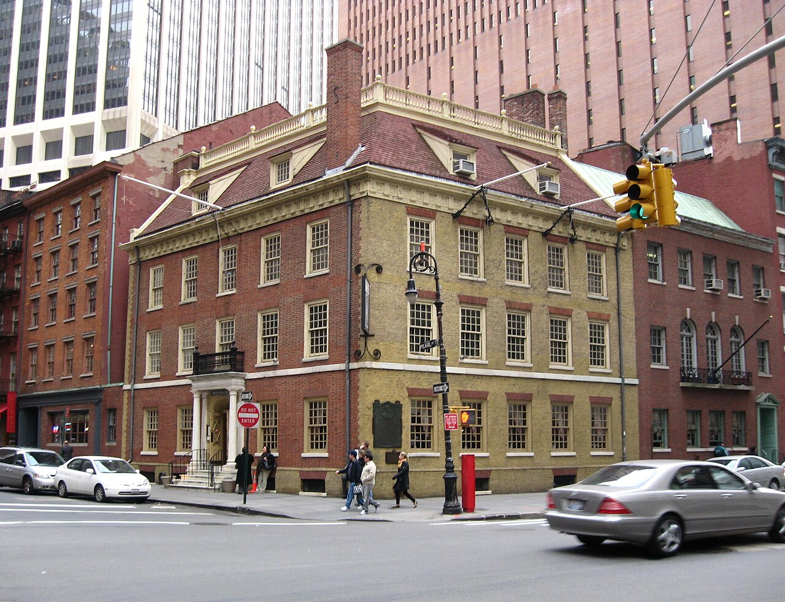

# 弗朗西斯酒馆

在曼哈顿金融区的高楼之间，珍珠街 54 号是一栋会被行人放慢脚步的砖砌老屋。它 1719 年作为商人住宅建成，1762 年改成酒馆，1783 年 12 月 4 日华盛顿在楼上的长厅向军官告别。今天这栋建筑同时装着两种身份：楼下是营业到深夜的餐厅与酒吧，楼上是需要买票进入的博物馆。先弄清自己在哪一层，是理解这个地方的起点。

图：弗朗西斯酒馆。图片：Jim.henderson，Public domain，via Wikimedia Commons（[原图页面](https://commons.wikimedia.org/wiki/File:Frauncestavern.JPG)）。

## 定位与历史

这栋建筑由商人斯蒂芬·德兰西（Stephen Delancey）于 1719 年建造，最初是一处体面的私人住宅。1762 年，塞缪尔·弗朗西斯（Samuel Fraunces）买下它并改作酒馆，此后迅速成为纽约爱国者活动的中心之一。独立战争前，纽约的“自由之子”在这里聚会；战争期间，英军占领纽约，弗朗西斯一边在港口为被关押的爱国者提供帮助，一边向大陆军传递情报。这些细节让“历史酒馆”四个字不只是装修风格，而是具体的政治空间。

1783 年是这栋建筑最常被讲述的一年。11 月 25 日，英军最后撤离纽约，华盛顿在酒馆参加“撤离日”庆祝；12 月 4 日，他在楼上的长厅（Long Room）与军官告别。现场目击记录主要来自本杰明·塔尔梅奇（Benjamin Tallmadge）的回忆录，博物馆把这份回忆录作为重要藏品展示。1785 年至 1788 年，纽约是美国首都，酒馆建筑又被用作联邦政府最早的行政办公地之一，容纳外交、战争与财政委员会事务。也就是说，这里同时是酒馆、政治俱乐部和临时政府办公楼，和今天“吃饭喝酒的地方”不是同一个概念。

1907 年，经过一次关键修复，弗朗西斯酒馆博物馆成立。今天博物馆所在的建筑群由五栋相互连通的历史建筑组成，馆藏约八千件，包括家具、文献、个人物品与艺术品。它被列为纽约市地标，也在国家史迹名录之内。把“1719 年建成”“1762 年成为酒馆”“1907 年成为博物馆”三条时间线分开，可以避免把整栋建筑都说成殖民时期原貌。

## 建筑与空间

从珍珠街看，建筑是乔治亚式的砖立面，尺度比周围写字楼低得多，入口也不在正中间。博物馆主入口在珍珠街 54 号二层，需要走楼梯或使用电梯；无障碍入口在沃特街 24/26 号，但馆方明确提示电梯会间歇性故障，出发前最好打电话确认。楼下的餐厅与酒吧有自己的入口和电话，和博物馆是两套运营体系。

长厅是最重要的历史空间，位于楼上，1776 年纽约省议会曾在此宴请华盛顿及其军官，1783 年的告别也发生在这里。今天它作为博物馆展厅使用，不是可以随便坐下点酒的包厢。博物馆的其他展厅分布在这组连通建筑中，展陈围绕独立战争、纽约的占领与撤离、早期共和国以及建筑本身的修复史展开。馆内还有关于“桦树审判”（Birch Trials）与《黑人名册》（Book of Negroes）的内容，提醒参观者：这栋建筑见证的“自由”并不是对所有人都同样成立。

楼下的餐厅保留了老建筑的墙体与木梁，但桌椅、吧台与灯光是现代餐饮空间。它并不是一整栋“沉浸式 18 世纪酒馆”，而是把历史外壳与当代服务放在一起。喜欢建筑的人可以注意楼梯、砖墙与低矮天花板的尺度；只想吃饭的人也不会被要求先看展。

## 吃什么喝什么

餐厅走美式酒馆路线，菜单上有生蚝、新英格兰蛤蜊浓汤、蟹饼、苏格兰蛋、招牌汉堡、牛排、鱼薯与鸡肉馅饼等，周末有早午餐，晚上有正餐。酒水以啤酒、威士忌与鸡尾酒为主，另有一间以威士忌为特色的酒吧。具体菜名、价格与供应时段会调整，点单前看官网菜单最稳。

座位规则值得提前知道：独立酒吧（Independence Bar）、拉法耶特隐藏酒吧（Lafayette’s Hideout）和丁格尔威士忌酒吧（Dingle Whiskey Bar）只接受现场到店、先到先得；塔尔梅奇厅（Tallmadge Room）、比塞尔厅（Bissell Room）与楼上钢琴酒吧可以预订。也就是说，想坐下来吃正餐，最好订位；只想喝一杯，直接走进去碰运气更合适。周末早午餐与节假日排队明显，别把博物馆参观时间卡得太紧。

博物馆内没有餐饮服务，展厅不允许携带食物与饮料（密封水瓶除外）。不要把餐厅的酒杯端上楼，也不要在长厅里吃喝。若只想体验“历史建筑里喝一杯”，楼下的酒吧已经足够；若想看展，另买博物馆门票。

## 实用信息

地址是 54 Pearl Street, New York, NY 10004，位于珍珠街与布罗德街交口附近，步行可达南街海港与炮台公园。地铁 R/W 线到 Whitehall Street–South Ferry，4/5 线到 Bowling Green，1 线到 South Ferry，J/Z 线到 Broad Street；公交 M20、M55、M15 也可到达。自驾不现实，金融区停车贵且车位少。

博物馆每天 12:00–17:00 开放。成人票 10 美元，65 岁以上长者、持证学生、6–17 岁儿童各 5 美元，5 岁及以下免费，现役美军与退伍军人凭证免费；联邦残疾访客及一名陪同者 5 美元。门票只能在二层前台现场购买，没有提前售票；大型团体需提前联系馆方。公共导览在周五 13:00、周六 12:00 与 15:00、周日 14:00 提供，凭门票免费参加，但可能临时取消。餐厅营业时间与博物馆不同，通常营业到深夜，具体以餐厅官网与订座页面为准。

时间安排上，博物馆 1–1.5 小时足够，若细看展板与长厅可以留到 2 小时；餐厅午餐或晚餐再加 1–1.5 小时。带大件行李的访客可把包寄放在礼品店，但没有储物柜，贵重物品自己保管。拍照允许个人非商业使用，禁止闪光灯、三脚架与自拍杆；商业拍摄需提前联系馆方。页面核验日期 2026-11-08，开放时间、门票与菜单以官方渠道为准。

## 分寸与误会

最常见的误区是把“弗朗西斯酒馆”当成一整栋都可以喝酒的历史布景。实际上，博物馆与餐厅分属不同运营方，开放时间、门票与订座规则都不同；长厅是展厅，不是餐厅包间。第二个误区是把 1783 年的告别当成一场可以精确复原的宴会：我们只知道时间、地点与少数当事人的回忆，具体菜单、座位与谈话内容并没有完整记录。第三个误区是把美国革命叙事浪漫化；这栋建筑也涉及英军占领、黑保皇派撤离与奴隶制问题，展览并不回避这些复杂面。

参观时不要触摸展品、不要跨过围栏、不要在展厅内吃喝；12 岁以下儿童须由成人陪同。大背包要背在胸前或手提，武器、尖锐物品与宠物（服务犬除外）不得入内。餐厅里按美国习惯给小费，账单通常另加纽约市税；订位后如要取消，按餐厅政策操作。若在长厅遇到纪念活动或重演，保持安静，不要穿过表演区域。

相关条目：[酒馆史：从酒肆、客栈到酒吧](ref:taverns)、[认识一座城，从一间酒馆开始](ref:pub-and-city)、[美国](ref:usa)。

## 另见

弗朗西斯酒馆是理解[酒馆史](ref:taverns)的一个美国样本：殖民时期的 tavern 同时承担客栈、法院、选举站与聚会场所的功能。把它放回[酒吧与城市](ref:pub-and-city)的脉络，能看清历史建筑如何被重新组织成博物馆与餐饮空间。它所在的[美国](ref:usa)东海岸城市，也提供了从港口、移民到金融区的城市史背景；若只关心杯中物，可以从[啤酒](ref:beer)开始，再回到这栋建筑看它如何把“喝酒”变成公共生活。

补充阅读：[A Ginjinha](ref:c-extra-1)。

**关键事实。**

| 项目 | 内容 |
| --- | --- |
| 一句话定位 | 纽约曼哈顿珍珠街 1719 年建成的历史建筑，1762 年改为酒馆，1783 年华盛顿在楼上长厅向军官告别；今天是楼下餐厅酒吧、楼上博物馆的复合场所 |
| 地址 | 54 Pearl Street, New York, NY 10004, United States |
| 城市/国家 | 纽约 / 美国 |
| 营业状态 | 已核验营业 |
| 官网 | frauncestavernmuseum.org |
