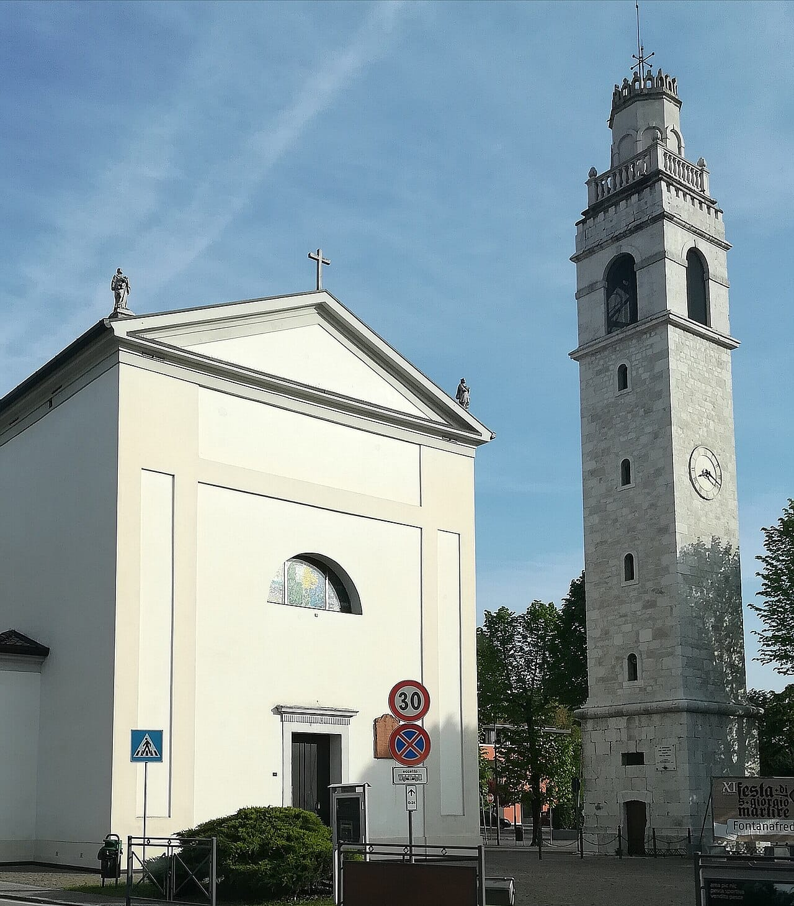

# 嘉雅巴巴莱斯科酒庄

嘉雅（Gaja）在巴巴莱斯科村的地址很清楚：Via Torino 5, 12050 Barbaresco (CN)。但它的“可参观性”并不清楚。官方网站在当时能打开的页面上只给出了地址、电话 +39 0173 635158 与邮箱 info@gaja.com，没有公布公众导览时段、票价或预约入口。因此本页把营业状态标为未知：地址与联系方式已经核实，参观与品鉴能否成行则必须以官方回复为准。把“名庄”自动等同于“随时可进”的想象，是这一站最容易犯的错误。

图：嘉雅巴巴莱斯科酒庄所在的皮埃蒙特风貌配图。摄影：Piedmont vineyard in autumn。署名：Giorgio Montersino，CC BY-SA 2.0，来自 Wikimedia Commons（[来源](https://commons.wikimedia.org/w/index.php?curid=5816942)）。这张照片用于说明产区环境与访问语境，不标定嘉雅巴巴莱斯科酒庄的门店、酒庄或活动现场。

## 巴巴莱斯科村的一栋房子

巴巴莱斯科是朗格地区的一个小村，村名同时属于酒名、产区和塔楼。嘉雅的酒厂就在村内，不在对外宣传的“城堡”或“庄园”里；这也解释了为什么不同资料给出的地址会让人困惑：有的写办公室，有的写酒厂。官方页面的 Via Torino 5 是酒厂地址，导航应直接输入这一条，而不是只搜品牌名。

村子本身很小，停车场有限，街道窄。即使预约成功，也应留出找车位与步行的缓冲。把车停在村外再走进去，比试图把车开到门口更实际。酒庄建筑不是开放式展馆，没有预约不要推门、不要在院内拍照或穿过生产区。

## 1859 年以来的家族线索

嘉雅的历史通常从 1859 年算起，家族在巴巴莱斯科扎根，经历几代人的扩张。20 世纪下半叶，Angelo Gaja 接手后把酒庄推向国际市场：他压低产量、更新酿造与栽培方式，并把巴巴莱斯科从“巴罗洛的兄弟”变成独立的风格叙事。这一段历史在酒庄的官方介绍与产区资料中反复出现，但具体年份与人事细节在不同版本里略有差异，阅读时应以酒庄官方叙述为准。

对访客来说，历史的意义不在于背年表，而在于理解酒庄为什么重视单园与品牌辨识度。嘉雅的名称本身就是资产，酒标上的“Gaja”比村庄名更容易被记住；这也意味着它的参观政策更可能服务于客户关系与专业访客，而不是大众旅游。

## 内比奥罗与单园

[内比奥罗](ref:nebbiolo)是巴巴莱斯科的唯一法定红葡萄品种。它晚熟、皮厚、单宁高，颜色不算深，香气却复杂：玫瑰、紫罗兰、红果、香料、焦油与甘草。朗格的雾与秋季凉意让它在十月前后慢慢成熟，采收过晚容易失去酸度，过早则单宁生硬。酒庄能否把内比奥罗做得既有力又细，取决于园地、产量与陈年，而不是单一“秘方”。

“单园”是理解嘉雅的关键词。把同一村庄里不同坡向、海拔与土壤的地块分开酿造，可以保留微差异，也让酒标上的园名成为可追踪的地理信息。巴巴莱斯科的法定产区覆盖巴巴莱斯科、内伊韦、特雷伊索与阿尔巴的部分地区；单园则是法定地理命名体系里更细的一层。喝嘉雅时，先看酒标写的是村庄级还是单一园，再谈风格，才不会把不同层级混为一谈。

## 橡木、产量与一场未结束的争论

嘉雅常被放在“新派”与“传统派”的争论里。争论的表面是[橡木桶](ref:oak)的大小与新旧，实质是酒在年轻时是否应该更容易亲近：小橡木桶增加氧气接触与香草、烘烤气息，也让单宁更快软化；大桶或旧桶则保留更多果香与结构，但需要更长时间。把这场争论简化成“法国桶好还是斯拉沃尼亚大桶好”，会错过真正的问题——酒庄想让酒在什么时间、以什么状态被喝到。

产量同样进入这场争论。低产可以提高浓度，但也可能让酒失去轻盈；高产则相反。巴巴莱斯科的法定规则已经给出底线：必须陈年至少两年，其中九个月在橡木桶；四年后才能标 Riserva。规则之内仍有大量选择，嘉雅只是其中一种答案。把它当作“标准答案”会妨碍理解其他酒庄。

## 参观边界：能确认与不能确认的

能确认的是：酒庄在 Via Torino 5，电话与邮箱有效，官方页面没有公布公众参观时段。不能确认的是：是否接待个人访客、是否提供品鉴、是否收费、是否需要提前多久预约。由于这些信息缺失，本页不写具体票价，也不建议“直接前往试试”。正确做法是先发邮件或打电话，说明人数、日期与目的，等待书面确认。

如果只是想理解巴巴莱斯科，不一定非要进嘉雅。村内的酒庄、合作社与产区展馆提供了更稳定的接待；把嘉雅作为“看外观、读酒标、在别处品鉴”的一站，反而更符合它当前的公开信息状态。若预约成功，遵守生产区规则：不触摸设备、不越过黄线、不在发酵区停留拍摄。

## 在村里还能看什么

巴巴莱斯科村有塔楼、教堂与几个小广场，步行一小时足够。村外的坡地是葡萄园与榛子林交错，秋季雾从谷底升起，是朗格最典型的光线。把嘉雅安排在上午或傍晚，避开正午强光，拍照与散步都更舒服。若想对比巴罗洛，可继续往南到塞拉伦加达尔巴，看[丰塔纳弗雷达](ref:fonta)的叙事村与酒窖。

从阿尔巴开车到巴巴莱斯科约二十分钟，从都灵约一小时半。公共交通有区域巴士，但班次少，酒庄又分散在山坡上，自驾更实际。参观政策、地址与联系方式以官方渠道为准；本页核验日期 2026-11-09，坐标未从官方页取得，坐标以官方渠道为准。

相关条目：[内比奥罗](ref:nebbiolo)、[橡木桶陈酿](ref:oak)、[丰塔纳弗雷达酒庄](ref:fonta)。

**关键事实。**

| 项目 | 内容 |
| --- | --- |
| 一句话定位 | 位于巴巴莱斯科村 Via Torino 5 的家族酒庄，官方页面只公布地址、电话与邮箱；对外参观与品鉴政策未公开确认，出发前须以官方渠道联系，不能默认可以随时进入 |
| 地址 | Via Torino 5, 12050 Barbaresco (CN), Italy |
| 城市/国家 | 巴巴莱斯科 / 意大利 |
| 营业状态 | 待核验 |
| 官网 | gaja.com |

## 参考资料

- [Gaja 官方网站](https://www.gaja.com/)：Via Torino 5 地址、电话与邮箱；未公布公众导览时段。
- [Barbaresco DOCG — 朗格产区协会](https://www.langhevini.it/le-denominazioni-tutelate-dal-consorzio/barbaresco-docg/)：产区市镇、内比奥罗纯酿与陈年规则。
- [Barolo DOCG — 朗格产区协会](https://www.langhevini.it/le-denominazioni-tutelate-dal-consorzio/barolo-docg/)：巴罗洛 11 个市镇、三年陈年与 Riserva 规则。

补充阅读：[皮埃蒙特](ref:c-extra-1)、[葡萄酒](ref:c-extra-2)。

## 相关图像

图：丰塔纳弗雷达酒庄。图片：Marchetto da Trieste，CC BY-SA 4.0，via Wikimedia Commons（[原图页面](https://commons.wikimedia.org/wiki/File:Fontanafredda_-_chiesa_parrocchiale.jpg)）。关联图像：嘉雅巴巴莱斯科酒庄。
