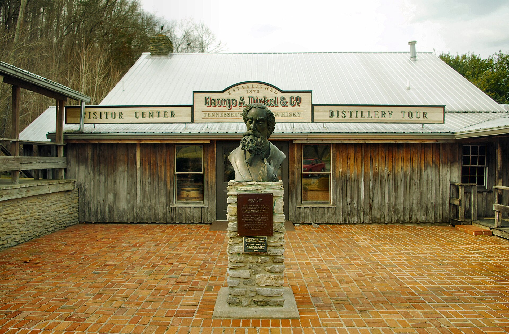
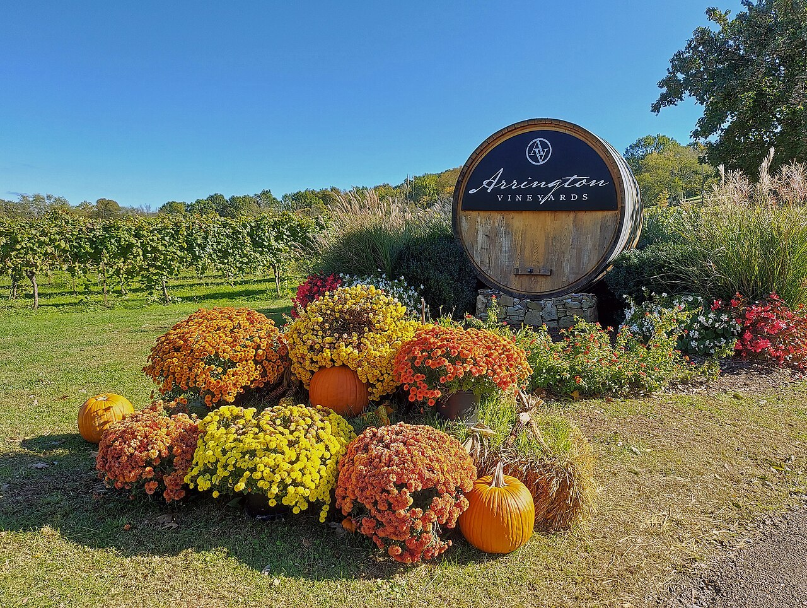

# 乔治迪克尔酒厂

乔治迪克尔（George Dickel）在田纳西州塔拉霍马（Tullahoma）附近的 Cascade Hollow，厂址藏在一条山谷里，离林奇堡的杰克丹尼大约半小时到四十分钟车程。它比邻居安静得多，游客也少得多，但两家做的是同一类酒：以玉米为主、经糖枫木炭过滤、在田纳西州境内完成的[田纳西威士忌](ref:tnwhiskey)。如果你只去过杰克丹尼，这里能补上“同一产区、不同做法”的另一半。

图：乔治迪克尔酒厂相关实景照片。图片：Brian Stansberry (photographer)，CC BY 3.0，via Wikimedia Commons（[原图页面](https://commons.wikimedia.org/wiki/File:George-dickel-distillery-visitor-center-statue-tn1.jpg)）。

## 山谷里的另一家田纳西酒厂

Cascade Hollow 的名字来自山谷里的瀑布与泉水，厂区被树林包围，视野里看不到成排的商业建筑。泉水从山坡流下，汇成小溪，再进入生产用水系统，这也是酒厂把厂址选在山谷里的原因之一。酒厂自称占地约 600 英亩，实际参观范围不大：游客中心、生产车间、桶库与品鉴室集中在一小片区域。游客中心不大，导览前值得留十分钟看看展板与旧工具。正因为规模小，导览的节奏更像“走进一家还在运转的作坊”，而不是穿过一座主题公园。

从纳什维尔开车约一小时，从查塔努加约一小时二十分钟，从林奇堡约半小时到四十分钟。最后一段是乡村公路，手机信号可能不稳，导航偶尔会把车带到错误的岔路；接近时按路牌走，或提前把路线截图保存。厂房没有公共交通可达，租车是唯一现实的选择，回程也要提前安排。

## 1870 年与 1878 年：品牌与厂址

George A. Dickel 是德国出生的纳什维尔商人，1870 年开始经营自己的威士忌生意；Cascade Hollow 的酒厂在 1878 年投产，他买下了其中的重要股份。禁酒令期间酒厂关闭，后来在二十世纪中期重建，品牌与厂址从此分分合合，今天归在 Diageo 旗下，运营主体写作 Cascade Hollow Distilling Co.。这段历史提醒你：酒标上的“1870”是品牌起点，“1878”才是这处厂址开始出酒的年份。

与杰克丹尼不同，迪克尔长期以“更小、更慢、更便宜”的形象存在，直到近二十年才被重新重视。它的酒款没有大规模的广告攻势，更多靠爱好者的口碑；这也解释了为什么这里的导览更朴素，商店更小，工作人员反而有更多时间回答工艺问题。

## 冷过滤、糖枫木炭与“无 e 的 whisky”

迪克尔的传统说法是“chill-charged”：新酒先被冷却，再经过糖枫木炭过滤，然后进入新烧焦的橡木桶。与在常温下做木炭过滤的杰克丹尼相比，低温让酒液更黏、流速更慢，酒厂认为这样能更温和地去掉粗糙感。这个差别不是玄学，但它对最终风格的影响，只有在并排品鉴时才容易察觉。

另一个细节是拼写：迪克尔写作 whisky，不带 e，跟苏格兰传统一致；大多数美国同行写作 whiskey。品牌解释这与其创始人的偏好有关，也与当时美国威士忌行业尚未统一拼写的历史有关。把[蒸馏](ref:distillation)与[橡木桶陈年](ref:oak)两条背景放在一起看，就能理解“冷过滤”只是工艺的一环，真正决定香气的是发酵、蒸馏切酒与桶。

## 参观：一小时能看到的与看不到的

官方页面写明，酒厂周四至周二开放，周三闭馆；周一、周二、周四、周五与周六为 9:30 到 16:00，周日为 11:30 到 16:00。导览约一小时，建议提前预订；自助品鉴按先到先得，21 岁以上并出示证件才能取样。生产区周一至周五运转，周末的导览仍会发团，但多半看不到正在蒸馏，这一点在预订时要心里有数。

路线会经过蒸馏车间、木炭过滤区与桶库，讲解会说明玉米、黑麦与发芽大麦的比例，以及为什么木炭过滤必须在装桶之前完成。约四分之一的行程在户外，夏天很热，冬天很冷；厂房有楼梯，行动不便者要提前询问。儿童可以参加，但需购买“Minor”票；宠物不能进入游客中心与厂区，服务犬除外。酒厂不提供瓶装酒邮寄服务，买酒要考虑行李与各州法规。

## 酒款地图：从 No. 8 到单桶

No. 8 是入门款，酒体轻、甜感明显，适合加冰或做 highball；No. 12 更厚，香料与橡木更清楚；Barrel Select 是单桶选择，差异最大；Bottled in Bond 按联邦“保税”规则装瓶，酒精度与陈年都有明确门槛；Single Barrel 15 年与 Rye 则面向更细分的人群。整体风格比杰克丹尼更干、更偏谷物与香料，木炭味没有那么突出。

第一次来，最有效的对比是 No. 8 与 No. 12：同一家酒厂、相近的原料，差别在陈年与调配。再进一步，可以点一杯 Barrel Select，观察单桶之间的差异。不要用“年份越高越好”来点酒；高年份改变的是复杂度与质地，不一定更适合你的口味。

## 到达、开放与提醒

地址是 1950 Cascade Hollow Rd, Tullahoma, TN 37388, USA。坐标以官方渠道为准，导航输入地址即可，但最后几英里是乡村道路，夜间没有路灯，尽量不要把行程排到天黑之后。游客中心电话是 931-408-2410，出发前可以确认当天是否营业、导览是否满员；天气恶劣时导览可能延迟或调整。

周边餐饮选择有限，塔拉霍马镇上有几家餐馆，林奇堡的游客选择更多。若把这里与[杰克丹尼酒厂](ref:jackdaniels)安排在同一天，建议上午去规模更大的那家，下午来迪克尔，节奏会更松。把[田纳西](ref:tennessee)与[美国](ref:usa)的背景先读一遍，再决定要不要继续往肯塔基跑。

对照阅读：[杰克丹尼酒厂](ref:jackdaniels)、[美国](ref:usa)。

**关键事实。**

| 项目 | 内容 |
| --- | --- |
| 一句话定位 | 田纳西州塔拉霍马附近 Cascade Hollow 的田纳西威士忌酒厂，品牌可追溯至 1870 年 George A. Dickel 的生意、酒厂 1878 年投产；以冷却后糖枫木炭过滤、无“e”的 whisky 拼写与 No. 8、No. 12 等酒款著称 |
| 地址 | 1950 Cascade Hollow Rd, Tullahoma, TN 37388, USA |
| 城市/国家 | 塔拉霍马 / 美国 |
| 营业状态 | 已核验营业 |
| 官网 | georgedickel.com |

**来源与边界。** 本页关于「乔治迪克尔酒厂」的关键事实，主要由以下来源交叉核对：George Dickel（1950 Cascade Hollow Rd、开放日与时段、导览时长、21 岁品鉴与儿童规定；品牌名称、Cascade Hollow Distilling Co. 与核心酒款序列）、Tennessee Whiskey Trail（酒厂在田纳西威士忌路线中的位置与州内酒厂分布）、UNESCO（补充核对条目背景、术语与制度口径）。产品、地址或营业状态变化较快时，以 georgedickel.com 的最新页面为准；价格、批次与状态会变，涉及这些字段时以页面所列来源的最新版本为准。正文为项目自写，来源只作核验，不复制原文。

## 相关图像

图：Tennessee - Arrington Vineyards。摄影：P. Hughes，CC BY-SA 4.0，来自 Wikimedia Commons。。图片：P. Hughes，CC BY-SA 4.0，via Wikimedia Commons（[原图页面](https://commons.wikimedia.org/w/index.php?curid=128050365)）。关联图像：乔治迪克尔酒厂。
