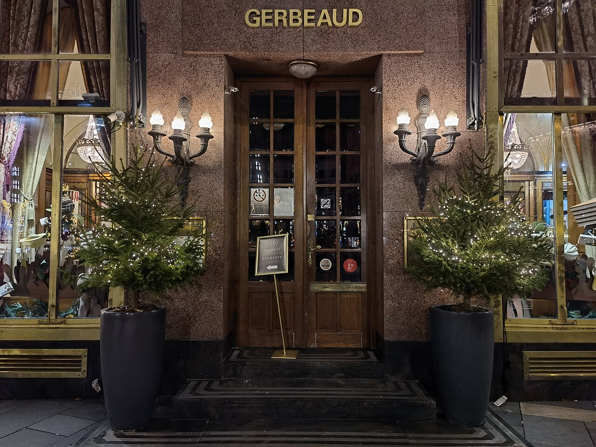

# Gerbeaud

Vörösmarty tér 的西北角，Gerbeaud 的深色雨棚、金色字母与一排面对广场的座位，几乎是布达佩斯“下午茶”的同义词。夏天露台坐满人，冬天橱窗里换成圣诞装饰；推门进去，吊灯、镜面、大理石台面与甜点柜把空间分成前场售卖与后场餐区。它不像 New York Café 那样用穹顶压人，而是用“老派甜点店”的尺度，把客人留在蛋糕与咖啡之间。

图：Vörösmarty tér 7–8 号的 Gerbeaud 店面，圣诞树前的临街入口。图片：Random photos 1989，CC0，via Wikimedia Commons（[原图页面](https://commons.wikimedia.org/wiki/File:Budapest,_V%C3%B6r%C3%B6smarty_t%C3%A9r_7-8,_Gerbeaud-h%C3%A1z,_kar%C3%A1csonyfa,_1.jpg)）。

## 1858 年：Gerbeaud的关键起点
Gerbeaud 的历史从 1858 年开始：Henrik Kugler 在 József nádor 广场开了一间糖果店（confectionery），卖巧克力、糖果与甜点。1870 年，Kugler 把店迁到 Vörösmarty tér 的现址；1880 年代，他把来自瑞士的糖点师 Émile Gerbeaud 请来合作，后来由 Gerbeaud 接手。关于接手的年份，官方英文历史页 与 Catering 年表有 1882/1884/1885 的不同排列；比较稳妥的说法是“1880 年代前期至中期，Émile Gerbeaud 成为店的主理人”，店名也逐渐从 Kugler 变成 Gerbeaud。

Émile Gerbeaud 把一间糖果店做成了布达佩斯上流社会的甜点客厅。他引入法式糖点技术，创造出以栗子、巧克力、香草与果酱层层堆叠的 Gerbeaud 风格；今天店里的 Dobos torte、Esterházy torte 与各种“Gerbeaud 蛋糕”都在这条线上。1919 年 11 月 8 日，Émile 去世，妻子 Esther Ramseyer 继续经营到 1940 年。1948 年国有化后，店名改成 Vörösmarty；1984 年恢复 Gerbeaud 的名字。1995 年，德国商人 Erwin Müller 买下这栋四层建筑；2004 年，Gerbeaud Gastronomy 接手经营。今天的 Gerbeaud 是“历史品牌 + 现代餐饮管理”的组合，甜点柜与餐厅仍然共享同一栋楼。

## 建筑与空间

Gerbeaud 的室内是“世纪之交咖啡馆 + 法式糖点店”的混合：高天花板、吊灯、镜面、白色与奶油色墙面、深色木饰、红色/绿色丝绒座椅与大理石小桌。前场是甜点柜与售卖区，蛋糕、巧克力、糖果与礼盒在玻璃后面排成阵列；后场是咖啡座与餐厅，靠窗的位置能看到 Vörösmarty tér 的广场与摩天轮。夏天露台是最抢手的位置，冬天则更适合坐在室内靠窗，看广场的圣诞灯与行人。

空间不大，桌距偏近，服务生端着咖啡与蛋糕穿过窄通道。它适合下午茶、早餐、轻午餐与晚餐，但不适合把电脑摊开工作。想拍照的话，甜点柜与吊灯是主要对象；不要对着其他客人，也不要把手机伸进玻璃柜。露台的座位通常由服务员带位，内场可以直接进去找空桌；高峰时段需要在门口排队。

## 酒单与味觉

Gerbeaud 的招牌是甜点，不是单一蛋糕。Dobos torte 是匈牙利经典：多层海绵蛋糕、巧克力奶油与焦糖脆面，切的时候要用力，吃的时候要配无糖奶油或咖啡。Esterházy torte 以核桃/杏仁层与香草奶油为主，甜度比 Dobos 温和。Gerbeaud 自家蛋糕常有栗子、杏子、巧克力与香草的组合，名字会随季节变化；点单时看柜台标签最准。

咖啡方面，可以点 Wiener Melange、黑咖啡、热巧克力与茶。甜度高的 Dobos 适合黑咖啡或微酸的果茶；Esterházy 适合 Melange 或拿铁。酒单覆盖匈牙利葡萄酒、Tokaji、香槟与少量鸡尾酒；下午可以点一杯 Tokaji 配甜点，晚上则可以点葡萄酒或鸡尾酒配正餐。价格属于布达佩斯中高端，甜点与咖啡是主要消费，正餐与酒单更高。

## 怎么喝

最合适的时间是上午九点到十一点，或下午三点到五点。上午人少，甜点柜刚补货，靠窗的位置更容易坐到；下午是传统下午茶时段，露台与内场都会满。因为不接受预订，策略是早到或避开周末下午。若只想买甜点，直接走前场售卖柜台；想坐下吃蛋糕与咖啡，就在门口等领位。夏天露台适合傍晚，冬天室内适合下午。

点单时先看柜台，再告诉服务员甜点名字；Dobos 与 Esterházy 可以两人分一块，Gerbeaud 自家蛋糕可以一人一块。咖啡可以续热水，但不要指望免费续咖啡。结账时服务费通常已包含，仍可按服务留零钱。若点正餐，建议先问“今天的菜单是否包含甜点”，避免重复点单。

## Gerbeaud的地址与营业安排
- 地址：Vörösmarty tér 7–8, 1051 Budapest。
- 营业：周一至周四/周日 09:00–20:00；周五至周六 09:00–21:00（官方 Contact；节假日可能调整）。
- 交通：地铁 M1 Vörösmarty tér 出站即到；电车 2、2B 等在 Vörösmarty tér 下车。
- 预订：不接受预订，现场排队；团队建议分开到店或选择非高峰时段。
- 价格：甜点与咖啡属中高端；正餐、下午茶套餐与酒单更高。
- 着装： smart casual；没有硬性 dress code，但晚餐与节日时段会有礼服客。
- 无障碍：主入口有门槛，室内通道窄；轮椅建议提前联系门店确认动线。

## 礼仪与常见误区

第一，不要把 Gerbeaud 只当成“咖啡馆”；它同时是甜点店与餐厅，前场售卖与后场餐区的规则不同。第二，不要把 Dobos 与 Sacher 混为一谈；Dobos 是匈牙利焦糖脆面蛋糕，Sacher 是巧克力杏子蛋糕。第三，不要以为“Gerbeaud”从 1858 年就是这个名字；1858 年是 Kugler 的糖果店，1880 年代 Émile Gerbeaud 接手后名字才逐渐固定。第四，不要用“1948 年国有化”解释今天的所有权；1995 年与 2004 年还有两轮关键变化。第五，不要在没有点单的情况下占着露台桌拍照；高峰时段服务员会请客人先点单。第六，不要把甜点柜里的蛋糕用手拿；用夹子或让服务员取。

## 从Gerbeaud延伸到New York Café
从 Gerbeaud 出门就是 Vörösmarty tér 与 Budapest Eye，往北是 St. Stephen’s Basilica 与 Zrínyi utca，往东是 Chain Bridge 与 Hungarian Academy of Sciences。可以把这一站排成“Gerbeaud 早餐/下午茶 → Vörösmarty tér → St. Stephen’s Basilica → Chain Bridge → 晚上 New York Café”。若想把布达佩斯甜点做成一条路线，先到 Gerbeaud 吃 Dobos 与 Esterházy，再到 [New York Café](ref:newyork) 看穹顶与金箔卡布奇诺；维也纳的 [Café Sacher](ref:sacher) 与 [Demel](ref:demel) 则能把“Sachertorte 双雄”放进中欧脉络。若继续维也纳咖啡馆路线，读 [Café Central](ref:central) 与 [维也纳咖啡馆之夜路线](ref:vienna-route)。

**关键事实。**

| 项目 | 内容 |
| --- | --- |
| 一句话定位 | 布达佩斯 Vörösmarty tér 7–8 号的 Gerbeaud，1858 年由 Henrik Kugler 在 József nádor 广场开糖果店，1870 年迁到现址，1880 年代由 Émile Gerbeaud 接手并改成今天这个名字；它以 Dobos、Esterházy 与自家甜点闻名，经历 1948 年国有化改名 Vörösmarty、… |
| 地址 | Vörösmarty tér 7-8, 1051 Budapest, Hungary |
| 城市/国家 | 布达佩斯 / 匈牙利 |
| 营业状态 | 已核验营业 |
| 官网 | gerbeaud.hu |

**来源与边界。** 本页关于「Gerbeaud」的关键事实，主要由以下来源交叉核对：Gerbeaud（Vörösmarty tér 7–8 地址、今日咖啡馆/餐厅定位与营业时间；地址、电话、营业时间与“不接受预订”的说明）、Gerbeaud Catering。产品、地址或营业状态变化较快时，以 gerbeaud.hu 的最新页面为准；价格、批次与状态会变，涉及这些字段时以页面所列来源的最新版本为准。正文为项目自写，来源只作核验，不复制原文。

## 参考资料
- Gerbeaud 官方首页：<https://gerbeaud.hu/en/>，用于核对地址与今日咖啡馆/餐厅定位。
- Gerbeaud 官方历史页：<https://gerbeaud.hu/en/gerbeaud-history/>，用于核对 1858/1870/1880 年代/1919/1948/1984 的时间线。
- Gerbeaud 官方 Contact 页：<https://gerbeaud.hu/en/contact/>，用于核对营业时间与“不接受预订”。
- Gerbeaud Catering 历史页：<https://www.gerbeaudcatering.hu/our_history>，用于交叉核对 1995 年 Erwin Müller 与 2004 年 Gerbeaud Gastronomy。
- 同城的 `place:new-york-cafe` 是“穹顶 + 金箔”的另一极，`place:cafe-sacher` 与 `place:demel` 是维也纳 Sachertorte 的两套叙事。
- 相关条目：[New York Café](ref:newyork)、[Café Sacher](ref:sacher)、[Demel](ref:demel)、[Café Central](ref:central)、[维也纳咖啡馆之夜路线](ref:vienna-route)

对照阅读：[New York Café](ref:newyork)、[Demel](ref:demel)。
