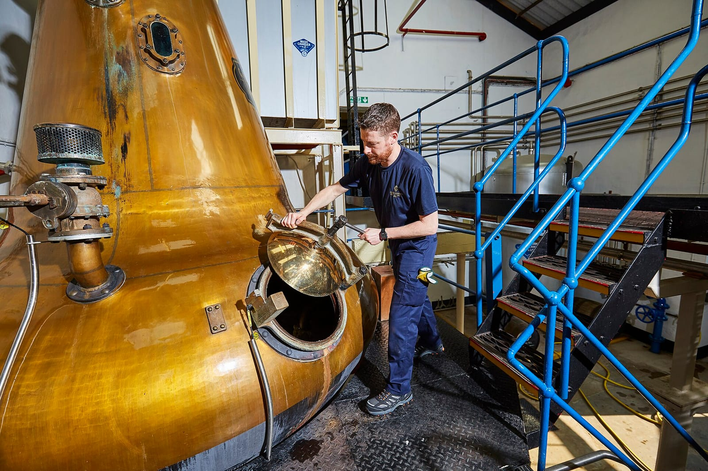
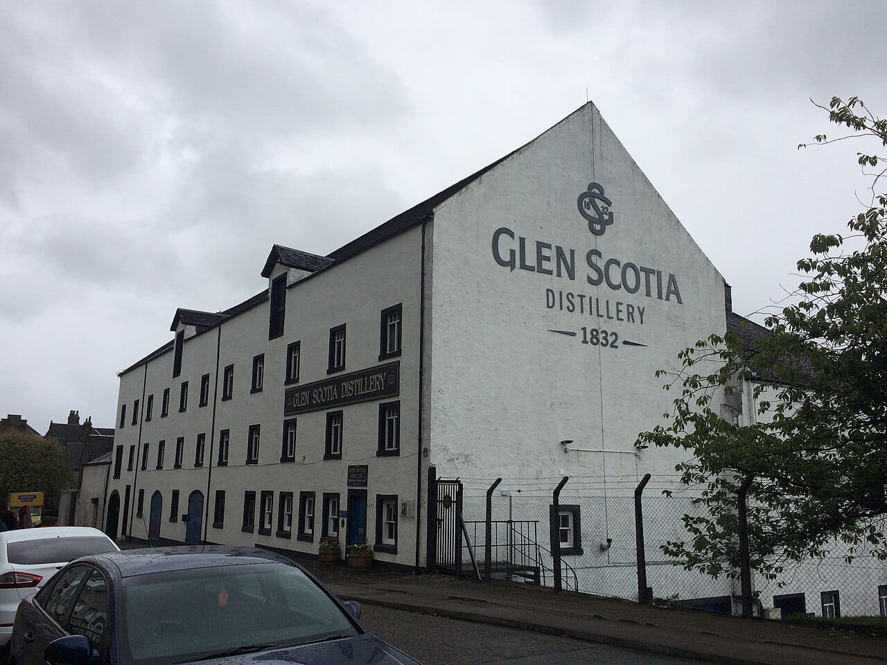

# 格兰帝酒厂

格兰帝（Glen Scotia）在[坎贝尔镇](ref:campbeltown) High Street 12 号，门口就是镇上的主街，往南走几分钟是港口，往北是 Longrow。它没有把游客中心搬到郊外，也没有用新建筑把老厂房包起来：石墙、窄门、低矮的仓库与仍在运转的设备挨在一起，参观时能感到这是一间在镇子里工作了一百多年的酒厂。1832 年，它以 “Scotia” 之名创立；今天属于 Loch Lomond Group，是坎贝尔镇仅存的三家酒厂之一。

图：格兰帝酒厂相关实景照片。图片：Abbieclements，CC BY-SA 4.0，via Wikimedia Commons（[原图页面](https://commons.wikimedia.org/wiki/File:Glen_Scotia_Still.jpg)）。

## 镇中心的一间维多利亚酒厂

坎贝尔镇在维多利亚时代被称为“世界威士忌之都”，港口边曾挤满运桶的船。格兰帝的厂区保留了那个时代的尺度：不是大型现代化工厂，而是一组围绕庭院展开的石砌建筑。官方特别提到，酒厂“rich in original features and equipment”，也就是说，参观看到的许多结构并非为游客重造，而是生产本身还在使用。庭院里还有两个蜂箱，蜂蜜是酒厂与周边环境关系的一个小注脚。对来访者而言，这种“仍在使用的老房子”比任何展板都更能说明坎贝尔镇为什么曾经繁荣，又为什么衰落。参观从游客中心集合开始，先看一段介绍，再穿过庭院进入生产区；路线不长，但门槛、楼梯与狭窄通道很多，行动不便的人要提前说明。

## 1832 年以来的开开停停

格兰帝在 1832 年以 Scotia 之名成立，此后多次易主。20 世纪初，坎贝尔镇威士忌需求下滑，酒厂在 1928 年至 1933 年间停产，之后被 Block Brothers 收购；1939 年，名字里才加上 “Glen”。它后来归入 Hiram Walker 等公司，1996 年被 Loch Lomond Distillery Company 买下，这家公司后来成为 Loch Lomond Group。与许多被改造成“品牌体验中心”的酒厂不同，格兰帝的复产与投资是围绕生产展开的：更换蒸馏器、维护建筑、继续在厂内陈酿。2021 年，它的 25 年单一麦芽在旧金山世界烈酒大赛被评为“世界最佳威士忌”，同年又获得苏格兰威士忌奖的“年度酒厂”，这两个奖项让它在国际上重新被看见。

## 小厂房里的工艺选择

格兰帝同时生产泥煤与非泥煤两种风格，泥煤酒通常每年只安排约六周。酒厂已不再自己发麦，而是向苏格兰发麦厂按指定规格采购；糖化、发酵与蒸馏仍在厂内完成。官方说，这些年他们延长了发酵时间、增加了麦芽的混合与更慢的蒸馏，但整体工艺没有改变。对参观者来说，最值得留意的是“慢”与“小”：发酵槽不大，蒸馏器不多，仓库就在旁边，酒液从蒸馏到入桶的路径很短。坎贝尔镇是苏格兰法定产区中面积最小的一个，官方承认的产区标签只有包括它在内的五个；这意味着“Campbeltown”出现在酒标上，不只是地理描述，而是受[苏格兰威士忌](ref:scotland)法规约束的产区声明。格兰帝的海洋咸感与油脂感，一部分来自海风与仓库湿度，一部分来自这种不追求极限效率的生产节奏。厂内使用波本桶、雪莉桶与葡萄酒桶等不同[橡木桶](ref:oak-ageing)，Double Cask 就是两种桶型的组合。

## Double Cask、Victoriana 与酒单读法

Double Cask 是理解格兰帝的起点：波本桶带来香草与甜感，雪莉桶补上干果与香料，酒体保留坎贝尔镇特有的咸味与油润。15 年更圆熟，Victoriana 则刻意靠近维多利亚时代的厚重风格，酒精度较高，香气更浓。25 年属于高端线，适合在特殊场合喝；单一桶与年度限定版变化较大，适合已经熟悉基础款的人。酒单可以按“日常—进阶—收藏”三层来读：先用 Double Cask 建立风格坐标，再用 15 年与 Victoriana 比较桶型与酒精度，最后才进入高年份与单桶。不要把“年份越高越好”当成规则，也不要把坎贝尔镇简单等同于“重泥煤”；格兰帝的泥煤款只是它的一部分。如果时间允许，品鉴后到庭院里坐一会儿，再看一眼石墙与仓库，比赶去下一家酒厂更有收获。

## 导览种类与预约

常规的 Whisky Distillery Tour 约 1 小时，每人 15 英镑，周一至周五 11:00 或 14:00 出发，结束时有一杯 Double Cask。The Warehouse Journey 约 45 分钟，12 英镑，重点看 palletised、racked 与 dunnage 三种仓库，并品尝新酒。Dunnage Warehouse Experience 约 2 小时，65 英镑，每年 4 月至 10 月的周一至周五 14:00 运行，包含五杯桶强品鉴。Distillery Manager Tour 约 2.5 小时，100 英镑，由酒厂经理 Iain McAlister 带领。Whisky Heritage Walking Tour 约 1.5 至 2 小时，30 英镑，需提前请求。所有体验都应在官网预约，旺季与坎贝尔镇威士忌节期间名额紧张；到场前确认当天是否有生产，因为停产日的动线会调整。

## 在坎贝尔镇怎么安排半天

地址是 Glen Scotia Distillery, 12 High Street, Campbeltown PA28 6DS。从格拉斯哥方向来，通常沿 A82 到 Tarbert，再走 A83 绕过 Kintyre 半岛；也可乘飞机到坎贝尔镇机场。镇上不大，格兰帝与[云顶](ref:springbank)、Glengyle 之间步行可达，半天看两家是现实的安排：上午格兰帝，下午云顶，中间在镇上吃饭。不要把品鉴安排在开车前后，坎贝尔镇周边多为单车道公路，酒精与方向盘不能共存。镇上住宿不多，威士忌节期间要尽早订房；如果只想来喝一杯，酒厂的导览结束后的品鉴室比镇上的酒吧更容易遇到酒厂限定款。酒厂没有公布可供引用的精确坐标，导航请以官方渠道与街牌为准。最后提醒一句：这里首先是[苏格兰](ref:scotland)的[单一麦芽](ref:single-malt)产区，其次才是旅游景点；尊重生产节奏，比拍到一张空厂房照片更重要。

对照阅读：[坎贝尔镇](ref:campbeltown)、[单一麦芽苏格兰威士忌](ref:single-malt)。

**关键事实。**

| 项目 | 内容 |
| --- | --- |
| 一句话定位 | 坎贝尔镇 High Street 的维多利亚式单一麦芽酒厂，1832 年以 Scotia 之名创立，现属 Loch Lomond Group；以海洋咸感、油脂感与 Double Cask、Victoriana 等酒款著称，提供 1 小时导览与 Dunnage 仓库品鉴 |
| 地址 | Glen Scotia Distillery, 12 High Street, Campbeltown PA28 6DS, Scotland, United Kingdom |
| 城市/国家 | Campbeltown / 英国 |
| 营业状态 | 已核验营业 |
| 官网 | glenscotia.com |

**来源与边界。** 本页关于「格兰帝酒厂」的关键事实，主要由以下来源交叉核对：Glen Scotia / Loch Lomond Group（导览种类、时长、价格、日期与 Double Cask 迎宾酒；品牌、酒款与参观入口）、Loch Lomond Group（1832 年创立、1928 至 1933 年停产、1939 年改名、1996 年归属与酒厂风格）。产品、地址或营业状态变化较快时，以 glenscotia.com 的最新页面为准；价格、批次与状态会变，涉及这些字段时以页面所列来源的最新版本为准。正文为项目自写，来源只作核验，不复制原文。

**并读。** 把「格兰帝酒厂」与「坎贝尔镇」、「苏格兰」、「单一麦芽苏格兰威士忌」放在一起读时，先确认它们是同一层级还是上下游关系：先确认地址与营业状态，再比较历史、空间与点单体验。本页负责给出场所的基本坐标，对照条目补上具体案例与差异；读完再回到本页，才能分清哪些差别属于场所本身，哪些只是产地、批次或品牌选择。

## 相关图像

图：Glen Scotia Distillery, Campbeltown。图片：Lirazelf，CC BY-SA 4.0，via Wikimedia Commons（[原图页面](https://commons.wikimedia.org/w/index.php?curid=62323489)）。关联图像：格兰帝酒厂。
