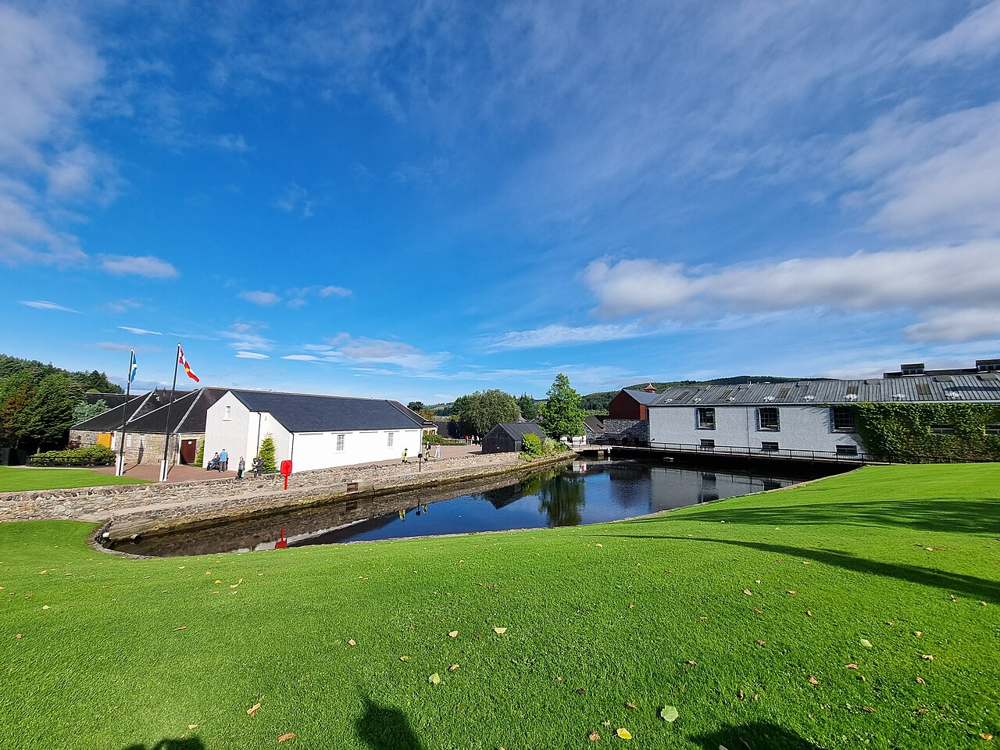

# 格兰菲迪蒸馏厂

达夫镇（Dufftown）在斯佩塞常被叫作“麦芽威士忌之都”，镇子周围的山谷里散落着多家酒厂。格兰菲迪在镇北的 Fiddich 河谷，入口是一段不算起眼的车道，进去之后才看到游客中心、厂房与远处的山坡。它不算斯佩塞最古老的酒厂，却是把“单一麦芽”从调酒原料变成独立品牌的推手之一；理解这一点，参观才不会只剩拍照与买酒。

图：格兰菲迪蒸馏厂。图片：Coldupnorth，CC BY-SA 4.0，via Wikimedia Commons（[原图页面](https://commons.wikimedia.org/wiki/File:Glenfiddich_Distillery_View.jpg)）。

## 定位与历史

1886 年，William Grant 在 Dufftown 开始建造酒厂，带着家人一起砌墙、架梁；1887 年圣诞节，酒厂第一次蒸馏出酒。Glenfiddich 这个名字来自盖尔语 Gleann Fhiodhaich，意思是“鹿之谷”，酒标上的雄鹿因此不是装饰，而是地名。格兰菲迪从创立起就由 Grant 家族持有，今天仍在 William Grant & Sons 名下，是苏格兰少数没有把品牌卖给跨国集团的家族酒厂之一；这种“独立”不是空泛的营销口号，它让酒厂可以做长线库存、维持相对稳定的定价，也让它有耐心把观光做成长期业务。

1963 年是另一个节点。当时苏格兰威士忌主要以调和酒的形式出售，单一麦芽大多留在调酒师的仓库里。格兰菲迪开始把单一麦芽装瓶、以品牌身份出口，并用三角瓶与鹿标建立辨识度；这一步常被写成“开创单一麦芽品类”，更准确的说法是：它把原本属于专业渠道的酒，推到了普通消费者的餐桌上。1969 年，酒厂向游客开放，是苏格兰较早做酒厂观光的蒸馏厂之一。今天回看，观光与品牌是同一套逻辑：让人进入产地，再让产地进入记忆。

## 空间与参观

游客中心在厂区入口，售票、集合、商店与品鉴都在这里。参观动线通常从一段介绍开始，再进入糖化、发酵与蒸馏车间，最后到仓库或品鉴室。格兰菲迪的产能很大，厂房尺度不像小作坊：成排的发酵槽、连续运转的蒸馏器、远处的装瓶与仓储建筑，会让人意识到“家族独立”不等于“小产量”。它是世界上最畅销的单一麦芽之一，产量与“手工感”之间的张力，是参观时值得留意的地方。

蒸馏器的形状与回流决定了新酒的基础。格兰菲迪的蒸馏器偏大，蒸馏节奏相对稳定，新酒里常见青苹果、梨、麦芽与淡淡的花香；这些风味在橡木桶里会逐渐转向香草、奶油与干果。厂内的仓库与装瓶设施是另一条线索：装瓶在厂内完成，意味着酒厂能控制从桶到瓶的最后一段。参观时不要只盯着铜器拍照，留意地面坡度、桶架排列与温湿度提示，这些细节更能解释“为什么同一款酒在不同年份会有差别”。

关于是否保留地板发麦、是否使用某种特定麦芽，酒厂在不同年代的说明并不完全一致；如果导览中提到工艺细节，以当天的讲解与官方页面为准。可以确定的是：格兰菲迪的麦芽并非全部来自厂内，斯佩塞大多数酒厂早已把发麦外包给专业发麦厂。把“酒厂”与“麦田”分开理解，是看懂苏格兰威士忌供应链的第一步。

## 酒款与品鉴

核心序列可以按“日常—雪莉—进阶”来读。12 年是基准款，以波本桶与雪莉桶调配，青苹果、梨、香草与麦芽是常见描述；15 年使用 Solera Vat（索莱拉调和槽），把不同年份的酒液在槽中持续融合，口感更圆，蜂蜜与香料更明显；18 年雪莉桶比例更高，干果、黑巧克力与橡木香料更突出；21 年经过加勒比朗姆桶收尾，带出热带水果与甜香料。更高年份与酒厂限定版价格跨度大，适合已经建立口味参照的人。

第一次来，最有效的对比是 12 年与 15 年：同一家酒厂、相近的基调，差别主要在桶型与融合方式。再进一步，可以用 18 年对比 15 年，观察雪莉桶带来的干果与单宁感。不要把“年份越高越好”当成规则；高年份改变的是复杂度与质地，不是简单的“升级”。如果参加的是含品鉴的导览，注意每杯的量不大，先闻后喝，喝不完可以吐掉，尤其是还要开车的人。

酒厂商店会有核心款、旅游渠道限定与较高年份的单瓶。买之前想清楚两件事：行李空间与携带规定，以及这瓶酒是否能在家里复现你在品鉴室喝到的状态。开瓶后的氧化、温度与杯型都会改变风味，别把“在酒厂喝到的那一杯”当成瓶中的保证。

## 实用信息

地址是 Glenfiddich Distillery, Dufftown, Keith AB55 4DH, Scotland。自驾从 Aberlour 或 Craigellachie 沿 A941 到 Dufftown，再按路牌进入酒厂；从因弗内斯（Inverness）或阿伯丁（Aberdeen）出发都在两小时上下，具体路况与季节有关。Dufftown 没有铁路车站，最近的大站是 Keith 或 Elgin，转巴士或出租车；不自驾的话，建议参加从 Elgin、Inverness 出发的一日游，或提前预约出租车。

参观通常需要提前在官网预约，旺季（五月至九月）与周末很快满员；淡季也可能有临时团，但不要把它当成保证。预约时确认场次、时长、是否含品鉴、年龄限制与集合地点；不同套餐走的区域不同，有的只到仓库与品鉴室，有的进入完整生产线。生产区地面湿滑、楼梯多，穿防滑鞋；厂房温度低，带一件外套。行动不便或带儿童的家庭，先问清楚路线与年龄政策。

开放时间、票价与场次会随季节调整，页面核验日期 2026-11-08，出发前以官网当日信息为准。酒厂有停车场与商店；周边 Dufftown 镇上有小餐馆与住宿，旺季要提前订。若把这里作为斯佩塞路线的第一站，建议预约上午场，给下午的 Craigellachie 与 Ballindalloch 留出余量。

## 礼仪与周边

酒厂是生产场所，不是酒吧。没有预约不要进入生产区，不要触摸蒸馏器、发酵槽、桶架与管道；地面可能有水与麦糟，走路看脚下。品鉴时不要喷浓香水，不要大声喧哗；想吐酒就用吐酒桶，这是正常做法。拍照前看标识，有些区域不允许拍摄设备与工艺细节。

开车的人全程不喝，这一点在苏格兰尤其重要：当地酒驾上限比英格兰更严，乡村道路窄、弯多，一杯也可能影响判断。最稳妥的安排是包车、指定司机或参加含接送的一日游。若同行者都不喝酒，也可以把参观重点放在工艺与建筑上，品鉴打包带走。

周边可以顺路去 Dufftown 镇上的 Mortlach 与 Balvenie（同样需要预约），或往北到 Aberlour、Craigellachie；往南则是 Glenlivet 与 Ballindalloch。把它们串成一天不是不可能，但三场导览加车程会很紧，建议一天两家、最多三家，并留出午餐与缓冲。想要更完整的斯佩塞理解，可以读[苏格兰威士忌](ref:scotch)与[斯佩塞](ref:speyside)的背景条目，再决定路线。

相关条目：[威士忌入门](ref:whisky-intro)、[苏格兰威士忌](ref:scotch)、[斯佩塞](ref:speyside)。

## 另见

格兰菲迪是[斯佩塞](ref:speyside)产区最容易进入的入口之一；想理解单一麦芽与调和酒的关系，可先读[苏格兰威士忌](ref:scotch)与[威士忌入门](ref:whisky-intro)。
