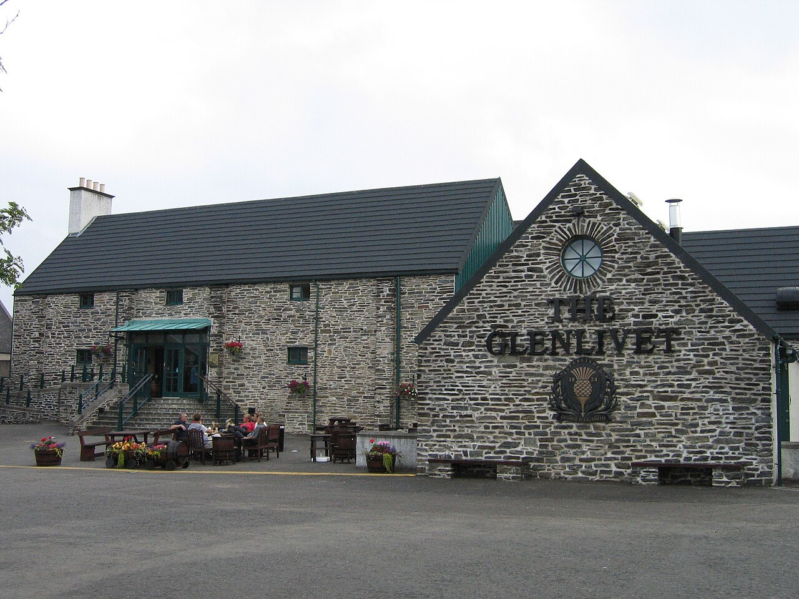

# 格兰威特蒸馏厂

从 Ballindalloch 沿 B9008 往山里走，路两侧先是牧场，再是石墙与稀疏的树，最后才看到格兰威特的游客中心与厂房。它不在城镇中心，也不在威士忌广告最常出现的那条“酒厂一条街”上；但 Glenlivet 这个地名在苏格兰威士忌史上分量很重，19 世纪的非法蒸馏、1823 年的新税法与 1824 年的第一张执照，都在这一带发生。今天的酒厂把这段历史讲得很清楚，同时也是一个产量很大的现代生产基地。

图：格兰威特蒸馏厂。摄影：The Glenlivet distillery。署名：Kkonstan，CC BY 3.0，来自 Wikimedia Commons（[来源](https://commons.wikimedia.org/w/index.php?curid=2808279)）。

## 定位与历史

1824 年，George Smith 在 Glenlivet 教区取得合法蒸馏执照，成为这一带第一家合法酒厂。这一步与 1823 年的 Excise Act 有关：新税法降低了蒸馏税、让合法经营变得可行，也让原本在地下运作的蒸馏者面临选择。酒厂资料常提到，Smith 的做法引来邻居不满，他一度需要随身带枪自卫；这类故事带有酒厂叙事的色彩，但它至少说明了一件事：合法化不是自然发生的，它改变了整个山谷的利益结构。

酒厂最初建在 Upper Drumin，1858 年迁到现在的 Minmore 址。Glenlivet 这个名字随后被大量酒厂借用，市场上出现许多“Glenlivet”后缀的酒；经过长期的法律与商标争议，The Glenlivet 得以在名称前保留定冠词，其他酒厂则不能再单独使用这个地名。今天它属于 Pernod Ricard 旗下的 Chivas Brothers，是集团最重要的单一麦芽品牌之一；2024 年，酒厂庆祝了建厂两百周年。

理解这段历史，有助于读懂酒标：The Glenlivet 的“The”不是装饰，而是名称争议留下的痕迹；“Glenlivet”既是地名，也是品牌名；酒厂现在的厂址不是 1824 年的原址。把这些层次分开，参观时就不会把“1824”简单理解成“这栋建筑有两百年”。

## 空间与参观

游客中心在 2021 年完成翻新，入口、商店、品鉴室与导览集合区都在同一栋建筑里。参观通常从品牌历史与山谷地貌讲起，再进入糖化、发酵、蒸馏与仓库。格兰威特的厂房规模不小，蒸馏器排列整齐，发酵槽与糖化设备都是现代生产节奏；但导览会刻意把“现代”与“传统”放在一起讲：一边是高效设备，一边是仍然依赖水、麦芽与时间的风味逻辑。

水源是这一站值得留意的细节。酒厂使用 Josie's Well 的水，名字来自当地的一口泉；水经过岩石与泥炭层，带来矿物与轻微的苔藓气息。威士忌的水不直接决定全部风味，但它影响糖化、发酵与稀释，也影响酒厂对“本地性”的叙述。参观时如果讲解提到水源，不妨记住这个名字，它比“纯净山泉”这样的形容词更具体。

仓库与陈酿区通常安排在导览后段。格兰威特的酒体偏轻、果味明显，桶型的影响很容易被喝出来：波本桶带来香草、椰子和梨，雪莉桶带来干果与香料。厂内是否保留地板发麦、麦芽从何处采购，这类细节会随酒厂安排变化；以当天讲解与官方页面为准，不要把旧攻略里的工艺描述当成永久事实。参观路线有楼梯与湿滑地面，穿防滑鞋，厂房温度低，带一件外套。

## 酒款与品鉴

核心产品可以从“无年份—常规年份—进阶”来读。Founder's Reserve 是无年份的入门款，强调梨、苹果与柔和口感；12 年是标准参照，果香、花香与蜂蜜是常见描述；14 年有 Cognac 桶收尾的版本，带出更明显的葡萄与香料；15 年、18 年与 21 年逐步增加复杂度，桶型与陈年比例也不同；Nadurra 系列以原桶强度装瓶，适合想看“未经稀释”状态的人。具体名称与供应会随市场变化，买之前看背标。

第一次来，建议用 Founder's Reserve 或 12 年建立基准，再对比一款雪莉桶比例更高或年份更长的酒。格兰威特的风格是“柔和、果味、易饮”，这不是“没有个性”，而是酒体结构的选择：较清澈的新酒、较长的发酵与蒸馏回流，让它在年轻时就好喝，也让高年份版本能保留果味而不被木头压住。不要把“柔和”理解成“淡”，也不要用泥煤强度来衡量它。

酒厂限定与单桶版本适合已经喝过常规款的人。品鉴时先闻后喝，少量慢饮；如果还要开车，全部吐掉。商店会有核心款与旅游渠道限定，注意行李重量与航空、渡轮的携带规定。高年份酒的价格与供应变化大，不要为了“买到”而忽略自己是否真的喜欢这种风格。

## 实用信息

地址是 The Glenlivet Distillery, Ballindalloch, Banffshire AB37 9DB, Scotland。酒厂在 B9008 上，距 Tomintoul 约 10 英里；自驾从 Ballindalloch、Aberlour 或 Grantown-on-Spey 出发都在半小时上下，乡村道路有单车道会车段，冬季要预留时间。公共交通不直接到门口，最近的车站是 Elgin 或 Keith，之后需要巴士、出租车或参加一日游；不自驾的话，建议提前预约含接送的行程。

酒厂建议提前在官网预约参观，旺季与周末尤其如此；不同体验的时长、是否含品鉴、年龄限制与价格不同，预约时逐项确认。生产区地面湿滑、楼梯多，穿防滑鞋；厂房温度低，带外套。行动不便或带儿童的家庭，先问清楚路线与年龄政策。开放时间与场次会随季节调整，页面核验日期 2026-11-08，出发前以官网当日信息为准。

周边有 Ballindalloch Castle 与 Cairngorms 国家公园的边缘地带，Speyside Way 的部分路段也经过这一带；把酒厂与城堡、步道排在同一天，要注意预约时间与日落。若只安排半天，建议只参加一场导览，再在游客中心慢慢喝一杯，不要急着赶下一家。

## 礼仪与周边

酒厂是生产场所，不是酒吧。没有预约不要进入生产区，不要触摸设备、桶架与管道；地面可能有水与麦糟，走路看脚下。品鉴时不要喷浓香水，不要大声喧哗；想吐酒就用吐酒桶。拍照前看标识，部分区域不允许拍摄设备与工艺细节。带儿童的家庭要管好孩子，不要让孩子在厂房里奔跑。

开车的人全程不喝。苏格兰的酒驾上限比英格兰更严，乡村道路窄、弯多，一杯也可能影响判断。最稳妥的安排是包车、指定司机或参加含接送的行程。若同行者都不喝酒，可以把重点放在历史、建筑与游客中心的展示上，品鉴打包带走。

周边可以顺路去 Aberlour、Craigellachie 与 Dufftown，或往北到 Elgin 看大教堂；往南进入 Cairngorms，风景与酒厂是两种节奏。把格兰威特与格兰菲迪、麦卡伦串成一天是可行的，但三场预约之间要留足车程与午餐时间。想先建立威士忌的基本框架，可以读[苏格兰威士忌](ref:scotch)、[斯佩塞](ref:speyside)与[威士忌入门](ref:whisky-intro)。

补充阅读：[威士忌](ref:c-extra-1)、[A Ginjinha](ref:c-extra-2)。

对照阅读：[苏格兰威士忌](ref:scotch)、[威士忌入门](ref:whisky-intro)。

相关条目：[斯佩塞](ref:speyside)。
