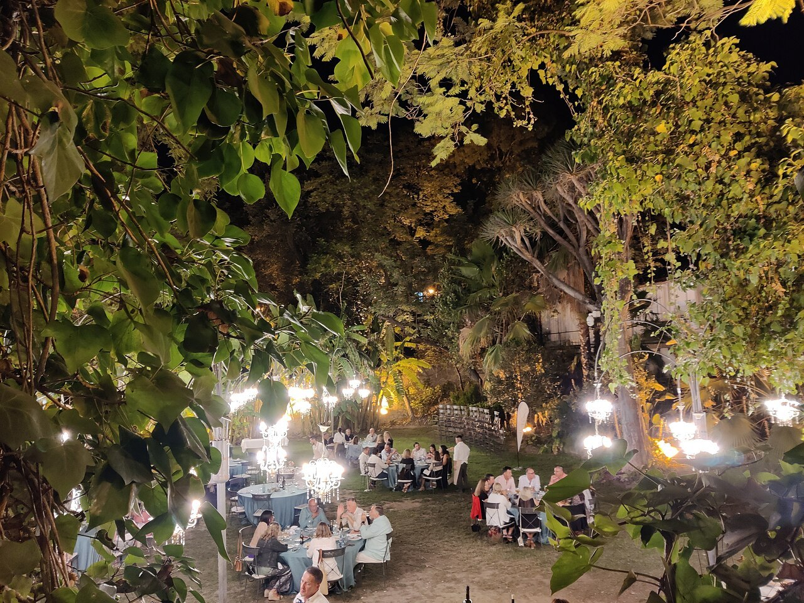
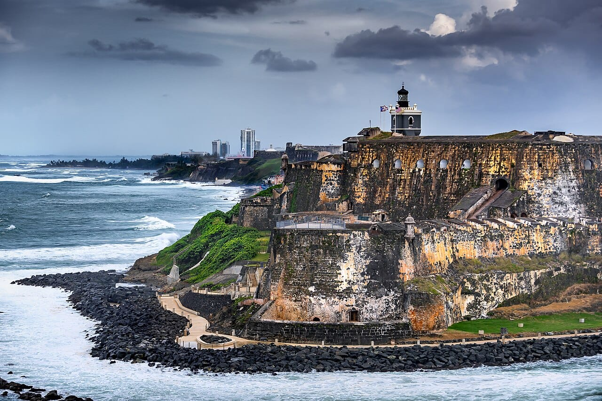

# 冈萨雷斯·比亚斯酒庄

冈萨雷斯·比亚斯（González Byass）在西班牙赫雷斯-德拉弗龙特拉（Jerez de la Frontera）市中心，地址是曼努埃尔·玛丽亚·冈萨雷斯街 12 号。它由曼努埃尔·玛丽亚·冈萨雷斯·安赫尔于 1835 年创立，以 Fino 品牌 Tío Pepe 闻名。与建在葡萄园边的酒庄不同，这里是一整片嵌在老城里的酒窖建筑群：庭院、鹅卵石小巷、白墙高窗的酒窖和花园连在一起，阿尔卡萨（Alcázar）就在几百米外。到这里参观，看的不是葡萄园，而是雪莉酒如何在城市建筑里完成生物陈年与氧化陈年。

图：冈萨雷斯·比亚斯酒庄。摄影：Jardines de las Bodegas González Byass - IMG 20220811 230512。署名：El Pantera，CC BY-SA 4.0，来自 Wikimedia Commons（[来源](https://commons.wikimedia.org/w/index.php?curid=121644467)）。

## 城市中心的一座“酒庄街区”

酒庄正门在曼努埃尔·玛丽亚·冈萨雷斯街 12 号。官方页面把邮编写作 11402，部分地图与旅游页面写作 11403，预订时以官方确认单为准。从赫雷斯火车站步行过来约 20 分钟，打车约 8 分钟；从赫雷斯机场开车约 18 分钟。它离阿尔卡萨、大教堂和老城步行街都很近，适合安排在同一个半天里。

这片建筑群不是单一厂房，而是多座酒窖的组合：La Constancia、Los Apóstoles、La Cuadrada、La Concha 与 Lepanto 各有不同的结构与用途。外墙刷石灰，屋顶很高，侧窗开在离地很远的位置，既能进风又不让阳光直射酒桶。巷子地面是鹅卵石，夏天晒得发白，走进酒窖却立刻凉下来。雪莉酒不像波特酒那样集中在河畔酒窖陈年，它就在城市里陈年；酒窖的墙厚、朝向、屋脊高度和地面湿度都是生产条件，所以这些建筑本身就是设备，不是后来改出来的布景。

地图坐标约为 36.68005, -6.14280，指向酒庄建筑群；具体入口、集合点与行李寄存以预约确认邮件为准。

## 1835 年与 Tío Pepe 的来历

1835 年，曼努埃尔·玛丽亚·冈萨雷斯·安赫尔在赫雷斯创办酒庄。他的叔叔何塞·安赫尔-巴尔加斯在家族里被叫作“佩佩叔叔”，也就是 Tío Pepe。叔叔懂酒窖，也懂酒花，把第一批 Fino 的 solera 交给侄子打理；这段家族关系后来变成了品牌名。不久，英国商人罗伯特·布莱克·比亚斯入股，公司才有了“González Byass”这个双姓，也打通了英国市场。

1844 年，Tío Pepe 已经卖到西班牙之外；对一个年轻酒庄来说，这比任何广告都更能说明 Fino 的运输与稳定有多难。1887 年创始人去世时，Constancia、Apóstoles、La Cuadrada、La Concha 与 Lepanto 已经建成，酒庄的城市格局基本定型。1935 年，设计师路易斯·佩雷斯·索莱罗（Luis Pérez Solero）给品牌画了红外套、宽檐帽、抱吉他的小人；1958 年，这个形象以霓虹灯形式出现在马德里太阳门，成了西班牙流行文化的一部分。2010 年，酒庄推出不过滤的 Tío Pepe En Rama；2012 年起，又在酒窖里办 Tío Pepe 音乐节。品牌史与城市史在这里是缠在一起的。

## La Concha 与 solera：酒窖怎样运转

La Concha 是最容易被记住的一座。它的平面接近圆弧，内部跨度约 28 米，屋架像贝壳一样从两侧向中间收拢；草图常被归到居斯塔夫·埃菲尔（Gustave Eiffel）名下，实际由工程师约瑟夫·库根（Joseph Coogan）与塞维利亚的 Portilla and White 铸铁厂完成。里面横排放着 214 只 Amontillado 酒桶。站在门口先看屋顶，再看桶，最后才看酒，顺序不要反过来。

真正决定风味的是 solera 与 criaderas。solera 不是一只桶，而是一组按“级”排列的桶：最老的一层叫 solera，上面依次是第一级、第二级……每年从最老的一层取出一定比例装瓶，再用上一级的酒补入，层层向上补新酒。酒桶只装到七成左右，留出空气和酒花活动的空间。Fino 靠 flor 酒花生存：基酒加强到 15 度，酒花在表面形成一层白色薄膜，隔绝氧气，酒因此保持苍白、干爽，带杏仁、面包团与海盐气息。Amontillado 则先经历生物陈年，再加强到 17 度，酒花死亡，转入氧化陈年，颜色变深，出现榛子与焦糖。Oloroso 从一开始就加强到 17 度，不形成酒花，直接在氧气中变老。三种风格的分岔，其实在加强的那一刻就决定了。

## 从 Fino 到 Pedro Ximénez：酒款与法规

赫雷斯法定产区（DO Jerez-Xérès-Sherry）允许的主要白葡萄是 Palomino Fino、Pedro Ximénez 与 Moscatel。干型 generoso 的残糖上限是每升 5 克；超过这个界线，通常就是经过“cabeceo”调配的甜型或半甜型。法规把加强后的酒精度定在 15 度或 17 度两个档口，酒庄据此选择生物陈年还是氧化陈年，这也是读酒标时最有用的线索。

Tío Pepe 是 Fino 的基准：干、咸、带酵母气息，酒精度通常 15 度，适合冰到 7–9 摄氏度，开瓶后尽快喝完。Viña AB 是 Amontillado，比 Fino 多一层榛子与旧木气息；Alfonso 是 Oloroso，酒体更宽；Apostoles 是 Palo Cortado 的 VORS，平均陈年超过 30 年；Nectar 用 Pedro Ximénez 酿成，浓稠、甜，带葡萄干与无花果。La Concha Medium 则是把干型雪莉与少量甜酒调配的半甜风格。酒庄还生产 Lepanto 白兰地与 Nomad 威士忌，说明它早已不只是雪莉酒商。VOS 标平均 20 年，VORS 标平均 30 年，这两个缩写比“陈年”二字更能说明价格差距。

## 预约参观的实际安排

酒庄周二至周日接待，必须提前预约，没有散客随到随进的导览。官方预约入口在 tiopepe.com，电话 +34 956 357 016；邮件与在线表格的回复时间在旺季会变长。基础线路“Tío Pepe Experience”约 25.50 欧元，含两款酒；“The Colors of Sherry”约 28.50 欧元，含四款；“Between Tapas”约 30.50 欧元，带小食；“Premium VORS”约 50 欧元，从桶中取 Tío Pepe，再喝四款 VORS。价格与内容会调整，以预约页面为准。

参观动线通常包括鹅卵石巷、历史花园、几座老酒窖与品鉴室；酒庄提供免费无线网络、商店与酒吧，并标明有无障碍空间，但老建筑的门槛与石板路仍需留意。常见导览在一小时上下，含品鉴会更长，具体时长以预约确认单为准。`operating_status: verified` 只表示酒庄在营业，不等于当天有散客名额；圣周、赫雷斯节庆与邮轮停靠日会特别紧张。

## 到访提示与常见误会

第一个误会是把雪莉都当成甜酒。赫雷斯产量最大的其实是干型 Fino、Manzanilla、Amontillado 与 Oloroso；甜型只是其中一支。第二个误会是把 Fino 当红酒收藏。Fino 依赖酒花，装瓶后仍在变化，买回来要尽快喝，不要在地下室放上几年。第三个误会是只认 Tío Pepe 一个名字。冈萨雷斯·比亚斯是一个集团，雪莉、白兰地、其它产区的葡萄酒都在同一个屋檐下。

酒窖温度低、地面可能潮湿，夏天进去会觉得凉，带一件薄外套，穿防滑鞋。品鉴可以吐酒，尤其要开车的人；赫雷斯老城路窄，酒后不要驾车。拍照不要用闪光灯直射酒桶与老照片，也不要触摸桶塞和管道。若想把这站放进更大的语境，可以先读[赫雷斯](ref:jerez)产区页与[雪莉酒](ref:sherry)风格页，再对照[solera](ref:solera)、[flor](ref:flor)与[加强](ref:fortification)三条工艺条目；想看看另一种“传统酒庄”的写法，可以读里奥哈的[洛佩兹雷迪亚](ref:lopez)。两家酒庄都把“老”当成生产方式而不是装饰，这一点比酒款名单更值得比较。

对照阅读：[洛佩兹雷迪亚酒庄](ref:lopez)、[雪莉](ref:sherry)。

## 相关图像

图：加强（加度）。图片：John Scofield，CC BY-SA 4.0，via Wikimedia Commons（[原图页面](https://commons.wikimedia.org/wiki/File:Castillo_San_Felipe_del_Morro_(10_of_1).jpg)）。关联图像：冈萨雷斯·比亚斯酒庄。
