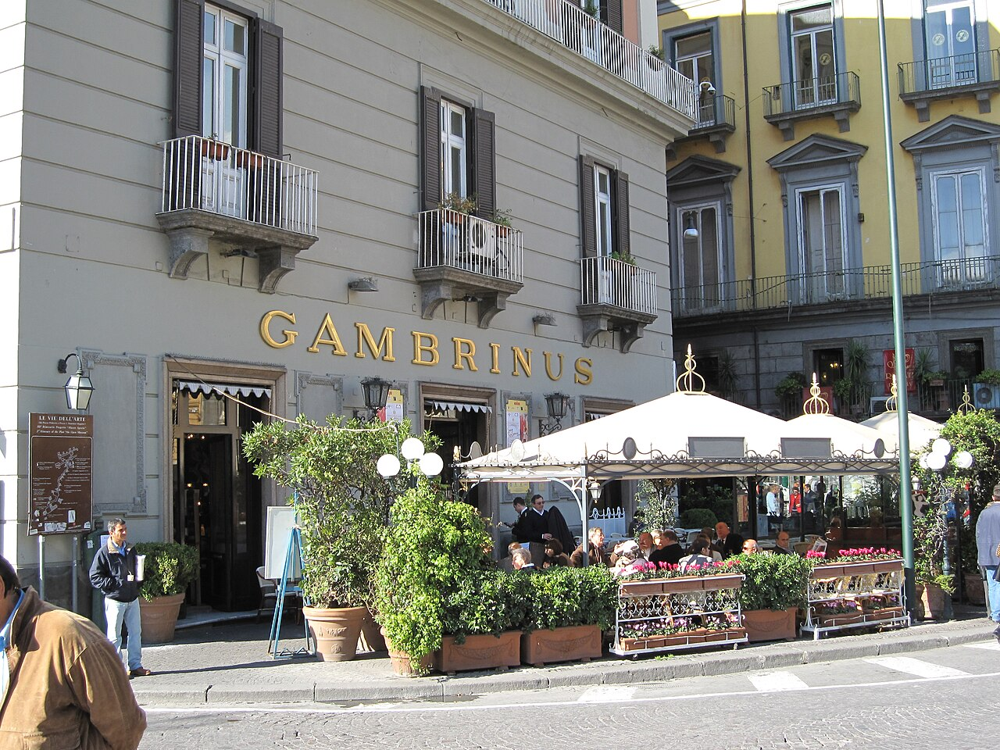

# 甘布里努斯咖啡馆

从 Piazza del Plebiscito 往南，拐进 Via Chiaia 不远，就能看到甘布里努斯咖啡馆的转角店面：深色木门、黄铜把手、玻璃橱窗里堆着糖果与蛋糕盒，门口永远有人站着喝咖啡。它夹在皇宫、圣卡洛歌剧院和翁贝托长廊之间，是那不勒斯老城最容易被“顺路经过”的一间历史咖啡馆，也是最容易被当成博物馆的一间。真正的用法不是站在门口拍一张照，而是进去点一杯咖啡或一份 babà，在镜子和灰泥装饰之间坐十分钟，听周围人用那不勒斯话争论足球、政治或晚饭吃什么。

图：甘布里努斯咖啡馆的 GAMBRINUS 金字招牌、遮阳篷与门前露台，位于 Piazza Trieste e Trento 转角。图片：Armando Mancini，CC BY-SA 2.0，via Wikimedia Commons（[原图页面](https://commons.wikimedia.org/wiki/File:Napoli_-_Il_Bar_Gambrinus.jpg)）。

## 1860 年：甘布里努斯咖啡馆的关键起点
甘布里努斯的故事有两个起点。1860 年，意大利统一的那一年，有人在 Palazzo della Foresteria 底层开出一间“Gran Caffè”，正对皇宫与 Plebiscito 广场；1890 年，店面经过一次大规模改造，以 Gambrinus 之名重新开张。Gambrinus 是欧洲民间传说里的“啤酒之王”，这个名字带着十九世纪末咖啡馆常见的饮酒与娱乐气质，而不只是卖咖啡。今天门楣上的名字、镜厅里的布局，基本都从 1890 年那次改造定型。

1890 年代的改造常被归到建筑师 Antonio Curri 名下：灰泥天顶、金框镜面、彩绘 lunette、深色木饰与大理石台面，把原本的咖啡馆变成一连串尺度不同的沙龙。它很快成为那不勒斯资产阶级、记者、律师与王公贵族的会面地点。Gabriele D'Annunzio、Benedetto Croce、Matilde Serao、Eduardo Scarpetta 与 Totò 的名字都和这里联系在一起；奥地利皇后 Sissi 1890 年到那不勒斯时也来过。对当时的城市来说，这里不是“喝咖啡的地方”，而是消息、文学与政治交换的客厅。

1938 年，那不勒斯省长 Giovanni Battista Marziale 下令关闭 Gambrinus。店方自己的年表给出两种解释：一种说省长住在附近，嫌夜间喧闹；另一种说这里被视为反法西斯人士的聚会点。两种说法并不互相排斥。关闭后，部分厅堂被 Banco di Napoli 占用，咖啡馆的完整空间被切开，战后也没有立刻恢复旧观。直到 1970 年代，Michele Sergio 与两个儿子 Arturo、Antonio 以及女婿 Giuseppe Rosati 接手，才开始一点点找回旧厅堂、修复灰泥与壁画。1973 年是 Sergio 家族正式接手的关键年份；今天店里的经营仍由这一家族延续。

## 空间与酒单

甘布里努斯的空间像一套被切开的十九世纪布景。主厅的镜面把对面的彩绘和吊灯叠在一起，靠墙的卡座、深色木柜台和大理石小桌保留着旧式咖啡馆的密度；往里走，会经过较小的沙龙与楼梯，墙面挂着老照片、海报和文人肖像。它不像现代精品咖啡店那样把吧台做成舞台，而是把客人分散到不同房间里，让每个角落都像在等一场旧式谈话。

饮品以那不勒斯式咖啡为核心：espresso、caffè macchiato、caffè freddo，以及加奶或加可可的热饮。甜点比酒更常被点：sfogliatella（贝壳酥）、babà 浸糖浆、pasticciotti、巧克力与糖果盒。酒单覆盖意大利起泡酒、Campania 本地白葡萄酒、limoncello 与常见的 aperitivo；傍晚时分，吧台会摆出小食，客人可以站着喝一杯再走。它不是精酿酒吧，也不是鸡尾酒实验室，重点在“咖啡 + 甜点 + 一小杯酒”的组合。

## 怎么喝

第一次来，最稳妥的是先在吧台点一杯 espresso 或 caffè macchiato，站在柜台边喝完，感受店里最快、最日常的节奏。如果想吃甜点，可以点一份 sfogliatella 或 babà，配一杯不加糖的咖啡；那不勒斯的甜点普遍偏甜，咖啡的苦味正好把糖浆压住。想坐久一点，再往镜厅里找座位，点 caffè freddo 或一杯本地白葡萄酒，把这里当成午后的歇脚点。

傍晚的 aperitivo 更适合站着喝：一杯起泡酒或 Campari 类苦酒，配几块小食，半小时内结束。不要把它当成正餐餐厅，也不要期待完整的鸡尾酒菜单；这里最强的是咖啡、甜点和“老咖啡馆”的空间感。若只想拍照，建议避开上午旅行团最密集的时段，午后两三点通常更容易找到空位。

## 甘布里努斯咖啡馆的地址与营业安排
- 地址：Via Chiaia 1/2（Piazza Trieste e Trento 转角），80132 Napoli。
- 营业：每日约 07:00–24:00，周六常延到 01:00；节假日与活动会调整，出发前看官网或电话确认。
- 交通：地铁 Municipio（1 号线）步行约 5 分钟；从 Piazza del Plebiscito、皇宫或圣卡洛歌剧院步行都在 3 分钟内。
- 点单：先在柜台付款或点单，再凭小票取咖啡；坐下会有桌边服务与相应价格，站着喝通常更便宜。
- 旺季：上午与周末下午旅行团较多；想安静看镜厅，开门后一小时或傍晚前最合适。

## 礼仪与常见误区

第一，不要把“站着喝”当成没礼貌。意大利咖啡馆的站立吧台是正常动线，尤其在上班前和午休时；坐下才慢慢喝，是另一种选择。第二，先看清楚价格表再落座：同一杯咖啡，站着喝和坐下喝可能不是同一个价，旅游区的价差更明显。第三，别把镜厅当成免费摄影棚；有人专程来喝咖啡或谈事，拍照时避开正对桌面的角度，也不要用闪光灯。第四，不要因为店里“很老”就假定所有厅堂都能参观；部分空间会因活动、婚礼或私人预订关闭。第五，不要把 Gambrinus 和“最老咖啡馆”这类称号绑在一起；它的看点是 1890 年定型的自由风格空间与二十世纪文学沙龙，而不是一条简单的年代纪录。

## 从甘布里努斯咖啡馆延伸到罗马希腊咖啡馆
从 Gambrinus 出门，正对面就是 Piazza del Plebiscito 与皇宫；往东两分钟是圣卡洛歌剧院，往北穿过拱廊是 Galleria Umberto I 与 Via Toledo。可以把这一带排成一条步行路线：皇宫外立面 → Plebiscito 广场 → Gambrinus 喝一杯 → 圣卡洛歌剧院门厅 → Galleria Umberto I → 沿 Via Toledo 往北到 Quartieri Spagnoli。若还有时间，往海边走到 Castel dell'Ovo 或 Napoli Sotterranea 入口，大约再要二十到三十分钟。

相关条目：[罗马希腊咖啡馆](ref:greco)、[花神咖啡馆（威尼斯）](ref:florian)、[坎帕里诺长廊酒吧](ref:camparino)。

## 参考资料
- 店方历史页：<https://grancaffegambrinus.com/en/il-salotto/>，用于核对 1860、1890、1938 与 Sergio 家族修复的脉络。
- Visit Naples 条目：<https://www.visitnaples.eu/en/where-to-eat/bakeries-in-naples/gran-caffe-gambrinus>，用于核对地址与客群。
- 同城的 `place:antico-caffe-greco` 与 `place:caffe-san-carlo-torino` 可以对照意大利历史咖啡馆的空间类型。
- 若对维也纳咖啡馆的坐席礼仪感兴趣，可读 `route:vienna-coffee-house-evening`。
- 本页把“1938 年关闭”的两种说法并列，不把单一原因写成定论；营业时间与价格以官方当日信息为准。
- 相关条目：[罗马希腊咖啡馆](ref:greco)、[花神咖啡馆（威尼斯）](ref:florian)、[Camparino in Galleria](ref:camparino)、[圣卡洛咖啡馆](ref:san-carlo)、[维也纳咖啡馆之夜](ref:vienna)
