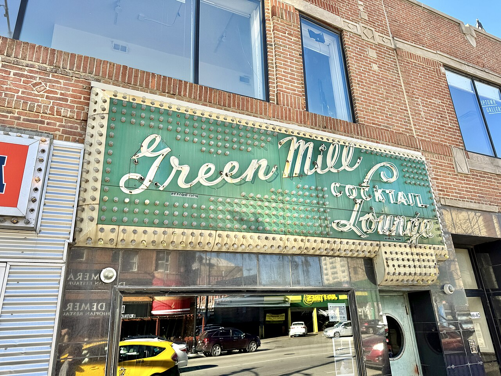

# 绿磨坊爵士酒吧

芝加哥 Uptown 区的 Broadway 与 Lawrence 交叉口，有一块绿色霓虹招牌，白天看略显褪色，入夜后亮起来，像一块从 1920 年代留下来的舞台布景。这就是绿磨坊（Green Mill）。它既不是大型音乐厅，也不是怀旧主题酒吧，而是一间仍在每晚演出爵士、仍用现金结账、仍保留禁酒令时期空间痕迹的老酒馆。对芝加哥人来说，绿磨坊的名气来自音乐；对游客来说，它最容易被记住的则是 Al Capone、地下隧道与“诗歌 slam 发源地”这几个标签。

图：芝加哥 Uptown 区 Broadway 的 Green Mill Cocktail Lounge 霓虹招牌；俱乐部起源于 1907 年前后的 Pop Morse's Roadhouse，现址建筑 1914 年完成，现空间在 1935 年成形。图片：Warren LeMay from Chicago, IL, United States，CC BY-SA 4.0，via Wikimedia Commons（[原图页面](https://commons.wikimedia.org/wiki/File:Green_Mill_Cocktail_Lounge_Sign,_Broadway,_Uptown,_Chicago,_IL_(54842064706).jpg)）。

## 1907 年：绿磨坊爵士酒吧的关键起点
绿磨坊的起点有两个年份：常见的说法是 1907 年，芝加哥市府的记录则把 Pop Morse's Roadhouse 的开业追到 1898 年。两种说法并不必然矛盾——前者更像“绿磨坊”这个品牌被反复讲述的起点，后者是同一街角酒馆更早的营业记录。1914 年，现在的建筑在 Broadway 与 Lawrence 的转角完成；此后这里被扩建成 Green Mill Gardens，名字借自巴黎红磨坊（Moulin Rouge），但用“绿色”避开芝加哥南区“红灯区”的联想。

1920 年代禁酒令期间，绿磨坊是芝加哥最出名的地下酒吧之一。它与 Al Capone 的手下 Jack “Machine Gun” McGurn 有财务关系；酒吧地板下与地下储藏隧道相连，传说警察突袭时，客人可以从吧台后的暗门逃进隧道。今天建筑里仍能看到与那段历史相关的结构，但酒吧不提供“隧道参观”，也不会把犯罪史当成卖点。更准确的说法是：这里是“禁酒令时代城市史”的现场，而不是“黑帮主题乐园”。

1935 年，禁酒令结束后的绿磨坊形成了今天这间 Cocktail Lounge 的基本空间。此后它经历过多次经营变化，1986 年由 Dave Jemilo 接手，逐渐把重心转向现场爵士。1984 年，Marc Smith 在这里发起“Uptown Poetry Slam”，后来被视为现代诗歌 slam 的重要起点之一。2000 年，Uptown Square Historic District 被列入 National Register of Historic Places，绿磨坊是街区中的一部分；2016 年，这一街区又被列为芝加哥地标区，绿磨坊仍被点名为区内著名建筑之一。它的历史层次因此很丰富：街角酒馆、禁酒令地下酒吧、爵士俱乐部、诗歌现场，四层身份叠在同一间屋子里。

## 空间与酒单

室内是一条狭长的房间：入口处是吧台，往里是舞台，两侧靠墙排着弧形卡座，后墙有装饰艺术风格的吧台背板、壁画与旧式灯具。空间没有大改造，座位也不多，所以演出一开始，整个房间很快坐满。舞台不高，乐手与观众距离很近；这也是绿磨坊的爵士体验为什么比大型俱乐部更“贴身”的原因。

绿磨坊不供应食物，只卖酒。酒单以经典鸡尾酒、啤酒与威士忌为主，也有简单的 highball 与季节性调酒；吧台速度不算慢，但演出前后会排队。由于只收现金，进门先确认钱包里有现金，或在店内 ATM 取钱。周边步行范围内有墨西哥、埃塞俄比亚、中国与美国菜餐厅，常见的做法是先吃饭再来看演出，或在中场休息时去附近吃一口。

## 怎么喝

第一次来，先看当晚的演出与门票规则。绿磨坊不接受预订，座位先到先得；热门演出与周末夜间通常要提前到场。点一杯简单的鸡尾酒或威士忌，比点需要长时间调制的复杂酒更合适，因为吧台在演出前后很忙。演出开始后，尽量降低说话音量；这不是“边聊边听”的酒吧，乐手与观众共享同一个狭小空间，交谈声会直接盖过音乐。

如果想体验诗歌 slam，留意周日的 Uptown Poetry Slam 或其他特别场次；具体时间以官网日历为准。想听爵士，工作日晚间通常比周末更容易找到座位；周末的深夜场会持续到凌晨，适合不赶时间的人。

## 绿磨坊爵士酒吧的地址与营业安排
地址是 4802 N Broadway, Chicago, IL 60640，位于 Uptown 区 Broadway 与 Lawrence 交叉口。地铁红线 Lawrence 站步行可达；周边有街泊与酒吧停车场，官方说停车场在 18:30 后开放。营业时间按官网 FAQ：周一至周四 16:00–01:00，周五 16:00–04:00，周六 13:00–05:00，周日 16:00–01:00；演出与节假日会调整。

绿磨坊严格执行 21 岁以上入场，必须带有效身份证件。只收现金，店内有 ATM；不接受预订，也不卖门票，入场按先到先得与当日 cover charge（入场费）执行。没有着装要求，牛仔裤或正式服装都可以。这里不供餐，也不提供隧道参观。小费按每杯 1–2 美元或账单 18%–20% 给。

## 礼仪与常见误区

第一个误区是把“1907”当成“这栋建筑建于 1907”。更准确的是：街角酒馆的营业记录可追到 1898 年，绿磨坊品牌常写作 1907 年，现建筑 1914 年完成，今日空间 1935 年成形。第二个误区是把 Al Capone 的故事当成酒吧的“卖点”；这里确实有禁酒令遗迹，但它的核心是音乐与社区，不是黑帮观光。第三个误区是以为可以参观地下隧道；官方明确不提供隧道 tour。第四个误区是带相机、开闪光灯或频繁走动；演出时请把手机调静音，拍照遵守现场规则。第五，不要以为可以刷卡；只收现金是硬规则。

## 从绿磨坊爵士酒吧延伸到禁酒令
从绿磨坊出来，沿 Broadway 往南可走到 Lawrence 与 Uptown 的其他历史剧院，包括 Aragon Ballroom、Riviera Theatre 与 Uptown Theatre 一带；往东是湖滨与 Foster Beach。把绿磨坊放进“禁酒令与爵士”主题路线很合适：先读[禁酒令](ref:prohibition)与[美国禁酒令](ref:us-prohibition)，再对比波士顿的[钟声酒馆](ref:bell)、洛杉矶的[Musso & Frank](ref:musso)与新奥尔良的[老苦艾酒屋](ref:absinthe)，能看到不同城市如何把“酒吧历史”变成今天的日常生意。

**关键事实。**

| 项目 | 内容 |
| --- | --- |
| 一句话定位 | 芝加哥 Uptown 区的 Green Mill 爵士酒吧，起源于 1890 年代、通常写作 1907 年，1920 年代与 Al Capone 时代相连，1935 年形成今日空间；以七晚爵士、诗歌 slam、现金支付与禁酒令遗迹闻名 |
| 地址 | 4802 N Broadway, Chicago, IL 60640, United States |
| 城市/国家 | 芝加哥 / 美国 |
| 营业状态 | 已核验营业 |
| 官网 | greenmilljazz.com |

## 参考资料
- [禁酒令：美国如何禁酒，又为什么失败](ref:prohibition)
- [美国禁酒令](ref:us-prohibition)
- [钟声酒馆](ref:bell)
- [Musso & Frank Grill](ref:musso)
- [老苦艾酒屋](ref:absinthe)

最后核对：4802 N Broadway 的地址、演出场次与票价按官网查于 2026-11-21；“最老/发源地”在正文中均带引号，不作为无争议史实。本页是“喝酒去”的芝加哥爵士酒吧条目，中文与英文版同步；文字许可见上方 rights 字段，图片署名与许可见各图注。

对照阅读：[禁酒令：禁令改变供给，不消灭需求](ref:prohibition)、[钟声酒馆](ref:bell)。
