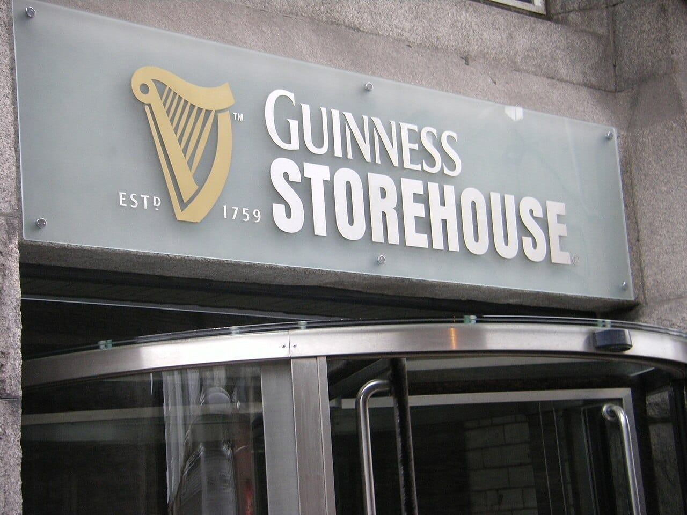

# 健力士仓库：圣詹姆斯门的黑色啤酒叙事

健力士仓库在都柏林圣詹姆斯门，门牌是 Dublin 8, D08 VF8H。很多游客把它当作“健力士酒厂参观”，但它首先是一座访客中心：展览、品鉴与顶层酒吧都在旧发酵车间里，真正的生产厂区仍在旁边工作，普通门票并不进入酿造车间。把这两件事分开，参观时对“看到了什么”和“没看到什么”就会有更清楚的判断。

> **到访信息**
> - 地址：St. James's Gate, Dublin 8, D08 VF8H, Ireland。
> - 开放与预约：以[官方页面](https://www.guinness-storehouse.com/)为准；开放时间、场次和预约规则会随季节调整。
> - 交通与费用：出发前以官方页面为准，本页不承诺固定票价。
> - 营业状态：已核实；来源最近核对：2026-11-21。

图：健力士仓库：圣詹姆斯门的黑色啤酒叙事。摄影：Guinness Storehouse。署名：Greatal386 at English Wikipedia，CC BY 2.5，来自 Wikimedia Commons（[来源](https://commons.wikimedia.org/w/index.php?curid=12671330)）。

## 一座发酵车间改成的城市入口

仓库所在建筑原本属于圣詹姆斯门厂区的发酵设施，2000 年改为对公众开放的展馆。改造保留了工业建筑的体量，内部则被重新组织成七层展线：底层是入口、商店与餐饮，中间几层讲原料、酿造与品牌史，顶层是玻璃与钢结构的 Gravity Bar。电梯把人群直接送到高处，再让人一层层往下走，这种动线安排让“看风景”和“看展览”自然叠在一起。

它位于利菲河南岸的 Liberties 老街区，周围是旧厂房、排屋与新建公寓混杂的城市纹理。步行从三一学院一带过来大约二十多分钟，沿途能感到都柏林中心区与旧工业区之间的过渡。仓库不是一个孤立的景点，它嵌在一片仍在使用的厂区边缘，这一点从建筑尺度、货运出入口和远处的发酵罐就能看出来。

## 从 1759 年租约到品牌档案

官方展线从 1759 年讲起：阿瑟·健力士（Arthur Guinness）在圣詹姆斯门签下租约，租期长达 9,000 年。这个数字更像品牌叙事里的锚点，而不是今天需要逐条核对的合同细节；它说明这家酒厂在同一地点持续经营的时间尺度。此后，健力士从本地啤酒厂成长为跨国品牌，圣詹姆斯门始终是品牌的地理原点。

展馆里大量使用广告档案：海报、电视广告、包装与周边。它们不是酿造技术资料，而是理解“健力士如何被讲述”的关键材料。品牌把深色酒液、白色泡沫、缓慢下沉的气泡与“等待”的仪式感做成视觉符号，这些符号又反过来影响消费者对世涛的预期。看展时不妨把广告与工艺分开：广告解释品牌，工艺解释酒。

## 展线里值得慢看的三处

第一处是原料与烘焙部分。健力士世涛的深色主要来自烘焙大麦，而不是简单地把麦芽烤焦；烘焙程度带来咖啡、可可与烤面包的气息，也带来干爽的收尾。展板会把水、大麦、酒花与酵母拆开讲，但真正决定风格的，是配方比例与烘焙曲线，这些属于企业细节，展览不会给出完整参数。

第二处是品鉴室。门票通常包含一杯健力士或 Guinness 0.0，品鉴环节会引导人观察泡沫、闻香与入口的质地。世涛的“厚”并不等于甜，干爽与苦味才是它的骨架；如果只记住“像咖啡”，会漏掉发酵与碳酸化带来的清爽感。

第三处是顶层 Gravity Bar。360 度视野把都柏林的天际线、教堂尖顶与远山放进同一画面，手里那杯酒反而成了观看城市的位置标记。想更深入生产区，可以另购 Guinness Brewery Experience 等升级项目，由导览带入仍在运转的厂区；普通门票不包含这部分，名额也有限，需提前在官网确认。

## 健力士世涛是什么酒

世涛属于上发酵的深色艾尔传统，健力士的做法则把它做成高度标准化、以氮气侍酒的现代版本。氮气让泡沫更细密、口感更柔滑，也会制造出杯中气泡下沉的视觉效果；这与普通二氧化碳碳酸化的啤酒在口感上差别明显。风味上，烘焙大麦给出咖啡与可可，酒花提供温和苦味，收尾偏干，整体酒精度不算高，适合连续喝上几杯。

健力士还有 Guinness 0.0 无醇版本，工艺上要处理酒精去除与风味保留的矛盾，展览与酒吧都会提供。把无醇版与常规版对照着喝，能更清楚地感到酒体与苦味的来源。若想理解更广的啤酒分类，可以回到[啤酒](ref:beer)的总览，再对照[世涛](ref:stout)与[发酵](ref:fermentation)的条目；世涛不是“黑啤”的同义词，颜色深浅与发酵类型、原料配方并不是一一对应的。

## 参观安排与交通

地址是 St. James's Gate, Dublin 8, D08 VF8H。官网列出的开放时间为周一至周五 10:00–19:00（17:00 停止入场），周六 9:30–20:00（18:00 停止入场），周日 9:30–19:00（17:00 停止入场）；12 月与 1 月的周六最后入场时间会提前。节庆与临时活动可能调整，出发前看官网当日信息。

门票建议在官网按时间段预订，成人票从 €24 起，包含自助参观与一杯饮品；品鉴升级、倒酒课程与“把自己的照片印在泡沫上”等项目另收费。参观通常需要两到三小时，旺季下午人流最密集，开门后一小时或傍晚时段相对从容。Luas 红线到 St. James's 站下车步行可达，也可从市中心步行；具体线路、无障碍入口与当日交通以官网和都柏林交通信息为准。

馆内提供无障碍通道、感官友好时段与降噪工具，带孩子的家庭可以提前查看楼层地图。酒吧区域只向达到法定饮酒年龄的访客供酒，具体年龄核验与证件要求以现场规定为准。

## 参观之后：把品牌叙事放回城市

从仓库出来，沿着利菲河南岸往东走，很快就能回到都柏林的酒馆密集区。想看“健力士在日常酒馆里怎么被喝”，可以去下桥街的[铜头酒馆](ref:brazen-head)：那里没有七层展线，只有木吧台、传统音乐与一杯正常的生啤，正好与仓库的品牌剧场形成对照。都柏林的酒馆文化属于[爱尔兰](ref:ireland)的日常生活，而不是展馆的延伸。

最后要提醒的是：健力士仓库讲的是一个非常成功的品牌故事，故事里的历史、广告与工艺都经过选择。它值得看，但不等于完整的啤酒工业史。把展馆、厂区与城市酒馆三处放在一起，才能同时看到品牌如何被制造、酒如何被生产、以及人如何在日常里消费它。

相关条目：[啤酒](ref:beer)、[世涛](ref:stout)、[爱尔兰](ref:ireland)。

**关键事实。**

| 项目 | 内容 |
| --- | --- |
| 一句话定位 | 都柏林圣詹姆斯门的健力士仓库，建在旧发酵车间里，用七层展线、广告档案与顶层 Gravity Bar 讲述健力士世涛；它是访客中心，不是生产车间导览，真正的酒厂仍在同一片厂区运转 |
| 地址 | St. James's Gate, Dublin 8, D08 VF8H, Ireland |
| 城市/国家 | 都柏林 / 爱尔兰 |
| 营业状态 | 已核验营业 |
| 官网 | guinness-storehouse.com |
