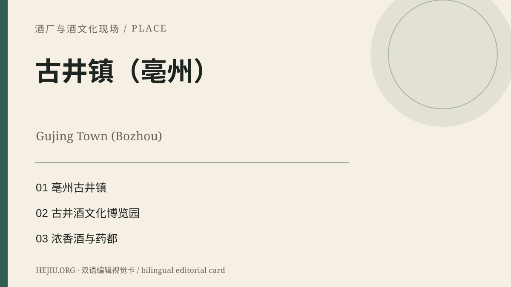
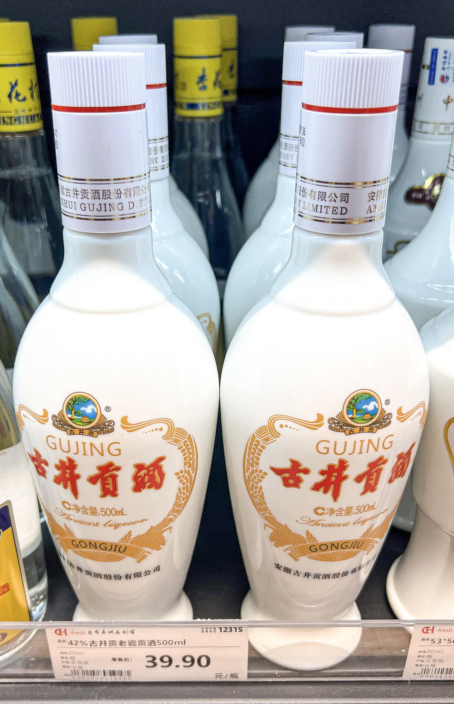

# 古井镇（亳州）

古井镇在亳州谯城区，酒厂、博览园与镇区连成一片。很多人只知道“古井贡酒”四个字，到了亳州却把时间全花在老城和药材市场。古井的价值在于它把浓香型白酒的窖池、古井水系与酒文化展陈放在同一座镇上；先分清厂区、博览园与镇区，再决定是半天看酒，还是一天把酒与药都一起看。

图：古井镇（亳州）专属双语视觉卡。项目自制双语视觉卡，用于识别主题，不是现场照片。

> **先给结论**
> **适合谁：** 想理解浓香型白酒与皖北酒镇、药都关系的人；适合与亳州老城、药材市场串线。
> **不适合谁：** 只想要“古井”牌坊拍照、不愿预约的人；厂区与博览园有各自入口。
> **一句话：** 先看博览园建立工艺框架，再看厂区外观与镇区，品鉴和买酒分开。

## 酒镇与药都

古井镇是酒业场镇，古井贡酒厂区、古井酒文化博览园、镇区住宅与商铺叠在一起；亳州则是药材之都，老城、药材市场与华佗文化构成另一条线。两条线在亳州相遇：酒需要水、粮、曲与窖池，药需要种植、炮制与交易，都是长周期的手上功夫。把“酒镇”与“药都”分开看，再找它们的交集，比简单说“酒药同源”靠谱。先看博览园的工艺，再去老城与药材市场，顺序更顺。

## 古井酒文化博览园

博览园负责把古井贡酒的历史、工艺与品牌讲清楚，重点看制曲、窖池、蒸馏、陈放与酒器。浓香型白酒用泥窖固态发酵，窖池连续使用越久，窖泥微生物群落越稳定；古井水系与当地粮食构成产区的一部分，但不是唯一变量。看展时抓三条线：古井与水源如何影响酿造，窖池与糟醅如何工作，成品如何陈放与勾调。展陈里的模型与剖面比单件酒瓶更有信息量，先看模型再看实物。

## 浓香工艺与古井

古井贡酒以浓香型为主，工艺上强调制曲、泥窖发酵、蒸馏与长期陈放。看厂区外观时，注意制曲房、窖池车间、蒸馏塔与陶坛库的相对位置；看镇区时，注意酒厂如何与道路、住宅、商铺共生。不要把“古井”只理解成一口井：它既是水源与地名，也是品牌叙事的一部分。若厂区不开放，就在博览园看剖面与流程图，再到镇区对照空间。品鉴要问清酒精度、容量与收费，司机不喝。

## 怎么到、留多久

古井镇在亳州谯城区西北，距亳州市区约半小时上下车程，通常从亳州站或亳州机场转车；班次以实时查询为准。只看博览园，约两小时；加镇区与品鉴，半天；再串亳州老城与药材市场，一天。镇区步行可达，但厂区与老城之间要打车或自驾。夏天皖北炎热，带水和帽子；冬天风大，穿防风外套。若从亳州老城过来，把古井安排在上午，下午回老城，避免返程太晚。

## 亳州老城与药材

亳州老城有花戏楼、曹操运兵道、华祖庵与老街，药材市场则是另一套交易空间。半天可以按“博览园—古井镇—亳州老城”走；一天可以加药材市场与华祖庵。吃饭可以试亳州牛肉馍、sa 汤、药膳与皖北家常菜，配浓香酒时控制量。买酒去官方店或授权店，保留发票；买药材去正规市场，问清产地、等级与炮制方式，不要把“野生”“特供”当成唯一标准。若带孩子，先看博览园模型，再走老城。

## 把古井放进“酒与药都”的一天

上午先到古井酒文化博览园，看制曲、窖池、蒸馏与陈放的模型和实物，把浓香型白酒的框架建立起来；再到镇区看厂区外观与酒镇生活，中午在亳州吃饭；下午走老城与药材市场，傍晚返程。这个顺序先室内后户外、先工艺后城市，避免正午在厂区暴晒。若只有两小时，选博览园与镇区，不要硬加药材市场；若带长辈，减少步行，把展陈模型先看懂。买酒与买药材都留到最后，不要在景区门口临时起意；买药材去正规市场，问清产地、等级与炮制方式，不要把“野生”“特供”当成唯一标准。镇上餐馆按本地饭点营业，过了午后选择变少；返程前确认末班车，带长辈备折叠凳，夏天带水与帽子。

## 出发前核对

- 确认博览园与厂区入口
- 厂区不自行进入
- 品鉴后不开车
- 买酒只走官方或授权店
- 药材市场问清产地与等级
- 夏天带水与帽子
- 从老城过来先查车程
- 带长辈减少步行
- 博览园讲解问场次
- 展陈内不触摸酒器
- 药市不轻信野生
- 镇区吃饭先问营业
- 买酒核对批次

## 这一页的边界与下一步

古井镇因古井与酒厂得名，镇区、酒文化博物馆、老窖池与现代化厂区分布在不同的点上。参观通常以博物馆和老作坊为核心，生产区是否开放要看当日安排；不要把“镇”与“厂”混成一个可以随便走的景区。

亳州是药都，药材市场与花戏楼、曹操地下运兵道等景点可以组合成一日或两日线；古井镇在市区之外，需要单独车程。镇区餐饮与住宿选择不多，旺季最好回亳州市区住。

这一页不承诺能进入所有车间，也不把古井镇写成“黄淮唯一产区”。它适合理解浓香在平原上的粮食与交通条件，再结合亳州的城市历史。买酒时比较厂区、市区与官方渠道，别只看包装。

## 参考资料

- 古井酒文化博物馆 — 亳州市人民政府 — https://www.bozhou.gov.cn/News/show/105123.html（亳州市人民政府，核对 2026-11-25）
- 古井酒文化博物馆 — 亳州市文化旅游体育局 — https://wlt.bozhou.gov.cn/News/show/367285.html（亳州市文化旅游体育局，核对 2026-11-25）
- 古井集团 — 企业简介 — https://gujing.com/about/index.html（安徽古井集团有限责任公司，核对 2026-11-25）
- 古井酒文化博览园门票价格收费标准延期的通知 — https://fgw.bozhou.gov.cn/News/show/685103.html（亳州市发展和改革委员会，核对 2026-11-25）

相关条目：[古井酒文化博览园](ref:museum)、[亳州古井路线](ref:route)、[古井贡酒](ref:brand)、[古井集团](ref:producer)、[浓香型白酒](ref:style)、[安徽省](ref:region)、[第一次喝白酒怎么选](ref:guide)、[中国酒史纲](ref:history)。

## 相关图像

图：安徽古井贡酒股份有限公司相关实景照片。图片：N509FZ，CC BY-SA 4.0，via Wikimedia Commons（[原图页面](https://commons.wikimedia.org/wiki/File:Gujing_Gongjiu_at_a_supermarket_in_Beijing_(20241109164639).jpg)）。关联图像：古井镇（亳州）。
