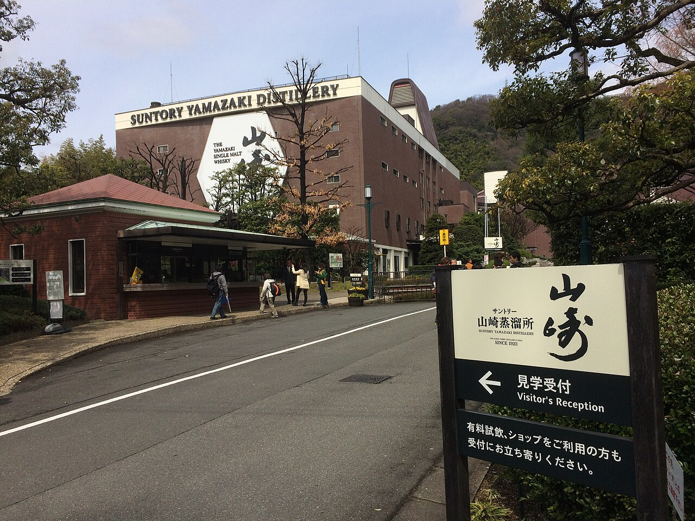

# 白州蒸馏所

白州蒸馏所在山梨县北杜市白州町，地址是鸟原 2913-1，背后就是南阿尔卑斯。三得利把它称作“森林中的蒸馏所”，这不是修辞：厂区被大片林地包围，参观动线会穿过树影、听到鸟叫，远处才是厂房。它建于 1973 年，是继山崎之后三得利的第二座麦芽[日本威士忌](ref:japanese-whisky)蒸馏所。与山崎的城市边缘位置不同，白州从一开始就把“自然环境”写进生产逻辑：水、空气、湿度与森林，都是酒体的一部分。

图：白州蒸馏所相关实景照片。图片：tetsuya yamamoto，CC0，via Wikimedia Commons（[原图页面](https://commons.wikimedia.org/wiki/File:Hakushu_Distillery_-_32128449586.jpg)）。

## 森林里的蒸馏所

白州的核心概念是“森林公园工厂”。厂区内设有鸟类保护区，建筑高度受控，尽量不切断山脊线；参观时先看到的是树与草坡，然后才是发酵与蒸馏车间。这种布局不只是景观设计，它直接影响生产：森林调节温度与湿度，仓库陈酿的环境更稳定；厂区周边的软水经过花岗岩层长期过滤，矿物质含量低，适合做清爽、干净的新酒。官方把白州的风味描述为“轻快、舒适”，这与其说是营销词，不如说是水源、发酵与蒸馏共同决定的结果。对来访者来说，先走一段林间路再进厂房，比直接下车进大厅更容易理解“森林”与“酒”的关系。

## 1973 年：三得利的第二座麦芽酒厂

三得利在 1923 年建成山崎蒸馏所，把日本威士忌从零做起；五十年后，白州在 1973 年投产，承担的是另一种任务：不是复制山崎，而是用不同的水、不同的环境与不同的设备，做出另一套原酒。今天日本威士忌的标识标准由日本洋酒酒造组合制定，对原料、糖化、蒸馏、陈酿地点与最低陈年时间都有要求；白州作为日本国内生产的麦芽威士忌，必须在这套框架内标注。理解这一点，就能明白为什么白州与山崎共享母公司，却在风味上刻意拉开距离：它们不是同一条生产线的两个标签，而是两座各自完整的酒厂。想比较两者，可以先读[山崎蒸馏所](ref:yamazaki)的条目，再看[山崎 12 年](ref:yamazaki-12)与白州 12 年的差别。

## 水、木槽与形状不同的蒸馏器

白州的工艺有几个容易被记住的关键词。第一是水：南阿尔卑斯的天然水经过花岗岩层约二十年的过滤，属于软水，适合长时间发酵与干净的新酒。第二是发酵：厂内使用木桶发酵槽，木材的保温与透气性与不锈钢槽不同，发酵过程中产生的香气更复杂。第三是蒸馏器：白州不是只有一种形状的蒸馏器，而是同时使用不同颈长、不同莱恩臂角度的壶式蒸馏器，让同一批麦芽产生轻重不同的原酒。第四是桶：波本桶、雪莉桶、水楢桶与其他类型并存，仓库里不同桶型分别陈酿，最后再由调酒师组合。参观时如果只记住“森林”两个字，会错过真正的技术细节：白州的清爽不是自然赐予的，而是用多套设备刻意做出的原酒多样性。

## 白州酒款怎么读

白州 12 年是核心款，带青苹果、薄荷、淡淡烟熏与矿物感，酒体不重，尾韵干净；Distiller's Reserve 更年轻、更易饮，适合 Highball；18 年与 25 年更圆熟，香气从青绿转向干果、蜂蜜与香料。白州也有轻度泥煤的版本，烟熏不似艾雷岛那样压过一切，而是与森林系的清新感并存。读酒单时可以按“年轻—核心—高年份”三层来喝：先用 Distiller's Reserve 建立白州的清爽基调，再用 12 年看结构与烟熏，最后才进入 18 年以上的复杂度。不要把“日本威士忌”当成一种统一风格；[日本](ref:japan)的麦芽酒厂之间，差异不比苏格兰产区之间小。白州所在的山梨县也常被当作葡萄酒产区，但[山梨](ref:yamanashi)的威士忌故事是另一条线，值得单独理解。

## 预约与参观规则

白州实行预约制，免费导览与收费的“ものづくりツアー”都要在官网预约。免费导览最晚在参观日前一天中午截止；收费团最晚在三天前中午截止，部分时段采用抽选。参观当天要提前到，入口处会核对预约与年龄。开放时间为 9:30 至 16:30，最后入场 16:00；年末年初与工厂休业日闭馆，临时休业会提前在官网公告。未成年人不能单独入场；开车、骑摩托或骑车来的人不能饮酒，同行者中的驾驶者同样受此限制。厂区内禁止携带外食，宠物不得入内（辅助犬除外）。这些规则看似琐碎，但白州是正在运转的食品工厂，遵守规则本身就是参观的一部分。

## 交通、季节与饮酒安全

从东京方向来，通常乘 JR 中央本线到小渊泽站，出站后在站前转乘三得利的免费接驳巴士，约 20 分钟到蒸馏所；巴士按先到先得，满员时可能上不去，返程也要预留时间。自驾从中央自动车道小渊泽 IC 或须玉 IC 下高速，停车场约可停 150 辆乘用车。春季新绿与秋季红叶是最好看的季节，也最拥挤；冬季山路可能结冰，出发前查天气与道路信息。参观结束后如果要开车，就不要参加含酒精的品鉴；日本对酒驾的处罚很严，不要抱侥幸心理。蒸馏所没有公布可供引用的精确坐标，导航请以官方渠道与 Google Map 链接为准。把白州与山崎排在同一天并不现实，两地之间需要跨过山梨与大阪之间的长距离，分两天更稳妥。

对照阅读：[日本](ref:japan)、[日本威士忌](ref:japanese-whisky)。

相关条目：[山梨](ref:yamanashi)。

**关键事实。**

| 项目 | 内容 |
| --- | --- |
| 一句话定位 | 三得利 1973 年在山梨县北杜市白州町建成的麦芽威士忌蒸馏所，位于南阿尔卑斯山脚，以森林环境、花岗岩过滤的软水与多形状蒸馏器著称；参观须提前预约，设有免费导览与收费的“ものづくり”团 |
| 地址 | 2913-1 Hakushu, Hokuto, Yamanashi 408-0316, Japan |
| 城市/国家 | 北杜市 / 日本 |
| 营业状态 | 已核验营业 |
| 官网 | suntory.co.jp |

**来源与边界。** 本页关于「白州蒸馏所」的关键事实，主要由以下来源交叉核对：Suntory Spirits Limited（地址、营业时间、最后入场时间、休业日与参观预约入口；南阿尔卑斯天然水、森林公园工厂、鸟类保护区、木桶发酵槽与多形状蒸馏器）。产品、地址或营业状态变化较快时，以 suntory.co.jp 的最新页面为准；价格、批次与状态会变，涉及这些字段时以页面所列来源的最新版本为准。正文为项目自写，来源只作核验，不复制原文。

## 相关图像

图：山崎蒸馏所。图片：Ujigis，CC BY-SA 4.0，via Wikimedia Commons（[原图页面](https://commons.wikimedia.org/wiki/File:YamazakiDistillery_01.jpg)）。关联图像：白州蒸馏所。
