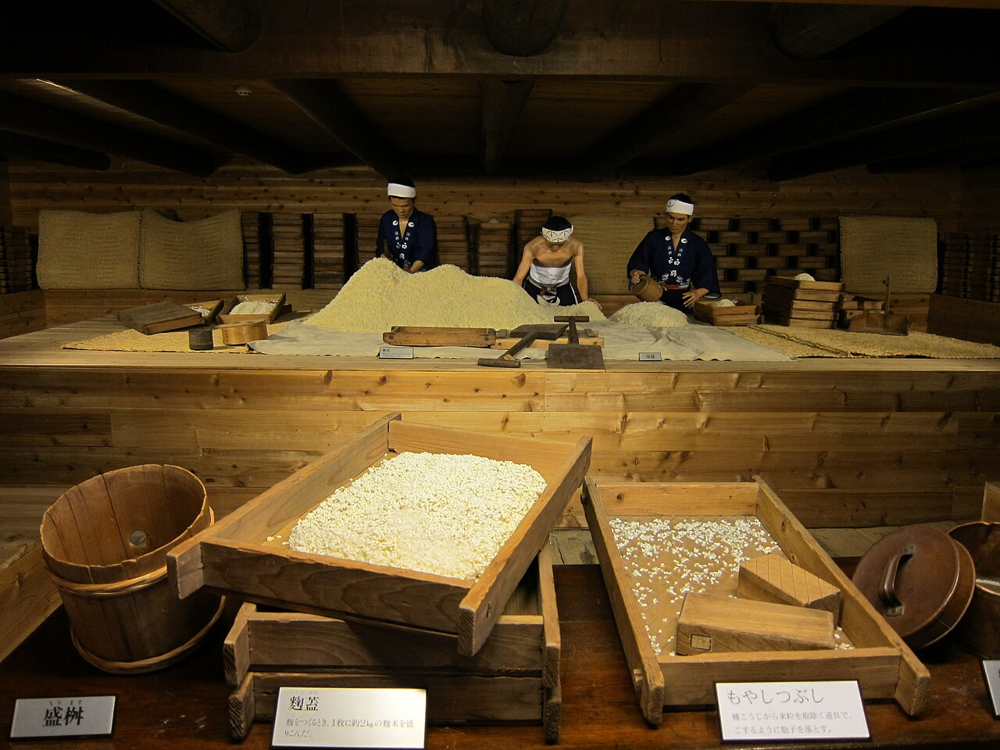

# 白鹤酒造资料馆

从阪神住吉站出来，沿住宅区走五分钟，会看到一栋深色木墙、白灰泥腰线、传统瓦顶的长屋式酒藏。它不像“企业博物馆”那样有玻璃幕墙与导览大厅，而是把一栋真正运作过的酒藏原样留下来：木梁、灰泥、桶架、曲室与蒸米场都还在，只是工人换成了等身大人偶。

图：白鹤酒造资料馆内的酿造工具展陈：木制酒槽、酒器与手工工具。图片：hslo，CC BY-SA 2.0，via Wikimedia Commons（[原图页面](https://commons.wikimedia.org/wiki/File:A_Hakutsuru_Sake_Brewery_Museum_exhibit.jpg)）。

## 1982 年：白鹤酒造资料馆的关键起点
白鹤酒造的资料馆开在“本店一号藏”。官方“关于”页写得很具体：这栋酒藏建于大正初期，一直作为本店一号藏运作到 1969 年（昭和 44 年）3 月；之后按原样改为资料馆，并于 1982 年（昭和 57 年）开馆。它的建筑面积 1,098.95 平方米（332.43 坪），延床面积 1,951.13 平方米（590.21 坪）；作为酒藏的生产能力是原酒 900 千升，按 1.8 升瓶换算约 60 万瓶。

白鹤酒造本身创业于 1743 年（寛保三年），是滩五乡御影乡的代表性酒厂之一。资料馆不是“把公司历史做成展板”，而是把一栋停用的酒藏连工具一起保留下来；1995 年阪神淡路大地震中，资料馆与木造酒藏受损，1997 年复原开馆。今天看到的建筑与器具，既有大正初期的原构，也有震后修复的痕迹。

## 建筑与空间

这是一栋“长屋式”酒藏：正面很长，屋顶平缓，白灰泥与深色木板形成水平条纹，屋顶中央有一个小小的换气塔。它的空间逻辑是“总有一件事在做”：一侧是蒸米与冷却，一侧是曲室，中央是巨大的木桶与压榨区，尽头是储藏与搬运。资料馆没有把墙打通做成白盒子，而是保留原来的柱网、梁架与地面，让参观者走在酒藏原本的动线上。

一层最醒目的是巨大的杉木发酵桶，桶壁由一块块木板箍成，直径接近人身高；旁边是压榨槽、滤布、酒器与量具。二层把冷却装置、曲室、蒸米场与各阶段工具按工序排开，等身大人偶在蒸米、翻曲、搅桶、压榨，动作被固定在某个瞬间。屋顶的梁架裸露，光线从高窗与天窗落下来，木头的颜色从深褐到浅黄，整个空间有一种“仓库的安静”，而不是“展厅的明亮”。

## 展线与馆藏

官方英文页把展线分成两层：一层展示各种酒造器具，包括曾经用于发酵的巨大杉木桶；试饮区可以喝到刚压榨、未经加热杀菌的生酒，这在别处不容易遇到；商店卖白鹤酒与原创博物馆商品，清酒果冻很受欢迎。二层把清酒制造的各个阶段详细拆开，展示冷却装置、曲室与多种设备，用实物与影像解释传统方法；旧酒藏本身成为展场，因此“早期酒造”的氛围非常真实。

兵库县观光网站给出更具体的数字：馆内一、二层合计约 500 件酒造工具，配合藏人等身大人偶，按工序展示；另有约 15 分钟影像介绍白鹤酒造历史，再用约 20 分钟看展线，合计约 35 分钟。实际参观可以留 45–60 分钟，试饮与商店会再多一点。重点不是“看完所有物件”，而是理解一条链：米→蒸→曲→酒母→仕込→压榨→储藏。

## 怎么参观

开馆时间 9:30–16:30，16:00 停止入馆；免费。10 人以上团体需提前预约，散客自由参观。休馆日为年末年初与盂兰盆（夏期休馆），另有维护临时休馆；出发前看官网或打电话确认。馆内是自由参观，没有固定讲解场次；团队可以预约导览，散客按标识走。

建议先看一层的巨大木桶与试饮区，再上二层按工序看工具，最后回一层试饮与商店。试饮通常提供少量清酒，空腹时先吃点东西；司机与未成年人不饮酒。馆内可以拍照，但不要用闪光灯、不要触摸展品、不要跨过护栏；木桶与工具是实物，不是复制品。商店的“藏酒”与果冻是常见伴手礼，带酒上飞机要遵守托运规定。

## 白鹤酒造资料馆的地址与营业安排
- 地址：〒658-0041 神戸市東灘区住吉南町4-5-5。
- 坐标：34.7101952, 135.2616997。
- 电话：078-822-8907；传真 078-822-4891。
- 开馆：9:30–16:30（16:00 停止入馆）；年末年初与盂兰盆休馆，另有维护临时休馆。
- 门票：免费。
- 预约：10 人以上团体需提前预约；散客自由参观。
- 交通：阪神住吉站步行约 5 分钟；JR 住吉站步行约 15 分钟；阪急御影站开车约 10 分钟。
- 时间：展线约 35 分钟；含试饮与商店约 45–60 分钟。
- 停车：有停车场（以现场为准）；大型巴士需提前确认。
- 无障碍：馆内有楼梯与旧式门槛，轮椅通行需提前电话确认。

## 礼仪与常见误区

第一，不要把这里与 [菊正宗酒造纪念馆](ref:kiku) 混为一谈。两者都在神户东滩，但白鹤看“原样酒藏与 500 件工具”，菊正宗看“震后重建的纪念馆与酒母/滩酒体系”。第二，不要把“白鹤”与“白鹿”（Hakushika）混淆；白鹿在西北宫，是另一家公司。第三，不要以为免费就可以随便触摸；木桶、曲室与工具都是实物，触摸会加速损坏。第四，不要在试饮区“干杯”；试饮是小杯、少量、品味，不是喝酒比赛。第五，不要带饮料食物进展厅，也不要在馆内大声讲电话。第六，不要把“盂兰盆休馆”当成只休一天；日本夏期休馆可能连续数日，出发前查官网。

## 从白鹤酒造资料馆延伸到菊正宗酒造纪念馆
从资料馆出来，可以走到鱼崎的 [菊正宗酒造纪念馆](ref:kiku)，看另一套“酒母与工具”的叙事；再往西到西宫的 [Hakushika 酒博物馆](ref:hakushika)，或到京都伏见的 [Gekkeikan Okura 酒博物馆](ref:gekkeikan)。如果走“滩五乡”长线，可以把御影、住吉、鱼崎、西宫串起来；更远可到酒田的 [Kamotsuru](ref:kamotsuru)。按 [日本酒藏路线](ref:route) 的框架，这一站最适合与菊正宗组成“半天双馆”。

神户东滩区用阪神线最方便：阪神住吉站到鱼崎站只有两站，走路也不远。资料馆与菊正宗之间约 20–30 分钟步行，沿途是住吉川与住宅区；夏天注意补水，冬天海风冷。若只够看一个馆，想看得更“原真”选白鹤，想看得更“体系化”选菊正宗。

## 参考资料
- 官方英文馆页：<https://www.hakutsuru.co.jp/english/culture/museum.html>，用于核对旧酒藏原样开放、两层展线、试饮、开馆时间、免费与预约规则。
- 官方“关于”页：<https://www.hakutsuru.co.jp/community/shiryo/about/>，用于核对大正初期建造、1969 年 3 月停用、建筑与产能数据、等身大人偶与原样保存。
- 公司年表：<https://www.hakutsuru.co.jp/community/history/>，用于核对 1982 年开馆、1995 年地震受损、1997 年复原开馆与 1743 年创业。
- 兵库县观光网站：<https://www.hyogo-tourism.jp/spot/result/87?0=9>，用于核对约 500 件展示、35 分钟展线、盂兰盆/年末年初休馆、停车场与交通。
- 清酒路线对照：[菊正宗酒造纪念馆](ref:kiku)、[Hakushika 酒博物馆](ref:hakushika)、[Gekkeikan Okura 酒博物馆](ref:gekkeikan)、[Kamotsuru](ref:kamotsuru)、[日本酒藏路线](ref:route)。

对照阅读：[菊正宗酒造纪念馆](ref:kiku)、[月桂冠大仓纪念馆](ref:gekkeikan)。
