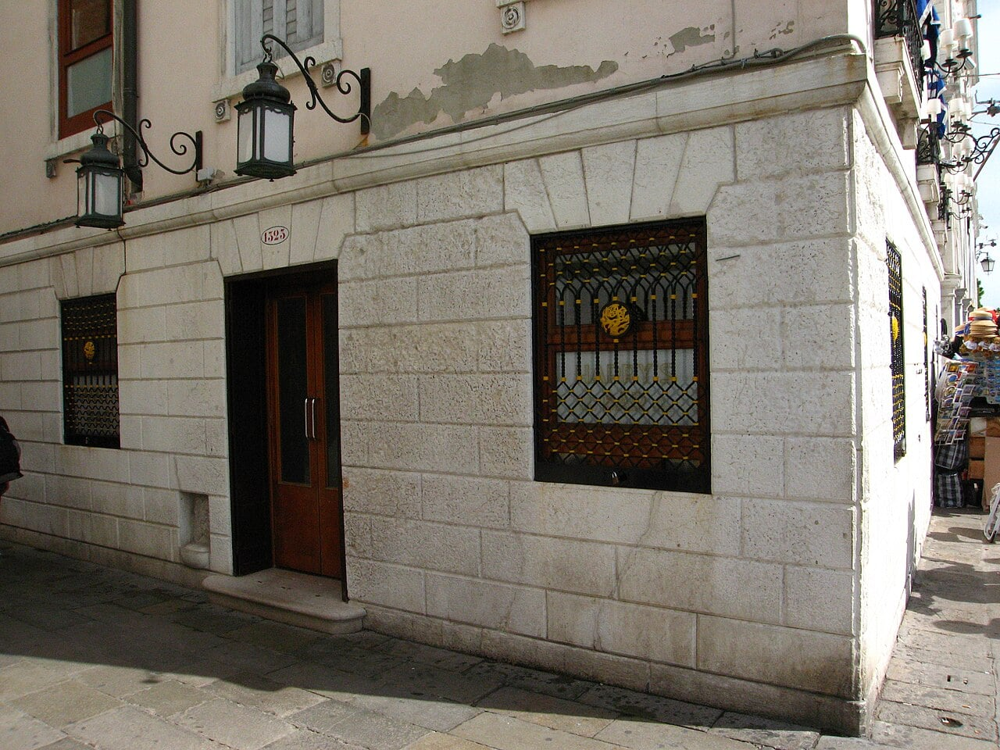
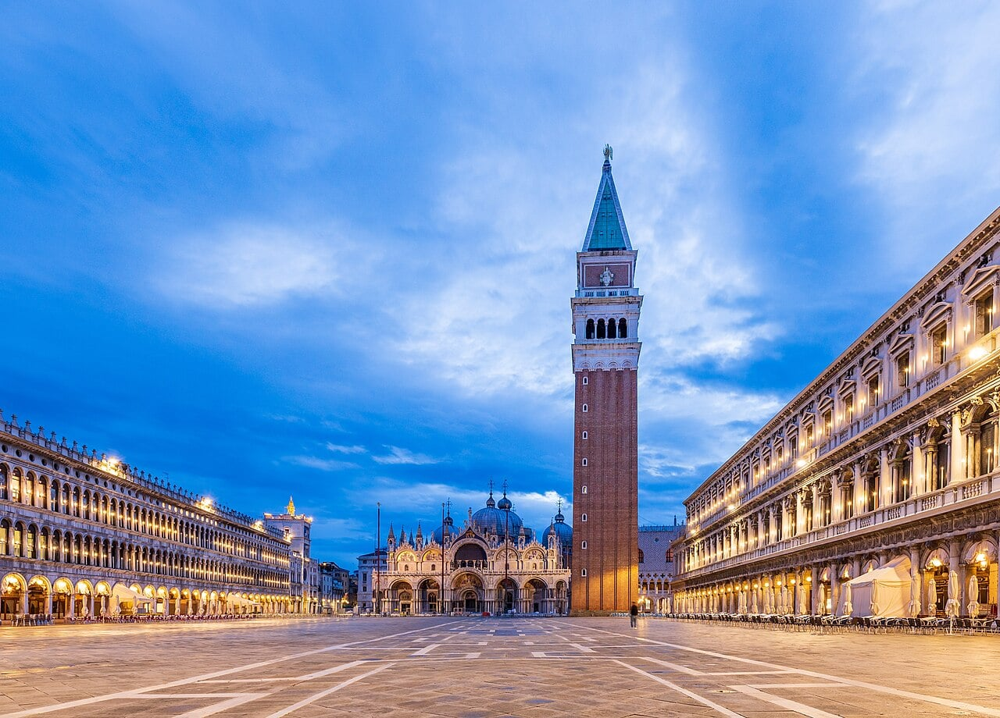

# 哈里酒吧（威尼斯）

图：哈里酒吧在 Calle Vallaresso 的入口，门楣上方标着门牌 1323。图片：Felix Haslimeier，CC BY-SA 2.0，via [原图页面](https://commons.wikimedia.org/wiki/File:Italy_-_Venice,_Harry%27s_Bar,_San_Marco.jpg)。

## 1931 年：哈里酒吧（威尼斯）的关键起点
哈里酒吧在 Calle Vallaresso 1323，从圣马可广场穿过拱廊与几条小巷，步行几分钟就到。它于 1931 年 5 月 13 日由朱塞佩·奇普里亚尼（Giuseppe Cipriani）开设。品牌自己的叙述里，店名来自一位美国青年 Harry Pickering：奇普里亚尼在威尼斯欧罗巴酒店当酒保时接济过他，后来这位客人还钱，并出资帮他开了店。"Harry's Bar"因此是客人的名字，不是老板的名字，也不是某位美国作家的产业。

酒吧的两次"发明"决定了它的菜单结构。1948 年，奇普里亚尼把白桃泥与普罗塞克（Prosecco）调在一起，以威尼斯画家乔瓦尼·贝里尼（Giovanni Bellini）命名，据说颜色让他想到画中人物的衣袍；这杯酒就是贝里尼。1950 年，常客阿玛利亚·纳尼·莫切尼戈伯爵夫人（Amalia Nani Mocenigo）因医嘱只能吃未烹煮的肉，厨房把生牛肉切成纸一样薄的片，配上浅色酱汁，并以威尼斯画家卡尔帕乔（Vittore Carpaccio）命名。今天"Carpaccio"已经是一个通用菜名，但这里的版本仍被当作原型。

海明威在 20 世纪 40 年代末至 50 年代常到威尼斯，哈里酒吧与他的名字在后来的写作与旅游叙事里被反复绑定。这类关联属于文化记忆，能解释这家店为什么出名，但不能当作"某张桌子属于某位作家"的证据。另一个常见混淆是：世界上不少叫 Harry's Bar 的店与威尼斯这家没有关系，招牌与配方在各地被大量模仿，认店要看地址与经营者，而不是名字。

## 空间与酒单

店面不大，入口低调，没有夸张的霓虹招牌。进门后是紧凑的吧台与餐桌，座位之间距离近，说话音量自然被压低。服务生着装正式，服务节奏偏快，整间店更像"高级小餐馆 + 酒吧"的合体，而不是可以大声聊天、久坐不走的夜店。

酒单的核心是贝里尼：白桃泥加普罗塞克，比例让酒体偏轻，甜度来自桃子而不是糖浆。以同一套逻辑延伸出的 Rossini（草莓版本）也是常见选择。除此之外，店里做经典鸡尾酒与餐前酒，具体酒单随季节与供应变化。食物方面，生牛肉薄片是招牌前菜，配浅色酱汁与芝士；正餐有意大利面、鱼类与威尼斯菜式，但多数第一次来的客人只需要一杯酒加一道前菜。

价格属于威尼斯最高的那一档。贝里尼的单杯价格常被游客拿来讨论，但更值得注意的是一整套费用结构：酒、餐、服务与座位位置共同决定账单。菜单不标价的部分要问清楚，尤其是只坐一会儿、只点一杯的情况。

## 第一次去怎么点

进门先说明意图：只喝一杯，还是要用餐。只喝一杯通常安排在吧台或小桌，点贝里尼最直接；想配点东西，就加一份生牛肉薄片，两个人分食刚好。想坐久一点，点一杯经典鸡尾酒或餐前酒，再慢慢看菜单，不要用一杯酒占住正餐桌。

第一次来不必追求"最贵"或"最像电影"的组合。贝里尼加薄片已经能说明这家店的两条招牌线索；如果只想感受空间，选上午或下午较空的时段，比晚餐高峰更容易从容。白桃有季节，非产季时的风味会与盛夏不同，这一点在官方叙述里也承认，不必把每一杯都当成同一个标准。

着装不必正装，但短裤、拖鞋、湿透的沙滩装不合适。这里不是水上巴士码头，也不是可以随意拍照的景点；门口与吧台都窄，进门先让出通道，是基本的城市礼貌。

## 哈里酒吧（威尼斯）的地址与营业安排
**地址**：Calle Vallaresso 1323, 30124 Venezia, Italy（官方写法为 San Marco 1323）；从圣马可广场穿过拱廊与小巷步行约 2–3 分钟。

**交通**：威尼斯没有汽车；水上巴士（Actv）1 号线与 2 号线在 San Marco Vallaresso 站停靠，下船步行约 1–2 分钟，比从罗马广场过来近得多。导航到"Harry's Bar"时注意核对街名与门牌，模仿同名店在旅游区并不少见。

**营业时间**：官网写明每日 11:00–23:00，页面核验日期 2026-11-08。节庆与季节性安排可能调整，以官方渠道当日信息为准。

**门票与预约**：不收门票，按点单付费。旺季与晚餐时段建议提前通过官方渠道（电话 +39 041 52 85 777）确认订位；散客在非正餐时段通常可以直接进店询问。

**价格与着装**：价格带为威尼斯最高一档，酒水与餐食分开计价，只喝一杯的预算也要按"高端酒吧"来准备。着装以"整洁、安静、不穿 beachwear"为准，没有强制外套。

「哈里酒吧（威尼斯）」的开放时间、价格与预约，以[官网](https://www.cipriani.com/harrys-bar)的公开页面为准；核验日期为 2026-11-08，临时调整以官网当日公告为准。

## 礼仪与常见误区

第一，贝里尼不是"桃子味香槟"。它用普罗塞克而不是香槟，用桃泥而不是桃汁或糖浆，口感更柔、气泡更细。第二，生牛肉薄片不是"生肉刺身"：它是薄切生牛肉配酱汁与前菜吃法，点单时不要要求"厚切"或"煎一下"。第三，不要把这杯酒当成"海明威同款"来打卡；海明威与此地的关系是历史叙事，不是菜单条目。

常见误区还包括：把这里当成可以大声聚会的酒吧；把服务生的正式当成冷漠；把小费直接留在桌上走人。意大利的小费不强制，结账时报一个含小费的总额，或刷卡时说明，都比留现金在桌上自然。若只想拍照，最好先消费再拍，且不要挡住吧台与门口。

不适合来这里的情况也很具体：带小孩的家庭、想点便宜大杯啤酒的团体、想坐着工作两小时的人，都会觉得不自在。它的空间与服务是为"短时间、精致地喝一杯"设计的。

## 从哈里酒吧（威尼斯）延伸到花神咖啡馆（威尼斯）
出门往广场方向走几分钟，就是圣马可大教堂、钟楼与总督宫；往另一侧走，可到凤凰剧院（Teatro La Fenice）一带。把它们串起来，最自然的是先到广场拱廊下的[花神咖啡馆（威尼斯）](ref:florian)坐一会儿，再走回 Calle Vallaresso 喝贝里尼；这条路线已整理为[威尼斯圣马可广场两站酒吧路线](ref:venice-route)。

如果时间只够一站，建议把哈里酒吧放在傍晚：广场人潮开始散去，酒吧进入晚间节奏，喝完还能沿运河走一段。圣马可一带在涨潮与游轮到达时段非常拥挤，出发前看当天水位与船期，比硬挤在巷子里更有效。

## 同城酒馆与延伸阅读
- [酒吧与城市](ref:pub-and-city)：bar 与咖啡馆、pub、beer hall 的空间差别，以及"座位卖时间"的逻辑。
- [花神咖啡馆（威尼斯）](ref:florian)：同一街区的 18 世纪咖啡馆，适合与这家 20 世纪酒吧对照。
- [威尼斯圣马可广场两站酒吧路线](ref:venice-route)：步行串联两店的短路线。

相关条目：[认识一座城，从一间酒馆开始](ref:pub-and-city)、[花神咖啡馆（威尼斯）](ref:florian)、[威尼斯圣马可广场两站酒吧路线](ref:venice-route)。

## 相关图像

图：傍晚的威尼斯圣马可广场，钟楼与行政官邸大楼围出路线所在的广场空间。。图片：Matthias Süßen，CC BY-SA 4.0，via Wikimedia Commons（[原图页面](https://commons.wikimedia.org/wiki/File:Piazza_San_Marco_(Venice)_at_night-msu-2021-6449-.jpg)）。关联图像：哈里酒吧（威尼斯）。
