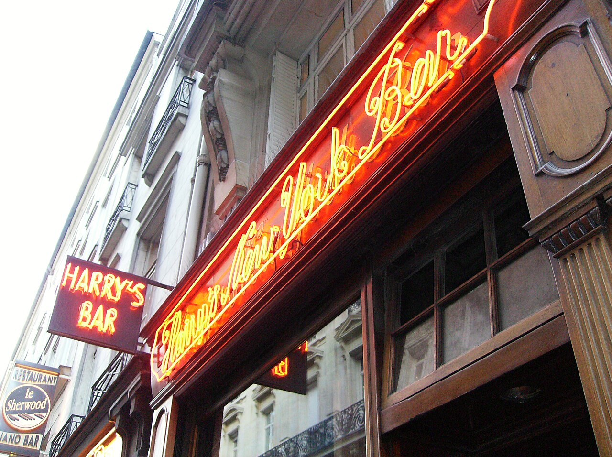

# 哈利纽约酒吧

图：哈利纽约酒吧。图片：Drhaggis，CC BY-SA 4.0，via Wikimedia Commons（[原图页面](https://commons.wikimedia.org/wiki/File:HarrysNewYorkBar_Neon.JPG)）。

## 为什么是这家

哈利纽约酒吧在巴黎第二区 5 Rue Daunou，离巴黎歌剧院只有几分钟步行。它不是一个靠“复古装修”搭出来的美式酒吧，而是真的把纽约的酒吧拆下来搬到巴黎：1911 年 11 月 26 日，美国骑师 Tod Sloan 把曼哈顿第七大道一间酒吧的木料、吧台与镜子运到巴黎重新组装，请来当时有名的调酒师 Harry MacElhone 打理，后来 MacElhone 接手，店名也渐渐变成 Harry's New York Bar。今天它仍是巴黎少数能把“美式鸡尾酒”“失落的 generation”“楼下钢琴”和“百年争议配方”放在同一个房间里的地方。

它的吸引力不在于安静。这里游客多、声音大、桌子挤，服务节奏快；但如果你对鸡尾酒史有兴趣，吧台本身就是一份活的档案：Bloody Mary、Sidecar、French 75、White Lady 这些名字都与这里发生过关系，尽管“发明权”往往不止一家在争。把它当作一间仍在营业的经典酒吧，而不是一间只供参观的纪念馆，体验会好得多。

## 时间线：1911 年与两个“Harry”

官方页面把开业日定在 1911 年 11 月 26 日，也就是美国的感恩节。这个日期对一间“纽约酒吧”来说很合适，也常被店方当作故事的一部分。需要纠正一个常见简化：1911 年开店的人是 Tod Sloan，Harry MacElhone 是他请来经营的吧台主管，后来才接手并把店做成自己的名字。把“1911 年由 Harry MacElhone 开设”当作精确事实并不准确，更稳妥的说法是“1911 年开业，MacElhone 随后接手并塑造了它的性格”。

MacElhone 是苏格兰人，先在伦敦与巴黎的酒吧工作，一战后回到巴黎，1920 年代成为这间店的老板。他赶上了美国禁酒令时期大批美国人涌向巴黎的年代：记者、作家、音乐家、富家子弟与政治流亡者都需要一个能喝到像样鸡尾酒的地方。Harry's 因此不只是酒吧，也是美国侨民在巴黎的社交据点。关于海明威、菲茨杰拉德、格什温的到访与轶事很多，有些有据，有些被反复转述后变得夸张；把它们当作“这间店的氛围证据”可以，当作逐字记录则不必。

## 鸡尾酒：Bloody Mary、Sidecar 与起源争议

店方把 Bloody Mary、Sidecar、Blue Lagoon、White Lady 等列为自家创造，这个说法在鸡尾酒史里影响很大。比较常见的版本是：1920 年代，调酒师 Fernand “Pete” Petiot 在巴黎 Harry's 工作期间调制出番茄汁与伏特加的雏形，后来他到纽约 St. Regis 酒店的 King Cole Bar，把配方继续发展；另一边，纽约的 21 Club 等也有自己的早期说法。Sidecar 的归属同样分散：巴黎 Harry's、伦敦 Buck's Club 与巴黎 Ritz 都常被点名。也就是说，“起源地”不是一个可以一锤定音的问题，而是一组互相竞争的地方叙事。

点酒时不必纠结谁先发明。想喝经典，可以从 Bloody Mary、Sidecar、French 75 或 Dry Martini 入手；想喝威士忌，这里的存酒是另一条主线，官方说酒单有 350 多款威士忌，也有与苏格兰酒厂合作的自家装瓶。鸡尾酒单很长，官方称有 400 多款；如果不知道选什么，告诉调酒师你偏好的基酒、酸度与甜度，比背酒名更有效。价格以官方菜单为准，经典款通常不便宜，但分量与做法是传统路线。

## 空间与音乐

一楼是主吧台，木色深、光线低，墙上挂着各校旗帜与老照片；楼下是钢琴酒吧，空间更紧凑，晚上有现场钢琴与演唱。官方页面把现场音乐标在 22:00 之后，实际演出安排会变，去之前查一下。钢琴声一起，一楼与楼下的气氛就分开了：想聊天坐一楼，想听歌往下走。店里的“Sank Roo Doe Noo”是最有名的招牌语，它其实是 “Cinq, Rue Daunou”（5 号，rue Daunou）用法语念给美国客人听之后的谐音，后来被印在镜子与周边上；伊恩·弗莱明也在邦德小说里用过这个梗。

空间不大，吧台前的位置最抢手。高峰时不要长时间占着吧台拍照，也不要把大衣和包堆在邻座；服务生会来回穿行，留出通道比“占一个完美角度”更重要。楼下钢琴表演时，说话音量自然会降下来；如果只想喝酒不想听歌，提前问清当晚是否有演出。

## 实用信息

地址是 5 Rue Daunou, 75002 Paris, France，最近的地铁站是 Opéra（3、7、8 号线），出站步行约 2 分钟；RER A 的 Auber 站也在附近。周边是歌剧院、老佛爷百货与旺多姆广场，步行可达，但街道窄、停车困难，不建议开车。官方页面列出的营业时间是周一至周六 12:00–次日 02:00，周日 17:00–次日 01:00，现场音乐从 22:00 开始；节假日与私人活动会调整，出发前请查官网。

这里不收门票，按酒单消费；高峰时段可能需要等位，尤其是周末晚上与演出后。是否接受预订、是否有最低消费，按当日安排与官方渠道为准。着装以 smart casual 最稳妥：不必西装领带，但拖鞋、背心与运动短裤不合适。酒吧门口没有宽敞等候区，雨天排队会不舒服；行动不便者应先电话确认入口与楼梯动线。页面核验日期 2026-11-08。

## 吧台规矩与辨认方法

最常见的误解是把巴黎的 Harry's New York Bar 与威尼斯的 Harry's Bar 混为一谈。两家都以“Harry”为名，但威尼斯那家由 Giuseppe Cipriani 创立，以贝里尼与生牛肉薄片闻名，与巴黎这家没有隶属关系。第二个误解是把所有经典鸡尾酒都说成“在这里发明、且没有争议”；更准确的说法是“店方与流行叙事把这里列为起源地之一”。第三个误解是把“1911 年”直接等同于 MacElhone 开店；实际是先由 Tod Sloan 开设，MacElhone 后来接手。第四个误解是以为这里只有游客；它确实游客多，但吧台传统与威士忌收藏仍吸引认真的喝酒人。

点单时先想好基酒与口味，不要在忙时让调酒师即兴创作十杯不同的酒；经典鸡尾酒按传统配方做，想少糖、少冰或换基酒可以提出，但要接受“改过就不是原版”。法国酒吧账单通常已含服务费，额外小费不是必须；如果坐在吧台且服务周到，留下几欧零钱即可。拍照可以，但别用闪光灯直打调酒师与邻桌；钢琴演奏时不要站在通道中间录像。

周边可以顺路看巴黎歌剧院、老佛爷百货的穹顶、旺多姆广场与杜乐丽花园；再走远一点是卢浮宫。若想把鸡尾酒吧放回城市夜生活的脉络，读[酒吧之外](ref:beyond-the-pub)与[酒吧与城市](ref:pub-and-city)；若对店里的威士忌收藏有兴趣，读[威士忌](ref:whisky)；若关心法国饮酒文化，读[法国](ref:france)。把 Harry's 安排在晚饭后、演出前，比当作全天候景点更合适。

补充阅读：[A Ginjinha](ref:c-extra-1)。

相关条目：[威士忌](ref:whisky)、[走出酒馆：把一杯酒追到产地](ref:beyond-the-pub)、[法国](ref:france)。
