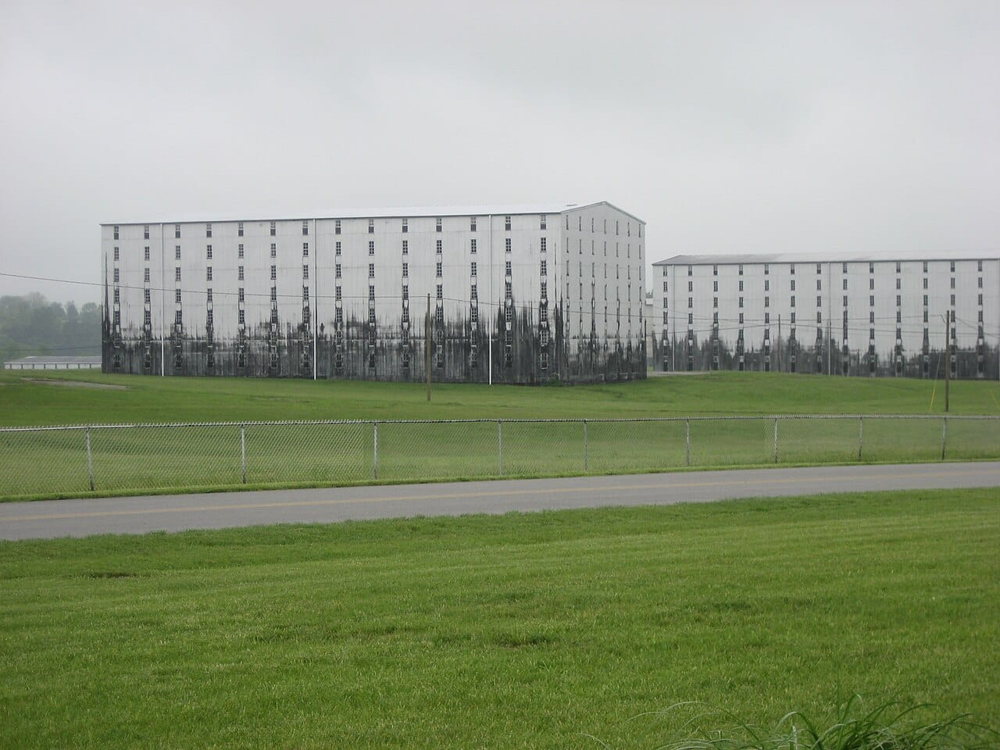
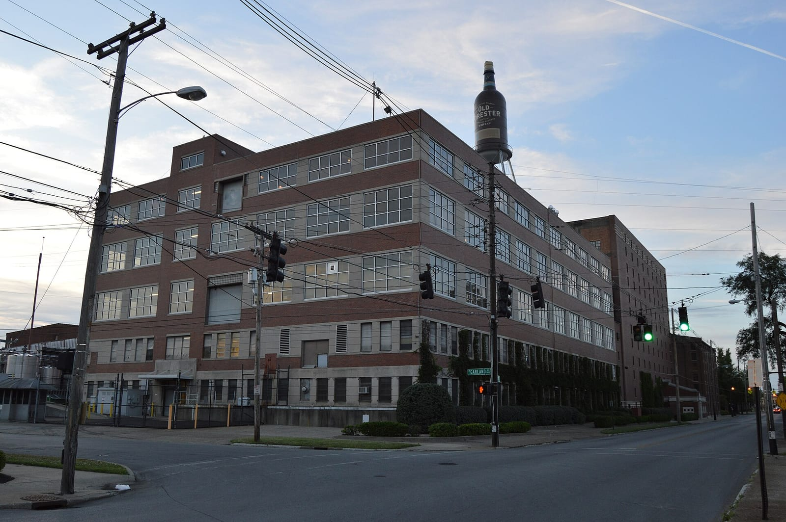

# 天堂山酒厂

巴兹敦（Bardstown）Gilkey Run 路 1311 号是天堂山（Heaven Hill）的游客中心 Heaven Hill Bourbon Experience，不是蒸馏车间。所有导览从这里集合，再乘接驳车去两英里外的 Springs 新厂；访客不能自行进入生产区。把“体验中心”与“生产厂”分开，是安排参观时最重要的信息。天堂山是美国最大的家族经营蒸馏厂之一，1935 年由 Shapira 五兄弟与巴兹敦本地投资人创立，至今仍由家族掌控。

图：天堂山酒厂。摄影：Heaven Hill distillery, Bardstown, Kentucky。署名：Shadle，CC BY-SA 3.0，来自 Wikimedia Commons（[来源](https://commons.wikimedia.org/w/index.php?curid=4136725)）。

## 1935：五兄弟与十二名员工

1935 年，David、Ed、Gary、George 与 Mose Shapira 五兄弟联合本地投资人，在巴兹敦创办 Old Heavenhill Springs 蒸馏厂，最初只有 12 名员工。酒厂从一开始就走“多品牌、多配方”的路线：既有黑麦波本，也有小麦波本、玉米威士忌与黑麦威士忌。这种结构后来变成天堂山的优势——它不依赖单一品牌，也能在同一套仓库与装瓶体系里管理不同风格。家族所有权延续至今，官方把“独立”与“长期库存”当作核心叙事，而不是装饰性的家族故事。

理解这一点，对参观很有帮助。天堂山的展区不是围绕某一个创始人或某一款酒展开，而是围绕“配方”“仓库”“保税装瓶”这些生产概念展开；你会在同一条动线上看到黑麦、小麦与玉米三种路线，而不是被引导去记一个英雄故事。对刚接触波本的人来说，这种结构反而更容易建立坐标系。

## 1996：大火与没有中断的熟成

1996 年 11 月 7 日，一场大风推动的大火烧毁了 1935 年建成的原蒸馏厂与七座仓库，约 100,000 桶正在熟成的威士忌受损，没有人员死亡。酒厂随后把蒸馏转移到路易斯维尔的 Bernheim 酒厂，1999 年正式买下该厂；装瓶、熟成与部分办公功能留在巴兹敦。这段经历解释了今天参观的分工：你看到的“体验中心”承担展览、品鉴与集散，真正的蒸馏在别处。也正因为如此，天堂山把“回到巴兹敦”讲成一个完整的故事——2022 年在 61 英亩的新园区动工，2025 年 Springs 新厂投产。

## 从 Bourbon Experience 出发

体验中心在 2021 年完成扩建，外立面复刻 1935 年原厂的样子，内部有三间围绕巨型酒桶布置的品鉴室、放映 11 分钟短片的 1935 Distillery Theater，以及 Elijah Craig、Larceny 与 Bottled-in-Bond 三个自助展区。Five Brothers Bar & Kitchen 在二楼，可以点鸡尾酒与简餐，天气好时坐到露台能看到成排仓库。导览产品分几种：Magic of the Mashbill 是 45 分钟品鉴，用五款不同配方建立对照；Whiskey Connoisseur 同样 45 分钟，聚焦高端与限量酒；You Do Bourbon 约一小时，包含调配、装瓶、贴标与实验室体验；此外还有限时的 Deatsville 仓库深度行程。所有品鉴都要求达到法定饮酒年龄，预约时看清场次说明。

如果只想快速建立概念，选 Magic of the Mashbill 就够了：五杯酒对应五套配方，讲解会把“同一套法规下，配方如何改变风味”说清楚。想带走一瓶自己参与的酒，再考虑 You Do Bourbon；它的重点不是喝，而是装瓶、贴标与质量控制流程。自助展区不需要额外购票，适合在导览前后补看，尤其是 Bottled-in-Bond 展区，能把货架上那些“bonded”标签解释清楚。

## Springs：三层楼里的连续生产

Springs 的导览约 60 分钟，走三层楼。第一层看不锈钢糖化罐：玉米、黑麦、小麦与麦芽与肯塔基石灰岩水一起煮熟，加入酵母后进入发酵。与 Bernheim 使用干酵母不同，这里在现场扩培与调理活酵母，菌株是家族沿用多代、并在大火中保留下来的那一支。第二层是实验室与连续蒸馏器：一台 66 英寸的柱式蒸馏器每天产出约 500 桶新酒，未来计划增加到三台；酒液经过“try box”由蒸馏师取样，再进入装桶。第三层是品鉴室与商店，结束后接驳车送回体验中心。园区种了 500 棵白橡树与 32 英亩原生草花，参观路上会经过这些恢复中的生境。

## 酒款与 Bottled-in-Bond

天堂山的品牌跨度很大：Evan Williams 是销量主力，Elijah Craig 偏橡木与焦糖，Larceny 走小麦配方，Rittenhouse 与 Pikesville 是黑麦威士忌，Henry McKenna 与 Old Fitzgerald 常见于年份或单桶版本。它也是美国 Bottled-in-Bond 产品线最完整的酒厂之一。1897 年的《保税装瓶法》要求同一蒸馏季、同一酒厂、在保税仓库至少陈放四年、以 100 proof 装瓶，不得混入其他酒液；这套规则原本是为了保证质量与税收透明，今天则成为一类风格标签。

波本的基本法规仍然是：玉米至少 51%、新烧焦橡木桶、装瓶酒精度不低于 40%；标为“straight”的酒需至少两年陈酿。仓库里的[天使的分享](ref:angels-share)每年带走一部分酒液，也让同一批酒在不同楼层呈现不同强度；天堂山用多层仓库与不同配方来管理这种差异，而不是追求每一桶都完全一样。

## 到访提示与巴兹敦周边

地址是 1311 Gilkey Run Rd, Bardstown, KY 40004。从路易斯维尔出发约一小时，从法兰克福出发约一小时出头；巴兹敦镇上有餐馆与住宿，波本路线旺季要提前订。导览最好提前在官网预约，周末与秋季尤其紧张；到场先在一层大厅集合，穿舒适的鞋，仓库与生产区温差明显。开车的人不要参加含品鉴的场次，或把酒样交给同行者。往北半小时是[美格](ref:makers-mark)，往东北一小时左右是[水牛足迹](ref:buffalo-trace)，三家园区的风格与参观逻辑差别很大，适合分两天走。坐标 37.7933、-85.4657 取自公开地理条目，精确入口与接驳安排以官方渠道为准。想先补背景，可读[波本](ref:bourbon)、[肯塔基](ref:kentucky)与[美国](ref:usa)条目。

对照阅读：[波本威士忌](ref:bourbon)、[美国](ref:usa)。

**关键事实。**

| 项目 | 内容 |
| --- | --- |
| 一句话定位 | 美国肯塔基州巴兹敦的波本威士忌蒸馏厂，1935 年由 Shapira 五兄弟与当地投资人创立；1996 年大火后转往路易斯维尔蒸馏，2025 年以 Springs 新厂回到巴兹敦，参观从 Heaven Hill Bourbon Experience 集合出发 |
| 地址 | 1311 Gilkey Run Rd, Bardstown, KY 40004, USA |
| 城市/国家 | Bardstown / 美国 |
| 营业状态 | 已核验营业 |
| 官网 | heavenhilldistillery.com |

**来源与边界。** 本页关于「天堂山酒厂」的关键事实，主要由以下来源交叉核对：Heaven Hill Distillery（1311 Gilkey Run Rd 地址、所有导览从 Bourbon Experience 出发且不直接进入 Springs 蒸馏厂的说明；2022 年动工、61 英亩园区、500 棵白橡树、32 英亩原生草花、60 分钟三层楼导览、66 英寸连续蒸馏器、每日 500 桶、现场扩培酵母与接驳车安排）、Heaven Hill Brands（1935 年由五名 Shapira 兄弟与巴兹敦投资人创立、最初 12 名员工）、Barlist（坐标 37.7933076, -85.4657156（本文取四位小数）与 1311 Gilkey Run Rd 地址）等 12 条来源。产品、地址或营业状态变化较快时，以 heavenhilldistillery.com 的最新页面为准；价格、批次与状态会变，涉及这些字段时以页面所列来源的最新版本为准。正文为项目自写，来源只作核验，不复制原文。

## 相关图像

图：肯塔基州类别配图。图片：Nyttend，Public domain，via Wikimedia Commons（[原图页面](https://commons.wikimedia.org/wiki/File:Brown-Forman_warehouse_A_and_bottling_house.jpg)）。关联图像：天堂山酒厂。
