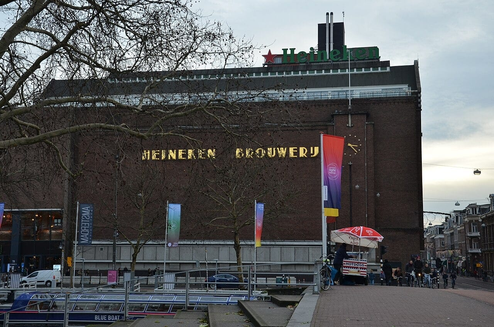
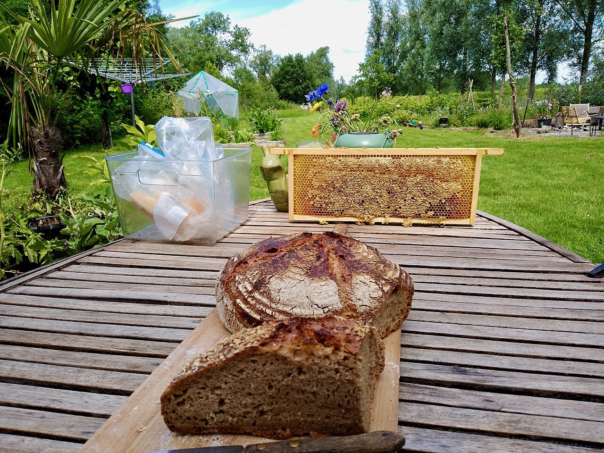

# 喜力体验馆：老啤酒厂的第二次生命

从阿姆斯特丹市中心往南，沿着 Singelgracht 运河走到 Stadhouderskade 78，会看到一排 19 世纪工业建筑，门口挂着喜力的绿色标志。这里不是一座仍在出酒的工厂，而是喜力最古老的啤酒厂在 1988 年停产后改造的体验馆。它把品牌史、酿造流程与品鉴打包成一条室内动线，适合想在城市里快速理解“荷兰拉格”与喜力这个品牌的游客，但它不能替代真正的生产参观。

> **到访信息**
> - 地址：Stadhouderskade 78, 1072 AE Amsterdam, Netherlands。
> - 开放与预约：以[官方页面](https://www.heinekenexperience.com/)为准；开放时间、场次和预约规则会随季节调整。
> - 交通与费用：出发前以官方页面为准，本页不承诺固定票价。
> - 营业状态：已核实；来源最近核对：2026-11-21。

图：阿姆斯特丹喜力体验馆的砖砌厂房立面，屋顶立着绿色 Heineken 标志。图片：Steven Lek，CC BY-SA 4.0，via [原图页面](https://commons.wikimedia.org/wiki/File:Heineken_Experience_Amsterdam_2018_3.jpg)。

## 运河边的旧厂区

建筑位于运河与街区交界处，体量不大，立面保留着旧厂房的砖墙、窗洞与屋顶轮廓。这样的厂址在 19 世纪的阿姆斯特丹很常见：靠近水道，便于运入大麦、运出成品，也方便工人通勤。今天周边是博物馆区、De Pijp 街区与繁忙的交通干道，工厂早已融入城市，而不是城市边缘的孤岛。

体验馆的入口不明显，队伍常常沿街排开。进门后先经过门厅、寄存与商店，再进入展线。空间被重新分割成展厅、体验装置与酒吧，但仍能看出旧厂房的梁柱与楼层关系。把它当作“工业建筑改造”来看，会比把它当作“啤酒厂”更准确：这里保留的是建筑外壳与部分历史酿造空间，生产的连续性已经中断。

## 从 1864 年到 1988 年

喜力的故事通常从 1864 年讲起：赫拉德·阿德里安·喜力（Gerard Adriaan Heineken）在阿姆斯特丹买下 De Hooiberg 啤酒厂，开始经营啤酒生意。此后公司逐步扩张，Stadhouderskade 的厂区成为其最重要的生产据点之一。1886 年，喜力开始使用后来被称为“A 酵母”的酵母菌株，这一菌株成为品牌风味稳定性的基础，也让喜力拉格在众多荷兰啤酒中有了可辨认的发酵特征。

随着产量增长，老厂区在 20 世纪后期无法继续扩容，生产于 1988 年迁出。厂区没有被拆除，而是转为访客中心，后来演变为今天的喜力体验馆。这个时间线很重要：它解释了为什么展馆里既有真正的旧建筑与设备，也有大量为参观者设计的互动装置。前者是工业遗产，后者是品牌传播，两者混在同一条动线上。

## 参观动线：品牌、工艺与品鉴

展线通常从品牌历史开始：家族、广告、赞助与全球化。喜力的绿色、红星、字体与广告语被反复呈现，展览用影像、海报与互动屏幕强化记忆点。这一部分更像品牌博物馆，而不是技术展；它能解释喜力为什么在全球范围内被识别，但不会给出完整的配方或生产参数。

中段转向酿造：原料、糖化、发酵、过滤与灌装。展馆用模型、管道与多媒体把流程拆开，游客可以按按钮、闻香气、看动画。对不熟悉啤酒的人来说，这是理解“拉格为什么要低温发酵”“麦芽与酒花各自做什么”的直观入口；对已经了解工艺的人来说，信息密度偏低，值得看的是旧设备与空间本身。

末段是品鉴与酒吧。门票包含饮品，数量与种类随票种不同；酒吧会教人如何倒出一杯有合适泡沫的喜力，也会提供无醇选项。 rooftop 票种还能在屋顶看城市天际线。品鉴环节的节奏偏快，适合把它当作参观的收尾，而不是严肃的垂直品鉴。

## 喜力拉格的风味坐标

喜力是典型的荷兰拉格：淡色、清澈、下面发酵、低温熟成，入口干净，苦味温和，收尾偏干。它的香气不靠大量酒花，而靠麦芽的轻甜与发酵产生的酯香；A 酵母带来的稳定发酵特征，是品牌能把口味做到全球一致的关键。服务温度通常偏低，泡沫要细密，这样才能让碳酸感与苦味平衡。

把喜力放进[拉格](ref:lager)的框架里看，会更容易理解它的位置：拉格不是“淡啤酒”的同义词，而是一类使用下面酵母、经过低温熟成的啤酒；不同国家的拉格在麦芽配方、酒花品种与发酵度上差别很大。喜力的风格更接近捷克与德国淡色拉格的商业变体，但苦味更低、口感更顺，适合佐餐与长时间饮用。

原料上，[大麦](ref:barley)麦芽提供糖分与麦芽香，酒花提供苦味与防腐能力，[发酵](ref:fermentation)决定干净度与香气。想理解更广的分类，可以回到[啤酒](ref:beer)的总览。至于“荷兰”与啤酒的关系，除了喜力，还有大量小型酒厂与地区风格，[荷兰](ref:netherlands)的啤酒地图远不止一个国际品牌。

## 门票、时段与交通

地址是 Stadhouderskade 78, 1072 AE Amsterdam。官网列出的开放时间为周一至周四与周日 10:30–19:30（17:15 停止入场），周五与周六 10:30–21:00（18:45 停止入场）；节庆与特殊日期会调整，出发前看官网当日公告。门票建议提前在线购买并选时段，旺季与周末下午排队时间较长；票价随票种变化，基础票通常在二十多欧元，屋顶或 VIP 票更贵。

交通上，电车 1、7、19、24 路与地铁 52 号线都在附近设站，从中央车站过来约二十分钟；骑自行车也方便，馆外有停车点。参观时间通常为 1.5 到 2 小时，若加屋顶酒吧会久一些。馆内可以拍照，但部分互动装置与影片可能限制闪光灯；具体规则以现场提示为准。

荷兰的法定饮酒年龄为 18 岁，入场与供酒会核验证件；带孩子的家庭可以参观，但品鉴环节需遵守现场规定。体验馆位于城市中心，参观后可以步行去博物馆广场、运河游船码头或 De Pijp 吃饭，把“品牌体验”与“城市漫游”接在一起。

## 把体验馆当作工业遗产来读

喜力体验馆最值得看的，不是它怎样夸耀品牌，而是它怎样处理一座停产的工厂。旧建筑被保留，生产空间被改写成展厅，设备成为布景，游客在曾经发酵的地方喝酒。这种改造在欧洲工业城市很常见：工厂迁出后，留下的是建筑、记忆与品牌，而新的功能必须让这些旧结构继续产生价值。

它也有明显的局限。展线以品牌为中心，历史被剪辑成易读的故事，工艺被压缩成互动装置；想看真实生产，应该去仍在运转的酒厂，而不是这里。把体验馆与城市里的酒馆、酒厂放在一起看，才能理解喜力如何从阿姆斯特丹的一家啤酒厂变成全球品牌，以及这座城市的工业遗产如何被重新使用。

相关条目：[啤酒](ref:beer)、[拉格啤酒](ref:lager)、[荷兰](ref:netherlands)。

## 相关图像

图：Vineyard Dassemus (Chaam, Netherlands, July 2020) - 2 (50522232027)。图片：Bruno Rijsman，CC BY-SA 2.0，via Wikimedia Commons（[原图页面](https://commons.wikimedia.org/w/index.php?curid=101342530)）。关联图像：喜力体验馆：老啤酒厂的第二次生命。
