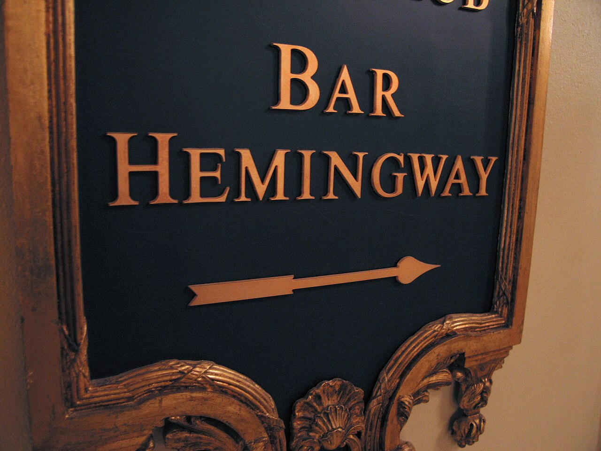
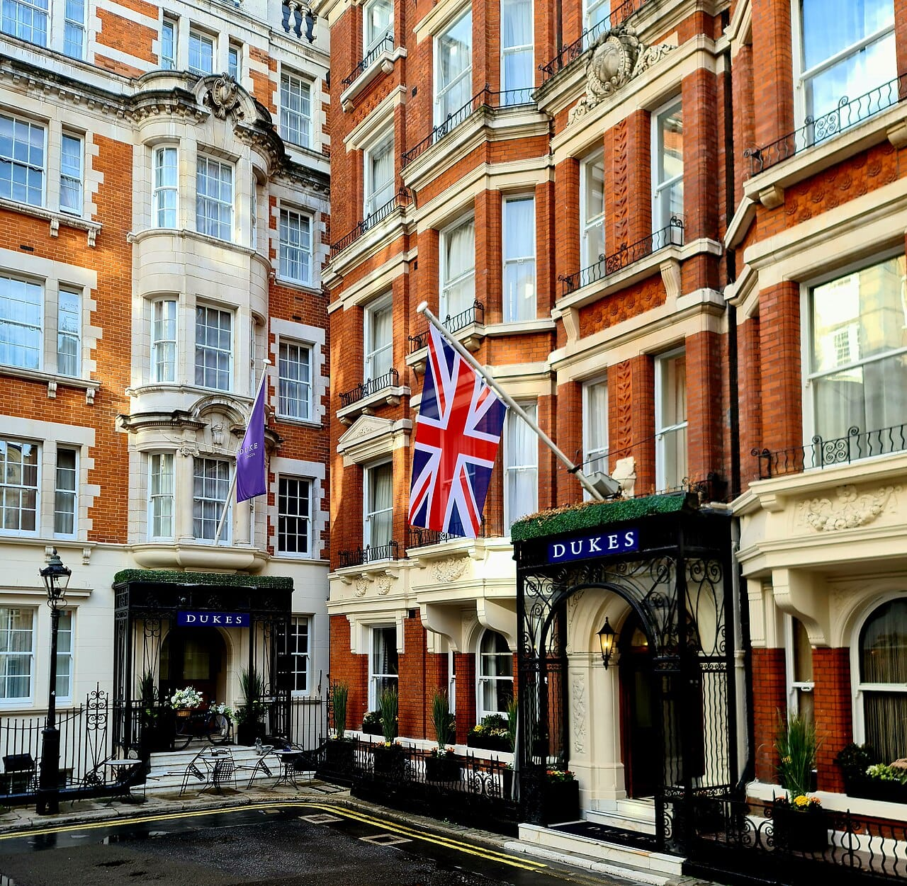

# 丽兹海明威酒吧

在巴黎旺多姆广场一侧，丽兹酒店的门廊把街道的噪声挡在外面。穿过大堂再往里走，海明威酒吧（Bar Hemingway）的门并不显眼，里面也没有音乐；你听到的是冰块碰杯壁、低声交谈和远处服务生脚步的声音。它只有 25 个座位，墙面是深色木饰与旧皮革，灯光偏琥珀色，像一个被保留下来的私人书房，而不是供人打卡的“文学主题空间”。

图：丽兹酒店海明威酒吧入口的铜字招牌；酒吧只有 25 个座位、没有背景音乐，照片为入口标识，不是吧台内部。图片：Pablo Sanchez，CC BY 2.0，via Wikimedia Commons（[原图页面](https://commons.wikimedia.org/wiki/File:Bar_Hemingway_Ritz.jpg)）。

## 1994 年：丽兹海明威酒吧的关键起点
丽兹酒店 1898 年开业，海明威从 1920 年代起就把这里的酒吧当作在巴黎的据点，和菲茨杰拉德夫妇喝干邑或干马天尼；他还与调酒师 Georges、Bertin 成为朋友。今天这间以他命名的酒吧并不是 1920 年代原址的简单复原：它现在的位置曾是 Le Petit Bar，据丽兹官方说，那是巴黎第一家允许女性独自进入的高级酒吧。1994 年，酒店在巴黎解放 50 周年时把这里命名为 Bar Hemingway，并请 Colin Field 重开；Field 在这里工作到 2023 年，之后由 Anne-Sophie Prestail 接任。关于 1944 年海明威“解放丽兹”、一口气喝下 51 杯干马天尼的故事，官方也只当作传说来讲，不能当作战地记录。

把酒吧放回酒店史里看会更清楚。丽兹 1898 年由 César Ritz 开业，1920 年代成为巴黎最时髦的社交场所之一；海明威在回忆录《流动的盛宴》里把丽兹写成“巴黎的一部分”，他在这里与 Georges、Bertin 两位调酒师建立友谊。1944 年巴黎解放时，他是否真的带人“解放”了酒吧、喝了 51 杯干马天尼，史料并不完整，丽兹官方也把它当作传奇。1994 年，酒店借解放 50 周年把 Le Petit Bar 改名为 Bar Hemingway，请 Colin Field 重开；Field 用近 30 年把它做成“只有 25 个座位、没有音乐、靠谈话与定制酒”的空间。2023 年 Anne-Sophie Prestail 接任后，酒单与玫瑰服务延续，但酒吧不再是 Field 时代的个人舞台。

## 空间与酒单

酒吧只有 25 个座位，桌子挨得近，皮革扶手椅、旧照片、手写信与海明威相关的物件填满了墙面；官方特别强调“没有音乐，只有冰块与谈话的声音”。酒单以经典与定制鸡尾酒为主，最出名的是在这里发明的 Serendipity： Calvados、新鲜薄荷、苹果汁与香槟，入口是苹果的清爽，尾段有起泡酒的轻盈；另一根支柱是 Dry Martini。女性客人点的酒会配一朵玫瑰，这是酒吧延续下来的服务细节。菜单也有 tapas，但多数人是为了一杯酒和一段安静的时间而来。

Serendipity 与 Dry Martini 是招牌，服务生仍以银色托盘与桌边调制延续旧式礼仪；酒吧不播放音乐，谈话声与冰块声就是背景。

## 怎么喝

第一次来，可以点 Serendipity 作为“这里才有”的入口，再点一杯 Dry Martini 做对照；如果不想喝太烈，可以问调酒师要低酒精或定制版本。酒吧不接受预订，25 个座位很容易满，开门前几分钟到最稳妥；晚上 7 点后往往需要等位。这里不适合大声聊天或一群人轮流拍照，坐在吧台和调酒师聊几句，比端着杯子绕场一周更符合这个空间。想喝得慢一点，可以点一杯经典，再要一小份 tapas，把时间拉长。

## 丽兹海明威酒吧的地址与营业安排
地址是 Ritz Paris, 15 Place Vendôme, 75001 Paris。最近的地铁是 Concorde 或 Opéra，步行几分钟即到。酒吧每日 17:00–00:00，tapas 17:30–22:30，不需要订位；丽兹全店有着装要求，酒吧尤其偏正式，短裤与运动装不合适。消费在巴黎属于最高一档，点单前先看酒单价格，避免只看到“定制”两个字就下单。座位少、空间窄，行动不便者建议提前联系酒店询问入口与座位安排。

## 礼仪与常见误区

第一，这里不是海明威博物馆：墙上的信件、拳击手套与照片是酒吧的陈列，不等于全部为海明威本人遗物，不要擅自触碰。第二，“51 杯干马天尼”是流传很广的解放故事，官方也将其作为传奇叙述，不能写成确定事实。第三，Serendipity 是丽兹的招牌，但它的配方在不同资料里略有差异，写作时应以官方给出的 Calvados、薄荷、苹果汁、香槟为骨架，不要补入未经核对的苦精。第四，酒吧没有音乐，不是服务缺失，而是它刻意保留的“谈话空间”；请把手机调静音，不要外放。

25 个座位与无音乐是体验的一部分，不是随时可进的公共酒吧；预订、着装与拍摄规则要先确认。

## 从丽兹海明威酒吧延伸到一杯酒里的时间
从酒吧出来就是旺多姆广场，往西可到玛德莲教堂，往南穿过协和广场可到杜乐丽花园与卢浮宫。若想走一条巴黎文学路线，可以另读圣日耳曼德佩的咖啡馆路线；这里先读[一杯酒里的时间](ref:time-in-cup)，理解“在酒吧里消费时间”这件事。若想比较欧洲经典酒吧的不同气质，可以读[萨沃伊美式酒吧](ref:american-bar)、[杜克斯酒吧](ref:dukes)与[康诺特酒吧](ref:connaught)；干马天尼的历史与配方见[干马天尼](ref:dry-martini)。

**关键事实。**

| 项目 | 内容 |
| --- | --- |
| 一句话定位 | 巴黎丽兹酒店内的传奇鸡尾酒吧，1994 年以海明威命名重开，25 个座位，以 Serendipity、Dry Martini 与无音乐的书房式氛围闻名 |
| 地址 | Ritz Paris, 15 Place Vendôme, 75001 Paris, France |
| 城市/国家 | 巴黎 / 法国 |
| 营业状态 | 已核验营业 |
| 官网 | ritzparis.com |

**来源与边界。** 本页关于「丽兹海明威酒吧」的关键事实，主要由以下来源交叉核对：Ritz Paris（25 个座位、Serendipity 与 Dry Martini、海明威与丽兹的关系、Le Petit Bar 历史、营业时间与着装要求；酒店 1898 年开业、1920 年代酒吧与文学艺术客人）、Visit Paris Region（酒吧的收藏、Serendipity 配方构成与 1994–2023 年主调酒师）、barsforKings（交叉核对 1994 年重开、25 个座位、Serendipity 与“玫瑰”服务细节；以 Ritz 官方为主）。产品、地址或营业状态变化较快时，以 ritzparis.com 的最新页面为准；价格、批次与状态会变，涉及这些字段时以页面所列来源的最新版本为准。正文为项目自写，来源只作核验，不复制原文。

## 参考资料
- [一杯酒里的时间](ref:time-in-cup)
- [干马天尼](ref:dry-martini)
- [萨沃伊美式酒吧](ref:american-bar)
- [杜克斯酒吧](ref:dukes)
- [康诺特酒吧](ref:connaught)

本页于 2026-11-21 核对 Ritz Paris 与 Bar Hemingway 的官方页面。酒吧每日 17:00–00:00、tapas 17:30–22:30、不接受订位，25 个座位与着装要求可能随酒店活动调整，出发前查官网。海明威“51 杯干马天尼”的解放故事、墙上陈列是否为其遗物，正文已保留限定；Serendipity 的配方以官方给出的 Calvados、薄荷、苹果汁与香槟为骨架。本页图片是丽兹海明威酒吧入口的铜字招牌，不是吧台或酒单；这块招牌是入口识别点，不代表酒吧内部陈设，图注已逐张署名，图片许可见来源页。

## 相关图像

图：杜克斯酒吧。图片：Ricardalovesmonuments，CC BY-SA 4.0，via Wikimedia Commons（[原图页面](https://commons.wikimedia.org/wiki/File:Hotel_Dukes_London.jpg)）。关联图像：丽兹海明威酒吧。
