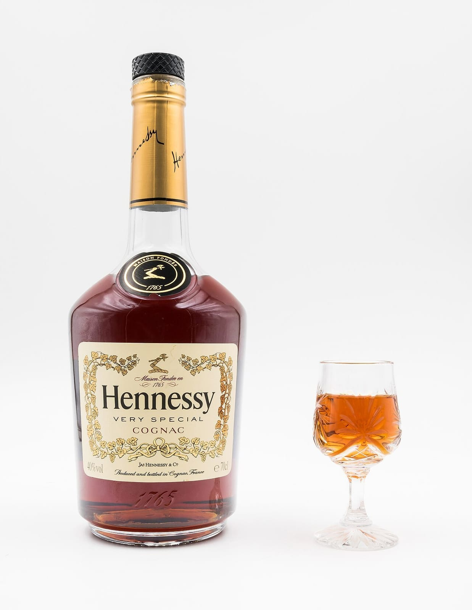

# 轩尼诗干邑酒庄

轩尼诗（Hennessy）是干邑历史最长的酒商之一，1765 年由爱尔兰人理查·轩尼诗（Richard Hennessy）在夏朗特河畔的干邑镇创立。今天向公众开放的并不是一栋孤立的厂房，而是一套以理查·轩尼诗码头为起点的参观体系：历史酒窖、陈年与调配空间、精品店，以及一条从河上进入老城的线路。要读懂这个地方，需要把三件事分开看——商行时代积累的贸易网络、以调配为核心的工艺体系，以及为访客设计的线路与价格梯度。

图：轩尼诗干邑酒庄。摄影：2023 Hennessy V.S. Cognac。署名：Jacek Halicki，CC BY-SA 4.0，来自 Wikimedia Commons（[来源](https://commons.wikimedia.org/w/index.php?curid=132066502)）。

## 1765 年：从爱尔兰到夏朗特河畔

理查·轩尼诗 1724 年生于爱尔兰，后来为法国王室效力，1765 年在干邑开设商行。他的本钱不是葡萄园，而是挑选生命之水（eau-de-vie）的眼光：从酒农手中收购新酒，再在自家酒窖里陈年、调配、装瓶，靠夏朗特河把货送到大西洋港口。轩尼诗官方把这段河岸称作酒庄的诞生地，老照片与明信片至今仍在讲当年的航运。

这条商路后来延伸得很远。1794 年，第一批轩尼诗酒桶运往美国；1859 年，首批干邑抵达中国；到 19 世纪末，销售已覆盖五大洲。今天轩尼诗自称产品行销 160 个国家和地区，并把自己描述为全球高端烈酒市场的领导者。这些是品牌口径，参访时更有用的，是把它当作一个“贸易商行变成全球品牌”的样本：产地在这里，市场在别处，酒窖则是两者的接口。

## 河岸上的游客中心

游客中心与精品店位于 Quai Richard Hennessy，官方通信地址写作 Quai Richard Hennessy, 16100 Cognac。精品店所在建筑由建筑师 Jean-Michel Wilmotte 设计，室内由设计师 Benjamin Graindorge 操刀，用木材、石灰岩与铜回应干邑的制作材料；官方称这是全球唯一能一次看到轩尼诗全系列产品的精品店。

参观通常从历史酒窖开始：厚墙、湿度与排列成行的旧桶，是干邑陈年的真实环境，而不是布景。之后进入品鉴环节，由导览带领对比不同等级。想从河上看老城，可以选择含太阳能船横渡夏朗特河的线路，船是对旧时运送酒桶的平底驳船（gabare）的致意。酒庄没有公布稳定的经纬度信息，坐标以官方渠道为准，导航直接输入地址即可。

## 十种线路与价格梯度

轩尼诗把参观做成了清晰的产品矩阵。最轻的是 2026 年新增的 Flash Tour：19 欧元、1 小时，含一杯 VSOP 调酒，5 月至 10 月运营；入门款 Initiation 为 25 欧元、1 小时 30 分，品鉴 VS 与 VSOP，适合带家人；最受欢迎的是沉浸式 Initiation，35 欧元、2 小时，在历史酒窖里加入 VR 环节，最后品鉴 VSOP 与 XO。

再往上走，Prestige 为 60 欧元，重点在 James Hennessy、XO 与 XXO；蒸馏季（10 月至次年 2 月）才有 85 欧元的 Distillery Tour，能进正在运转的蒸馏车间；制桶工坊线路 170 欧元；干邑与鱼子酱品鉴 99 欧元；Paradis 私人线路 330 欧元，Richard Hennessy 私人线路 550 欧元。价格与场次随季节调整，预订前以官网当日信息为准。首次到访，35 欧元的沉浸式线路信息密度最高；若在冬天来，且对工艺而非酒单更感兴趣，85 欧元的蒸馏线路更值得。

## 调配师世家与调配体系

19 世纪初，轩尼诗把干邑事务交给 Fillioux 家族：先是制桶匠 Jean Fillioux，他的儿子 Christophe 成为首位调配师（Master Blender），此后这一角色在家族内传了八代，现任为 Renaud Fillioux de Gironde。这段谱系解释了轩尼诗的风格为何强调连续性——调配师要凭嗅觉与记忆，把不同年份、不同分区、不同桶的生命之水组合成每年一致的酒。

调配常被误解为“加水”或“混便宜酒”。实际上它解决的是年份差异：新酒在橡木桶中逐年变化，只有通过[调配](ref:blending)才能让 VS 或 XO 保持可识别的风格。等级只规定最低酒龄，不代表瓶中每一滴的年龄；一瓶 XO 里可能同时有远高于规定年限的酒液。把[蒸馏](ref:distillation)得到的基酒、桶陈带来的香气和调配决定的平衡分开理解，才不会把“年份”当成唯一标准。

## 实用信息：地址、预约与交通

地址是 Quai Richard Hennessy, 16100 Cognac, France。参观需预约，可在线预订或致电 +33 5 45 35 06 44；开放时间按季节分段，1 月 1 日至 13 日闭馆，5 月至 10 月多数日期每天开放，11 月至 12 月多为周三至周六，周一、周二只接团体与私人预订，具体以官网日历为准。看点集中在三处：历史酒窖、河畔精品店与季节性船游。行动不便的访客可选 Initiation、沉浸式 Initiation 与 XO 线路，官方提供“Mobility Inclusion”优惠票。

交通方面，干邑火车站到游客中心步行约 5 分钟；从昂古莱姆 TGV 站转乘约 45 分钟；波尔多与拉罗谢尔自驾各约 1 小时 30 分。游客中心位于 Flow Vélo 自行车道旁，正对面有自行车架，300 米内有三自服务平台。开车的人应把品鉴交给同行者或使用代驾，干邑老城停车位有限，旺季最好提前到场。

## 把轩尼诗放回干邑的坐标系

干邑是受原产地命名保护的葡萄白兰地：以白玉霓为主，经二次壶式蒸馏，在法国橡木桶中至少陈年两年，再按最低酒龄分为 VS、VSOP、XO 等等级，具体规则可回到[干邑](ref:cognac)产区页。轩尼诗属于[白兰地](ref:brandy)大类中的干邑，但它作为大酒商的运作方式与单一庄园差别很大：原料来自广泛的合作酒农网络，酒窖里同时躺着数量惊人的不同年份酒液，品牌靠稳定风格而不是某一块田的个性取胜。

它自 1987 年起隶属 LVMH 集团（[LVMH](ref:lvmh)），这解释了它为何在免税店、旗舰店与大型活动上曝光密集。参访时不妨把两条线并排看：一条是码头、酒窖与调配室的工艺线，一条是精品店、限量版与联名构成的品牌线。两条线交汇的地方，正是“干邑酒庄参观”今天真正的样子。

对照阅读：[路威酩轩](ref:lvmh)、[白兰地](ref:brandy)。

相关条目：[干邑](ref:cognac)。

**关键事实。**

| 项目 | 内容 |
| --- | --- |
| 一句话定位 | 1765 年由爱尔兰人理查·轩尼诗在干邑创立的酒商，如今在夏朗特河畔的理查·轩尼诗码头设游客中心与全球唯一全系列精品店，以八代调配师世家与从 19 欧元到 550 欧元的参观线路著称 |
| 地址 | Quai Richard Hennessy, 16100 Cognac, France |
| 城市/国家 | 干邑 / 法国 |
| 营业状态 | 已核验营业 |
| 官网 | hennessy.com |

**来源与边界。** 本页关于「轩尼诗干邑酒庄」的关键事实，主要由以下来源交叉核对：Hennessy（1765 年创立、理查·轩尼诗生平、Fillioux 调配师世家、1794 年与 1859 年的早期出口；10 条参观线路的名称、时长、价格与季节性运营）、BNIC（干邑法定产区、六个 cru 与夏朗特二次蒸馏的行业表述）、INAO（干邑作为原产地命名产品的管理框架）。产品、地址或营业状态变化较快时，以 hennessy.com 的最新页面为准；价格、批次与状态会变，涉及这些字段时以页面所列来源的最新版本为准。正文为项目自写，来源只作核验，不复制原文。

## 相关图像

图：路威酩轩类别配图。图片：bgvjpe，CC BY 2.0，via Wikimedia Commons（[原图页面](https://commons.wikimedia.org/wiki/File:Glass_of_champagne.jpg)）。关联图像：轩尼诗干邑酒庄。
