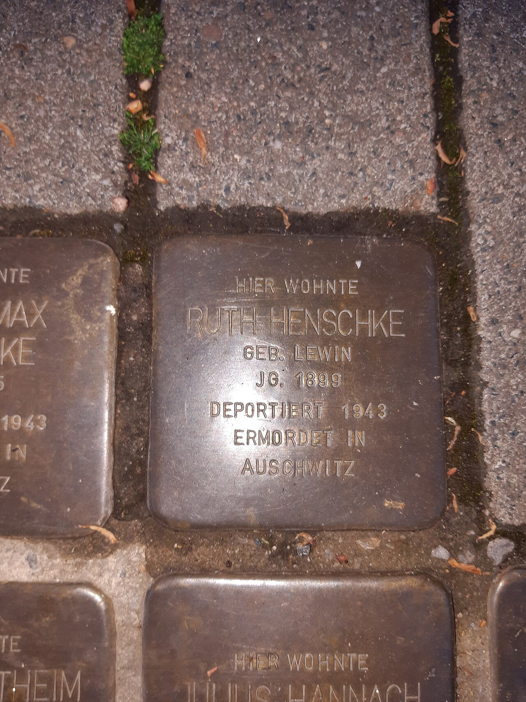

# 亨施克酒庄

亨施克在伊甸谷的基内顿，离巴罗萨谷底有一段爬升。它的门市不大，酒窖也不以规模取胜；真正撑起名声的是两块老藤西拉葡萄园、六代人的家族记录，以及一套把“地块”讲得比“品牌”更重要的叙事。到访者如果只把这里当成“喝 Hill of Grace 的地方”，会错过它最有价值的部分：海拔、老藤与家族记忆如何在同一片山坡上叠合。

图：亨施克酒庄。摄影：Henschke Ruth Stolperstein Magdeburg。署名：Adnon，CC BY-SA 4.0，来自 Wikimedia Commons（[来源](https://commons.wikimedia.org/w/index.php?curid=90422028)）。

## 1868 年：从西里西亚到基内顿

1841 年，Johann Christian Henschke 从西里西亚的 Kutschlau 移民南澳，先落脚阿德莱德山，后来在巴罗萨的 Krondorf 与 North Rhine（后改名 Keyneton）购置土地。家族在 1860 年代初种下小片葡萄园，1868 年出现第一笔售酒记录；这个年份被官方用作酒庄的起点。Johann 本是石匠与车轮匠，早期酿酒更多是家庭与邻里之间的交换，随着需求增长才转向销售。

这段移民史解释了酒庄的气质：它不是城市资本推动的大型项目，而是德语路德派移民社区里长出来的家族企业。石造酒窖、教堂、村庄与葡萄园连在一起，形成了一个可以代际传递的生产单位。官方把 1868 年作为起点，而不是把 1860 年代初的种植当作诞生日，这种选择本身就强调“进入市场”而非“种下第一棵藤”。Keyneton 的德语社区、教堂与石造酒窖，至今仍是理解酒庄的入口。

## 伊甸谷的海拔与老藤

[巴罗萨](ref:barossa)的 Barossa Valley 葡萄园在 112–596 米，Eden Valley 在 219–632 米；后者的成熟期更凉，夜晚更冷，酸度保留更好。亨施克在 Keyneton 的位置属于伊甸谷的高海拔带，酒体通常比谷底更收束，香料与酸度更突出。这里的老藤也不是装饰：Wine Australia 记录巴罗萨仍有 1843 年种植的 Shiraz，老藤的根系更深、产量更稳定，但年份与地块仍然决定最终风味。

不要把“老藤”当成质量保证。老藤能提供更稳定的成熟曲线与更复杂的根系结构，却也会受到干旱、热浪与病害影响；同一块地在不同年份可能表现完全不同。理解亨施克，最好把“海拔 + 老藤 + 年份”放在一起看，而不是只看酒标上的年份或藤龄。在 219–632 米这条带里，坡向与谷口位置又造成细小差异：朝北的坡面更凉，谷口更容易聚集冷空气。品鉴时如果听到“高海拔”三个字，最好追问具体地块与海拔，而不是把它当成风格保证。

## Hill of Grace 与 Mount Edelstone

官方家族史把 Hill of Grace 与 Mount Edelstone 视为两块核心西拉葡萄园。Hill of Grace 的原始种植可追溯到约 1860 年，与 Nicolaus Stanitzki 在 Gnadenberg 教堂附近种下的老藤相连；1891 年，第二代 Paul Gotthard Henschke 购得这块带小片葡萄园的土地，后来成为 Hill of Grace Vineyard。Mount Edelstone 则由第四代 Cyril Henschke 在 1950 年代推动成单一葡萄园酒；Cyril 在 1950 年接手酒庄，把重心从加强酒转向干型餐酒。

这两块地的意义不在于“最贵”，而在于它们把单一葡萄园的概念做成了家族长期承诺：同一块地、同一品种、连续多个年份。对访客来说，品鉴时可以把两款酒放在一起，观察地块差异如何压过年份差异；如果只喝一款，至少问问它来自哪块地、哪一年，以及那一年的气候如何。

## 六代人的酒窖

酒庄已传至第六代。第五代 Stephen 与 Prue Henschke 在 1970 年代之后引入新的酿造与栽培方法，包括桶发酵、法国橡木与更精细的园区管理；第六代 Johann、Justine 与 Andreas 已经参与日常经营。官方叙述强调“葡萄园与酒厂的完整整合”，意思是酒窖不是被动接收果实，而是从栽培阶段就介入成熟与风味决策。

门市与酒窖的参观因此更像一次“家族档案阅读”：老照片、地块图、桶样与不同年份的酒放在一起，讲述同一块地如何随时间变化。1975 年，Cyril 还是 Barons of the Barossa 的创始成员之一；这类地方组织说明亨施克不是孤立品牌，而是巴罗萨葡萄酒共同体的一部分。这些档案不用于证明某款酒更好，而是帮助参访者把地名、家族与年份对应起来。

## 预约、开放与到达

酒窖门市周一到周六 9:00–16:30 开放，周日关闭，公共假日 10:00–15:00；官方明确写着因容量限制，到访必须预约。这个规则比许多大型酒庄更严格，临时开车过去很可能只能看风景。预约时确认项目时长、是否含酒窖参观、是否含餐，以及取消规则；不同体验的集合点可能不同。

地址是 1428 Keyneton Road, Keyneton, South Australia 5353, Australia。从阿德莱德市区开车约一小时，从玛吉尔庄园出发也约一小时；乡村道路窄、弯多，夜间没有路灯，回程要留出余量。坐标以官方渠道为准，导航直接输入地址。若与[奔富玛吉尔庄园](ref:penfolds)同日安排，先订亨施克，再倒推玛吉尔的时间，因为前者的容量限制更硬。

## 常见误区

第一，把亨施克当成“巴罗萨谷底酒庄”。它在伊甸谷的 Keyneton，海拔与成熟节奏都不同。第二，以为 Hill of Grace 是一片可以随意参观的葡萄园。它是生产地块，参观点与路线要按酒庄安排。第三，把老藤等同于高分。老藤提供稳定性，但年份、地块与酿造仍然决定质量。第四，忽略预约；容量限制是官方明确的规则。第五，把“家族酒庄”当成小规模作坊。亨施克的产品线覆盖多个地块与价格带，家族经营不等于产量小。

相关条目：[巴罗萨](ref:barossa)、[西拉](ref:shiraz)、[红葡萄酒](ref:red-wine)。

**关键事实。**

| 项目 | 内容 |
| --- | --- |
| 一句话定位 | 位于南澳伊甸谷基内顿的家族酒庄，1868 年出现首笔售酒记录，已传至第六代；以 Hill of Grace 与 Mount Edelstone 两块老藤西拉葡萄园著称，酒窖门市周一到周六 9:00–16:30 开放、周日关闭，因容量限制必须预约 |
| 地址 | 1428 Keyneton Road, Keyneton, South Australia 5353, Australia |
| 城市/国家 | 基内顿 / 澳大利亚 |
| 营业状态 | 已核验营业 |
| 官网 | henschke.com.au |

**来源与边界。** 本页关于「亨施克酒庄」的关键事实，主要由以下来源交叉核对：Henschke（1428 Keyneton Road 地址、周一到周六 9:00–16:30 的开放时间、周日关闭、公共假日 10:00–15:00 与必须预约的说明；1868 年以来的家族酿酒史、六代人、Eden Valley 与 Barossa Valley 的葡萄来源）、Wine Australia（巴罗萨谷底与高海拔带的温度差异、Shiraz 老藤与 1843 年种植记录）。产品、地址或营业状态变化较快时，以 henschke.com.au 的最新页面为准；价格、批次与状态会变，涉及这些字段时以页面所列来源的最新版本为准。正文为项目自写，来源只作核验，不复制原文。

## 参考资料

本页依据亨施克官方联系页、官网首页与家族史页，以及 Wine Australia 的巴罗萨谷资料核验，页面核验日期 2026-11-09。若要把这一站放进行程，可继续读[巴罗萨葡萄酒路线](ref:route)；关于品种与风格背景，见[西拉](ref:shiraz)与[红葡萄酒](ref:red-wine)。开放时间、预约规则与酒款以官方渠道为准。
