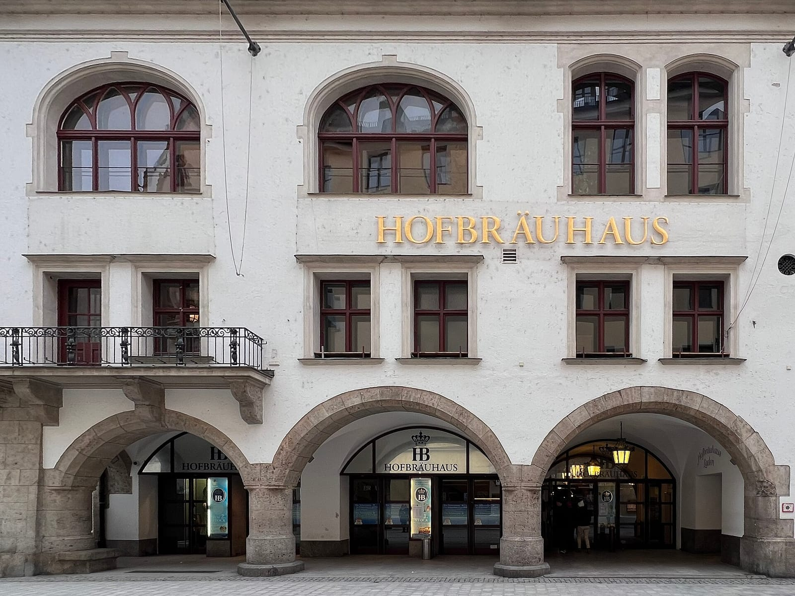
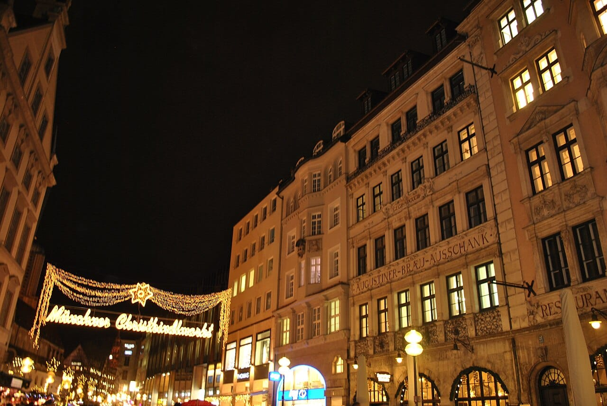

# 皇家啤酒屋

图：皇家啤酒屋相关实景照片。图片：Burkhard Mücke，CC BY-SA 4.0，via Wikimedia Commons（[原图页面](https://commons.wikimedia.org/wiki/File:2023-02-03_Hofbr%C3%A4uhaus_am_Platzl_07.jpg)）。

## 1589 年：皇家啤酒屋的关键起点
皇家啤酒屋在慕尼黑老城的 Platzl 9，从玛利亚广场步行几分钟就到。1589 年 9 月 27 日，巴伐利亚公爵威廉五世（Wilhelm V）在 Alten Hof 设立宫廷啤酒坊，最初只为供应宫廷，不对外营业；1828 年，国王路德维希一世（Ludwig I）批准向公众售酒并允许餐饮经营，这里才真正变成"酒馆"。今天看到的主体建筑建于 19 世纪末，二战中严重受损，战后重建，所以它既是历史场所，也是持续使用的建筑。

"Hofbräuhaus"直译是"宫廷啤酒屋"，中文常译"皇家啤酒屋"。它容易让人误以为是宫廷宴会厅，实际上是宫廷啤酒厂附设的大众酒馆：长桌、木凳、大杯、乐队，从一开始就是为"很多人同时喝酒"设计的。啤酒厂与酒馆的品牌归巴伐利亚州所有，这种"州营 + 大众酒馆"的组合，在慕尼黑六大啤酒厂里并不常见。

这里也有一段需要正视的历史：20 世纪初，酒馆曾被政治集会使用，1920 年希特勒在此宣读纳粹党纲领。今天它不再承担那种功能，建筑与品牌以啤酒文化为主；了解这段历史，比把它当成单纯的"网红打卡点"更诚实。

## 空间与酒单

酒馆由多个大厅组成。主厅最热闹，中央是乐队舞台，四周是长桌与长凳；地下是拱顶式的 Bierkeller，光线更暗、回声更强；此外还有适合小团体的侧厅与吧台区。座位不分区售卖，进门自己找空位，看到长桌有空就直接坐下，是这里的常规操作。

啤酒以自家品牌 Hofbräu 为主，核心几款是：Hofbräu Original（淡色拉格，麦芽甜与温和苦味，最接近"日常啤酒"）、Münchner Dunkel（深色拉格，烤面包与可可风味更重）、Münchner Weisse（小麦啤酒，香蕉与丁香香气，苦度低）。季节性酒款如 Maibock、Oktoberfestbier 会在相应时段出现，具体供应以现场酒单为准。点单单位通常是 0.5 升（Halbe）或 1 升（Maß）；第一次来建议先点 0.5 升，确认自己喜欢哪一种再加大杯。

食物是巴伐利亚家常菜：烤猪肘（Schweinshaxe）配酸菜与土豆泥、白香肠（Weisswurst）配甜芥末与面包、Obatzda 芝士酱配黑麦面包、Radieschen 与 Brezn。白香肠传统上在上午食用，配甜芥末，不切开来吃；晚上点它并不"错"，但当地人会觉你点得不太对时辰。

## 第一次去怎么点

先想清楚要"喝一种"还是"比较几种"。第一次来最稳的组合是 0.5 升 Original 加一份烤猪肘或白香肠；想比较，就再点一杯 Dunkel 或 Weisse，用同一顿饭完成淡色、深色、小麦三类的对照。喜欢苦味的人可以问侍者当天有没有 Pils 或季节款；不喜欢苦味的人直接点 Weisse。

点单时直接说杯型与酒名，例如"ein Halbe Original"或"eine Maß Helles"；侍者会记在桌卡上，结账时一起算。不要一次点很多杯让它们放凉，啤酒在桌上放久了香气会散。乐队演奏时主厅会非常吵，想聊天就选侧厅或 Bierkeller。

白香肠的经典吃法是：把香肠从中间切开，用面包蘸甜芥末，配一杯淡色啤酒；不要在盘子里切成一截一截。烤猪肘皮很硬，先用刀背敲开再切，配酸菜解腻。若只想小吃，Obatzda 加 Brezn 是最便宜也最像本地人的组合。

## 皇家啤酒屋的地址与营业安排
**地址**：Platzl 9, 80331 München, Germany。

**交通**：乘 S-Bahn 或 U3/U6 至 Marienplatz，出站步行约 5–6 分钟；也可乘 Tram 19 至 Nationaltheater，步行约 4 分钟。老城内步行即可，不必开车；具体线路、无障碍出口与末班车以 MVG 当日信息为准。

**开放时间**：官网首页明确写明每日 11:00–24:00。节庆、演出与跨年夜可能调整，出发前以官网当日公告为准。

**预约**：散客无需订位，一楼（Schwemme 等）现场找空位或拼桌即可；四人及以上团体才需要通过官网预订页订位。大型旅行团、活动与包场需提前邮件联系。旺季周末晚间等位时间会很长。

**门票与消费**：不收门票，按点单付费。啤酒按杯计价，食物分量大，两个人点一份主菜加两杯酒通常够；菜单与价格以官网 2026 年版 PDF 菜单及店内当日菜单为准。价格在慕尼黑市中心属于中等。

着装完全休闲，啤酒节期间很多人穿 Tracht，但平时穿 T 恤也正常。建议备些现金，小额结账时更方便。

「皇家啤酒屋」的开放时间、价格与预约，以[官网](https://www.hofbraeuhaus.de/)的公开页面为准；核验日期为 2026-11-08，临时调整以官网当日公告为准。

## 礼仪与常见误区

拼桌是常态。走到长桌旁先问一句"Ist hier frei?"（这里有人吗），得到允许再坐；不要把包放在整条长凳上，也不要把别人留下的杯子挪走。碰杯时说"Prost"，按德国习俗要看着对方的眼睛，这个说法带点玩笑性质，但确实能让气氛更自然。

结账时不要把钱放在桌上走人。德国的方式是把侍者叫来，说出你想付的总额（含小费），例如"zusammen, bitte"或"stimmt so"；小费通常凑整或 5%–10%。不要自带食物和饮料进场，也不要把 Maß 杯当纪念品带走，店里有正规售卖渠道。

常见误区有四个：把"皇家"当成高档餐厅；以为要穿正装；以为必须订位；把这里当成只喝一杯就走的酒吧。它更像一个"可以吃饭的啤酒大厅"，适合两小时以上的坐着、聊天、听乐队。另一点是：这里游客比例很高，想体验本地人日常，可以把[奥古斯丁啤酒厂](ref:augustiner)一带的餐饮作为对照。

## 从皇家啤酒屋延伸到奥古斯丁啤酒厂
出门就是 Platzl 小巷，往南两分钟到玛利亚广场与新市政厅钟琴，往东几分钟是 Viktualienmarkt 露天市场，适合先买点奶酪、面包再进酒馆。往北步行约十分钟可到慕尼黑王宫（Residenz），往西是谷物市场与购物街。把这些点串起来，半天的老城路线很顺：上午市场，午间白香肠，下午王宫，傍晚回酒馆听乐队。

如果想把"啤酒大厅"与"啤酒厂"对照着看，可以安排另一天去慕尼黑西侧的[奥古斯丁啤酒厂](ref:augustiner)厂区与相关餐饮；前者是州营品牌的游客型大厅，后者是家族企业的生产与本地餐饮，两种空间的组织方式差别很大。酒馆在啤酒节期间会非常拥挤，出发前看清当天是否有活动。

## 同城酒馆与延伸阅读
- [啤酒](ref:beer)：Helles、Dunkel、Weizen 等风格的基本框架。
- [酒吧与城市](ref:pub-and-city)：beer hall 如何用长桌、大杯与乐队组织社交。
- [奥古斯丁啤酒厂](ref:augustiner)：慕尼黑另一家老牌啤酒厂的厂区与酒款，可作对照。

对照阅读：[啤酒](ref:beer)、[奥古斯丁啤酒厂](ref:augustiner)。

把皇家啤酒屋放回慕尼黑啤酒馆传统，可对照[啤酒](ref:beer)与[奥古斯丁啤酒厂](ref:augustiner)。

## 相关图像

图：奥古斯丁啤酒厂。图片：Elisa.rolle，CC BY-SA 4.0，via Wikimedia Commons（[原图页面](https://commons.wikimedia.org/wiki/File:Augustiner-Br%C3%A4u_0004.jpg)）。关联图像：皇家啤酒屋。
