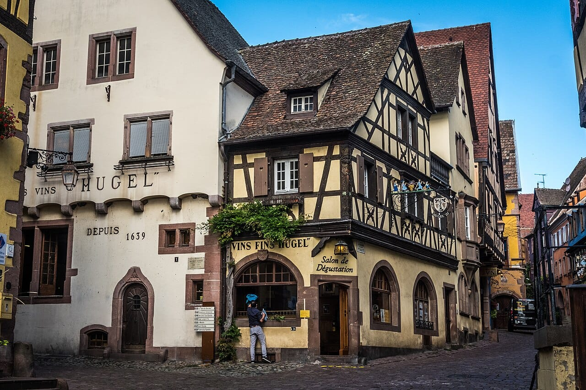

# 雨格酒庄

雨格酒庄（Hugel & Fils / Famille Hugel）在法国阿尔萨斯的里屈埃维尔（Riquewihr），门牌是 3, rue de la Première Armée。它在同一座中世纪小镇经营了三百多年，酒窖就在老城建筑之下，品鉴室与街道只隔几步。雨格不是“把游客挡在门外”的封闭庄园：它有按季开放的品鉴室，也有需要预约的酒窖参观；但想进入地下酒窖，仍要提前安排。

图：雨格酒庄。图片：Photo Claude TRUONG-NGOC，CC BY-SA 4.0，via Wikimedia Commons（[原图页面](https://commons.wikimedia.org/wiki/File:Hugel_et_Fils_Riquewihr_ao%C3%BBt_2020-3.jpg)）。

## 里屈埃维尔：城墙内的家族酒庄

里屈埃维尔是阿尔萨斯葡萄酒之路上的典型酒村：城墙、塔楼、窄街与彩色房屋保存得相当完整，村内多为步行区，车辆只能在外围装卸。雨格的建筑群在镇中心，酒窖入口与品鉴室都藏在不显眼的门面之后；第一次到访容易走过，认准门牌与黄标酒瓶的招牌即可。

这种“村内酒庄”的形态决定了参观方式：不能把大巴直接开到门口，停车要放在村外；品鉴室容量有限，旺季需要等候。酒庄官方页面也提醒，抵达酒窖与品鉴室要步行，车辆只允许装卸。把这一点写进行程，比到了再找车位更省时间。

## 1639 年以来的家族

官方叙述把家族在里屈埃维尔的起点定在 1639 年。此后数百年，雨格家族一直是当地的酒农与酒商，逐渐把自有葡萄园与合同种植者的果实结合起来。今天酒庄自有约 30 公顷，主要位于里屈埃维尔最好的地块，其中不少被列为特级园；此外还与约 100 公顷的合同种植者合作，用稳定的供应支撑出口。

年产约 60,000 箱，其中 90% 出口到 100 多个国家。这组数字是理解雨格的关键：它不是只服务本地餐桌的小酒庄，而是把阿尔萨斯酒卖到全球的贸易型家族企业。也正因如此，它的酒单强调一致性——黄标、同一瓶型、同一风格语言，让远方的买家每年都能找到熟悉的味道。

## 酒窖与 1715 年的 S. Caterine 桶

酒窖位于 16 世纪建筑之下，潮湿、阴凉，仍在使用超过一个世纪的大橡木桶。最著名的一只叫“S. Caterine”，官方叙述称其制造于 1715 年，并被记录为仍在使用的最古老酒桶之一。它不是用来炫耀的古董，而是酒窖仍在运转的一部分；参观时会看到它与其他老桶并排，规模与木纹都很直观。

老桶在阿尔萨斯的意义与新桶不同：它不追求烘烤与香草，而是让酒在微氧环境中缓慢稳定。雨格的酒单刻意避免明显的橡木风味，黄标酒强调品种本身的香气与清爽。把“老桶”误读成“重橡木”，是参观时最常见的误会。

## 雨影下的贵族品种

阿尔萨斯西侧的孚日山脉挡住大西洋水汽，东麓因此少雨、日照长，葡萄可以慢慢成熟。雨格只用阿尔萨斯的贵族品种：雷司令、琼瑶浆、灰皮诺与麝香；[琼瑶浆](ref:gewurztraminer) 给荔枝与玫瑰，[灰皮诺](ref:pinot-gris) 给梨与蜂蜜，雷司令给酸度与矿物，麝香给葡萄本身的花香。白皮诺与西万尼也存在，但不属于“贵族”这一组。

酒庄的葡萄园平均藤龄约 35 年，老藤与合同种植者的年轻藤形成互补。雨影气候让成熟稳定，但也意味着年份差异更多来自秋季降雨与贵腐条件，而不是普遍的寒冷。参观时如果只记住“干燥”，会忽略阿尔萨斯秋天也可能出现连续降雨，这正是迟摘年份需要判断的地方。

## 黄标酒单怎么读

雨格的黄标是它最容易被认出的视觉符号。酒单从入门级到特级园，再到迟摘与贵腐精选，品种与地块逐级具体。入门款强调新鲜与平衡，适合配餐；特级园会写清园名与品种，价格更高，陈年潜力也更强；迟摘与 SGN 则是另一个维度，按甜度与浓度排序。

读标时先看品种，再看是否有“Grand Cru”与园名，最后看是否有 Vendanges Tardives 或 Sélection de Grains Nobles。不要把黄标当成“同一个酒”：同一标签下可能有不同品种、不同年份与不同等级。若只想买一瓶日常酒，选入门雷司令或白皮诺；若想理解酒庄，选一款特级园雷司令。

## 迟摘法规的推动者

雨格家族在阿尔萨斯迟摘与贵腐精选的法规形成中扮演了推动者角色。官方叙述称，家族促成 Vendanges Tardives 与 Sélection de Grains Nobles 两类标签的设立，并参与固定其生产条件；这些规则后来成为阿尔萨斯 AOC 体系的一部分。对消费者而言，这意味着 VT 与 SGN 不是酒庄自创的营销词，而是有法定门槛的标签。

法规解决的是“最低糖度与品种”，没有解决“风格”。雨格的 VT 可以做得相对清爽，SGN 则浓郁；同一酒庄的两款甜酒可能适合完全不同的场合。喝之前先问酒庄当年的贵腐比例与残糖，比只看标签更准确。

## 品鉴室与预约式酒窖参观

官方页面写明：品鉴室从复活节到圣诞每天开放，时间为 09:00–12:00 与 13:00–18:00；其余日期建议先联系。品鉴室最多同时接待 8 至 10 人，酒款用惰性气体保存，部分稀有酒款另行计价。酒窖参观只限工作日、避开采收期，且须提前预约，每组最多约 15 人，面向葡萄酒从业者或有一定基础的爱好者。

地址是 3, rue de la Première Armée, 68340 Riquewihr, France；电话 +33 (0)3 89 47 92 15。开车的人应把车停在村外，步行进村；品鉴时吐酒，不要酒后驾车。若只想买酒，品鉴室与线上商店都可；若想下酒窖，务必先预约并确认集合地点。

相关条目：[阿尔萨斯](ref:alsace)、[白葡萄酒](ref:white-wine)。

黄标酒单是酒庄的分级表达，不是官方 AOC 等级；迟摘与贵腐精选的法规身份，也要按瓶标上的具体术语核对，瓶标上的术语才是法规身份。

## 另见

- [阿尔萨斯产区](ref:alsace)：孚日雨影、特级园与贵族品种。
- [琼瑶浆](ref:gewurztraminer)与[灰皮诺](ref:pinot-gris)：雨格黄标的核心品种。
- [白葡萄酒](ref:white-wine)：阿尔萨斯酒的读标与配餐。

开放时间、预约与交通以官方渠道为准，本文不填经纬度，坐标以官方渠道为准；页面核验日期 2026-11-09。

**关键事实。**

| 项目 | 内容 |
| --- | --- |
| 一句话定位 | 法国阿尔萨斯里屈埃维尔的一座家族酒庄，1639 年起在同一小镇经营，以黄标酒单、中世纪酒窖与 1715 年的 S. Caterine 大桶闻名，也是迟摘与贵腐精选法规的推动者；品鉴室按季开放，酒窖参观须预约 |
| 地址 | 3, rue de la Première Armée, 68340 Riquewihr, France |
| 城市/国家 | 里屈埃维尔 / 法国 |
| 营业状态 | 已核验营业 |
| 官网 | hugel.com |
