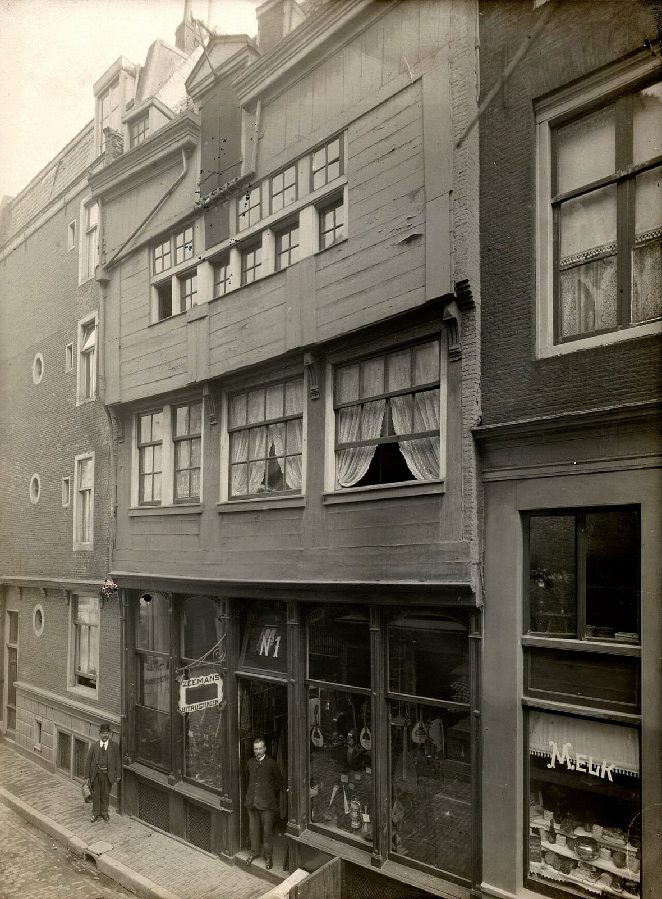

# In ’t Aepjen

从阿姆斯特丹中央车站往南走几分钟，Zeedijk 街口会突然收窄。黑色木板的立面、白色的窗框、门楣上金色的 “In ’t Aepjen”，还有橱窗里一排排猴子玩偶与旧酒瓶，让这间店在红灯区边缘显得像一块被时间留下的木刻。它不是一个被复原出来的“荷兰主题酒吧”，而是一栋真的在十六世纪中叶建成的木构房屋，底层从 1980 年代后期才变成咖啡馆。

图：Zeedijk 1 的木结构立面历史照片；房屋约建于 1550 年，现由 Hendrick de Keyser 协会保护。图片：Unknown author Unknown author，Public domain，via Wikimedia Commons（[原图页面](https://commons.wikimedia.org/wiki/File:Historische_stadswoning_met_houten_gevel,_SFA022811075.jpg)）。

> **先给结论**
> **一句话：** 这页判断In ’t Aepjen值不值得专程去，以及到访前要核对什么。
>
> - **适合谁：** 正在计划去In ’t Aepjen、想知道值不值得专程安排半天到一天的人。
> - **不适合谁：** 只想要“必去榜单”、不准备核对预约、交通和开放时间的人。
> - **先看这两点：**
>   - 最舒服的时间是下午三点到五点，或晚上十点以后。
>   - 第一，不要把“1519 年客栈”当成事实。

## 1519–2026：In ’t Aepjen的历史节点
先把三个时间分开：建筑、店面、酒吧。Hendrick de Keyser 协会的官方页面把 Zeedijk 1 的建造年份写作 1550 年，并说明协会在 1920 年购入这栋房子；Amsterdam Monumentenstad 的档案则说，关于“Het Aepgen”的最早资料可追到 1543 年，现存房屋约建于 1560 年。两个说法相差十年左右，但都指向十六世纪中期，而不是常被引用的 1519 年。

“1519 年客栈”是这间店最顽固的传说。Atlas Obscura 与许多旅游文章都写它自 1519 年起提供麦酒、jenever、食物与住宿；但 Amsterdam Tourism 在 2026 年的研究型文章明确说，这一说法缺少档案证据，猴子付账的故事也没有可靠记录。更关键的是，Hendrick de Keyser 的房屋史写得很清楚：十六世纪中期这里是 Jan Claesz “int Aepgen” 的住宅，并不是水手客栈；十八世纪是纸店，十九世纪是杂货店，1878 年才装上现在的店面，1986–87 年修复后底层才取得餐饮用途。换句话说，店名很老，建筑很老，但“连续经营五百年的酒吧”这个叙事是后来拼上去的。

名字本身也有层次。“In ’t Aepjen”字面是“在猴子那里”，房屋史与档案写作“Het Aepgen”。猴子图像在今天的室内无处不在：木雕、海报、油画、吧台上的小塑像。它们来自一个更晚的民间故事：水手从殖民地回来，身上没有足够的钱，就把随船带来的猴子当账付给店主；猴子多到客人抱怨跳蚤，后来被送给一位常客，最终与阿尔蒂斯动物园的起源缠在一起。这个故事很好听，但动物园与酒吧之间没有可核实的档案链。把它当阿姆斯特丹的都市传说，比当历史更准确。

## 建筑与空间

这栋房子是阿姆斯特丹木构传统最后的标本之一。1452 年大火之后，城市要求山墙用砖，后来干脆禁止木立面；Zeedijk 1 的侧墙是砖，正面却仍是木板包覆的木框架，因此被归入“木立面房屋”的稀少类型。Hendrick de Keyser 说它是“从木构向砖构过渡”的房子：平面接近方形，面宽约 7 米、进深约 5.6 米，屋顶与街道平行，属于“横屋”（dwarshuis），不是运河边常见的窄而深的“纵屋”。

室内的木骨架只在一、二层保留得较完整；底层因为改成咖啡馆，只留下旧梁架。楼梯是十六世纪式的螺旋梯，但如今被堵住，不能上到客房；楼上是隔壁酒店的客房。这个细节很重要：你在一层喝酒，头顶并不是同一间酒馆的楼座，而是被并入酒店的历史建筑。店面的水平木板、白色大窗与 Louis XVI 风格的控制线大约在 1800 年形成，1878 年又换成现在的商店门面；所以“看起来像老酒吧”的橱窗，其实比建筑本身晚得多。

空间不大，进门就是吧台与几张小桌。深色木饰、黄铜灯具、旧镜面、成排的酒瓶与猴子塑像把视线压得很低；最里面有一幅横跨墙面的大画，画的是饮酒的人群。白天光线从 Zeedijk 的橱窗进来，木头的纹理很清楚；晚上只靠台灯与烛光，整间店像一块暖色的琥珀。它适合十几个人，不适合大团；转身时要小心背包与酒杯。

## 酒单与味觉

In ’t Aepjen 的核心是荷兰棕色咖啡馆的日常：啤酒、jenever 与简单的酒馆食物。啤酒以荷兰主流拉格与小麦啤为主，常见的是 Palm、Heineken 或本地季节酒；jenever 通常有小杯的 jonge（年轻）与 oud（陈年）两种，年轻版干净、偏烈，陈年版更圆、更甜，常配一杯啤酒或苦味酒一起喝。这里不追求鸡尾酒单，也不会做“阿姆斯特丹主题特调”；它的味道来自冷啤酒、杜松子与老木头的组合。

食物是酒吧级别：bitterballen、奶酪块、炸肉丸、三明治与坚果。分量不大，适合配酒而不是当正餐。想认真吃一顿，可以把这里当开场，再去附近的印尼餐厅或唐人街吃晚饭。点单可以直接说 “een biertje” 或 “een jenever”；如果不确定 jenever 的类型，让吧台推荐 jonge 或 oud。不要期待英语酒单把每款酒讲得很细，这里的酒单短，选择靠吧台的口头介绍。

## 怎么喝

最舒服的时间是下午三点到五点，或晚上十点以后。白天 Zeedijk 的游客流还没到峰值，站在窗边喝一杯，能看到街口的自行车与店铺；晚上周末会非常挤，尤其是红灯区开始热闹之后。它不适合大型聚会，也不适合带孩子；门口常有游客拍照，进门后请把音量降下来。

点单通常在吧台完成，喝完可以把空杯放回吧台。荷兰酒吧的账单有时当场结、有时最后结，进门可以先问一句。不要站在门口堵住通道；Zeedijk 很窄，门口也是邻居的过道。拍照可以，但不要用闪光灯对着吧台后的客人；室内很暗，闪光会破坏整个空间的气氛。最后，不要把猴子玩偶拿下来摆拍，它们是店里的陈设，不是道具。

## In ’t Aepjen的地址与营业安排
- 地址：Zeedijk 1, 1012 AN Amsterdam。
- 坐标：52.376303, 4.900146。
- 交通：从 Amsterdam Centraal 步行约 5 分钟； tram 或 metro 到 Centraal 后按 Zeedijk 指示牌走。
- 营业：常见记录为周日到周四 12:00–01:00、周五周六 12:00–03:00；店面玻璃与二手资料一致，但临时调整需以现场为准。
- 预订：不接受大型预订，按现场空位入座；团队建议拆开。
- 支付：银行卡与现金都常见；小额消费备一点零钱更方便。
- 无障碍：门口有门槛，室内通道窄，轮椅进入困难；先在门口观察再决定。
- 周边风险：Zeedijk 位于红灯区边缘，夜间人多且杂，注意随身物品，不要对着橱窗人物拍照。

## 礼仪与常见误区

第一，不要把“1519 年客栈”当成事实。建筑约 1550 年，酒吧用途自 1987 年修复后开始；猴子付账是传说，不是账本记录。第二，不要把整栋楼都当成酒馆；楼上属于酒店，螺旋梯被封住，不能“上楼参观”。第三，不要期待“历史主题菜单”或花式鸡尾酒；这里是棕色咖啡馆，啤酒与 jenever 才是主角。第四，不要用闪光灯拍室内，也不要把猴子塑像搬来搬去。第五，不要在门口大声外放音乐或堵住通道；Zeedijk 的街面很窄，邻居与行人都在用。第六，不要把它当成“最老酒吧”的打卡点就走；真正值得看的是木构房屋、1878 年店面与 1980 年代修复留下的分层。

## 从In ’t Aepjen延伸到Café Hoppe
从 Zeedijk 1 出发，往南两条街就是唐人街与 Nieuwmarkt；往西是 Dam 广场与水坝，往北回到中央车站。可以把这一站放进“阿姆斯特丹小酒吧”的半日线：先在 [Café Hoppe](ref:hoppe) 看 Spui 的“站着喝/坐着喝”双空间，再步行到 [Café De Dokter](ref:dokter) 看 18 平方米的极限尺度，傍晚到 In ’t Aepjen 看木构房屋与猴子陈列。若想把啤酒工业也串进来，[Heineken Experience](ref:heineken) 是品牌博物馆；跨到布鲁塞尔，[Cantillon](ref:cantillon) 是兰比克与贵兹的对照。再远一点，里斯本的 [A Brasileira](ref:brasileira) 是另一种“文学咖啡馆”的城市样本。

这条线不建议开车：阿姆斯特丹市中心几乎不能停车，Zeedijk 与 Spui 之间步行约 20 分钟，正好穿过 Dam 与王宫。若只想喝一杯，下午到黄昏最合适；若想拍立面，上午的侧光最清楚，晚上则只剩霓虹与橱窗。

## 参考资料
- Hendrick de Keyser 的 Zeedijk 1 房屋页：<https://www.hendrickdekeyser.nl/de-huizen/zeedijk-1>，用于核对 1550 年、1920 年购入、纸店/杂货店/1878 年店面与 1987 年餐饮用途。
- Amsterdam Monumentenstad 的 Zeedijk 1 条目：<https://www.amsterdam-monumentenstad.nl/database/grachtenboek_objecten.php?id=340>，用于交叉核对 1543 年最早记载、约 1560 年房屋与 1986/87 年修复。
- Amsterdam Tourism 的 In ’t Aepjen 文章：<https://amsterdamtourism.net/in-t-aepjen/>，用于核对猴子传说属民间故事与参考营业时间。
- Atlas Obscura 的 In’t Aepjen 页面：<https://www.atlasobscura.com/places/in-t-aepjen>，用于核对地址、坐标与传说的流行版本；不要把其中的 1519 年当成档案事实。
- 同城条目：[Café Hoppe](ref:hoppe)、[Café De Dokter](ref:dokter)、[Heineken Experience](ref:heineken)；跨城对照：[Cantillon](ref:cantillon)、[A Brasileira](ref:brasileira)。
