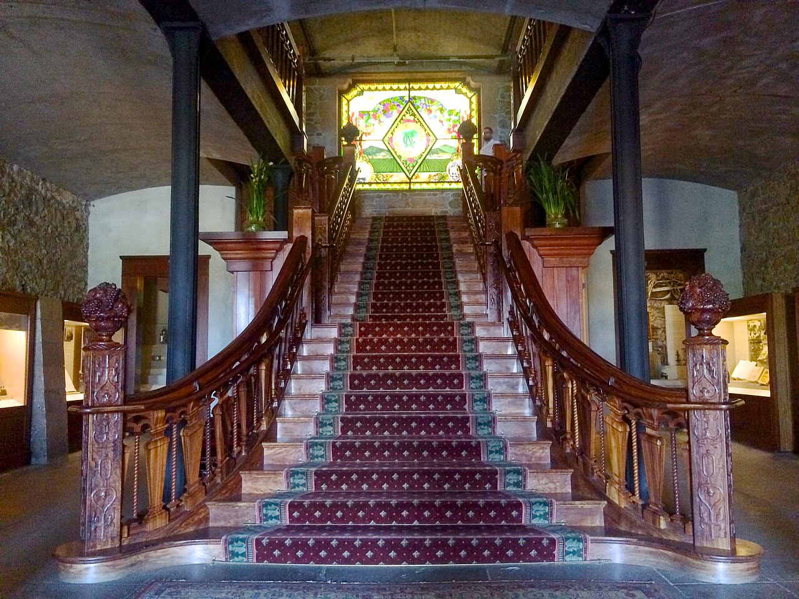

# 英格努克酒庄

卢瑟福在纳帕谷中部，29 号公路两侧是极长的葡萄园与低矮的石墙。英格努克的入口是一段林荫道，尽头是 1882 年建成的石砌城堡，前面有喷泉、草坪与高大的橡树。它看起来像一座欧洲庄园，但故事是美国的：一位芬兰裔船长在 1879 年买下土地，用航海带来的资本与纪律建起酒庄；20 世纪中期，酒庄分裂、易主、改名，直到 Coppola 家族把地块一块一块买回来。今天它既是历史建筑，也是仍在生产的酒庄；参观时最好把“城堡”与“葡萄园”分开看，前者是记忆，后者才是酒。酒庄的导览通常从庭院开始，再进入城堡与品鉴室；发酵间与酒窖不随普通团开放。这里也是品鉴与教育空间。

图：英格努克城堡内的主楼梯与木镶板。图片：Lou Stejskal，CC BY 2.0，via Wikimedia Commons（[原图页面](https://commons.wikimedia.org/wiki/File:Inglenook_-_26022139253.jpg)）。

## 1879 年：英格努克酒庄的关键起点
Gustave Niebaum 是芬兰裔船长，靠阿拉斯加航运积累财富，1879 年在卢瑟福买下土地，建立 Inglenook。1882 年，他请 25 名石匠建成石砌城堡；1887 年，酒庄首次装瓶。Niebaum 去世后，妻子 Susie 与侄子 John Daniel Jr. 继续经营；1941 年，John Daniel Jr. 酿出被后世称为纳帕传奇的赤霞珠，也是酒庄风格的基准。1964 年，酒庄被卖给 United Vintners，随后名字与地块分散。1975 年，Francis Ford Coppola 买下部分产业，1995 年买回大部分，2011 年重新统一；1994 年，英格努克成为纳帕最早获得有机认证的葡萄园之一。今天酒庄由 Coppola 家族管理，Rubicon 是旗舰赤霞珠，RC Reserve 是隆河谷风格的西拉，Blancaneaux 是白隆河谷品种混酿。

## 建筑与空间

城堡是 1882 年的石砌建筑，墙用当地砂岩，入口、拱窗与塔楼都带着 19 世纪欧洲复兴风格的痕迹。内部保留了原始的石墙与拱顶，一层是历史博物馆，二层是 Magic Lantern 博物馆，展示早期的玻璃幻灯片与影像设备；旁边还有经典车陈列。庭院有喷泉、树篱与长椅，餐厅与品鉴室围绕庭院展开。最值得看的是“石匠的手工”：25 名石匠用不规则石块砌出墙面，灰缝宽窄不一，和后来加州酒庄常见的混凝土与玻璃形成对照。生产区在城堡后方，发酵间与酒窖不对随意访客开放；参观动线集中在城堡、庭院与品鉴空间。

## 酒单与味觉

Rubicon 是旗舰赤霞珠，首个年份 1978，来自庄园内的老藤与特定地块，酒体深、单宁多，黑醋栗、雪松、石墨与皮革明显，新桶比例高，陈年潜力长。RC Reserve Syrah 是 Coppola 家族与酿酒团队合作的隆河谷风格，黑莓、黑胡椒、橄榄、烟熏与紫罗兰，18–20 个月法国橡木桶，部分新桶；它说明英格努克不只做波尔多式混酿。Blancaneaux 是维欧尼、玛珊与胡珊的混酿，带白花、杏、蜂蜜与矿物，是纳帕少见的白隆河谷风格。除此之外还有 Cabernet Sauvignon、Zinfandel、Sauvignon Blanc 与 Syrah 等酒款。品鉴时不要只盯 Rubicon；RC Reserve 与 Blancaneaux 更能说明酒庄的品种实验。

## 怎么喝

Rubicon 建议 16–18°C，年轻年份提前 1–2 小时，老年份 30–60 分钟；配烤牛排、羊排、野味、蘑菇与硬质奶酪。RC Reserve Syrah 建议 16–17°C，配黑椒牛排、烧烤、炖羊肉与烟熏菜；它的胡椒与橄榄气息适合带香料的菜。Blancaneaux 建议 10–12°C，配烤鸡、奶油酱海鲜、白肉与软质奶酪。Zinfandel 建议 15–17°C，配烧烤、披萨与番茄炖菜。不要用高酒精度的 Rubicon 配重辣，酒精感会被放大；也不要把 Blancaneaux 过冰，否则香气会闭塞。

## 英格努克酒庄的地址与营业安排
地址是 1991 St Helena Highway, Rutherford, CA 94573；电话 707-968-1100，预订 707-968-1179。酒庄每日 10:30–17:00 开放，品鉴周四至周一 10:30–16:00；建议预约，9 人以上必须预约。从 Napa 市区沿 CA-29 向北约 20 分钟，入口在路西，林荫道尽头是停车场。城堡与庭院对轮椅基本友好，但历史建筑部分有台阶；品鉴室与餐厅在同一区域。卢瑟福夏季炎热，预约上午或傍晚更舒适；收成季节 29 号公路会有卡车，留出时间。

## 礼仪与常见误区

第一，英格努克不是“Coppola 的酒庄”这么简单；它先是 1879 年的历史产业，后来才由 Coppola 家族收回，不要把电影导演的名字覆盖整个历史。第二，Rubicon 不是“每一年都最好”；它取决于年份与调配，RC Reserve 与 Blancaneaux 也值得单独看。第三，城堡内的博物馆与经典车陈列不是游乐设施，不要触摸展品、不要攀爬车辆。第四，庭院与喷泉是公共品鉴空间，但不要野餐、不要下水、不要用无人机。第五，9 人以上必须预约，不要临时带团；酒庄不设大规模接团。第六，品鉴后不要自驾；29 号公路车流快，酒精度偏高。

酒庄的城堡与历史名称是参观点，不是酒款等级；Rubicon 等酒款的质量要看年份与酿造，不能由建筑年代推断，也不能把观光体验当成品质证明。

## 从英格努克酒庄延伸到纳帕谷
卢瑟福周边有 [纳帕谷](ref:napa) 的 Rutherford Bench、St. Helena 与 Oakville；向北是 Calistoga，向南是 Napa 市区。若只有半天，城堡、庭院与一场品鉴足够；一天可以加 Rubicon Estate 的葡萄园、[美国](ref:usa) 葡萄酒历史与 29 号公路的乡间风景。把 [赤霞珠](ref:cabernet) 与 [红葡萄酒](ref:red) 的背景放在一起读，会更容易理解 Rubicon 的结构；[橡木桶陈年](ref:oak) 则解释它的新桶比例。不要把英格努克与蒙特莱纳安排在同一上午：两者都需要预约，而且一个在卢瑟福、一个在卡利斯托加，路线不顺。

**关键事实。**

| 项目 | 内容 |
| --- | --- |
| 一句话定位 | 纳帕谷卢瑟福的历史酒庄，1879 年由芬兰裔船长 Gustave Niebaum 创立；1882 年建成石砌城堡，1941 年 John Daniel Jr. 的赤霞珠成为纳帕传奇 |
| 地址 | 1991 St Helena Highway, Rutherford, CA 94573, United States |
| 城市/国家 | 卢瑟福 / 美国 |
| 营业状态 | 已核验营业 |
| 官网 | inglenook.com |

**来源与边界。** 本页关于「英格努克酒庄」的关键事实，主要由以下来源交叉核对：Inglenook（1991 St Helena Highway、Rutherford, CA 94573、电话与预订电话；RC Reserve Syrah、Rutherford、20 个月橡木桶、35% 新桶与 Coppola 家族管理）、Napa Valley Vintners。产品、地址或营业状态变化较快时，以 inglenook.com 的最新页面为准；价格、批次与状态会变，涉及这些字段时以页面所列来源的最新版本为准。正文为项目自写，来源只作核验，不复制原文。

**并读。** 把「英格努克酒庄」与「纳帕谷」、「美国」、「赤霞珠」放在一起读时，先确认它们是同一层级还是上下游关系：先确认地址与营业状态，再比较历史、空间与点单体验。本页负责给出场所的基本坐标，对照条目补上具体案例与差异；读完再回到本页，才能分清哪些差别属于场所本身，哪些只是产地、批次或品牌选择。

**适用边界。** 对「英格努克酒庄」而言，营业时间、预约方式与菜单会变；到访前以官网、电话或现场公告为准。

## 参考资料
- 同类对照：[napa-valley](ref:napa)、[usa](ref:usa)、[cabernet-sauvignon](ref:cabernet)、[red-wine](ref:red)、[oak-ageing](ref:oak)。
- 背景阅读：[napa-valley](ref:napa)、[usa](ref:usa)。
关于英格努克酒庄，本页不绘制参观地图；开放时间、年份与价格以酒庄官网为准。

对照阅读：[纳帕谷](ref:napa)、[赤霞珠](ref:cabernet)。
