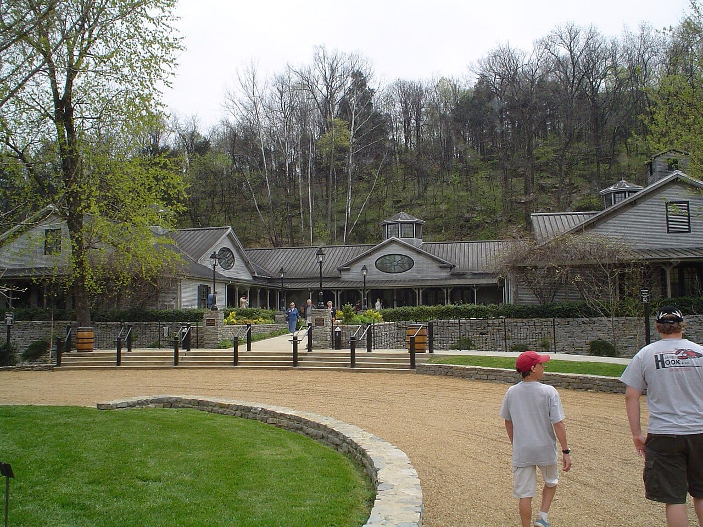

# 杰克丹尼酒厂

杰克丹尼在美国田纳西州的小镇林奇堡（Lynchburg），属于摩尔县（Moore County）。它常被当作“美国威士忌”的代名词，但严格说，它生产的是[田纳西威士忌](ref:tnwhiskey)：原料与桶的规定接近[波本](ref:bourbon)，却多了一道糖枫木炭过滤，并且必须在田纳西州境内完成。酒厂的参观动线穿过泉眼、木炭车间、蒸馏与桶库，最后落在品鉴室；理解这套流程，比记住酒标上的名字更重要。

> **到访信息**
> - 地址：280 Lynchburg Hwy, Lynchburg, TN 37352, USA。
> - 开放与预约：以[官方页面](https://www.jackdaniels.com/)为准；开放时间、场次和预约规则会随季节调整。
> - 交通与费用：出发前以官方页面为准，本页不承诺固定票价。
> - 营业状态：已核实；来源最近核对：2026-11-08。

图：杰克丹尼酒厂。图片：Ben Jacobson ( Kranar Drogin )，CC BY 2.5，via Wikimedia Commons（[原图页面](https://commons.wikimedia.org/wiki/File:Jack_Daniel_Distillery_Lynchburg_TN_001.JPG)）。

## 干县里的酒厂

林奇堡是摩尔县的县治，而摩尔县自禁酒令以来就是“干县”：县内不设酒类专卖店，餐馆也不能随意卖酒。唯一的例外是酒厂本身，它可以在访客中心出售瓶装酒，并在导览中提供品鉴。这种反差是理解杰克丹尼的第一层背景：一个以威士忌闻名的地方，日常生活里却买不到一杯酒。

镇中心很小，法院广场一圈就走完，餐馆与商店集中在附近。酒厂地址常用 280 Lynchburg Hwy，官方游客中心页面标注的入口是 133 Lynchburg Highway，两者都在同一条公路上；导航时以官方页面给出的入口为准。从纳什维尔开车约一个半小时，从查塔努加约两小时，公共交通基本不可行，租车是最实际的方式。

## 1866 年与“美国最老注册酒厂”

酒厂把 1866 年视为注册年份，并自称“美国最老注册酒厂”。官方与母公司 Brown-Forman 的表述一致：Jack Daniel 在联邦政府开始对威士忌征税与登记后，较早完成了注册。历史学者对具体日期仍有讨论，因为早期档案并不完整；更稳妥的写法是“官方叙述以 1866 年为起点”，而不是把“第一”当成没有争议的事实。

1904 年，旧 7 号在圣路易斯世界博览会（Louisiana Purchase Exposition）拿到金奖，这是品牌从地方酒厂走向全国市场的关键节点。方瓶、黑标与“Old No. 7”的编号，也在这一时期逐渐固定下来。把营销史与生产史分开看，会发现杰克丹尼的成功一半来自工艺，一半来自它很早就懂得如何让一瓶酒被记住。

## 林肯县工序：木炭、时间与泉水

田纳西威士忌与波本最大的差别，是所谓的“林肯县工序”（Lincoln County Process）：新酒在入桶前，要缓慢通过厚厚一层糖枫木炭，滤去部分粗糙感，再进入新烧焦的橡木桶。杰克丹尼的木炭在厂内自行烧制，过滤不是几秒钟的“过一下”，而是以滴滤方式持续数天；这套做法让新酒更柔，也让酒厂把“木炭”写成了品牌核心。

水源来自 Cave Spring，官方说泉水常年约 56 华氏度，且不含铁——铁会让威士忌产生异味，所以无铁泉水是这家酒厂选址的理由之一。需要提醒的是，木炭过滤并不会让酒变甜，它改变的是质地与入口的粗糙度；真正的甜味与香草感，主要来自新橡木桶的烘烤与陈年。把[田纳西](ref:tennessee)放回美国威士忌地图，就能看出它和肯塔基波本的分工。

## 参观动线：从泉眼到品鉴室

标准导览约 1.8 小时，成人票价 35 美元，每组 1 到 24 人，结束时品鉴六杯不同的田纳西威士忌。路线通常包括游客中心、Cave Spring 泉眼、木炭烧制与过滤区、蒸馏车间、桶库，最后回到品鉴室；全程步行，户外段落在夏天很热，冬天风大，穿舒适的鞋比穿得正式更重要。生产区有蒸汽、噪音与强烈气味，带小孩的访客要看管好孩子。

如果想看更多，酒厂还有 All About the Barrel、Bonded 与 A Day at Jack 等场次，价格与内容差别很大；有的含午餐或纪念品，有的限 21 岁以上。标准导览允许 21 岁以下参加，但不能品鉴；所有品鉴都必须出示带照片的身份证件。导览每天发团，旺季与周末很快售罄，最好提前在官网预订并确认取消政策。

## 酒款与风格

旧 7 号（Old No. 7）是基准款，酒精度 40%，香气以香蕉、香草、焦糖与橡木为主，入口偏甜，尾段有一点木炭的干涩。Gentleman Jack 经过两次木炭过滤，口感更干净；Single Barrel 以单桶装瓶，酒精度更高，风味更集中；Bonded、Bonded Rye 与 Triple Mash 则对应不同的法规类别与调配。Honey、Fire 等风味酒属于加味威士忌，不能拿来当田纳西威士忌的工艺样本。

[杰克丹尼](ref:jackdaniels)的风格常被概括为“甜、顺、带一点炭味”，这与它的原料比例、木炭过滤和新桶陈年都有关。想比较，可以点一杯旧 7 号与一杯单桶：前者是稳定的日常款，后者更能看出桶与年份的差异。不要把“顺口”误解为“没有个性”，在高温高湿的田纳西，酒厂本来就把易饮性放在很重要的位置。

## 预约、到达与票价

官网是唯一可靠的票务入口，现场买票经常只剩边角时段。标准导览 35 美元，Bonded 约 55 美元，All About the Barrel 约 75 美元，A Day at Jack 约 160 美元；价格含税与手续费的说法以页面为准。游客中心每天 9:00 到 16:30 开放，圣诞节、感恩节等少数日期闭馆；White Rabbit 瓶装店另有营业时间，周日开门更晚。

从纳什维尔出发走 I-24，从查塔努加走反方向，最后都汇入田纳西州道；坐标以官方渠道为准，导航到游客中心停车场即可。林奇堡镇上没有像样的公共交通，打车也不稳定，返程要提前安排。若要把田纳西威士忌串成线，可以把这里的[乔治迪克尔酒厂](ref:georgedickel)放在同一天或次日，两者相距约半小时到四十分钟，风格对比很明显。

## 误解与周边

第一个误解是把杰克丹尼当成波本：它符合波本的原料与桶要求，但酒厂选择以“田纳西威士忌”标识，并额外经过木炭过滤。第二个误解是以为干县完全不能喝酒：酒厂获准在访客中心销售与提供品鉴，但镇上的餐馆并不都能卖酒。第三个误解是以为“木炭过滤”是杰克丹尼的发明：林肯县一带的多家酒厂都使用类似工艺，差别在细节与规模。

周边可以逛林奇堡的法院广场、旧监狱与当地餐馆，也可以去 Tims Ford 湖；如果时间充裕，往北到纳什维尔看音乐现场，往南到查塔努加看山脉。把[美国](ref:usa)威士忌的整体地图先读一遍，再决定要不要租车跑两三家酒厂；一天排三家会很赶，两家加一顿午饭更舒服。

对照阅读：[乔治迪克尔酒厂](ref:georgedickel)、[美国](ref:usa)。

## 相关图像

图：杰克丹尼老7号。图片：Ben Jacobson ( Kranar Drogin )，CC BY 2.5，via Wikimedia Commons（[原图页面](https://commons.wikimedia.org/wiki/File:Jack_Daniel_Distillery_Lynchburg_TN_001.JPG)）。关联图像：杰克丹尼酒厂。
