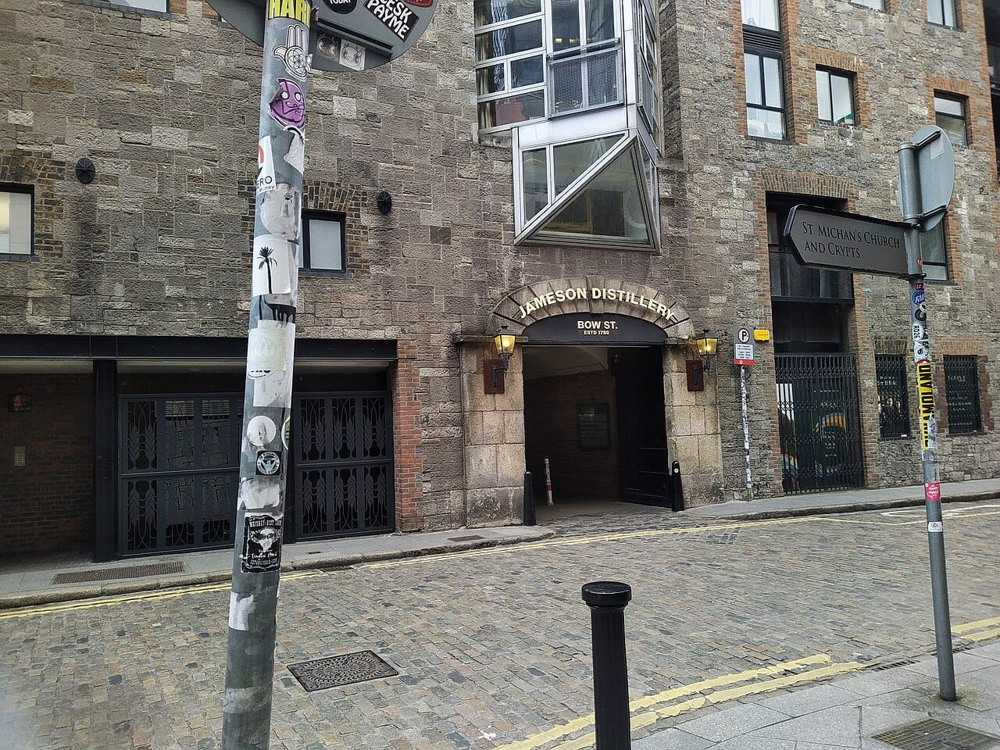
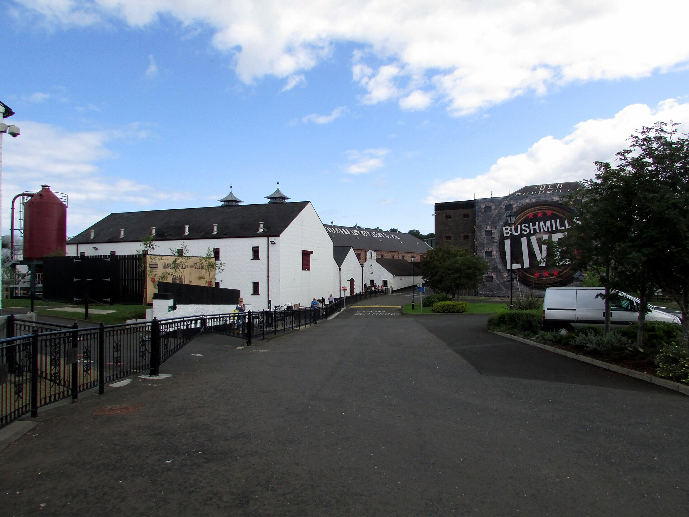

# 尊美醇弓街酒厂

弓街酒厂在都柏林 7 区的 Smithfield，离利菲河北岸不远，是一处把“旧酒厂”改造成游客体验的场所。它在 1780 年由 John Jameson 创立，曾是一座占地六英亩、雇有数百名工匠的城市酒厂；1970 年最后一次壶式蒸馏之后，生产迁往科克的 Midleton，这里在 1997 年改为游客中心。今天你能看到厂房、铜器与仓库，却看不到正在出酒的生产线——把这个前提弄清楚，参观才不会失望。

图：尊美醇弓街酒厂。图片：Lingual Friendulum，CC0，via Wikimedia Commons（[原图页面](https://commons.wikimedia.org/wiki/File:Jameson_distillery_2.jpg)）。

## 从 1780 年的弓街开始

John Jameson 生于苏格兰 Alloa，1770 年代末来到都柏林，1780 年在弓街开始自己的威士忌生意。酒厂随后扩张成一座“城中之城”：除了蒸馏车间，还有制桶、铁匠、木工与石匠，Smithfield 一带至今仍是手工艺与旧仓库混杂的街区。19 世纪后期，弓街是都柏林最大的酒厂之一，产品经码头与铁路运往海外；这段城市工业史，比任何单一酒款都更能解释这处厂址为什么值得保留。

需要区分的是，Jameson 是一个品牌，而不是一家始终独立的家族酒厂。品牌后来并入 Irish Distillers，今天由 Pernod Ricard 持有；弓街只是它的“出生地”与品牌之家，实际生产集中在 Midleton。理解这层关系，就不会把这里的展板当成整个品牌的生产说明书。

## 一座不再蒸馏的“酒厂”

1970 年 6 月，弓街最后一次蒸出壶式威士忌，随后生产迁往 Midleton；旧厂区一度闲置、失修，直到 1997 年以游客中心身份重新开放。2017 年，展馆完成一轮大规模改造，加入新的品鉴室、酒吧与互动展项。今天它更像一座“威士忌解释中心”：用旧建筑、铜制蒸馏器与投影讲工艺，再用对比品鉴讲风格。

因此，不要把这里当成可以闻到发酵味的在产酒厂。真正的生产现场在科克郡；弓街的价值在于城市尺度、品牌历史与入门教育。若你想看仍在运转的铜壶与糖化槽，应把[布什米尔斯](ref:bushmills)或[基尔伯根](ref:kilbeggan)排进行程；若想先建立概念，再来弓街会更有效。官方给出的坐标是 53.348376, -6.277354，导航到 Smithfield 即可。

## 参观动线：设备、仓库与对比品鉴

标准导览通常从旧厂建筑与品牌故事开始，经过保存下来的铜制蒸馏器、发酵与仓库展区，最后进入品鉴室。讲解的核心是三次蒸馏与调和：为什么爱尔兰威士忌常做三次蒸馏，壶式蒸馏酒与谷物酒各自贡献什么，桶型如何改变香气。部分场次会做“爱尔兰、苏格兰、美国”三杯对比，这是最实用的入门方式，也比单喝一杯更容易记住差别。

另有调酒课程与更长的品鉴场次，适合已经喝过一轮的人。导览时长约一小时，具体场次与语言随季节调整；展馆内有酒吧与商店，可以不参加导览直接进入。旧建筑的门槛与楼梯不完全平整，行动不便者建议提前询问路线；带儿童的家庭要确认所选场次是否允许未成年人进入品鉴区。

## 杯中的风格：调和、壶式与桶

Jameson Original 是典型的[调和](ref:blending)爱尔兰威士忌：壶式蒸馏酒提供香料与油脂感，谷物酒提供轻柔与甜味，三次蒸馏让整体更顺口。Black Barrel 使用双重烧焦的波本桶，香草与焦糖更明显；18 年与 Bow Street 18 年则把陈年与桶型推到更高价位。它们共同的气质是“易饮”，但这不等于简单——把水加一点，香料与谷物甜会分得更开。

从法规上看，[爱尔兰威士忌](ref:irish)必须在爱尔兰岛上蒸馏与陈年，壶式蒸馏酒对发芽与未发芽大麦的比例有要求，调和酒则把壶式酒与谷物酒组合起来。三次蒸馏是多数酒厂的做法，却不是法律强制；[壶式蒸馏器](ref:potstill)的形状、回流与蒸馏次数，才是各家风格的真正分水岭。把弓街当作“概念课”，再去产区喝具体酒款，顺序会更顺。

## 预约、开放与到达

地址是 Bow St, Smithfield, Dublin 7, D07 N9VH, Ireland。官方页面列出每周七天开放：周日 11:45 开始，周一至周四 10:00 开始，周五与周六 10:00 开始；末场导览在 18:00 或 18:30，酒吧与商店关得更晚。爱尔兰的酒类销售有时间限制，工作日上午 10:30 前、周日上午 12:30 前不能在商店或酒吧买酒，这一点对早到的游客很实际。

交通很方便：Luas 红线在 Smithfield 站下车，步行约两分钟；从 O'Connell 街步行过来约二十分钟；最近的停车场在 Queen Street 与 Smithfield Square。导览建议提前在线预订，周末与假期容易满场；如果想参加调酒课程，确认年龄限制与取消政策。展馆位于旧城西侧，可以和都柏林城堡、St Michan's 教堂或 Jameson 所在的 Smithfield 广场串成半日路线。

## 误解与半日路线

最常见的误解有三个。第一，以为这里仍在生产：弓街今天没有商业蒸馏，真正的酒厂在 Midleton。第二，以为“Jameson 只有一款”：从 Original 到 Black Barrel、18 年与单桶，风格跨度不小。第三，以为导览就是喝酒：讲解占了大半时间，品鉴只是收尾；不喝酒的人也能从工艺与建筑里得到东西。

周边可以步行到 Smithfield 广场、Light House 影院与 St Michan's 教堂，往南过河就是都柏林城堡与 Temple Bar。若要把爱尔兰威士忌串成一条线，可以把弓街、[布什米尔斯](ref:bushmills)与[基尔伯根](ref:kilbeggan)分开安排：一个看城市工业史，一个看仍在运转的北海岸酒厂，一个看小镇复兴。把[爱尔兰](ref:ireland)产区的背景先读一遍，再决定顺序，通常比临时买票更从容。

对照阅读：[布什米尔斯酒厂](ref:bushmills)、[爱尔兰](ref:ireland)。

**关键事实。**

| 项目 | 内容 |
| --- | --- |
| 一句话定位 | 都柏林 Smithfield 的尊美醇旧酒厂，1780 年由 John Jameson 在弓街创立，1970 年最后一次壶式蒸馏后停产，1997 年改为游客中心；今天以导览、对比品鉴与调酒课程讲述爱尔兰威士忌，但已不再生产 |
| 地址 | Bow St, Smithfield, Dublin 7, D07 N9VH, Ireland |
| 城市/国家 | 都柏林 / 爱尔兰 |
| 营业状态 | 已核验营业 |
| 官网 | jamesonwhiskey.com |

**来源与边界。** 本页关于「尊美醇弓街酒厂」的关键事实，主要由以下来源交叉核对：Jameson（Bow St 地址、坐标、开放时间、LUAS 与停车提示；1780 年创立、1970 年最后一次壶式蒸馏与 1997 年改为游客中心）、The Spirits Business（1997 年改为游客中心与 2017 年完成的展馆改造）。产品、地址或营业状态变化较快时，以 jamesonwhiskey.com 的最新页面为准；价格、批次与状态会变，涉及这些字段时以页面所列来源的最新版本为准。正文为项目自写，来源只作核验，不复制原文。

## 相关图像

图：布什米尔斯酒厂相关实景照片。图片：Reading Tom，CC BY 2.0，via Wikimedia Commons（[原图页面](https://commons.wikimedia.org/wiki/File:Bushmills_Whiskey_Distillery_02.jpg)）。关联图像：尊美醇弓街酒厂。
