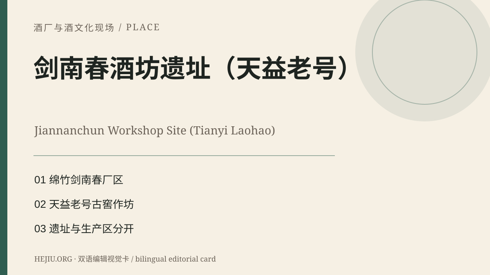

# 剑南春酒坊遗址（天益老号）

绵竹在唐代就以“剑南烧春”闻名，今天的剑南春把这段酒史落在厂区里的酒坊遗址与“天益老号”古窖作坊上。很多人到了绵竹只看到大门和酒瓶，以为“遗址”是一块碑；实际上，碑后的窖池、作坊和仍在使用的生产系统才是重点。先分清遗址、厂区与展陈，再决定这趟是看历史、看工艺，还是两者都要。

图：剑南春酒坊遗址（天益老号）专属双语视觉卡。项目自制双语视觉卡，用于识别主题，不是现场照片。

> **先给结论**
> **适合谁：** 想看传统浓香型窖池与酒坊空间的人；适合与绵竹年画村、德阳或成都串线。
> **不适合谁：** 把遗址当成自由开放的古镇街区、不愿预约的人；生产区有明确边界。
> **一句话：** 先看碑与遗址范围，再看天益老号的窖池与作坊，展陈与品鉴按官方安排。

## 先分清遗址、厂区与展陈

第一层是“剑南春酒坊遗址”的文物保护范围，核心是酒坊遗存、窖池与相关空间，不是一整片可以随意穿行的老街区。第二层是剑南春正在使用的生产厂区，有车间、仓库、运输和门禁，不能因为“来看遗址”就进入。第三层是展陈或酒史介绍空间，可能设在厂区内外，开放方式与预约入口要单独确认。三层常常共用一条路，却有不同的规则；到现场先看导览牌和边界线，不要跟着人流越过围栏。把这三层分清，才不会把“国保碑”当成全部。

## 天益老号与古窖作坊

“天益老号”是剑南春传统酒坊的代表性空间，重点看窖池的连续使用、窖泥的维护、糟醅的入窖与蒸馏。浓香型白酒靠泥窖固态发酵，窖池越老、养护越稳定，酒体的窖香与己酸乙酯才容易形成。看的时候不要只数窖池数量，要注意池壁的厚度、池底的泥层、作坊的通风与排水，以及蒸馏设备与窖池的距离。古窖作坊的价值在于它仍能说明“粮食—曲—窖—甑—酒”的一条完整链路，而不是单独的旧房子。现场若有人作业，保持距离，不触摸窖泥，不把相机伸进池口。

## 绵竹怎么到、留多久

绵竹在成都平原西北，距成都约一小时多车程，距德阳更近；从成都东站或德阳站转车都可行，具体班次以实时查询为准。只看遗址与展陈，约两小时；加上年画村与老城，半天到一天。剑南春厂区周边是工业与居住混合区，餐饮选择不如成都密集，午饭可以回绵竹市区。夏天窖池区气味重，地面可能湿滑，穿防滑鞋；拍照前看现场标识，不要把生产设备与工人拍进特写。若从成都当天往返，建议把绵竹安排在上午，下午回程避开晚高峰。

## 预约与生产边界

遗址与厂区的开放方式会随生产、维修与接待安排变化，出发前看剑南春官方渠道或绵竹文旅公告，不要拿几年前的攻略当现时信息。即使遗址区域开放，正在运转的车间也不等于参观区：蒸汽、机械、叉车和酒糟堆放都有风险，不能自行进入。品鉴要问清酒精度、容量与收费，司机不喝；买酒去官方店或授权渠道，保留发票，不要把“内部酒”当成遗址的延伸。若带着孩子，提前说明窖池不是游乐设施，不要让他们在池边追逐。

## 年画村、龙门山与酒乡

绵竹不只是酒：孝德镇的年画村、绵竹年画博物馆与老城，能把“酒乡”放进川西的民间生活里。半天线路可以按“酒坊遗址—年画村—绵竹老城”走；多留一天可以去九龙山、麓棠温泉或龙门山一带，但山区天气与路况变化大，出发前看预报。吃饭可以试绵竹米粉、板鸭、蒸菜与川味家常菜，配浓香型白酒时控制量。若在年画村体验拓印或绘制，问清是否使用模板、是否另收费，不要把体验成品当成“手工原作”。

## 把绵竹排成“酒与年画”的一天

上午先到剑南春酒坊遗址，按现场边界看碑、窖池与作坊，把浓香型白酒的“窖—糟—甑—酒”链路看明白；中午回绵竹市区吃饭，下午去年画村看木版年画的起稿、刻版、套印与手绘，最后在老城走一圈。这样的顺序把“生产现场”和“民间工艺”分开，不会把两个空间都挤在饭点。若只有两小时，就只选遗址与展陈，不要硬加年画村；若带着长辈，减少走动，把展陈里的模型和剖面先看懂，再到现场对照。返程前买酒，别在遗址门口临时起意。若只留一小时，放弃年画村，集中看遗址与展陈；若带长辈，把展陈模型先看懂，再到现场对照，减少来回找路。

## 出发前核对

- 确认遗址与展陈的开放入口
- 生产车间不自行进入
- 不触摸窖泥与池口
- 穿防滑鞋，夏天带口罩
- 买酒留到返程前，保留发票
- 国保碑与遗址范围不是全部展线
- 年画村与酒坊之间留足车程
- 遗址内不攀爬遗存、不追逐打闹

## 这一页的边界与下一步

天益老号酒坊遗址的核心价值在“仍在使用的老窖池与作坊空间”，不是一座新建的展馆。参观时先确认遗址开放范围：有些区域属于生产保护单位，只能在外围观看；讲解是否提供、是否允许拍摄，也要现场问清。把“看遗址”和“买酒”分开，避免被导购节奏带着走。

绵竹市区到酒坊不远，可与年画村、绵竹老城组成一日线；若从成都出发，高铁到绵阳或德阳再转车更稳。酒坊周边道路窄，节假日停车紧张，尽量早到。

这一页没有覆盖剑南春全部厂区。若你要看现代化灌装线或酒库，需要另约企业参观，不能把遗址门票当成全厂通行证。出发前核对开放时间与预约要求，比到了再问更省事。

## 参考资料

- 绵竹市人民政府 — 美丽绵竹 — https://www.mz.gov.cn/meilimianzhu.htm（绵竹市人民政府，核对 2026-11-25）
- 剑南春 — 关于剑南春 — https://www.jnc.cn/about（四川剑南春（集团）有限责任公司，核对 2026-11-25）
- 德阳市人民政府 — https://www.deyang.gov.cn/（德阳市人民政府，核对 2026-11-25）
- GB/T 2260-2007 中华人民共和国行政区划代码（国家标准化管理委员会，核对 2026-11-25）

相关条目：[绵竹年画村](ref:village)、[绵竹剑南春路线](ref:route)、[剑南春](ref:brand)、[剑南春集团](ref:producer)、[浓香型白酒](ref:style)、[四川省](ref:region)、[第一次喝白酒怎么选](ref:guide)、[中国酒史纲](ref:history)。
