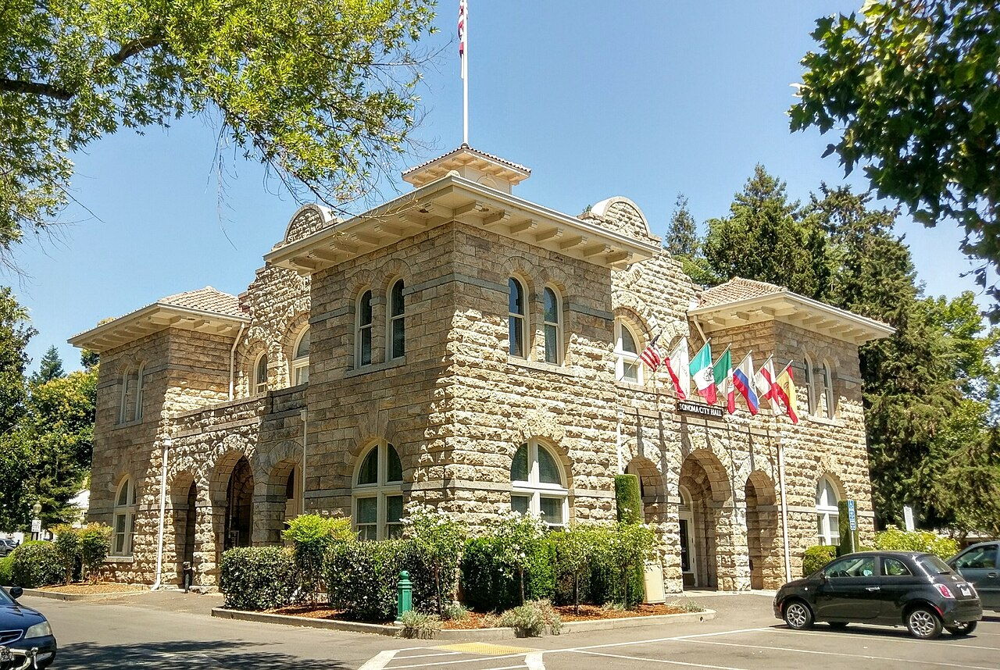

# 乔丹酒庄

乔丹是亚历山大谷最像波尔多酒庄的美国酒庄之一：1972 年由来自丹佛的 Tom 与 Sally Jordan 创立，只做一款亚历山大谷赤霞珠和一款俄罗斯河谷霞多丽，用一座 5.8 万平方英尺的法式城堡把酿酒、餐饮与待客放在同一个屋檐下。

图："乔丹酒庄"所在的索诺马风貌配图。图片：Cullen328，CC BY-SA 3.0，via Wikimedia Commons（[原图页面](https://commons.wikimedia.org/wiki/File:Sonoma_City_Hall_(cropped).jpg)）。这张照片用于说明产区环境与访问语境，不标定"乔丹酒庄"的门店、酒庄或活动现场。

> **先给结论**
> **一句话：** 这页判断乔丹酒庄值不值得专程去，以及到访前要核对什么。
>
> - **适合谁：** 正在计划去乔丹酒庄、想知道值不值得专程安排半天到一天的人。
> - **不适合谁：** 只想要“必去榜单”、不准备核对预约、交通和开放时间的人。
> - **先看这两点：**
>   - 乔丹的参观以预约制为主，常见形式包括城堡导览、 Estate Tour、露台餐饮配对与图书馆品鉴。
>   - 乔丹是工作中的酒庄，不是拍照基地。

## 1972 年：乔丹酒庄的关键起点
乔丹酒庄位于索诺马县亚历山大谷，酒厂在 1474 Alexander Valley Road，希尔兹堡以北。Tom 与 Sally 1959 年结婚，两人都是法国酒与法国菜的爱好者；在旧金山喝到一杯 Beaulieu Vineyard 的 Georges de Latour 后，他们决定把“法国式的酒庄梦”放在加州实现。1972 年 5 月，他们买下亚历山大谷谷底的 275 英亩土地，巧合的是，儿子 John 也在签署地契的同一天出生。

1974 年，Jordan 夫妇决定正式建酒庄，又通过置换获得约 1,300 英亩亚历山大谷山坡地，也就是今天的 Jordan Estate。他们请来 André Tchelistcheff 做酿酒顾问，请旧金山建筑师 Bob Arrigoni 设计一座 58,000 平方英尺的城堡，把酿酒车间、仓库、办公、厨房与客房放在一起。1976 年，酿酒部分在采收前一周完工，Jordan 的第一个年份——赤霞珠与梅洛——就在那一年进罐。

首任酿酒师 Rob Davis 于 1976 年入职，一直做到 2019 年退休，横跨 43 个采收季，是索诺马县任期最长的酿酒师之一。2019 年，与他共事 13 个采收季的 Maggie Kruse 接任酿酒师。John Jordan 2005 年开始主持日常经营，2007 年成为全资所有者；2022 年，酒庄庆祝成立 50 周年。

## 建筑与庄园

乔丹的城堡是酒庄最直接的“法国引文”：黄墙、陡坡屋顶、烟囱与拱门，外观接近波尔多与勃艮第的乡村酒庄，而不是纳帕常见的现代玻璃盒子。城堡内部的工作区与待客区被有意放在同一栋建筑里，让参观者能看到酿酒、厨房与餐厅如何共享一个空间。

Jordan Estate 约 1,200 英亩，其中约四分之三是自然栖息地：橡树林、草地、湖泊与河岸被保留下来，葡萄园、橄榄树与厨师花园只占一小部分。1990 年代根瘤蚜虫毁掉谷底老葡萄园后，酒庄没有全部重种，而是把 estate 分成十几个小块，保留缓冲带与老树；这种“先留白、再耕种”的做法，后来成了酒庄可持续叙事的基础。

2021 年，乔丹买下亚历山大谷一块 45 英亩的地产，这是 1974 年之后首次购地；同年完成三间城堡客房的首次大修。酒庄也种橄榄、养蜂、做橄榄油，把“餐桌”作为参观体验的中心，而不是把品酒室单独抽出来。

## 葡萄与风土

乔丹的赤霞珠主要来自亚历山大谷：谷底冲积土与山坡的火山沉积土混合，白天热、夜晚凉，适合让赤霞珠成熟而不失去酸度。酒庄早期只用自有园，后来逐步转向“自有园 + 长期合作农园”的勃艮第式拼配：东北向山地的果实提供结构与黑醋栗，谷底与河岸的果实提供柔和的红色果味。

霞多丽则来自俄罗斯河谷，靠近太平洋，夏季多雾、昼夜温差大，果实酸度高、成熟慢。2000 年，乔丹的霞多丽全面转向俄罗斯河谷；今天酒庄在那边与多家长年农园合作，按地块分别发酵，再拼配出酒庄风格。2022 年，酒庄购入八个混凝土蛋形发酵罐，用来增加霞多丽的质地与细腻感。

酒庄的葡萄园管理强调可持续：2019 年，乔丹获得加州可持续葡萄种植联盟（CSWA）认证，赤霞珠农园也全部通过 CSWA、Fish Friendly Farming 或 USDA Organic 的第三方认证。酒庄在庄园里保留传粉昆虫栖息地，并因为帝王蝶栖息地保护获得过 Pollinator Partnership 的奖项。

## 酒款与风格

乔丹只做两款酒，这在加州酒庄里很少见。第一款是 Jordan Cabernet Sauvignon Alexander Valley：以赤霞珠为主，混少量梅洛、小维多、马尔贝克与品丽珠，法国橡木桶陈酿，风格偏“年轻时能喝、陈年后更顺”——黑醋栗、黑樱桃、雪松、香草与细单宁，酒精度通常克制，不追求纳帕式的浓稠。

第二款是 Jordan Chardonnay Russian River Valley：勃艮第式酿造，部分桶发酵、带酒泥搅拌，酸度清晰，带柠檬、白桃、榛子与奶油质地；新桶比例控制得低，避免香草味盖过果实。酒庄历史上还做过 Riviere Russe  dessert wine（1982、1983、1985 等年份），但今天主线仍是这一红一白。

乔丹的风格常被形容为“比加州更法国”：单宁细、酒精中等、果味不炸，适合配餐而不是单独比拼浓度。这个选择也解释了酒庄为什么重视餐厅与厨房：酒不是货架上的 trophy，而是餐桌的一部分。

## 参观与空间

乔丹的参观以预约制为主，常见形式包括城堡导览、 Estate Tour、露台餐饮配对与图书馆品鉴。城堡导览会讲建筑、历史与酿酒流程；estate tour 会进入葡萄园、橄榄林与花园，时间更长，适合想理解庄园整体的人。

品鉴通常在城堡内或露台进行，配厨师做的小食；酒庄的餐饮体验在索诺马县口碑很好，但名额少，旺季要提前较久预约。三间城堡客房对住客开放，适合想把参观拆成两天的人；如果只住一晚，优先选含 estate tour 与餐饮配对的套餐。

酒庄距离希尔兹堡镇约十五分钟车程，从旧金山出发约两小时。门口有停车位，但大型团体与无障碍需求要提前沟通；城堡与葡萄园之间有坡道与碎石路，穿高跟鞋不合适。

## 「乔丹酒庄」的上桌方式
赤霞珠适合在十六到十八摄氏度饮用，开瓶后醒三十到六十分钟；年轻年份可以更早开，老年份则先倒一杯试，避免过度氧化。霞多丽适合十到十二摄氏度，不要太冰，否则榛子与奶油质地会被压住；开瓶后不必醒酒，直接倒杯等几分钟即可。

配餐上，赤霞珠适合烤牛排、炖牛肉、烤羊排、硬质奶酪与黑巧克力；它的单宁细，不适合配太辣的菜。霞多丽适合烤鸡、龙虾、奶油蘑菇、烤鱼与软质奶酪；如果配生蚝，选酸度更突出的年份，不要配重桶的老年份。

乔丹的酒不追求“开瓶即爆”，更适合在餐桌上慢慢展开。若只有一瓶，选赤霞珠配红肉；若有两瓶，先霞多丽配前菜、再赤霞珠配主菜，顺序不要反过来。

## 乔丹酒庄的地址与营业安排
从希尔兹堡出发，走 Alexander Valley Road 向北约十五分钟；从旧金山走 101 北，约两小时。参观建议留九十到一百二十分钟；estate tour 加餐饮配对要三小时以上。周末、采收季与节假日名额紧张，最好提前几周预约。

开放时间、套餐价格与可试酒款会变化，出发前以酒庄官网为准。带小孩或长辈时，先确认无障碍通道、洗手间与休息区；城堡内部分地面是石阶，葡萄园是草地与碎石路。若遇到闭馆，先把希尔兹堡镇或俄罗斯河谷的酒庄写进备选。

## 礼仪与常见误区

乔丹是工作中的酒庄，不是拍照基地。按预约时间到，穿能走草地的鞋；城堡内可以拍照，但发酵间、仓库与办公区不要拍，也不要碰设备。带大型团体、小孩或宠物，先问清楚是否接待；品鉴时把酒吐进吐酒桶是正常做法，开车的人最好只喝一两杯。

最常见的误区是把乔丹当成“纳帕式大酒庄”。它只有两款酒，规模也不靠铺货；赤霞珠不是越浓越好，霞多丽也不是越冰越好。另一个误区是把城堡当成独立景点：真正值得看的是城堡背后的庄园、橄榄林、花园与那套“酒配餐”的逻辑。

## 从乔丹酒庄延伸到索诺马
乔丹适合作为亚历山大谷一日路线的核心：上午从希尔兹堡出发，先到乔丹做城堡导览，午餐在酒庄或回镇上，下午再去一家对照酒庄。若想看俄罗斯河谷的霞多丽，可以把乔丹与 Williams Selyem、Ridge 等排在一起，但不要一天跨太多子产区。

如果只有半天，选乔丹加希尔兹堡镇，不要再去第三个酒庄；乔丹的导览与餐饮体验本身就需要时间。如果有一整天，可以把亚历山大谷与俄罗斯河谷分开：上午赤霞珠、下午霞多丽，中间留一顿饭与一段车程。

相关条目：[索诺马](ref:sonoma)、[美国](ref:usa)、[赤霞珠](ref:cabernet)。

## 参考资料
- 相关条目：[sonoma](ref:sonoma)、[usa](ref:usa)、[cabernet-sauvignon](ref:cabernet)、[chardonnay](ref:chardonnay)、[oak-ageing](ref:oak)。
- 本页不提供实时价格、套餐库存或营业状态；参观前以酒庄官网与亚历山大谷葡萄酒协会为准。
- 想把乔丹喝明白，可以同一趟对比它家的赤霞珠与霞多丽，再各选一瓶亚历山大谷、俄罗斯河谷的其他酒庄做对照，理解“谷地 vs 海岸”的成熟度与酸度差异。
