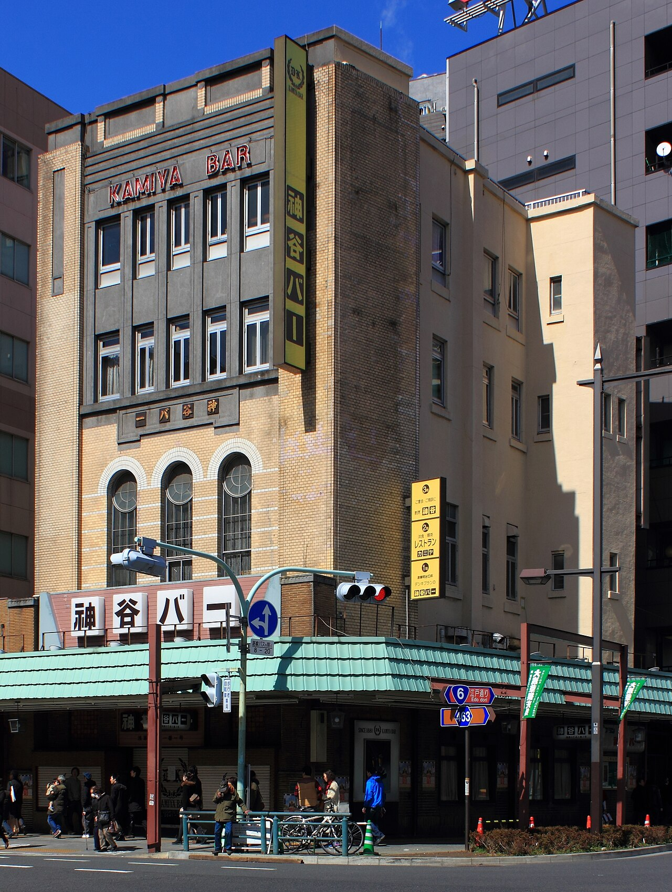
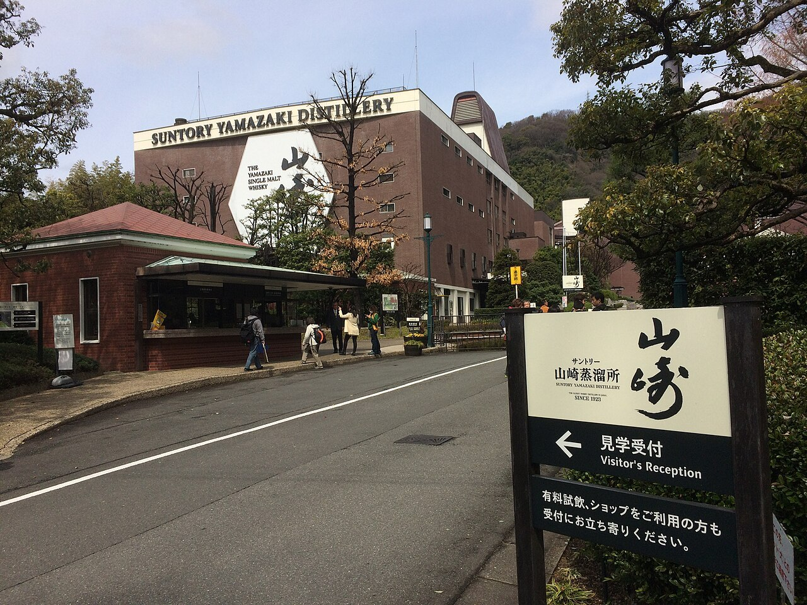

# 神谷酒吧

浅草雷门通上，有一栋红砖与白色招牌的老建筑，门口写着“Kamiya Bar”与“创业明治十三年”。这就是神谷酒吧（神谷バー），东京浅草最著名的老酒吧，也是日本最早的“bar”之一。它不像银座的现代鸡尾酒吧那样安静、昂贵，而是把一杯“电气布兰”（Denki Bran）、几碟下酒菜、喧闹的浅草日常与 140 多年的历史放在同一个空间里。

图：东京浅草的神谷酒吧。图片：Kakidai，CC BY-SA 3.0，via Wikimedia Commons（[原图页面](https://commons.wikimedia.org/wiki/File:Kamiya_bar_at_Asakusa_Tokyo.JPG)）。

> **先给结论**
> **一句话：** 这页判断神谷酒吧值不值得专程去，以及到访前要核对什么。
>
> - **适合谁：** 正在计划去神谷酒吧、想知道值不值得专程安排半天到一天的人。
> - **不适合谁：** 只想要“必去榜单”、不准备核对预约、交通和开放时间的人。
> - **先看这两点：**
>   - 第一次来，直接进 1 楼，先在入口买票。
>   - 第一，不要把“日本第一家酒吧”当成“日本第一家酒馆”；神谷酒吧是近代西式 bar 的先驱，不是所有酒馆的起点。

## 1880 年：神谷酒吧的关键起点
神谷酒吧的创始人是神谷传兵卫（Denbei Kamiya）。1880 年 4 月，他在浅草区花川户町四番地开出“みかはや銘酒店”（Mikawaya 酒铺），开始按杯卖酒；1881 年开始销售进口葡萄酒；1882 年，他开始制造与销售“速成白兰地”（即后来的电气布兰）。1912 年 4 月 10 日，店面改成西式风格，改名“神谷酒吧”；1921 年，今天仍在使用的神谷大楼本馆落成。2011 年 10 月 28 日，本馆被登录为日本有形文化财。

“日本第一家酒吧”的说法需要加限定：它指的是日本最早以“bar”形态经营、并延续至今的西式酒吧之一，而不是“日本第一家卖酒的店”。神谷酒吧的官方英文页写作“Japan's first bar”，这是它的自我定位；从历史研究角度看，更准确的说法是“日本近代酒吧业的先驱”。把“第一家”当成营销用语，同时承认它在日本酒吧史上的位置，比较稳妥。

电气布兰是神谷酒吧的核心。它最初以白兰地为基酒，加入琴酒、葡萄酒、橙皮酒（curaçao）与多种香草，配方至今保密；早期酒精度约 45 度，现在常规版 30 度，“Old”版 40 度。名字里的“电气”来自明治时代对电力的新奇感：当时任何现代、先进的东西都爱加“电气”二字；“Bran”则是 brandy 的缩写。它甜、暖、香气重，像一杯“老东京”的餐后酒，不是现代意义上的清爽鸡尾酒。

神谷酒吧与文学的关系也很深。萩原朔太郎在《神谷バァにて》里写一个人独自喝酒的寂寞；永井荷风、川端康成、三浦哲郎等作家都写过浅草，神谷酒吧也出现在《忍ぶ川》等作品里。它不是“文学咖啡馆”，而是“文学酒吧”：作家与普通市民共用一张桌子，喝的是同一杯电气布兰。

## 空间与酒单

神谷大楼共三层，功能分得很清楚。1 楼是“神谷酒吧”，进门先在售票机或柜台买票，再把票交给服务员换酒与食物；座位有桌子和吧台，全部禁烟，另设吸烟室。2 楼是“餐厅神谷”（Restaurant Kamiya），卖西式料理、汉堡排、牛排、蛋包饭、甜点与咖啡，适合家庭与团体；3 楼是“割烹”，1970 年开业，做日本料理。卖店“神谷酒吧賣場”在雷门通一侧，卖电气布兰、神谷葡萄酒与原创商品，营业时间与酒吧不同。

1 楼的酒单以电气布兰为轴：常规电气布兰、Old 电气布兰、生啤酒、葡萄酒、清酒、烧酒、软饮与下酒菜。电气布兰通常装在小玻璃杯里，一口或两口喝完；也可以点“电气布兰兑啤酒”或加冰，具体问服务员。生啤酒是浅草下班后的常见选择；下酒菜有毛豆、腌菜、炸物、关东煮风格的小菜与洋风小吃，菜单不复杂。

2 楼菜单更完整：汉堡排、牛排、炸虾、蛋包饭、咖喱饭、沙拉、蛋糕与冰淇淋；价格比 1 楼高，但仍是“浅草洋食”的价位。想坐下来吃一顿，去 2 楼；想站着或挤在 1 楼喝一杯，留在楼下。3 楼割烹需要预约，适合想吃日本料理的客人。

## 第一次去怎么点

第一次来，直接进 1 楼，先在入口买票。不会日语也能点：指着菜单上的“デンキブラン”（Denki Bran）说“one”，或指“Old”；把票交给服务员，酒会端上来。想尝味道，先点常规 30 度版本，小杯一口；觉得太甜，可以点一杯生啤酒或气泡水。想配酒，点毛豆、腌菜或炸物，不要点一大桌菜，1 楼的空间不适合正餐。

时段上，11:00 开门，下午人少，适合拍照与慢慢喝；傍晚下班后与周末很吵，本地人与游客混在一起；19:30 最后点单，20:00 关门。周二定休，另有每月两个周一休息，出发前看官网日历。想安静聊天，去 2 楼；想感受“浅草日常”，留在 1 楼。

费用与支付：1 楼买票制，现金与刷卡的具体方式看现场；官方说明“除 1 楼神谷酒吧外可刷卡”，所以 1 楼要备现金。2 楼可刷卡，debit 卡不可。电气布兰价格不高，属于“日常一杯”的价位；不要把它当成高级鸡尾酒，期待“调酒师表演”会失望。

## 神谷酒吧的地址与营业安排
**地址**：东京都台东区浅草 1 丁目 1 番 1 号，邮编 111-0032。面对雷门通，靠近浅草站；看到红砖立面、白色“Kamiya Bar”招牌与“创业明治十三年”字样就到了。

**交通**：东京地铁银座线浅草站 3 号出口，步行 1–2 分钟；都营浅草线浅草站 A5 出口，步行 1–2 分钟；东武天空树线浅草站正面出口，步行 1–2 分钟；筑波快线浅草站 A1 出口，步行约 10 分钟。浅草站周边人流大，推婴儿车要慢行。

**营业时间**：11:00–20:00，19:30 最后点单；周二定休，每月另有两次周一休息；卖店 10:00–19:00，周二定休。节假日与浅草活动可能调整，以官网日历为准。`operating_status` 记为 `verified`，表示官网在 2026-11-20 仍显示营业；这不等于每天一定开门。电话 03-3841-5400。

**预订**：1 楼不接受预订，walk-in 与售票制；2 楼餐厅可电话咨询团体预订；3 楼割烹需要预约。没有 dress code，穿日常衣服即可；1 楼空间窄，大件行李不方便。

**价格**：1 楼电气布兰与下酒菜属于日常价位；2 楼西餐人均约 1,500–3,000 日元；3 楼割烹更高。具体以菜单为准。1 楼备现金，2 楼可刷卡。

页面核验日期 2026-11-20；营业时间、价格与定休日以官方渠道为准。

## 礼仪与常见误区

第一，不要把“日本第一家酒吧”当成“日本第一家酒馆”；神谷酒吧是近代西式 bar 的先驱，不是所有酒馆的起点。第二，不要以为 1 楼可以“坐下点单”；1 楼是买票制，先买票再换酒，别坐下来等服务员。第三，不要点一大桌菜占住 1 楼的小桌；1 楼以下酒菜为主，正餐去 2 楼。

常见误区还有三个。其一，把电气布兰当成“普通甜酒”；它酒精度 30 度，Old 版 40 度，喝快容易上头，小杯慢慢喝。其二，以为每天营业；周二定休，另有每月两个周一休息，别白跑。其三，以为“神谷大楼”是 1880 年原建筑；本馆 1921 年落成，2011 年登录文化财，1880 年是创业年。

不适合来这里的情况：想安静喝精品鸡尾酒的人；不喝酒、只想吃饭的人（可以去 2 楼）；带大件行李或推婴儿车的人。它适合“浅草散步途中喝一杯”的场景，也适合想感受日本近代酒吧史的人。

## 东京的周边街区
神谷酒吧在浅草 1 丁目，往北是雷门与浅草寺，往南是吾妻桥与隅田川，往东是浅草花屋敷与浅草六区。把酒吧放在“雷门—浅草寺—仲见世—神谷酒吧”这条线上：上午看浅草寺，中午吃天妇罗或荞麦面，下午在神谷酒吧喝一杯电气布兰，傍晚去隅田川看夜景。走路约 30 分钟，不需要交通工具。

若想把“东京酒吧”作为主题，可以再去银座的 Star Bar 或新宿的现代鸡尾酒吧；神谷是“大众酒吧”，Star Bar 是“精致鸡尾酒”，两者对比有意思。不要把神谷当成“调酒技术”的样本，它卖的是历史、价格与浅草氛围。

浅草周末与节假日非常拥挤，雷门通拍照要排队；酒吧门口不要堵住通道。若遇到团体包场或媒体拍摄，1 楼可能临时调整，改天再来。

## 同城酒馆与延伸阅读
- [Star Bar 银座](ref:star-bar)：东京银座的经典鸡尾酒吧，可与神谷的“大众酒吧”传统对照。
- [白兰地](ref:brandy)：电气布兰的基酒，了解它的原料与风格。
- [利口酒](ref:liqueur)：电气布兰里的橙皮酒与香草配制酒，属于这一大类。
- [酒吧与城市](ref:pub-and-city)：酒吧如何用价格、座位与营业时间组织城市夜生活。
- [中央咖啡馆](ref:cafe-central)：维也纳的文学咖啡馆，另一种“作家常客”传统。

相关条目：[星光酒吧（银座）](ref:star-bar)、[白兰地](ref:brandy)、[利口酒](ref:liqueur)。

## 相关图像

图：File:YamazakiDistillery 01.jpg。摄影：Ujigis，CC BY-SA 4.0，来自 项目图库（已授权实景照片）。该图用于说明相关类别，并非该对象的官方产品图。。图片：Ujigis，CC BY-SA 4.0，via Wikimedia Commons（[原图页面](https://commons.wikimedia.org/wiki/File:YamazakiDistillery_01.jpg)）。关联图像：神谷酒吧。
