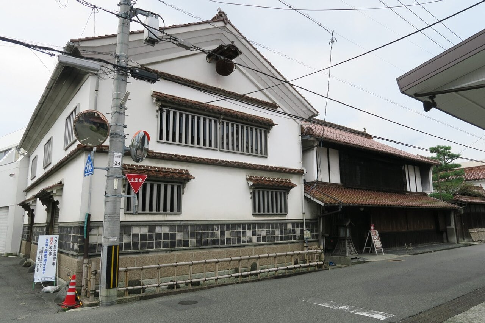

# 贺茂泉酒造

贺茂泉酒造位于[日本](ref:japan)广岛县东广岛市西条上市町 2 番 4 号，是西条酒藏通上以纯米酒为主线的酒藏。参观入口是藏内的“延寿藏”：平日可预约进入，由藏方按来客时间安排看片、走藏、讲解与试饮；周末与节假日则改由街边的酒泉馆接待，那里常备二十种以上的贺茂泉清酒，可以少量比较后再决定买哪一瓶。需要先说明：官网目前公告参观预约暂停，恢复时间未定，出发前必须打电话确认。

图：贺茂泉酒造的本社厂房，白色灰泥墙面与深色木格窗。图片：Lumi iori，CC BY-SA 4.0，via [原图页面](https://commons.wikimedia.org/wiki/File:Kamoizumi_shuzou.jpg)。

## 延寿藏与上市町的藏屋

西条酒藏通由几条旧街拼成，贺茂泉在上市町一侧，门口没有大型游客中心，也没有统一售票处。延寿藏是实际接待参观的藏屋，白壁、木构与老式藏内动线都保留着；进门后先在一间小厅看介绍影片，再按路线进入醸造藏。这个尺度决定了参观方式：一次不能塞进太多人，团体要分组，四十人以上直接谢绝，大型巴士也没有停车位。

把贺茂泉放回街区看，会更清楚西条的产业结构。七家酒造各自有主力产品与擅长的工序，却共用同一片伏流水、同一批酒米供应商与同一条通往车站的街。贺茂泉的辨识度来自“纯米”二字：它长期把不加醸造酒精的酒放在产品线中心，而不是把纯米酒当成大吟酿之外的附属品。这种选择让酒体更依赖米与水的质量，也让[清酒](ref:sake)的原料差异更容易在杯中尝出来。

## 纯米酒路线

官方商品页把旗舰款写成以广岛县产[酒米](ref:rice)山田锦 100% 酿造的纯米大吟酿，用西条伏流水仕込，强调温和香气、透明米甜与新鲜酸度。这里的关键不是“纯米”两个字本身，而是它带来的约束：纯米酒只能以米、米麹与水为原料，不能添加醸造酒精；纯米吟酿的精米步合要在 60% 以下，纯米大吟酿要在 50% 以下，纯米酒则没有精米步合上限，但仍必须满足香味与色泽的要求。

精米步合越低，米粒外层被磨掉得越多，香气越干净，酒体也越容易显得轻。把纯米大吟酿与纯米吟酿并排喝，差别往往不在“谁更高级”，而在香气外向程度、米旨味的厚度与收口速度。日常配餐时，纯米吟酿的酸度与米味通常更耐吃；单喝或送礼时，纯米大吟酿的透明感更容易被注意到。若再往传统工艺走，[生酛与山废](ref:kimoto)这类酒母路线会带来更高的酸度与更长的发酵期，和速酿型酒母形成另一种对照。

## 酒泉馆：先比较再购买

酒泉馆是贺茂泉在酒藏通上的常设窗口，定位更像“酒的喫茶室”而不是卖场。馆内常备二十种以上的贺茂泉清酒，可以点小杯逐款比较；不喝酒的人也有酒馒头、酒水果蛋糕、用仕込み水冲的咖啡与抹茶。二楼设酒图书室，收日本酒与酒类相关书籍，可以边喝茶边翻；旁边是商店，卖全系列产品与酒泉馆限定酒。

营业时间写得清楚：每周六、周日与祝日 10:00–17:00，盂兰盆与年末年始休业。这个安排刚好补上酒造平日参观的时间差：平日想进藏要预约，周末想喝比较酒则来酒泉馆。若只为买酒，商店与试饮在同一栋楼里，不用再跑第二趟；若想先建立味觉参照，建议从纯米吟酿、纯米大吟酿与一款季节酒开始，再决定带哪一瓶走。

## 参观流程与预约现状

延寿藏的参观按内容拆成几段：酒造影片约二十五分钟，藏内导览约十分钟，醸造藏参观约三十分钟，酒与藏的故事约十到十五分钟，试饮约十到十五分钟，最后是买土产的时间。接待时段为平日 8:30–12:00 与 13:30–16:00，原则上周末与祝日不受理；预约要在到访日一周前提出，人数上限四十人，二十人以上可能拆成两组。开车来的客人不得试饮，这一点在预约时就会被告知。

官网在参观页顶端挂着公告，说明受疫情影响，目前暂停接受藏见学预约，恢复时会在网站通知。这条信息比任何攻略都重要：即使你看到旧文章写着“可预约”，也应按官网现状处理。计划到访时，先打电话到代表号确认当天是否接待、能否试饮、需要留多久；若藏见学仍未恢复，就把重点放在酒泉馆，把“进藏”留到下一次。

酒藏的参观预约曾暂停，酒泉馆的营业时间也与平日不同；把官网公告与电话确认都做完，再安排行程更稳妥。

## 到访提示与周边

地址是西条上市町 2 番 4 号，从 JR 西条站步行进入酒藏通后按街区指示牌走即可；普通车可停附近，大型巴士没有专用停车位。坐标以官方渠道为准，本页不给出经纬度。参观当天穿平底鞋，藏内地面可能湿滑；带小孩或推婴儿车时要先问清楚动线，发酵区与设备区不是所有路段都适合停留。

若想把“纯米酒”的两种叙事放在一起看，西宫市的[白鹿酒纪念馆](ref:hakushika)提供了另一类样本：那里以纪念馆与酒藏资料为主体，参观节奏更接近博物馆；贺茂泉则是仍在运转的藏加上一间周末营业的喫茶室。两个地方都适合慢慢看，但只有在贺茂泉，你比较完几杯之后，走几步就能回到藏门口。西条站周边还有贺茂鹤一号藏等常设展售点，安排半天可以把两三家串起来。

相关条目：[清酒](ref:sake)、[生酛与山废](ref:kimoto)、[大米](ref:rice)。

## 参考资料

- [蔵｜賀茂泉酒造](https://kamoizumi.co.jp/kura/index.html)，贺茂泉酒造，核验地址、参观流程、时段与暂停预约公告。
- [酒｜賀茂泉酒造](https://kamoizumi.co.jp/sake/index.php)，贺茂泉酒造，核验山田锦 100% 与纯米大吟酿表述。
- [酒泉館](https://www.kamoizumi.co.jp/syusenkan/index.php)，贺茂泉酒造，核验二十种以上酒款与周末营业时间。
- [日本酒の分類](https://japansake.or.jp/sake/about-sake/classification-of-sake/)，日本酒造组合中央会，核验纯米酒与吟酿类的标签条件。
- [広島の西条酒の街](http://www.saijosake.com/japanese/town/)，西条酒藏组合，核验酒藏通上的位置关系。

页面核验日期 2026-11-09；参观预约与酒泉馆营业时间以官方渠道为准。
