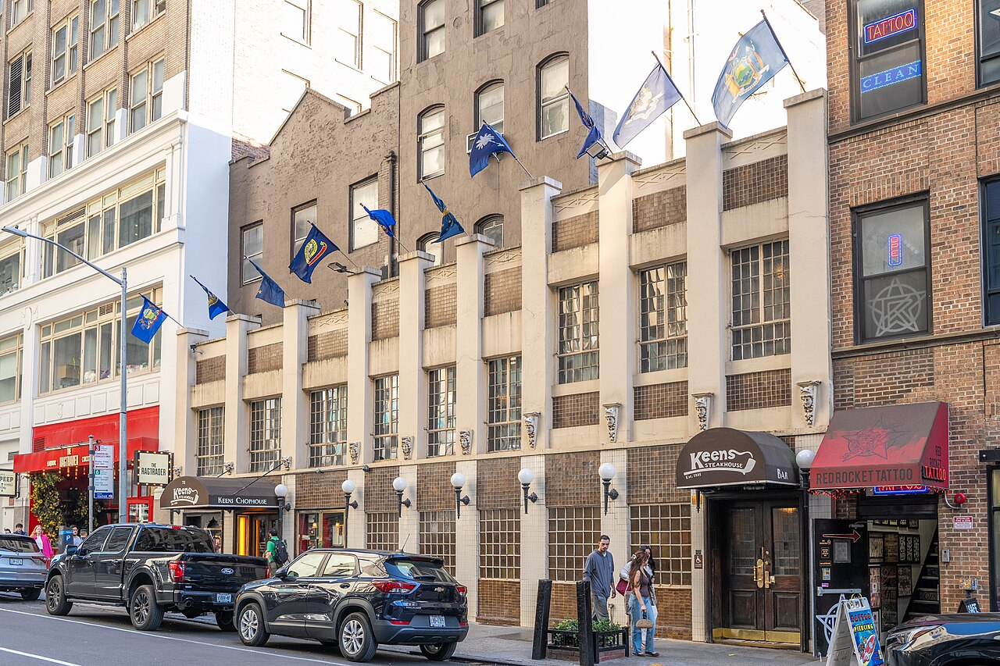
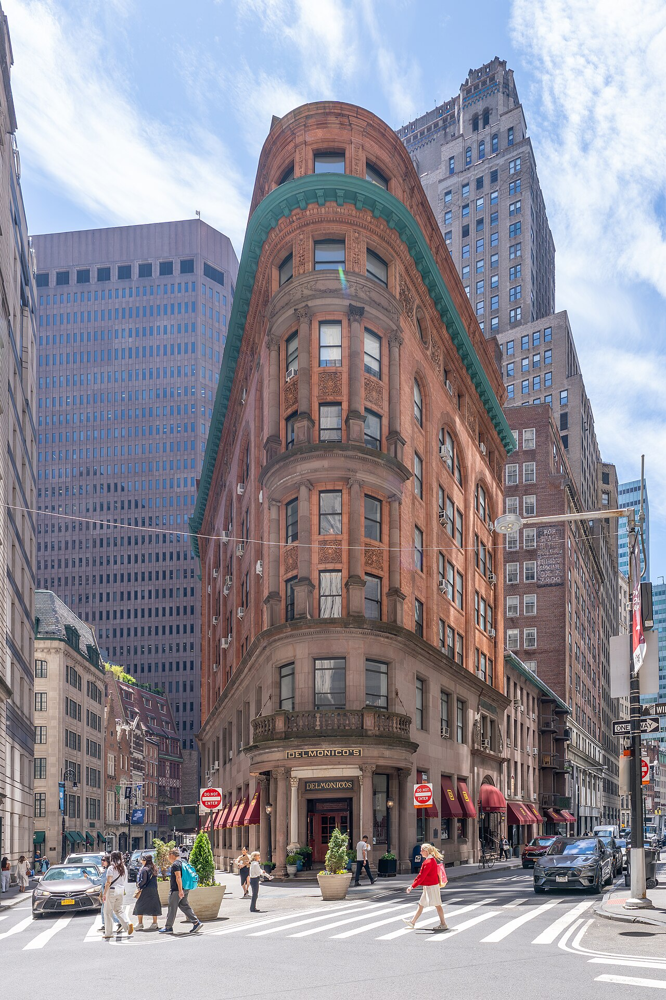

# 基恩斯牛排馆

纽约西 36 街靠近第六大道的一段，街道两侧是服装批发楼、便利店与不停卸货的货车。基恩斯（Keens Steakhouse）的黑色雨棚和白色“Keens Chophouse”字样并不算起眼，但推门进去，头顶一排排细长的陶土烟斗会把时间直接拉回 19 世纪。它不是那种靠复古装修制造气氛的餐厅：烟斗、剧场海报、旧菜单与木饰都是在这栋楼里积累下来的，很多物件比现在大多数纽约餐厅的历史都长。

图：纽约西 36 街基恩斯牛排馆的临街立面与入口；建筑由三栋联排屋合并，烟斗收藏在室内。图片：ajay_suresh，CC BY 4.0，via Wikimedia Commons（[原图页面](https://commons.wikimedia.org/wiki/File:Keens_Steakhouse_(54821833498).jpg)）。

## 1885 年：基恩斯牛排馆的关键起点
1885 年，Albert Keen 在 Herald Square 剧院区独立开出 Keens Chophouse；此前他是 Lambs Club 的经理，俱乐部楼上就设在餐厅二层。附近的 Garrick 剧院与餐厅背靠背，演员带着舞台妆从后门进来，在两幕之间喝一杯“壮胆酒”。Keens 的 Pipe Club 以 5 美元终身会员制起家，会员可以把刻着自己名字的陶土烟斗存在店里，名册累计超过 9 万人，包括 Theodore Roosevelt、Babe Ruth、Buffalo Bill Cody 等；今天墙上与天花板上仍挂着大量 churchwarden 长烟斗。1905 年，女演员 Lillie Langtry 因被拒之门外而起诉，胜诉后进入店里点了一份羊排；这件事常被当作 Keens 从“男士专属”转向对女性开放的标志。1977 年餐厅一度停业，1981 年由新业主修复重开；2013 年获詹姆斯·比尔德基金会“美国经典”奖。

剧院区的背景很关键。Herald Square 在 19 世纪末是纽约剧场与报纸的中心，Keens 与 Garrick Theatre 背靠背，演员在两幕之间从后门进来，点一杯麦酒或一份羊排。Pipe Club 的运作也像一套早期的“存酒”服务：会员付 5 美元，把刻了名字的陶土烟斗存在店里，由 pipe warden 登记、pipe boys 取送；烟斗从荷兰订购，每三年可达 5 万支。1905 年 Lillie Langtry 的诉讼让女性可以进入，但 Keens 并没有立刻变成混合空间，更多是逐步开放。1977 年停业时，纽约时报写了它的“死亡”；1981 年 George Schwarz 与 Kiki Kogelnik 花三年、约 140 万美元修复重开。2013 年的 James Beard America's Classic 奖，认可的不是“新派料理”，而是这种持续经营与地方记忆。

## 空间与酒单

Keens 由三栋联排屋合并而成，内部是一连串木饰房间：Lincoln Room、Bull Moose Room、Lambs Room 等，每间都挂着与剧院、政治或体育有关的旧物。天花板上的烟斗不是装饰复制品，而是当年会员存放的真品；有些烟斗上还能看到名字与年份。餐厅的招牌是 26 盎司的“mutton chop”，今天实际多用 lamb，但菜单与老客人仍叫它 mutton chop；此外有干式熟成牛排、porterhouse、羊排、Dover sole 与经典美式配菜。酒吧一侧供应单一麦芽威士忌、house ale 与带巴萨米克醋的血腥玛丽，适合只想喝一杯的人。

## 怎么喝

如果目标是完整用餐，提前订位，并直接把招牌羊排作为主菜；两个人分一份 26 盎司羊排再加一份沙拉或配菜，通常比每人一份更合适。酒吧区可以 walk-in，点一杯威士忌或 house ale，配一份酒吧小食，看看墙上的剧场旧物。这里的分量偏大，不要按欧洲餐厅的“前菜+主菜+甜点”节奏硬点；先点一份共享的羊排，再根据胃口加菜。晚上与演出前后，酒吧会比餐厅更热闹；想安静看东西，选工作日下午较早的时段。

## 基恩斯牛排馆的地址与营业安排
地址是 72 West 36th Street, New York, NY 10018，位于 Fifth Avenue 与 Sixth Avenue 之间。最近的地铁是 34th Street–Herald Square（B/D/F/M/N/Q/R/W），从站里出来走几分钟即到；时代广场与 Penn Station 也在步行范围。餐厅全年营业，圣诞节除外；午餐与晚餐时段不同，酒吧通常比餐厅更晚。着装以 smart casual 为主，不需要西装领带，但也不要穿拖鞋与背心。羊排与牛排价格偏高，点单前先看菜单；酒吧消费相对低一些。

## 礼仪与常见误区

第一，墙上的烟斗是历史收藏，不是让客人拿来抽的；不要伸手去碰，也不要问“能不能点一支”。第二，“mutton chop”在今天多为 lamb，这是菜单与传统名称的延续，不是餐厅“造假”；写作者应说明这一点。第三，Keens 是仍在营业的餐厅与酒吧，不是博物馆，不要为了拍天花板烟斗而站在餐位中间。第四，Lillie Langtry 的故事常被简化为“她赢了官司”，更准确的版本是：她因被拒进入男士专属区域而起诉，胜诉后成为象征性的转折点。第五，2013 年的 James Beard 奖是“America's Classic”，不是“最佳新餐厅”或米其林星级。

## 从基恩斯牛排馆延伸到纽约历史酒馆路线
从 Keens 出来，往北两条街是 Empire State Building，往东可到 Bryant Park 与 New York Public Library，往南可步行到 34 街的剧场区边缘。把这里放进[纽约历史酒馆路线](ref:ny-route)时，它更适合作为“正餐+酒吧”的终点，而不是匆匆喝一杯的中转站。若想比较纽约两种不同的历史餐饮空间，可以读[德尔莫尼科餐厅](ref:delmonicos)；想理解 chophouse 与酒馆的区别，可读[酒馆史](ref:taverns)与[认识一座城，从一间酒馆开始](ref:pub-city)；关于“在餐厅里消费时间”的写法，见[一杯酒里的时间](ref:time-in-cup)。

**关键事实。**

| 项目 | 内容 |
| --- | --- |
| 一句话定位 | 纽约 1885 年开业的传统 chophouse，以 26 盎司羊排、大量陶土烟斗与 Herald Square 剧院区记忆闻名，2013 年获詹姆斯·比尔德“美国经典”奖 |
| 地址 | 72 West 36th Street, New York, NY 10018, USA |
| 城市/国家 | 纽约 / 美国 |
| 营业状态 | 已核验营业 |
| 官网 | keens.com |

**来源与边界。** 本页关于「基恩斯牛排馆」的关键事实，主要由以下来源交叉核对：Keens Steakhouse（1885 年、Herald Square 剧院区、James Beard 2013 America's Classic 与营业信息；Lambs Club、陶土烟斗俱乐部、9 万会员名单与 1905 年 Lillie Langtry 诉讼）、James Beard Foundation（America's Classic 奖、26 盎司羊排、干式熟成与酒吧氛围）、Tasting Table（交叉核对三栋联排屋合并、烟斗覆盖天花板与剧院区历史；以 Keens 官方为主）。产品、地址或营业状态变化较快时，以 keens.com 的最新页面为准；价格、批次与状态会变，涉及这些字段时以页面所列来源的最新版本为准。正文为项目自写，来源只作核验，不复制原文。

## 参考资料
- [纽约历史酒馆路线](ref:ny-route)
- [酒馆史：从酒肆、客栈到酒吧](ref:taverns)
- [认识一座城，从一间酒馆开始](ref:pub-city)
- [德尔莫尼科餐厅](ref:delmonicos)
- [一杯酒里的时间](ref:time-in-cup)

本页于 2026-11-21 核对 Keens Steakhouse 官方页面。餐厅全年营业（圣诞节除外），午餐、晚餐与酒吧时段不同，羊排与牛排价格会调整，订位前查官网。墙上烟斗是会员旧藏、mutton chop 今天多用 lamb，Lillie Langtry 诉讼与 2013 年 James Beard “America’s Classic”奖，正文都已按史料限定。本页图片是基恩斯牛排馆的临街立面与入口，不是烟斗墙或内景；图注已标摄影者与许可，文字许可见文末 rights 字段。酒吧区通常可直接入座，正餐与羊排建议提前订位，菜单会随季节调整。

对照阅读：[纽约历史酒馆路线：东村到格拉梅西](ref:ny-route)、[认识一座城，从一间酒馆开始](ref:pub-city)。

## 相关图像

图：德尔莫尼科餐厅 56 Beaver Street 的弧形转角门廊；现楼由 James Brown Lord 设计，建于 1890–91 年，不是 1837 年原建筑。图片：Ajay Suresh，CC BY 4.0，via Wikimedia Commons（[原图页面](https://commons.wikimedia.org/wiki/File:Delmonico%27s_-_56_Beaver_Street_(55312935822).jpg)）。关联图像：基恩斯牛排馆。
