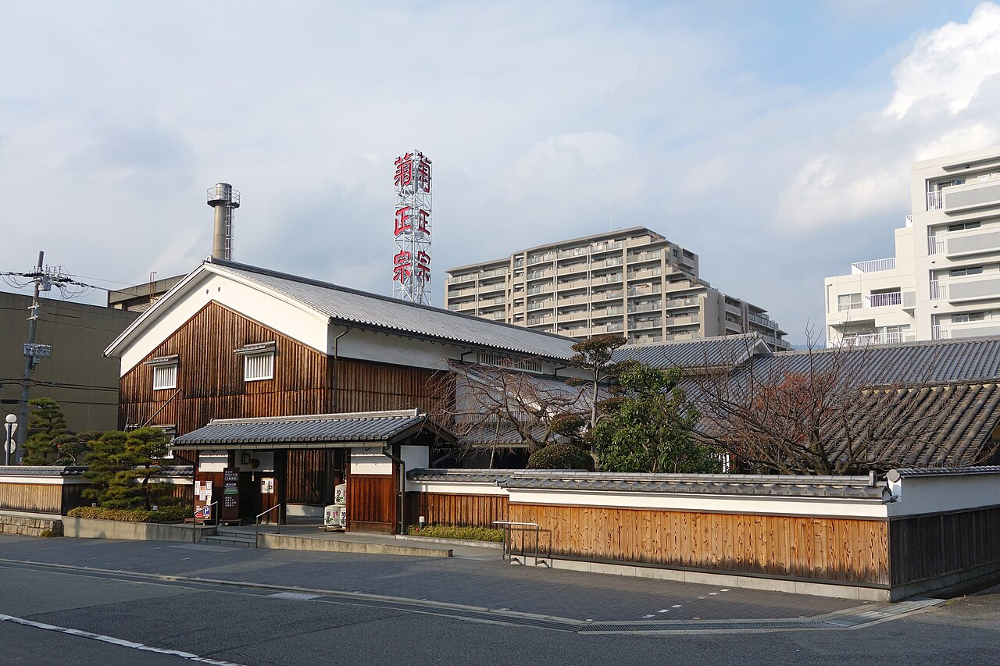
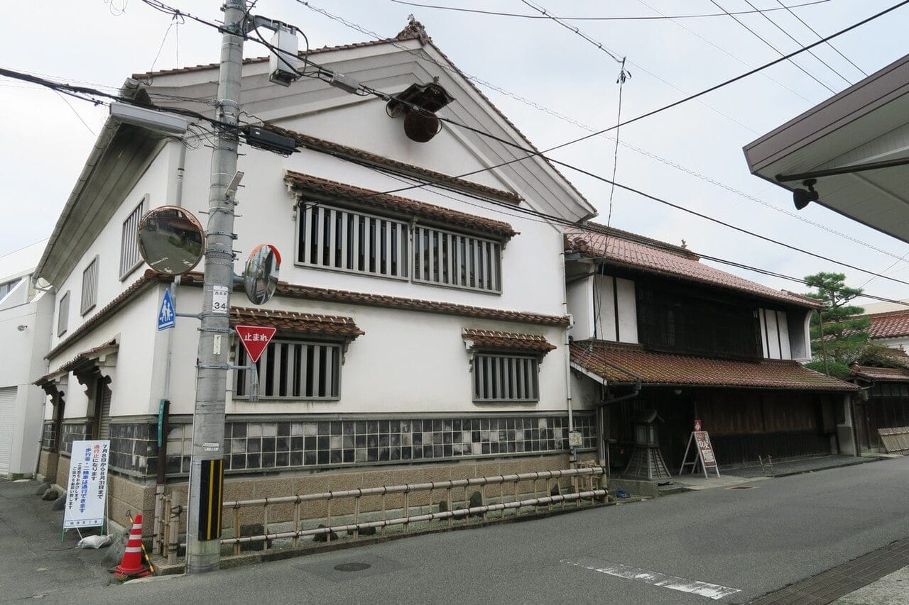

# 菊正宗酒造纪念馆

从阪神鱼崎站沿着住吉川的散步道往南走，酒藏的白墙与深色木格窗会逐渐出现。菊正宗酒造纪念馆就在鱼崎西町的厂区边上，免费开放，却不像“企业展厅”那样只摆奖杯与广告：它把滩区清酒的工具、酒母、木桶、米与水一层层摊开，让你看到一杯辛口清酒背后的体力活。

图：菊正宗酒造纪念馆本馆外观；这座源自 1659 年御影本嘉纳家宅邸的酒藏于 1960 年移筑至此。图片：Oilstreet，CC BY 2.5，via Wikimedia Commons（[原图页面](https://commons.wikimedia.org/wiki/File:Kikumasamune_Kobe_Japan01-r.jpg)）。

> **先给结论**
> **一句话：** 这页判断菊正宗酒造纪念馆值不值得专程去，以及到访前要核对什么。
>
> - **适合谁：** 正在计划去菊正宗酒造纪念馆、想知道值不值得专程安排半天到一天的人。
> - **不适合谁：** 只想要“必去榜单”、不准备核对预约、交通和开放时间的人。
> - **先看这两点：**
>   - 纪念馆本身免费，1–10 人按小团体对待，无需预约，直接入馆；10–40 人需在官方预约网页提前申请日期与时间；40 人以上要直接打电话到本馆柜台人工预约。
>   - 第一，不要把纪念馆当成“酒厂参观”。

## 1960 年：菊正宗酒造纪念馆的关键起点
官方“关于”页把这座馆的来历写得很清楚：旧馆原本是 1659 年（万治二年）在神户御影本嘉纳家宅邸内建造的酒藏，1960 年（昭和 35 年）移筑到现址，作为酒造纪念馆保存并向公众开放。馆内收藏了国家指定重要有形民俗文化财“滩の酒造用具”以及大量小道具，曾经每年接待约 5 万人。

1995 年 1 月 17 日，阪神淡路大地震把旧馆震塌。幸运的是，收藏的酒造用具与小道具大多从瓦砾下被逐件手工挖出，几乎没有损坏，或处于可修复状态。全面重建后，1999 年 1 月 25 日以新馆复活：地上两层，耐火、耐震结构，延床面积约 1,400 平方米（含既有“参考室”），屋顶用本瓦，外墙与辻墙用烧杉板，传统酒藏的轮廓被保留下来；旧馆的柱与梁有的树龄超过 400 年，被重新用在馆内各处。今天它每年接待超过 10 万人。

## 建筑与空间

新馆不是把老酒藏原样搬来，而是用“酒藏的语法”重建：白墙、深色烧杉板、本瓦屋顶、低矮的入口与内部的高天花，形成一种从街道进入仓内的过渡。两层空间不算大，但动线清楚：一层偏重酒造过程与工具，二层偏重滩区的水、米、风土与酒文化；旧柱梁被露在结构里，提醒你这不是全新的博物馆，而是从废墟里长出来的。

馆内的光线偏暖，展柜与开放陈列混用。木桶、酒母桶、压榨器、曲箱、量具与酒器按工序排列，有些可以近距离看到木纹与使用痕迹；等身大的酿酒人偶与场景复原把“蒸米、制曲、酒母、仕込、压榨、储藏”的动作固定下来。空间不追求沉浸式投影的炫技，而是让工具本身说话。对清酒不熟的人，先看一遍工序，再去二楼看风土，会更容易理解“滩酒为什么以辛口著称”。

## 展线与馆藏

主题是“知道酒造的原点”。官方把展示内容概括为：酒造过程与用具、滩酒酿造的技・水・米・风土、酒造的热情与传统、日本酒新的享受方式与文化。换句话说，它不只讲“菊正宗”一个品牌，而是把滩区（Nada）的清酒体系作为对象。滩区位于神户东滩一带，以“宫水”（西宫之水）与硬水、优质山田锦米、冬季低温与海风形成独特的酿造条件；菊正宗以生酛（kimoto）酒母工艺著称，酒母的酸度与乳酸菌管理是辛口风味的关键之一。

重点展品包括国家指定重要有形民俗文化财“滩の酒造用具”与各类小道具：木桶、酒母桶、曲盖、压榨槽、滤布、量器、酒器与搬运工具。它们不是“古董摆件”，而是可以对应到工序的位置。馆内还有酒器与酒杯的展示，以及关于日本酒新喝法的内容。看完一层再上二层，会形成“工具—工序—风土—文化”的完整链条。

## 怎么参观

纪念馆本身免费，1–10 人按小团体对待，无需预约，直接入馆；10–40 人需在官方预约网页提前申请日期与时间；40 人以上要直接打电话到本馆柜台人工预约。开馆时间 9:30–16:30；2026 年 4 月起周二休馆，若周二逢节假日则正常开放、周三休馆；周二与周三都在节假日周时不休馆；年末年初另有休馆。出发前看官网的“2026 开馆日历”最稳。

如果还想看樽酒 Meister Factory 与酒杯展示馆，需要在纪念馆提出申请。樽酒工坊不是博物馆，而是展示吉野杉制桶与樽酒酿造的名匠工坊；2026 年 4 月起参观时间为 10:30、13:30、14:30 三场，每次最多 15 人，需提前 2 天在官方预约网页预约，约 30 分钟，免费。学龄前儿童不可入内；身体不适或醉酒状态不可入内；宠物不可入内（导盲犬除外）；工坊内没有卫生间，需先在纪念馆使用；不要带饮料食物入内，也不要触碰展品或进入制桶作业区。

## 菊正宗酒造纪念馆的地址与营业安排
- 地址：〒658-0026 神戸市東灘区魚崎西町1-9-1。
- 坐标：34.7086206, 135.2679126。
- 电话：078-854-1029；传真 078-854-1028；邮箱 kinenkan@kikumasamune.co.jp。
- 开馆：9:30–16:30；2026 年 4 月起周二休，周二逢假日则周三休；年末年初休馆。
- 门票：免费。
- 预约：1–10 人无需预约；10–40 人网上预约；40 人以上电话预约。
- 交通：JR 住吉站换六甲线到南鱼崎站（约 4 分钟），出站往西北步行约 2 分钟；阪神鱼崎站沿住吉川散步道往南步行约 10 分钟。
- 时间：纪念馆约 60–90 分钟；加樽酒工坊约 30 分钟，需另预约。
- 无障碍：馆内有楼梯，轮椅通行需提前电话确认；工坊需过马路，移动时注意车辆与自行车。

## 礼仪与常见误区

第一，不要把纪念馆当成“酒厂参观”。它展示的是酒造工具、历史与风土，不是灌装线；想看生产线，需另查菊正宗的工厂参观安排。第二，不要以为“免费”就可以随意拍照或触摸展品；馆内拍摄规则以标识为准，木桶、酒器与工具不要用手摸。第三，不要带饮料食物进馆，也不要在展厅里大声讲电话；这是博物馆，不是餐厅。第四，不要把樽酒工坊当成“随时可进”的附加展；它每次最多 15 人、需提前 2 天预约，学龄前儿童不可入内。第五，不要穿高跟鞋或不便行走的鞋；馆内楼梯与工坊的移动路线需要走一段路。第六，不要把“周二休”当成全年固定；节假日周有例外，出发前看官网日历。

## 从菊正宗酒造纪念馆延伸到白鹤酒造资料馆
从纪念馆出来，可以沿鱼崎、住吉的酒藏街走到 [白鹤酒造资料馆](ref:hakushika)，看另一家大厂的“本店一号藏”与等身人偶；也可以把这一站放进“滩五乡清酒”路线：鱼崎的菊正宗、住吉的白鹤、西宫的 Hakushika（白鹿）、京都伏见的 [Gekkeikan Okura 酒博物馆](ref:gekkeikan)，再远到酒田的 [Kamotsuru](ref:kamotsuru) 与广岛的 [Kamoizumi](ref:kamoizumi)。如果只想在神户走，按 [日本酒藏路线](ref:route) 的框架，把鱼崎与住吉串成半日步行线即可。

神户东滩区不适合开车串酒藏，阪神线与六甲线更稳。纪念馆与白鹤资料馆之间步行约 20–30 分钟，沿途是住吉川与住宅区；夏天注意补水，冬天海风冷。若时间只够一站，选菊正宗看“工具与酒母”，选白鹤看“建筑与人偶”，两者不重复。

**关键事实。**

| 项目 | 内容 |
| --- | --- |
| 一句话定位 | 神户东滩区鱼崎西町的免费清酒博物馆，由菊正宗酒造开设；旧馆源自 1659 年在御影本嘉纳家宅邸内建造的酒藏，1960 年移筑至现址并对外开放 |
| 地址 | 〒658-0026 神戸市東灘区魚崎西町1-9-1 |
| 城市/国家 | 神户 / 日本 |
| 营业状态 | 已核验营业 |
| 官网 | kikumasamune.co.jp |

**来源与边界。** 本页关于「菊正宗酒造纪念馆」的关键事实，主要由以下来源交叉核对：菊正宗酒造（“江戸・万治二年から三百六十余年”、生酛（生もと）与纪念馆的总体定位）。产品、地址或营业状态变化较快时，以 kikumasamune.co.jp 的最新页面为准；价格、批次与状态会变，涉及这些字段时以页面所列来源的最新版本为准。正文为项目自写，来源只作核验，不复制原文。

## 参考资料
- 官方中文交通页：<https://www.kikumasamune.co.jp/kinenkan/zh-cn/access.html>，用于核对地址、电话、开馆时间、预约规则、周二休与交通。
- 官方“关于”页：<https://www.kikumasamune.co.jp/kinenkan/about.html>，用于核对 1659 年酒藏、1960 年移筑、1995 年地震、1999 年复活、建筑数据与展陈主题。
- 纪念馆官网首页：<https://www.kikumasamune.co.jp/kinenkan/>，用于核对“江户・万治二年から三百六十余年”、生酛与整体定位。
- 樽酒 Meister Factory 中文页：<https://www.kikumasamune.co.jp/tarusake-mf/zh-cn.html>，用于核对工坊性质、吉野杉制桶、参观场次、人数、预约与安全规则。
- 清酒路线对照：[白鹤酒造资料馆](ref:hakushika)、[Gekkeikan Okura 酒博物馆](ref:gekkeikan)、[Kamotsuru](ref:kamotsuru)、[Kamoizumi](ref:kamoizumi)、[日本酒藏路线](ref:route)。

## 相关图像

图：贺茂泉酒造的本社厂房，白色灰泥墙面与深色木格窗。。图片：Lumi iori，CC BY-SA 4.0，via Wikimedia Commons（[原图页面](https://commons.wikimedia.org/wiki/File:Kamoizumi_shuzou.jpg)）。关联图像：菊正宗酒造纪念馆。
