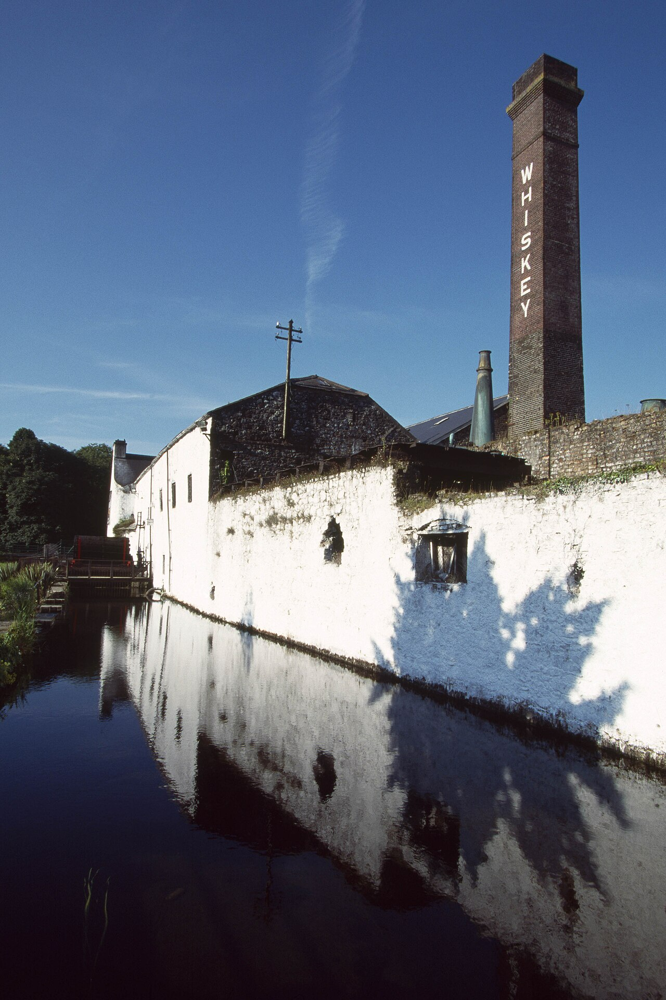

# 基尔伯根酒厂

基尔伯根（Kilbeggan）在[爱尔兰](ref:ireland)中部 Westmeath 郡的小镇上，Lower Main Street 从酒厂门口经过。酒厂的砖砌烟囱是镇子的地标，从远处就能看见；厂房沿 Brosna 河展开，水轮、旧磨坊与仓库仍在原位。1757 年，Matthias McManus 在此取得蒸馏执照，酒厂最初叫 Brusna Distillery。它经历过火灾、停业与社区自救，2007 年恢复蒸馏，今天由 Beam Suntory 旗下的 Cooley 体系运营。

图：基尔伯根酒厂。图片：Whisky lover，Public domain，via Wikimedia Commons（[原图页面](https://commons.wikimedia.org/wiki/File:Old_Kilbeggan_Distillery_-_Low_Res.jpg)）。

## 一座以烟囱为地标的小镇酒厂

基尔伯根不是把酒厂围起来收门票的“遗址公园”，而是镇子的一部分：游客中心、酒吧与商店设在老建筑里，生产区仍在使用。参观时会看到巨大的水轮、蒸汽机与旧式[壶式蒸馏器](ref:pot-still)，它们不是道具，而是酒厂历史的一部分。官方说，厂内有一台“世界最古老的仍在运行的壶式蒸馏器”，使用时间超过 180 年。对第一次接触[爱尔兰威士忌](ref:irish-whiskey)的人来说，这里比都柏林的品牌体验中心更像一间真实的乡村酒厂：尺度小、动线短、设备和人的距离近。Brosna 河从厂边流过，水轮曾靠它驱动；今天河水仍在，水轮更多是历史见证。镇子本身不大，看完酒厂可以沿主街走一圈，酒吧、教堂与旧商铺都在步行范围内。

## 1757 年的执照，与“最老”说法的边界

官方把基尔伯根称为“爱尔兰历史最悠久的持照酒厂”，依据是 1757 年的执照记录。这个说法常被误读成“从未停产的酒厂”，但事实并非如此：它在 1957 年停产，直到 2007 年才恢复蒸馏。更准确的表述是，这块厂址的持照历史可以追溯到 1757 年，而“连续生产”并不是它的卖点。1843 年，John Locke 接手，酒厂后来以 Locke's 之名被人记住；1878 年仓库失火，镇上的人冲进去把酒桶滚到街上，保住了大部分库存。1982 年，停产近三十年后，当地人成立修复协会，筹钱修复水轮与厂房，先把它作为博物馆开放；1987 年，John Teeling 接手并改名为 Kilbeggan Distillery；2007 年，酒厂在创立 250 周年时重新蒸馏，修复工程到 2010 年完成。

## 从水轮到旧磨坊：参观动线

参观通常从老厂区开始，经过水轮、传动轴、磨麦设备与旧的糖化槽，再进入蒸馏与仓库区域。基尔伯根的看点不在“现代化”，而在“还能运转”：木制水轮、铁制管道、旧式蒸汽机与铜制壶式蒸馏器构成一条完整的十九世纪生产线。导览会解释爱尔兰[壶式蒸馏](ref:pot-still)的特点：壶式蒸馏器分批蒸馏，酒液与铜接触时间长，新酒更厚、更有油脂感；单一壶式威士忌还会把发芽大麦与未发芽大麦一起糖化，形成香料与谷物感。仓库部分会讲到桶型与陈年，但这里的主角仍是设备与建筑本身。拍照时注意标识，生产区有些位置不允许进入。

## 酒款：调和、单一壶式与黑麦

爱尔兰威士忌在法律上分为调和、单一麦芽、单一谷物与单一壶式等类别，核心区别在于原料与蒸馏方式，而不是年份。单一壶式必须使用壶式蒸馏器，并把发芽与未发芽大麦一起糖化；调和则可以把不同酒厂的壶式与谷物威士忌混合。基尔伯根同时生产这几类酒，参观时听讲解比只看酒标更容易分清。

Kilbeggan 的产品线可以从三条线来理解。第一条是调和：Kilbeggan Blended 以传统方式两次蒸馏，目标是顺滑、易饮，适合做 Highball 或 Irish Coffee。第二条是单一壶式：Kilbeggan Single Pot Still 使用壶式蒸馏器与发芽、未发芽大麦的混合配方，带有香料、青草与油脂感，是理解爱尔兰风格的入口。第三条是黑麦：Small Batch Rye 是酒厂修复完成后，第一款完全在基尔伯根蒸馏并陈酿的产品，黑麦带来胡椒与干爽的尾韵。另有 Triple Cask 与 Berry Selection 等偏易饮的版本。不要把“调和”当成低端代名词；在爱尔兰，调和与单一壶式是并行的两条传统。

## 体验项目怎么选

Distillery Experience 约 90 分钟，走完老厂区后有四款威士忌的大师班，适合第一次来的人。Distillers Cask Bottling 约 30 分钟，不含导览，可以从桶中取酒，自己灌装一瓶 70cl 的 Distillery Exclusive。Irish Coffee Masterclass 约 60 分钟，只对 18 岁以上开放，先参观老酒厂，再到 Locke's Lounge 学做爱尔兰咖啡。Cask Selection Premium Tasting 约 60 分钟，从 heritage cask 中取酒品鉴，适合已经喝过基础款的人。Warehouse Bar 提供单杯、鸡尾酒、咖啡与轻食，不参加体验也可以进店。所有体验建议提前在线预约，私人团与私人品鉴可直接发邮件给酒厂。含品鉴的项目只对达到法定饮酒年龄的客人开放，带孩子的家庭可以选择不含酒精的参观与酒吧软饮。

## 从都柏林或戈尔韦出发

地址是 Kilbeggan Distillery, Lower Main Street, Kilbeggan, Co. Westmeath N91 W7YY。自驾从都柏林或戈尔韦方向走 M6，在 Junction 5 下高速，按镇中心路牌行驶；酒厂附近有停车位，但周末与活动日会紧张。公共交通班次有限，建议先查 Bus Éireann 或 Local Link 的当日时刻，不要按固定班次做紧凑行程。开放时间随季节变化：3 月 17 日至 10 月 31 日为每天 10:00 至 17:30，11 月 1 日至次年 3 月 16 日为每天 10:00 至 15:30；节假日与私人活动可能调整。把基尔伯根与[都柏林的尊美醇弓街](ref:jameson)、北爱的[布什米尔斯](ref:bushmills)放在同一条线上，能看出爱尔兰威士忌从城市品牌到乡村厂址的不同面貌，但三地之间车程不短，至少留两天。酒厂没有公布可供引用的精确坐标，导航请以官方渠道为准。

相关条目：[爱尔兰](ref:ireland)、[爱尔兰威士忌](ref:irish-whiskey)。

**关键事实。**

| 项目 | 内容 |
| --- | --- |
| 一句话定位 | 爱尔兰 Westmeath 郡基尔伯根镇的老酒厂，1757 年取得执照，官方称为爱尔兰历史最悠久的持照酒厂；1957 年停产后由社区推动修复，2007 年恢复蒸馏，现以 Kilbeggan 调和、单一壶式与小型批次黑麦威士忌闻名 |
| 地址 | Kilbeggan Distillery, Lower Main Street, Kilbeggan, Co. Westmeath N91 W7YY, Ireland |
| 城市/国家 | Kilbeggan / 爱尔兰 |
| 营业状态 | 已核验营业 |
| 官网 | kilbeggandistillery.com |

**来源与边界。** 本页关于「基尔伯根酒厂」的关键事实，主要由以下来源交叉核对：Kilbeggan Distillery / Beam Suntory（1757 年执照、体验项目、Warehouse Bar、商店与季节开放时间；酒厂名称、品牌与参观入口）、Beam Suntory。产品、地址或营业状态变化较快时，以 kilbeggandistillery.com 的最新页面为准；价格、批次与状态会变，涉及这些字段时以页面所列来源的最新版本为准。正文为项目自写，来源只作核验，不复制原文。

**并读。** 把「基尔伯根酒厂」与「爱尔兰」、「爱尔兰威士忌」、「壶式蒸馏器（pot still）」放在一起读时，先确认它们是同一层级还是上下游关系：先确认地址与营业状态，再比较历史、空间与点单体验。本页负责给出场所的基本坐标，对照条目补上具体案例与差异；读完再回到本页，才能分清哪些差别属于场所本身，哪些只是产地、批次或品牌选择。
