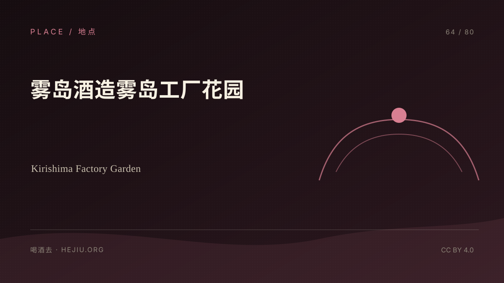

# 雾岛酒造雾岛工厂花园

雾岛酒造雾岛工厂花园的正式名称是“烧酎之里 雾岛工厂花园”，地址为[日本](ref:japan)宫崎县都城市志比田町 5480 番地。它常被误认为鹿儿岛县雾岛市的本社厂区，实际是独立的观光设施：从雾岛酒造本社向西约十分钟车程，与国道 10 号沿线的 KIRISHIMA GREENSHIP icoia 也相隔约五分钟车程，导航要直接输入“雾岛工厂花园”。园区把见学、餐饮、商店与散步放在同一块地里，核心是步行式工厂 KIRISHIMA WALK FACTORY。

图：雾岛酒造雾岛工厂花园栏目示意图。项目自产或类别插图，用于亚洲酒类语境，不是该对象的实拍。

## 都城志比田町的烧酒之里

园区在都城盆地的一侧，背后是雾岛山系，周围是田野与公路。与明治藏那种“藏屋贴着港口”的尺度不同，这里更像一座被设计过的产业公园：宽草地、步道、餐厅、面包房、博物馆与卖店分开布置，见学动线从室内展区延伸到实际生产区。它适合家庭与团体，也适合只想喝一杯、买一瓶而不进工厂的人。

名字里的“雾岛”是品牌与山系，不是行政区。地址在宫崎县都城市，行政上不属于鹿儿岛县雾岛市；从鹿儿岛机场或鹿儿岛市区过来都要跨县，车程比地图上看起来长。把住宿放在都城或鹿儿岛市都可以，但若同日还要去枕崎的明治藏，就要把南萨摩与都城之间的山路算进去。

## 步行工厂与五感体验

KIRISHIMA WALK FACTORY 是一条步行动线，用“看、听、香、味、触”五种感官组织内容。展区从甘薯与原料讲起，经过制曲、蒸芋、发酵与蒸馏，墙面、灯光与影像把微生物与蒸汽的变化做成可感知的场景；部分区段能听到发酵气泡与蒸芋的声音，也能闻到不同工序的气味。它不是把设备围起来让人远望，而是尽量让访客接近流程，同时用动线与护栏控制安全距离。

“味”的环节最直接：园区提供免费试饮，可以比较雾岛酒造的不同产品，也能试饮雾岛裂罅水、试吃甘薯。对不喝酒的人与小孩，试吃与香气体验仍然成立；这也是它比传统酒藏更适合家庭的原因。需要提醒的是，试饮不等于无限量，现场会按杯量与时段管理，开车的人应跳过。

## 裂罅水、甘薯与白曲

雾岛酒造的招牌水是雾岛裂罅水，取自雾岛山系的裂隙水，园区内设有“雾岛裂罅水之泉”，可以试饮。水在这里不是背景：烧酒的仕込み水直接影响发酵速度与成品口感，硬度、温度与微生物状态都要稳定。甘薯是另一项主角，园区用巨大甘薯装置与试吃把“原料”变成可触摸的东西；甘薯蒸熟后的甜香，是芋烧酒最容易被记住的气味。

雾岛酒造的主力产品以白曲为主。白曲的柠檬酸生成能力强，能在酸性环境下抑制杂菌，发酵稳定，成品香气较轻、入口干净；这与黑曲的浓厚路线不同。把白曲、甘薯与裂罅水放在一起看，就能理解为什么九州的大量芋烧酒喝起来清爽、适合兑热水或加冰，而不是一味追求浓烈。米麹在二次仕込中提供酶与风味，[米](ref:rice)因此仍是这条甘薯路线里不可省略的原料。

## 蒸馏与度数：清爽与浓郁的分岔

本格烧酒采用单式[蒸馏](ref:distillation)，常见设备是[壶式蒸馏器](ref:potstill)，与连续式蒸馏的甲类烧酒不同。单式蒸馏保留更多原料香气与微量成分，常压蒸馏得到的酒更厚、更带甘薯与谷物气息；减压蒸馏在较低温度下进行，杂味与刺激感更少，成品更清爽。酒造可以按产品定位选择压力与切酒点，同一原料也能做出不同风格。

度数方面，[日本烧酒](ref:shochu)的常见规格是 25 度，20 度则更轻、更适合佐餐。日本酒税法以 20 度为课税基准，超过 20 度后按度加算；因此 25 度与 20 度之间的差别不只是口感，也包含税负与产品定位。园区试饮时可以留意这一点：同一品牌的不同度数，往往对应不同的饮用场景，而不是简单的“浓”与“淡”。

## 商店、餐厅与营业时间

商店营业 9:00–18:30，卖烧酒、精酿啤酒、原创周边与伴手礼；雾之藏博物馆 9:00–16:00，讲芋烧酒与雾岛的历史；创业纪念馆“吉助”是把 1924 年建造的创业社屋移筑而来，同样 9:00–16:00 开放。餐厅午餐 11:00–15:00，茶点 15:00–17:00，晚餐 17:00–21:00；夏季有啤酒花园，冬季有发酵主题自助餐，具体日期以官方日历为准。面包房周二休息，生态工厂周日休息。

这些时间不是统一的一张表，而是按设施分开管理。安排半日时，先锁定见学场次，再把博物馆与餐厅插进去；若只想购物，商店开到 18:30，比博物馆晚，适合放在行程最后。临时休业与营业时间变更会挂在官网日历上，出发前一天再看一次。

## 预约与到访提示

工厂见学每天五个时段：10:00、11:00、13:30、14:30、15:30，约 45 分钟，需提前电话预约，预约与设施咨询电话为 0986-21-8111，接听时间 9:00–17:00。场次可能因检修、活动或团体包场调整，预约时确认集合地点、是否含试饮与所需时间；迟到不一定能补进下一场。

自驾从都城站或国道 10 号过来都方便，园区停车免费；大型巴士也能停。坐标取自上图官方链接，约为北纬 31.741422、东经 131.062057，仍应在到访前用官方地图复核。园区户外区域多，夏天遮阴有限，冬天风大；见学动线有楼梯与坡道，穿好走的鞋比穿正式鞋合适。带宠物、推婴儿车或需要无障碍协助时，先打电话问清楚当天动线。

若想把“工厂花园”与“传统藏屋”对照，可以把枕崎的明治藏排在另一天：一处是设计过的体验园区，一处是仍靠甕与人力运转的老藏。两者都看，才容易理解九州烧酒既依赖传统工艺，也依赖规模化生产与观光经济。

相关条目：[日本烧酒](ref:shochu)、[蒸馏](ref:distillation)、[壶式蒸馏器（pot still）](ref:potstill)。

## 参考资料

- [アクセス](https://www.kirishima-fg.jp/access/)，雾岛工厂花园，核验都城市志比田町 5480 番地地址与周边距离。
- [営業時間・お問い合わせ](https://www.kirishima-fg.jp/contact/)，雾岛工厂花园，核验商店、博物馆、餐厅与见学场次时间。
- [KIRISHIMA WALK FACTORY](https://www.kirishima-fg.jp/factory/)，雾岛工厂花园，核验五感体验、免费试饮与甘薯试吃。
- [霧島酒造の施設紹介](https://kirishima.co.jp/facility/)，雾岛酒造，核验园区设施构成与见学定位。
- [霧島創業記念館 吉助](https://www.kirishima-fg.jp/kichisuke/)，雾岛工厂花园，核验 1924 年创业社屋移筑信息。

页面核验日期 2026-11-09；营业时间、见学场次与餐饮安排以官方渠道为准。

## 相关图像

图：大米。图片：China News Service，CC BY 3.0，via Wikimedia Commons（[原图页面](https://commons.wikimedia.org/wiki/File:20201102.Hengnan.Hybrid_rice_Sanyou-1.6.jpg)）。关联图像：雾岛酒造雾岛工厂花园。
