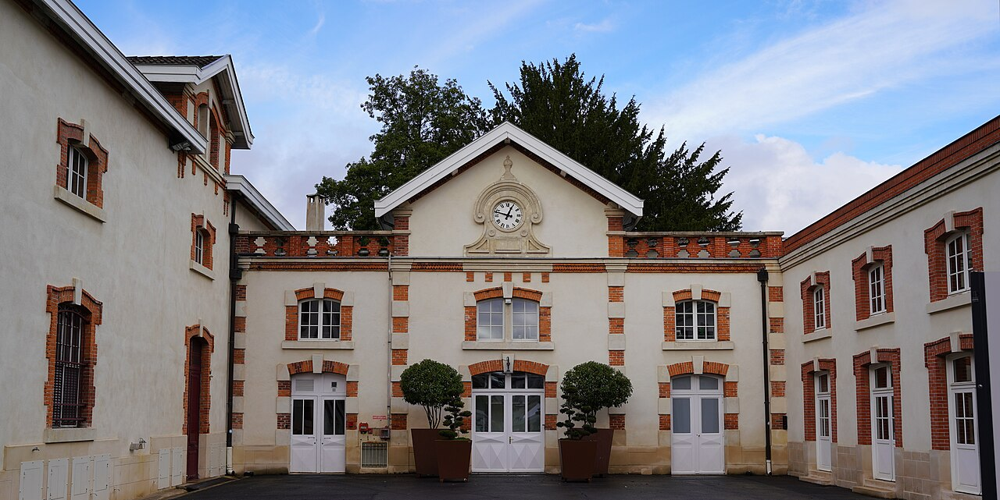

# 库克香槟

兰斯市中心的 Rue Coquebert 并不宽，库克的宅邸藏在一条安静的街里。它没有香槟大道的华丽门面，也不设日常游客大厅。库克的核心不是一座建筑，而是一套“把不同年份、不同地块的酒放在一起”的方法：每年重新做一版 Grande Cuvée，同时保留两块单地块、单一年份的“独奏”香槟。理解库克，先理解这种“用储备酒写年份”的逻辑。

图：兰斯 Krug 酒庄建筑（Boulevard Lundy 一侧）。图片：G.Garitan，CC BY-SA 4.0，via Wikimedia Commons（[原图页面](https://commons.wikimedia.org/wiki/File:Krug_boulevard_Lundy_1512968.jpg)）。

## 1843 年：库克香槟的关键起点
1843 年，Joseph Krug 在兰斯创立酒庄。他的目标不是做“年份香槟”，而是每年都做出尽可能好的香槟，不受天气变化影响。1848 年，他把这套想法写进一本深樱桃色封面的笔记：尊重每一块地的个性，建立跨年份的储备酒库，再把它们拼成一版新的 Grande Cuvée。今天库克仍以这本笔记为方法源头。

酒庄由库克家族六代人经营，后来加入 LVMH 酒类事业部。1970 年代初，第五代的 Rémi 与 Henri Krug 在 Le Mesnil-sur-Oger 买下一块围墙葡萄园，1979 年首次酿造 Clos du Mesnil；随后他们用七年寻找 Pinot Noir 的“独奏地块”，1991 年发现 Clos d’Ambonnay，1994 年购入，1995 年首次采收，2007 年才公开发布。2011 年，酒庄推出 Krug iD，用背标六位码公开每瓶酒的调配与陈年信息；2016 年起，Grande Cuvée 与 Rosé 的 Édition 编号印在正标上。

## 建筑与空间

兰斯总部是一栋 19 世纪的宅邸，外观克制，内部是办公室、品鉴室与地下酒窖。真正的工作空间在酒窖与发酵间：库克把来自不同地块的葡萄分别压榨、分别在小旧橡木桶中发酵，保留每一块的个性，再在品尝委员会中决定它们进入哪一版 Grande Cuvée。所谓“one plot, one wine”，不是营销话术，而是每年要处理数百个小批次的实际流程。

2024 年，库克在 Ambonnay 启用 Joseph 酒厂。新建筑以可持续设计为目标，靠近 Clos d’Ambonnay 与 Pinot Noir 的核心产地；它不是把兰斯总部搬空，而是把发酵与部分生产放到更靠近葡萄的地方。参观时如果只看到“漂亮的酒窖”，会错过重点：库克的建筑首先是为分地块处理与小批量发酵服务的。

## 酒单与味觉

库克的产品可以分三层。第一层是 Krug Grande Cuvée：每一版由 120 款以上、来自 10 多个不同年份的酒组成；酒庄每年品尝约 400 款基酒（250 款当年酒与 150 款储备酒），再从约 15 个年份的储备中挑选。它在酒窖中陈年约 7 年，气泡细，香气从烤面包、榛子、蜂蜜到柑橘与矿物，口感宽但不腻。第二层是 Krug Vintage：只做当年最好的酒，风格更集中，果味与酸度更清晰。第三层是两块“独奏”：Clos du Mesnil 是 1.84 公顷的 Chardonnay 围墙园，1979 年首次酿造；Clos d’Ambonnay 是 0.68 公顷的 Pinot Noir 围墙园，1995 年首次采收。两者都只做单一年份，产量极小。

Krug Rosé 是另一条线：它不是把红葡萄酒简单混进去，而是用长期储备与少量红葡萄酒调配，颜色偏三文鱼，香气有红莓、柑橘皮与香料。Grande Cuvée 的“版本差异”很重要：同一款酒在不同 Édition 之间会有变化，这不是质量问题，而是每年重新调配的结果。

## 怎么喝

库克建议 9–12°C。不要冰到 6°C 以下，否则香气与气泡的细腻度都会被锁住。用较大的白葡萄酒杯或香槟杯，杯肚要给香气空间；倒酒时分两次，先倒三分之一，等气泡稳定后再补。Grande Cuvée 开瓶后可以放 15–20 分钟再喝，让烤面包与坚果气息展开；Clos du Mesnil 与 Clos d’Ambonnay 不需要剧烈醒酒，但可以提前半小时开瓶。

配餐上，Grande Cuvée 配烤鸡、蘑菇、Comté、龙虾、扇贝都合适；Vintage 配奶油汁白肉、烤鱼；Clos du Mesnil 配龙虾、螃蟹、白松露；Clos d’Ambonnay 配小牛肉、鸭胸、蘑菇。Rosé 配三文鱼、草莓、地中海香料。避免过甜、过辣的菜，它们会把香槟的酸度推得太前。

## 库克香槟的地址与营业安排
地址：5 Rue Coquebert, 51100 Reims。库克不设日常公众参观；酒庄的开放通常通过官方邀请、专业访问或 LVMH 的开放日活动，普通游客不要把“到兰斯”当成“能进库克”。兰斯从巴黎东站乘 TGV 约 45 分钟，从车站走到 Rue Coquebert 约 15 分钟；自驾可停在市中心地下停车场，再步行进入。

如果只想喝一杯，兰斯市内的香槟酒吧与餐厅比酒庄更容易安排；如果想看葡萄园，Clos du Mesnil 在 Le Mesnil-sur-Oger、Clos d’Ambonnay 在 Ambonnay，二者都不对散客开放，只能从公共道路远观。把库克与[兰斯香槟大道](ref:avenue) 或[香槟大道步行路线](ref:route) 放在同一天，注意不要把品鉴安排在开车前。

## 礼仪与常见误区

第一，库克不是“只有贵价香槟”的品牌。Grande Cuvée 是它的核心，也是理解酒庄的入口；不要只盯着 Clos。第二，Édition 编号不是“年份”。Grande Cuvée 是跨年份调配，Édition 只表示这是酒庄历史上第几次重做这款酒；背标的 Krug iD 才是查这瓶酒具体调配的钥匙。第三，不要把“气泡细”当成唯一标准；库克的酒体与香气宽度同样重要。

第四，不要在没有邀请的情况下进入酒庄或拍摄酒窖；生产区不是餐厅。第五，不要用“甜不甜”来判断香槟，库克的风格是干型、宽体、低酸度平衡，不是甜酒。第六，陈年香槟不等于“越老越好”；Grande Cuvée 已经陈年约 7 年，开瓶后应在 2–3 天内喝完，老酒则要更小心氧化。

## 从库克香槟延伸到香槟大道
兰斯可以按“教堂—酒庄—酒吧”走：上午看兰斯主教座堂与 Saint-Remi，下午到[香槟大道](ref:avenue) 或[Taittinger](ref:taittinger)、[Bollinger](ref:bollinger) 的方向，晚上回兰斯吃饭。若想去 Ambonnay 看 Clos d’Ambonnay 的石墙，从兰斯自驾约 25 分钟；从 Épernay 出发约 20 分钟。把[香槟产区](ref:champagne) 的地图打开，先分清 Reims、Épernay 与 Côte des Blancs 三条轴，再安排路线。

只安排一天，建议兰斯市内步行加一场预约品鉴；两天则可以加 Épernay 的香槟大道与一个白丘村庄。不要把库克、Taittinger、Bollinger 三家排得太紧，香槟的品鉴需要时间与清醒的味觉。

**关键事实。**

| 项目 | 内容 |
| --- | --- |
| 一句话定位 | 兰斯的香槟酒庄，1843 年由 Joseph Krug 创立，以跨越多个年份的 Krug Grande Cuvée 为核心；Clos du Mesnil 1.84 公顷、Clos d’Ambonnay 0.68 公顷，均为单地块单一年份 |
| 地址 | 5 Rue Coquebert, 51100 Reims, France |
| 城市/国家 | 兰斯 / 法国 |
| 营业状态 | 已核验营业 |
| 官网 | krug.com |

**来源与边界。** 本页关于「库克香槟」的关键事实，主要由以下来源交叉核对：Maison Krug（Clos d’Ambonnay 0.68 公顷、1766 年石墙、1991 年发现、1994 年购入、1995 年首个采收与 2007 年发布）、LVMH。产品、地址或营业状态变化较快时，以 krug.com 的最新页面为准；价格、批次与状态会变，涉及这些字段时以页面所列来源的最新版本为准。正文为项目自写，来源只作核验，不复制原文。

## 参考资料
- 香槟对照：[Bollinger](ref:bollinger)、[Taittinger](ref:taittinger)、[香槟大道](ref:avenue)、[香槟大道步行路线](ref:route)。
- 背景阅读：[香槟产区](ref:champagne)。
- 本页不提供地图；库克的参观与发布信息以官方渠道为准。
