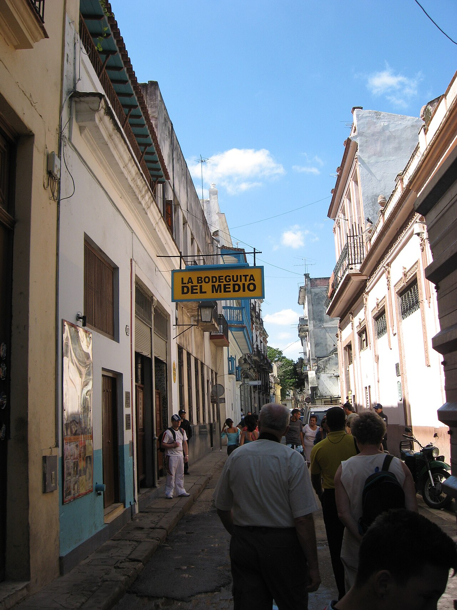

# 半途小酒馆

半途小酒馆（La Bodeguita del Medio）在哈瓦那老城 Empedrado 街 207 号，介于 Cuba 街与 San Ignacio 街之间，距离哈瓦那大教堂只有几十米。它 1942 年开业，最初不是酒吧，而是一间叫“La Complaciente”的小杂货店；古巴人安赫尔·马丁内斯·博罗托（Ángel Martínez Borroto）把它买下后改名“Casa Martínez”，卖日常食品，也偶尔给熟客做饭。店名直译是“街区中段的小杂货铺”，这个朴素的来源，比“海明威酒吧”的标签更能解释它的空间：窄、旧、墙面被签名和照片覆盖。

图：半途小酒馆。图片：Derek Blackadder from Cobourg, ON, Canada，CC BY-SA 2.0，via Wikimedia Commons（[原图页面](https://commons.wikimedia.org/wiki/File:Bodeguita_del_Medio,_Havana,_Cuba_9.jpg)）。

## 1942 年：半途小酒馆的关键起点
1942 年，安赫尔·马丁内斯接手这间小店后，附近的知识分子、记者与艺术家开始在这里聚集。排字工费利托·阿永（Felito Ayón）在附近开了印刷所，他的客户常来借电话，顺便喝一杯朗姆酒；小店逐渐从杂货铺变成聚会场所。1948 年前后，阿永开始在这里组织饭局；1949 年，厨师西尔维娅·托雷斯（Silvia Torres，人称“la china”）加入，把白米饭、黑豆、猪肉与炸芭蕉做成了店里的家常菜。1950 年，店名正式定为“La Bodeguita del Medio”。据店方资料，早期常客包括古巴诗人尼古拉斯·纪廉（Nicolás Guillén）与作家阿莱霍·卡彭铁尔（Alejo Carpentier）；1950 年代，纳特·金·科尔、海明威、碧姬·芭铎、索菲亚·罗兰等名字也出现在访客名单里。海明威到访过这里，但“常客”说法常被放大；他更稳定的据点是几步之外的小佛罗里达。墙面签名从顾客的即兴留言变成了这间店的“档案”，今天按店内规定作为历史陈设保护，不要再补写。

## 空间与酒单

店面是一栋十九世纪末的殖民风格小楼，空间狭小，墙面与天花板几乎被签名、照片与旧物占满；空气里有薄荷、青柠与朗姆的味道。现场常有四重奏或五重奏演奏传统古巴音乐，音乐声与人群声是体验的一部分。酒单以莫吉托（mojito）为核心：朗姆酒、青柠、薄荷、糖与苏打水；也有其他朗姆鸡尾酒与简单酒饮。餐食是古巴克里奥尔家常菜，白米饭、黑豆、猪肉、炸芭蕉是常见组合，不是精致餐厅的摆盘。价格属于老城旅游区水平，分量与质量会因时段与客流波动。

## 第一次来怎么点

第一次来，先点一杯莫吉托，注意它的甜度通常偏高；怕甜可以请调酒师减少糖浆，但不要要求“完全无糖”，那会破坏薄荷与青柠的平衡。想吃饭就点一份克里奥尔套餐或简单肉菜，不要期待海鲜大餐。店里常有现场音乐，坐下前看清是吧台区还是餐区；吧台更适合快速喝一杯，餐区更适合慢慢吃。旺季门口常有人排队，建议开门后不久或傍晚前到；如果只想拍照，不要堵在门口，先让里面的人出来。

## 半途小酒馆的地址与营业安排
地址：Calle Empedrado 207, entre Cuba y San Ignacio, La Habana Vieja, La Habana 10100, Cuba；坐标 23.14083, -82.35222。距哈瓦那大教堂约 79 米，距 Plaza de Armas 约 400 米，从老城各处步行即可，无需交通工具。Palmares 官方页面标注营业时间为每日 12:00–23:30（本次核验时页面显示“即将开门”状态，说明按当日时刻正常开关门），入口不设门票，消费按酒水与餐食计价；古巴旅游区价格以可兑换比索或外币结算的情况变化较快，公开信息有限，具体标价与支付方式未核验。店方未公布可预订渠道，普通酒吧座位通常不接受提前预订，团体与餐位建议先拨打官方电话 +53 7 866 8857 或发邮件确认。着装 casual 即可；空间窄、楼梯陡，行动不便者或推婴儿车者建议先确认动线。本页的营业状态、价格与预约，以当地旅游页面与现场公告为准；核验日期为 2026-11-08，临时调整以现场公告为准。

## 礼仪与常见误区

墙面上的签名是历史陈设，不是留言板：不要用笔、钥匙或指甲去补写，也不要撕下照片。门口与楼梯很窄，拍照前先让出通道；拍乐队时先问一句，演奏后给小费是礼貌。点单时不要用“海明威同款”代替具体酒名；如果你想要的是莫吉托，就说 Mojito，并说明甜度。最大的误区是把墙上那句署名海明威的“我的莫吉托在 La Bodeguita，我的代基里在 El Floridita”当成已核实的亲笔名言：这句话流传极广，但书写者与真伪存在争议，店里把它当作品牌叙事而不是档案证据。另一个误区是把莫吉托的发明权归给这间店：莫吉托的前身更早，La Bodeguita 是让它流行起来的关键场所，但不是唯一源头。

## 什么情况不适合来

如果你有幽闭恐惧、讨厌拥挤与现场音乐、想要安静谈话或精致餐饮，这里都不合适。大团体在窄店里很难安顿；对无障碍通行有要求的人应先确认入口与楼梯。只想喝一杯便宜酒的人也会失望：这里的价格是旅游区价格。若你反感“名人签名墙”的观光叙事，老城还有其他更本地的小馆；但若你想理解哈瓦那酒吧文化如何把文学、音乐与日常生活混在一起，这里仍是一个高密度的样本。

## 从半途小酒馆延伸到小佛罗里达酒馆
出门就是 Empedrado 街，往北几十米是哈瓦那大教堂与 Cathedral Square，往西北走到 Plaza de Armas 与 Castillo de la Real Fuerza；Obispo 步行街、革命博物馆与 Malecón 也在步行或短程打车范围内。它与[小佛罗里达酒馆](ref:floridita)相距约十分钟步行，可以安排成“莫吉托 + 代基里”的对照路线：先在这里看窄墙、签名与家常菜，再去小佛罗里达看长吧台、铜像与冷冻代基里。两家都属于游客密集的老城名店，最好避开正午旅行团高峰。

## 同城酒馆与延伸阅读
要理解这类酒吧在城市中的位置，可以读[酒吧与城市](ref:pub-and-city)；它也比较了咖啡馆、pub 与 beer hall 的差别。想了解这杯酒的配方与变体，读[莫吉托](ref:mojito)；想了解基底酒，读[朗姆酒](ref:rum)；想看哈瓦那另一间以代基里闻名的老店，读[小佛罗里达酒馆](ref:floridita)。

对照阅读：[认识一座城，从一间酒馆开始](ref:pub-and-city)、[朗姆酒](ref:rum)。

相关条目：[莫吉托](ref:mojito)。

**关键事实。**

| 项目 | 内容 |
| --- | --- |
| 一句话定位 | 哈瓦那老城的著名小酒馆，1942 年开业，以莫吉托和文人顾客的墙面签名闻名 |
| 地址 | Calle Empedrado 207, entre Cuba y San Ignacio, La Habana Vieja, La Habana 10100, Cuba |
| 城市/国家 | 哈瓦那 / 古巴 |
| 营业状态 | 已核验营业 |

**来源与边界。** 本页关于「半途小酒馆」的关键事实，主要由以下来源交叉核对：La Bodeguita del Medio（创立时间、地址与历史背景）、Oxford University Press（提供关于莫吉托与哈瓦那酒吧文化的条目）、Palmares Extrahotelera Company（1942 年 Ángel Martínez 接手小店、1950 年定名、招牌莫吉托与克里奥尔菜、营业时间）等 6 条来源。价格、批次与状态会变，涉及这些字段时以页面所列来源的最新版本为准。正文为项目自写，来源只作核验，不复制原文。
