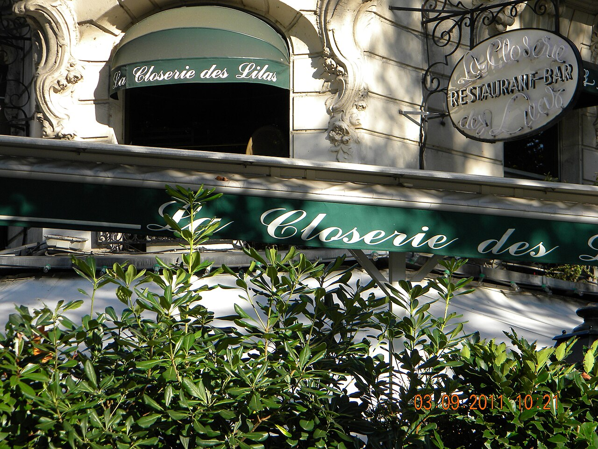

# 丁香园咖啡馆

蒙帕纳斯大道走到 Observatoire 路口，会看到一排被绿植和遮阳篷包住的店面，门口立着菜单牌，里面传出钢琴声。这就是丁香园咖啡馆。它不像花神或双叟那样把“文学咖啡馆”做成明显的旅游标签，门口甚至有点低调；但推门进去，酒吧台面上刻着海明威的名字，墙上挂着旧照片，靠里的钢琴吧在晚上会有人弹爵士。它既是餐厅，也是酒吧，也是蒙帕纳斯“还活着”的文学记忆。

图：La Closerie des Lilas 的绿色门面与招牌，171 boulevard du Montparnasse。图片：Britchi Mirela，CC BY-SA 3.0，via Wikimedia Commons（[原图页面](https://commons.wikimedia.org/wiki/File:La_Closerie_des_Lilas,_Paris.jpg)）。

## 1847 年：丁香园咖啡馆的关键起点
丁香园这个位置的历史可以追到 1847 年。那一年，Bal Bullier 舞厅在 Observatoire 路口开业，旁边的客栈与酒吧为舞客提供饭食和饮品；1883 年，旁边的 brasserie 以 La Closerie des Lilas 之名重新经营，名字来自周围成片的丁香。它很快成为学生、画家与作家的会面点，十九世纪末的常客包括 Zola、Cézanne、Verlaine、Gautier 与 Goncourt 兄弟。

二十世纪初，诗人 Paul Fort 把这里选作周二聚会的地点。Apollinaire、Alfred Jarry、Brancusi 等人会来；列宁也在这里与 Paul Fort 下过棋。1910 年，Robert Delaunay、Albert Gleizes、Fernand Léger、Henri Le Fauconnier 与 Jean Metzinger 在这里商量如何绕过独立沙龙的挂画委员会，这段聚会常被看作立体主义团体形成的一个节点。

1922 年，Tristan Tzara 与 André Breton 在这里发生争吵。巴黎旅游局把这场争吵写成“字面意义上终结了达达、催生了超现实主义”的事件；更稳妥的说法是，它是达达在巴黎分裂、超现实主义成形过程中的一次关键冲突。1925 年，海明威在这里完成《The Sun Also Rises》的初稿；他常坐在吧台前写作，酒吧至今保留着刻有他名字的位置。战后，Sartre、Sagan、Juliette Gréco 等人继续把这里当作左岸的会面点。

2007 年 3 月 7 日，Prix de la Closerie des Lilas 设立，奖励当年 1 月至 3 月出版的法语女性写作。这个奖让咖啡馆的文学身份不只停留在“过去时”，而是继续参与当下的出版与讨论。

## 空间与酒单

丁香园的空间分成几个层次：临街的玻璃棚与绿色露台、主餐厅、酒吧与钢琴吧。室内保留着 1920 年代的装饰语言：马赛克地面、皮革卡座、镜面、深色木饰、黄铜灯具与一架钢琴。桌子之间不算宽，晚上钢琴一响，谈话会被压到比较低的音量；这正是它和大型 brasserie 不同的地方。

菜单以法式 brasserie 与正餐为主：洋葱汤、蜗牛、鹅肝、鱼类、牛排与经典甜点；酒吧提供香槟、法国葡萄酒、威士忌与经典鸡尾酒。海明威时代的价格早已不存在，但点一杯干邑或香槟、配一份小食，仍然是理解这个空间的方式。若只喝咖啡，下午的露台比晚上更轻松。

## 怎么喝

下午或傍晚先在露台点一杯咖啡、香槟或 kir，看看蒙帕纳斯大道的车流与行人；如果想吃正餐，再移到餐厅。晚上钢琴吧开始后，建议点一杯威士忌、干邑或经典鸡尾酒，坐得靠近钢琴一点，但不要挡住演奏者与常客的视线。

海明威的“写作位”在酒吧一侧，很多人会点一杯干邑或 café crème 坐在附近。不要期待这里提供“海明威同款套餐”或固定讲解；它仍然是营业中的餐厅，最好的进入方式是点单，而不是把酒吧当成展柜。若只想快速喝一杯，酒吧比餐厅更容易找到空位。

## 丁香园咖啡馆的地址与营业安排
- 地址：171 Boulevard du Montparnasse, 75006 Paris，Observatoire 路口。
- 营业：每日 12:00–00:00；餐厅与酒吧的最后一轮时间会不同，深夜前往前先电话确认。
- 交通：地铁 Vavin（4 号线）或 Port-Royal（RER B）；公交 38、68 等在大道附近停靠。
- 预订：餐厅建议预订；酒吧与露台通常按到场顺序入座。
- 价格：餐厅、酒吧与露台价位不同；正餐人均明显高于一杯咖啡。
- 钢琴：晚上常有钢琴演奏，演出时段不建议大声交谈或频繁走动。

## 礼仪与常见误区

第一，不要把“海明威坐过”当成可以占用吧台位置的借口。酒吧座位是先到先得，站着喝一杯再让位是常态。第二，不要以为所有区域都能只点饮品；餐厅桌在正餐时段通常要求点菜，想只喝一杯就留在酒吧或露台。第三，不要把 1922 年的争吵写成“达达在此被正式终结”；它是达达在巴黎分裂的关键事件，具体因果仍有不同叙述。第四，不要用“1847 年”推断现在的建筑与装饰都是 1847 年的原物；这个位置经历过多轮改建，今天看到的主要是二十世纪的空间。第五，不要在钢琴演奏时大声接电话或开闪光灯；这里不是演出厅，但演奏者与客人共享同一个空间。

这里的文学史标签集中在酒吧与露台，不等于每张桌子都适合安静写作；想感受海明威式的下午，应避开午餐与晚市高峰，并先确认是否需要预订，也别把名人故事当成菜单的一部分。

## 从丁香园咖啡馆延伸到利普啤酒馆
从丁香园往东走几分钟是 La Coupole 与 Brasserie Lipp，往西是蒙帕纳斯火车站与 Tour Montparnasse，往北穿过卢森堡公园是 Saint-Germain-des-Prés。可以排成一条“蒙帕纳斯文学一日”：La Closerie des Lilas → La Coupole → Brasserie Lipp → 蒙帕纳斯墓园（Baudelaire、Sartre、Beauvoir） → 卢森堡公园。若只想喝一杯，Observatoire 路口的三家历史咖啡馆足够形成一个下午。

相关条目：[利普啤酒馆](ref:lipp)、[圆顶咖啡馆](ref:coupole)、[和平咖啡馆](ref:paix)。

**关键事实。**

| 项目 | 内容 |
| --- | --- |
| 一句话定位 | 巴黎蒙帕纳斯大道 171 号的 La Closerie des Lilas，1847 年已作为舞厅与客栈出现、1883 年以现名经营；保罗·福尔的周二沙龙、海明威 1925 年的写作与 1922 年达达/超现实主义的争吵，使它成为左岸文学史的一处坐标 |
| 地址 | 171 Boulevard du Montparnasse, 75006 Paris, France |
| 城市/国家 | 巴黎 / 法国 |
| 营业状态 | 已核验营业 |
| 官网 | closeriedeslilas.fr |

**来源与边界。** 本页关于「丁香园咖啡馆」的关键事实，主要由以下来源交叉核对：La Closerie des Lilas（171 boulevard du Montparnasse 地址与每日 12:00–00:00 营业时间）、Paris Convention and Visitors Bureau、Ville de Paris（海明威在 Closerie 写作、1925 年完成《The Sun Also Rises》初稿与 1926 年出版的关系）等 4 条来源。产品、地址或营业状态变化较快时，以 closeriedeslilas.fr 的最新页面为准；价格、批次与状态会变，涉及这些字段时以页面所列来源的最新版本为准。正文为项目自写，来源只作核验，不复制原文。

## 参考资料
- 巴黎旅游局蒙帕纳斯艺术漫步：<https://en.parisinfo.com/discovering-paris/walks-in-paris/the-montparnasse-of-artists>，用于核对 1847 年、客群与达达争吵。
- Ville de Paris 的海明威漫步：<https://paris-recette.paris.fr/pages/balade-sur-les-pas-d-ernest-hemingway-19062>，用于核对 1925 年写作与《The Sun Also Rises》。
- 同一条街区的 `place:la-coupole` 与 `place:brasserie-lipp` 可以对照蒙帕纳斯/圣日耳曼的文学咖啡馆类型。
- 若想走完整的左岸路线，读 `route:saint-germain-literary-cafes`。
- 本页把达达争吵写成“关键冲突”而非单一因果；文学史叙述与店方故事之间存在细节差异。
- 相关条目：[利普啤酒馆](ref:lipp)、[圆顶咖啡馆](ref:coupole)、[和平咖啡馆](ref:paix)、[圣日耳曼文学咖啡馆路线](ref:saint-germain)、[巴黎丽兹 Hemingway 酒吧](ref:hemingway)
