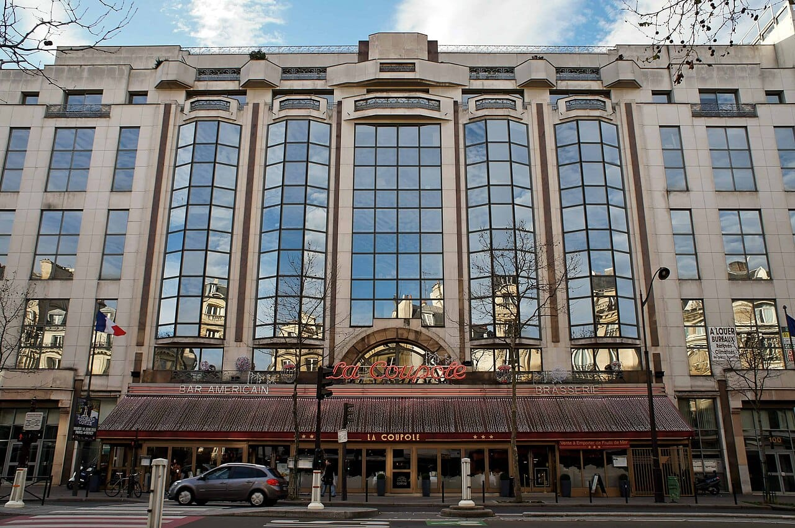
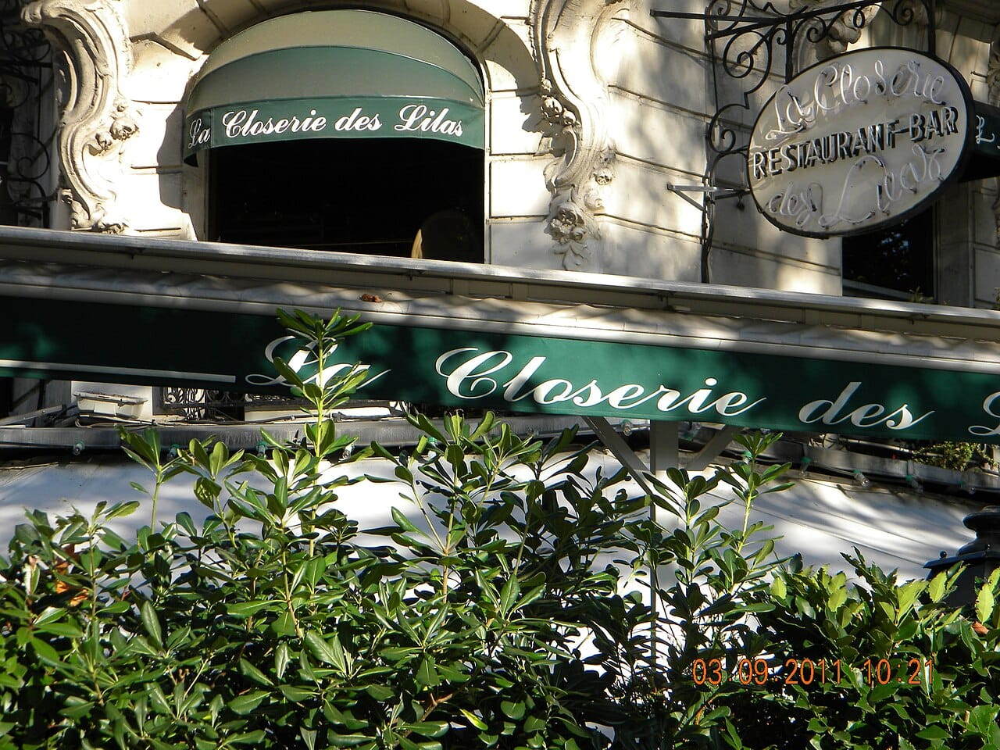

# 圆顶咖啡馆

蒙帕纳斯大道 102 号，一间门面宽得几乎占满街区的餐厅，门口挂着“LA COUPOLE”的霓虹与遮阳篷。它不像圣日耳曼的咖啡馆那样把座位摆在人行道上，而是用一整面玻璃与大理石立面把人吸进去。进门后先看到的是穹顶下的主厅、成排的柱子、白色与奶油色的墙面、 brass 灯具与开放式海鲜台。La Coupole 不是“小而美”的左岸咖啡馆，它是蒙帕纳斯“疯狂年代”的宴会厅，也是今天仍然从早到晚营业的大型 brasserie。

图：La Coupole 的 Art Deco 立面与红色遮阳篷，102 boulevard du Montparnasse。图片：besopha，CC BY 2.0，via Wikimedia Commons（[原图页面](https://commons.wikimedia.org/wiki/File:La_coupole_(46200235745).jpg)）。

## 1927 年：圆顶咖啡馆的关键起点
La Coupole 于 1927 年 12 月开业，创办人是 Ernest Fraux 与 René Lafon。开业夜，店方备下 1,500 瓶酒，当晚全部售罄；这个数字后来被反复引用，用来形容蒙帕纳斯在两次大战之间的热闹。1928 年，地下舞厅开张，爵士乐队、查尔斯顿舞与蒙帕纳斯的画家、模特、作家、美国侨民挤在同一栋楼里。

主厅的 32 根柱子是 La Coupole 最著名的视觉特征。1927 年，27 位蒙帕纳斯艺术家——其中包括 Marc Chagall、Louis Latapie 等——在柱子上绘制了花卉、风景、人物与抽象图案。它不是美术馆式的“委托创作”，而是把餐厅本身变成画布，让客人在吃饭时被艺术包围。

1988 年 1 月 12 日，底层大厅列入历史建筑；同年，Michel Bourbon 在厅内加了第 33 根柱子，柱面由他绘制。1993 年，Louis Derbré 的青铜雕塑《La Terre》安放在厅内。2018 年，Bertrand 集团收购 La Coupole，随后进行修复，保留柱绘、镜面、brass 灯具与海鲜台，同时更新厨房与动线。

开业后的最初十年，La Coupole 成了蒙帕纳斯美国侨民、画家与作家的食堂；Hemingway 在《A Moveable Feast》里写到它，Picasso、Sartre 与 Beauvoir 后来也各有固定桌。它既是餐厅，也是“看人与被看”的舞台：晚上有乐队，舞池在地下，客人从正餐一直吃到深夜。

## 空间与酒单

La Coupole 的空间是“大厅 + 露台 + 地下酒吧”的组合。主厅有穹顶、成排柱子、白色桌布、皮革卡座与镜面；靠窗的露台对着蒙帕纳斯大道；地下酒吧在晚上有 DJ 或现场音乐。它的尺度不适合悄声谈话，但适合团体、家庭与想看“老蒙帕纳斯”场面的人。

菜单以法式 brasserie 与海鲜为主：生蚝、虾、蟹、海鲜拼盘、牛排、鸭腿、鹅肝、洋葱汤、cassoulet 与经典甜点。酒单以法国葡萄酒、香槟与鸡尾酒为主；海鲜台旁边可以点一杯 Muscadet、Chablis 或香槟。它不是以“创意菜”取胜，而是以稳定的传统菜、海鲜与场景取胜。

## 怎么喝

中午适合点海鲜拼盘或牛排，配一杯 Muscadet 或 Chablis；生蚝的咸鲜需要干型白葡萄酒，香槟也可以。下午可以在露台点一杯咖啡、香槟或 kir，看蒙帕纳斯大道的车流。晚上地下酒吧开门后，可以点一杯鸡尾酒或威士忌，听音乐；若想吃正餐，主厅与露台都可以，但周末建议预订。

不要期待“1,500 瓶酒”的复刻；那是 1927 年开业夜的传说，不是今天的菜单。若只想喝一杯，露台与酒吧比主厅更容易找到位置；主厅在正餐时段通常要求点菜。

## 圆顶咖啡馆的地址与营业安排
- 地址：102 Boulevard du Montparnasse, 75014 Paris。
- 营业：周一 08:00–23:00；周二至周六 08:00–00:00；周日 08:00–23:00。
- 交通：地铁 4 号线 Vavin 或 6 号线 Edgar Quinet；RER B 线 Port-Royal；公交 38、68 等。
- 预订：正餐建议预订，尤其是周末与演出日；露台与酒吧通常可以直接到店。订位时可以说明想坐靠窗或看柱绘的位置，服务生会尽量安排。
- 价格：海鲜拼盘与正餐人均较高；咖啡与小食相对轻。
- 无障碍：主厅与露台有台阶，行动不便者建议提前电话确认入口。天气好时露台最抢手，想坐外面要早到。

## 礼仪与常见误区

第一，不要把柱子当成可以触摸的展品；柱绘是历史建筑的一部分，油渍、汗渍与闪光灯都会造成损害。第二，不要以为所有座位都能只喝一杯；主厅在正餐时段通常要求点菜，想只喝饮品就留在露台或酒吧。第三，不要把“1927 年开业夜卖光 1,500 瓶酒”写成今天的事实；它是历史轶事，不是当下的库存或促销。第四，不要用“蒙帕纳斯黄金年代”掩盖今天的商业现实；La Coupole 现在是 Bertrand 集团旗下的大型餐厅，服务、价格与客群都已变化。第五，不要在海鲜台前长时间拍视频挡住取餐动线；那是工作区，不是布景。

圆顶咖啡馆的舞厅与艺术家柱子属于历史空间，不是每张桌子都能看到；用餐高峰的座位安排与预订规则要先确认，把这里当成随便进出的景点会扑空，午市与晚市也不同。

## 从圆顶咖啡馆延伸到利普啤酒馆
从 La Coupole 往西两分钟是 La Closerie des Lilas，往东十分钟是 Brasserie Lipp 与 Saint-Germain-des-Prés，往北是蒙帕纳斯墓园与 Tour Montparnasse。可以排成：La Coupole 午餐 → La Closerie des Lilas 喝咖啡 → 蒙帕纳斯墓园 → Tour Montparnasse 观景 → 圣日耳曼晚餐。若只想在蒙帕纳斯活动，Vavin 路口的三家历史餐厅足够排一天。

相关条目：[利普啤酒馆](ref:lipp)。

**关键事实。**

| 项目 | 内容 |
| --- | --- |
| 一句话定位 | 蒙帕纳斯大道 102 号的 La Coupole，1927 年 12 月开业，开业夜备下的 1,500 瓶酒当晚售罄；32 根由 27 位艺术家绘制的柱子、1928 年的地下舞厅与 1988 年的历史建筑认定，使它成为蒙帕纳斯“疯狂年代”的活标本 |
| 地址 | 102 Boulevard du Montparnasse, 75014 Paris, France |
| 城市/国家 | 巴黎 / 法国 |
| 营业状态 | 已核验营业 |
| 官网 | lacoupole-paris.com |

**来源与边界。** 本页关于「圆顶咖啡馆」的关键事实，主要由以下来源交叉核对：La Coupole（102 boulevard du Montparnasse 地址与周一至周日分时段营业时间）、Visit Paris Region（蒙帕纳斯“疯狂年代”定位、开业盛况与今日餐厅/酒吧并存的描述）、Groupe Bertrand（交叉核对 1927 年开业、2018 年 Bertrand 集团收购与地址）。产品、地址或营业状态变化较快时，以 lacoupole-paris.com 的最新页面为准；价格、批次与状态会变，涉及这些字段时以页面所列来源的最新版本为准。正文为项目自写，来源只作核验，不复制原文。

**并读。** 把「圆顶咖啡馆」与「丁香园咖啡馆」、「利普啤酒馆」、「和平咖啡馆」放在一起读时，先确认它们是同一层级还是上下游关系：先确认地址与营业状态，再比较历史、空间与点单体验。本页负责给出场所的基本坐标，对照条目补上具体案例与差异；读完再回到本页，才能分清哪些差别属于场所本身，哪些只是产地、批次或品牌选择。

## 参考资料
- 店方“关于”页：<https://www.lacoupole-paris.com/en/about-us/>，用于核对 1927 年 12 月、1,500 瓶酒、32 根柱子、1928 年舞厅、1988 年历史建筑与第 33 根柱。
- Visit Paris Region 条目：<https://www.visitparisregion.com/en/la-coupole>，用于核对“疯狂年代”定位与今日场景。
- Groupe Bertrand 菜单 PDF：<https://evenement.groupe-bertrand.com/wp-content/uploads/2025/05/LA-COUPOLE-MENUS-PE25.pdf>，用于交叉核对 2018 年收购与地址。
- 同街区的 `place:la-closerie-des-lilas`、`place:brasserie-lipp` 与 `place:cafe-de-la-paix` 可以对照巴黎大型 brasserie 与文学咖啡馆的不同类型。
- 若走圣日耳曼/蒙帕纳斯文学路线，读 `route:saint-germain-literary-cafes`。
- 相关条目：[丁香园咖啡馆](ref:closerie)、[利普啤酒馆](ref:lipp)、[和平咖啡馆](ref:paix)、[圣日耳曼文学咖啡馆路线](ref:saint-germain)、[巴黎丽兹 Hemingway 酒吧](ref:hemingway)

对照阅读：[丁香园咖啡馆](ref:closerie)、[和平咖啡馆](ref:paix)。

## 相关图像

图：La Closerie des Lilas 的绿色门面与招牌，171 boulevard du Montparnasse。图片：Britchi Mirela，CC BY-SA 3.0，via Wikimedia Commons（[原图页面](https://commons.wikimedia.org/wiki/File:La_Closerie_des_Lilas,_Paris.jpg)）。关联图像：圆顶咖啡馆。
