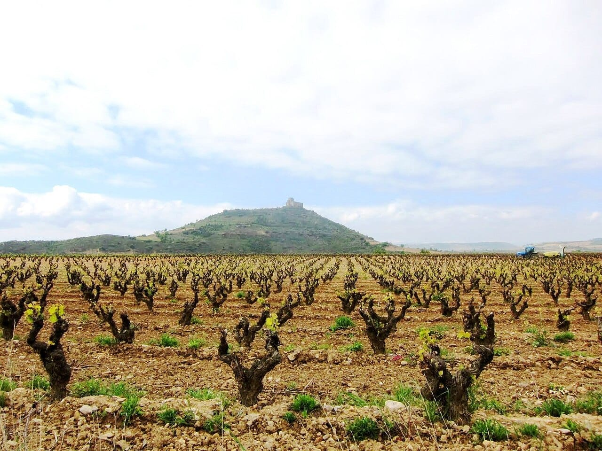
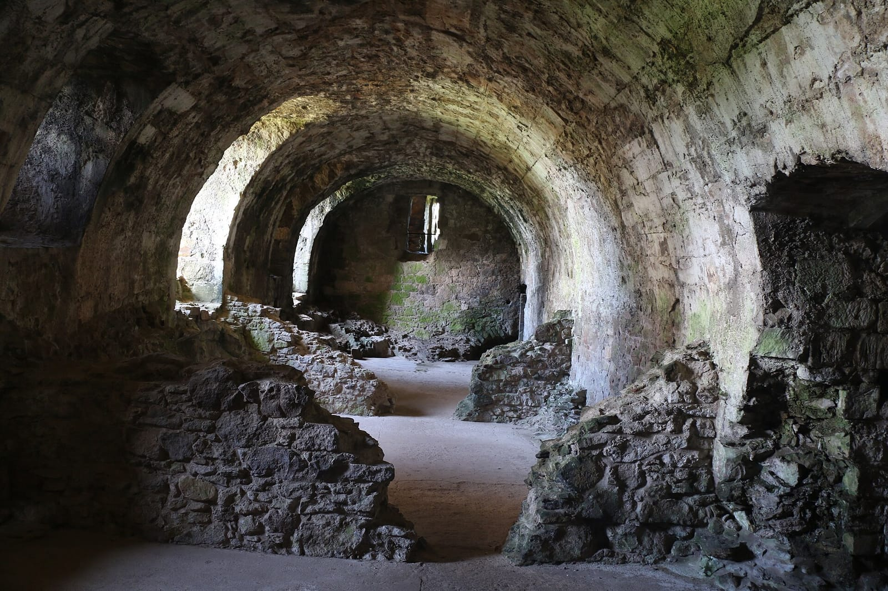

# 里奥哈阿尔塔酒庄

阿罗（Haro）火车站区（Barrio de la Estación）是一条很短的街：一边是铁路，一边是连成排的老酒厂，砖墙、铁门与酒窖的通风口挤在一起。里奥哈阿尔塔在 Vizcaya 大道 8 号，离洛佩兹雷迪亚只隔几分钟步行。它没有把参观做成“主题乐园”，而是把一间仍在按传统节奏运转的酒庄打开给预约访客看：美国橡木桶、长时间陈酿、缓慢的倒桶，以及一套从 1890 年延续下来的家族股东结构。

图：里奥哈阿尔塔酒庄所在的里奥哈风貌配图。摄影：A Rioja Vineyard - panoramio。署名：Art Anderson，CC BY-SA 3.0，来自 Wikimedia Commons（[来源](https://commons.wikimedia.org/w/index.php?curid=56546384)）。这张照片用于说明产区环境与访问语境，不标定里奥哈阿尔塔酒庄的门店、酒庄或活动现场。

> **先给结论**
> **一句话：** 这页判断里奥哈阿尔塔酒庄值不值得专程去，以及到访前要核对什么。
>
> - **适合谁：** 正在计划去里奥哈阿尔塔酒庄、想知道值不值得专程安排半天到一天的人。
> - **不适合谁：** 只想要“必去榜单”、不准备核对预约、交通和开放时间的人。
> - **先看这两点：**
>   - 酒庄的建筑沿街展开，入口不张扬，进去后是接待区、品鉴室与生产区。
>   - 产品线可以按“陈年等级—园子—历史名”来读。

## 定位与历史

1890 年，五个里奥哈与巴斯克家族在阿罗火车站区共同创立了“Sociedad Vinícola de La Rioja Alta”。首任主席是 Doña Saturnina García Cid y Gárate，一位女性；首任酿酒师是法国人 Monsieur Vigier。酒庄资料把 1890 年的 Reserva 视为今天 Gran Reserva 890 的前身，这个名字也直接指向创立年份。这里有两点值得记住：第一，里奥哈的现代酒业从一开始就是跨家族、跨地区的资本合作，不是单个农户的作坊；第二，法国酿酒师的到来与 19 世纪末法国葡萄园的病害有关，里奥哈在那段时间获得了进入法国市场的窗口。

酒庄至今仍由创立家族的股东共同持有，没有把品牌卖给大型饮料集团。它常被称为“传统里奥哈”的代表之一，但“传统”不等于“拒绝现代”：酒庄在发酵、温控与设备上都有更新，真正保持不变的是陈年逻辑——用美国橡木桶长时间熟成，让酒在上市前就达到可饮状态，而不是把年轻酒直接推向市场。理解这一点，才能读懂它的酒单为什么看起来“年份很久、价格却不疯狂”。

酒庄的葡萄来源分布在里奥哈的不同子产区，Tempranillo 是主体，Garnacha、Graciano、Mazuelo 与 Viura 等品种按酒款需要加入。Viña Ardanza 是最常被提起的名字，通常以 Tempranillo 为主、加入 Garnacha，风格比 Gran Reserva 更圆、更早适饮；Gran Reserva 904 与 890 则是更长时间陈年的旗舰。904 的名字来自 1904 年，890 来自 1890 年；把两个数字当成“酒龄”会误解，它们是酒庄用来标记历史节点的名字。

## 空间与参观

酒庄的建筑沿街展开，入口不张扬，进去后是接待区、品鉴室与生产区。参观通常从历史与葡萄园讲起，再进入发酵车间、桶陈酒窖与瓶陈空间。最值得看的是桶陈区：成排的美国橡木桶、昏暗的光线、墙面的霉斑与地面的湿气，构成一种很具体的“时间感”。酒庄在 Labastida 设有自己的制桶车间，能控制橡木桶的烘烤与使用；这在里奥哈并不常见，也解释了它为什么能坚持一套稳定的桶陈风格。

倒桶是另一个细节。传统里奥哈会在陈年期间定期把酒从一桶换到另一桶，分离沉淀、让酒与氧气短暂接触；这套动作听起来简单，实际需要人力、空间与经验。参观时如果看到桶塞、虹吸管与老式工具，不要只看成“复古道具”，它们仍在某些环节中使用。酒窖温度低、湿度大，地面可能湿滑，穿防滑平底鞋，带一件薄外套；拍照不要用闪光灯直射酒桶与老标签。

酒庄的参观以预约为准，通常安排在工作日，采收期（九月至十月）会减少或暂停接待。不同套餐的时长、是否含品鉴、品鉴酒款与语言不同，预约时要逐项确认；团体与业内人士的安排可能另有一套流程。不要把它当成“到门口买票”的酒庄，也不要指望在品鉴室随到随喝。若同行者不喝酒，可以只参加历史与酒窖部分，或把时间留给阿罗老城。

## 酒款与品鉴

产品线可以按“陈年等级—园子—历史名”来读。Viña Alberdi 是较年轻的 Crianza，适合日常饮用；Viña Arana 是 Reserva，结构更完整；Viña Ardanza 是旗舰 Reserva，Tempranillo 与 Garnacha 的组合让它在果味之外多了一层圆润与香料；Gran Reserva 904 与 890 则是长时间陈年的顶级款，上市时已经带有干果、皮革、烟草与香草的气息。白葡萄酒与桃红不是主线，但酒庄也有生产，具体供应看年份与市场。

美国橡木是这条线的关键词。与法国橡木相比，美国橡木通常带来更明显的香草、椰子、莳萝与甜香料，单宁也更柔和；长时间陈年会让这些“甜桶味”与果味、酸度融合，变成干果、皮革与烟草的复杂香气。第一次来，最有效的对比是 Viña Ardanza 与 Gran Reserva 904：前者更圆、更早适饮，后者更深、更慢；如果还能喝到 890，注意它的质地与余味，不要只比较“谁更老”。

品鉴时先看颜色，再闻香气，最后小口喝；里奥哈的红葡萄酒常有沉淀，直立静置或换瓶即可，不要以为酒坏了。喝不完可以吐掉，尤其是还要开车或赶火车的人。酒庄门市有售酒，但开放时间不固定，部分时段只对预约访客开放；买之前确认携带与托运规定，别在行程第一天就买满一箱。

## 实用信息

地址是 Avenida de Vizcaya 8, 26200 Haro, La Rioja, Spain，位于阿罗火车站区。火车到 Haro 站后步行约五分钟；从洛格罗尼奥（Logroño）乘火车或巴士约四十分钟到一小时，从毕尔巴鄂（Bilbao）乘火车约两小时，班次不多，出发前查当日时刻。自驾从洛格罗尼奥约 45 公里、从维多利亚约 50 公里、从毕尔巴鄂约 120 公里，镇内酒庄集中，停车位有限。

参观须提前预约，可通过官网的 Visit Us 入口或电话、邮件联系；确认日期、时间、语言、人数、是否含品鉴与费用。采收期会关闭或减少接待，周日与节假日通常不安排。参观时长一般在一到两小时之间，视套餐而定；酒窖温度低、湿度大，穿防滑鞋并带薄外套。行动不便的访客要提前说明，历史建筑的门槛与楼梯不一定适合轮椅。

开放时间、票价与酒款会调整，页面核验日期 2026-11-08，出发前以酒庄回复与官网当日信息为准。若把这里作为哈罗车站区路线的第二站，建议预约上午晚些时候或下午早段，给午餐与下一家酒庄留出时间；不要把三场品鉴排得太密，味觉疲劳会让第三家变成“喝不出区别”。

## 礼仪与周边

酒庄是生产场所，不是酒吧。按预约时间到达，不要迟到；迟到可能被缩短行程或拒绝进入。不要触摸酒桶、管道、老照片与展品，不要进入未开放的地窖分支；拍照前看陪同人员的提示，闪光灯与三脚架通常不受欢迎。品鉴时不要喷浓香水，不要大声喧哗；吐酒是正常做法，不需要勉强喝完。

就「里奥哈阿尔塔酒庄」而言，开车的人全程不喝。里奥哈的酒庄之间距离不远，但乡村道路弯多，酒后驾驶风险高；最稳妥的是火车加步行、包车或指定司机。若乘火车，注意回程班次不多，不要把最后一场品鉴安排在发车前半小时。

周边就是火车站区的其他酒庄：洛佩兹雷迪亚、CVNE、Muga、Gómez Cruzado 都在步行范围内，但每家都要预约。阿罗老城的和平广场（Plaza de la Paz）周边有酒吧与小餐馆，适合午餐；六月二十九日的 Haro 葡萄酒节（Batalla del Vino）会让全镇非常拥挤，想安静参观要避开。往东可到布里奥内斯（Briones）的 Vivanco 葡萄酒博物馆，往北可到拉瓜迪亚（Laguardia）与里奥哈阿拉维萨。想理解酒窖如何影响风味，可以读[酒窖与储存](ref:cellar)；想建立里奥哈的整体框架，则从[里奥哈](ref:rioja)与[葡萄酒](ref:wine)开始。

补充阅读：[A Ginjinha](ref:c-extra-1)、[À la Mort Subite](ref:c-extra-2)。

对照阅读：[葡萄酒](ref:wine)、[酒窖与储存：温度、湿度、光照与时间](ref:cellar)。

相关条目：[里奥哈](ref:rioja)。

**关键事实。**

| 项目 | 内容 |
| --- | --- |
| 一句话定位 | 西班牙里奥哈阿罗（Haro）火车站区的历史酒庄，1890 年由五个里奥哈与巴斯克家族共同创立；以美国橡木桶、长时间陈酿与 Viña Ardanza、Gran Reserva 904、890 等酒款闻名，参观须提前预约 |
| 地址 | Avenida de Vizcaya 8, 26200 Haro, La Rioja, Spain |
| 城市/国家 | 阿罗 / 西班牙 |
| 营业状态 | 已核验营业 |
| 官网 | riojalta.com |

## 相关图像

图：酒窖与储存：温度、湿度、光照与时间相关实景照片。图片：Deepsphotography，CC BY-SA 3.0，via Wikimedia Commons（[原图页面](https://commons.wikimedia.org/wiki/File:The_Cellars_in_Direlton_Castle.JPG)）。关联图像：里奥哈阿尔塔酒庄。
