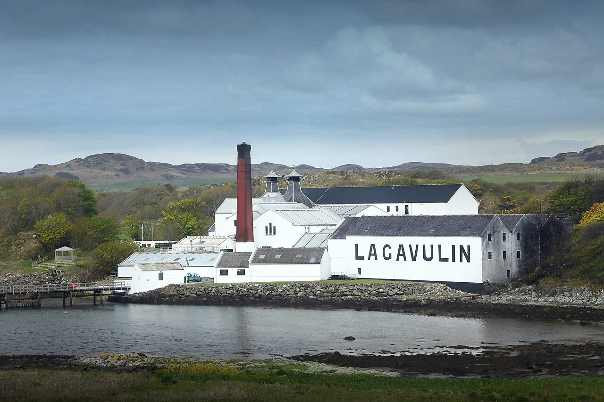

# 乐加维林蒸馏厂

乐加维林在艾雷岛南岸的 Lagavulin Bay，Port Ellen 以东约 2 英里，A846 沿海公路旁，邻近 Dunyveg 城堡遗址。1816 年由 John Johnston 创立，是苏格兰最古老的蒸馏厂之一。此前这一带已有非法蒸馏的传统；合法化后，乐加维林把重泥煤、慢发酵与长陈酿变成稳定风格。今天酒厂属于 Diageo，但参观体验仍以酒厂本身为主。官方把酒名读作“Laga-VOO-lin”，重音在第二音节。

图：乐加维林蒸馏厂。图片：Charlie Marshall，CC BY 2.0，via Wikimedia Commons（[原图页面](https://commons.wikimedia.org/wiki/File:2019-05-05_Lagavulin_Distillery.jpg)）。

## 1816 年：乐加维林蒸馏厂的关键起点
艾雷岛的威士忌史，一半是农业，一半是海岸。岛上泥煤丰富，麦芽烘干时吸收大量烟熏；海风与潮湿仓库又让酒体带有碘、海藻与咸味。乐加维林在 1816 年取得合法身份，但它的位置在此之前就适合蒸馏：海湾提供水源与运输，海岸公路连接 Port Ellen 的港口，泥煤从附近的沼泽取来。19 世纪，乐加维林与邻近的 Laphroaig、Ardbeg 一起，把南岸变成艾雷岛最密集的威士忌地带。

今天的乐加维林以“重泥煤但不粗糙”著称。它的麦芽泥煤酚值高，发酵时间长，蒸馏器是梨形，酒体在桶中缓慢成熟。官方把 16 年单一麦芽作为核心酒款，这不是“越老越好”的推销，而是酒厂风格最稳定的表达：烟熏、碘、海盐、干果与油脂感同时存在。理解这一点，比记住年份表更有用。

## 空间与酒单

厂房面朝海湾，游客中心、商店与 Malt Mill Bar（Dramming Room）在入口一带；生产区包括糖化、发酵、蒸馏与仓库。乐加维林的蒸馏器是梨形，官方特别提到这一点；重泥煤麦芽带来碘、海藻、烟熏与油脂感。核心酒款是 16 年单一麦芽，另有 8 年、12 年原桶强度特别版、Distillers Edition 与 Fèis Ìle 节庆装瓶。酒吧提供单杯、鸡尾酒与无酒精饮料，不参加导览也可以进店与酒吧，但要看当天接待能力。

酒单的读法可以按“日常—桶强—实验”来分。16 年是基准，适合第一次喝乐加维林的人；8 年更年轻、烟熏更直接；12 年原桶强度酒精度高，加几滴水后香气会打开；Distillers Edition 经过额外的雪莉桶熟成，甜味更明显；Fèis Ìle 与酒厂限定版每年不同，适合已经喝过基础款的人。不要在第一杯就选桶强，也不要把“泥煤越重越好”当成标准。

如果只看酒单，乐加维林像是一排年份；走进生产区才会明白风格从哪来。麦芽在烘干时吸收泥煤烟，发酵槽里的时间比许多酒厂更长，梨形蒸馏器的回流让酒体保留更多油脂感；这些步骤叠加，才有碘、海盐与烟熏同时出现的味道。仓库靠海，湿度高，桶陈过程中酒体会慢慢失去尖锐感。参观时留意墙上的流程说明，比在酒吧里猜风味更有效。

## 参观或点单方式

导览必须提前在官网预约。经典导览约 1.5 小时，含三杯品鉴，2026 年 11 月官网起价 22 英镑；Warehouse No.3 体验约 1.25 小时，起价 60 英镑，可以从桶中取酒；Premium Warehouse No.3 约 2 小时，105 英镑；Distillery Exclusive 约 2 小时，130 英镑。每团最多 16 人，8 岁以下不得参加导览。旺季与 Fèis Ìle 期间很快售罄，建议提前数周。只想喝酒不参观，可直接去 Malt Mill Bar，但座位有限，最后点单在关门前 30 分钟。

预约时要区分“导览”和“品鉴”。经典导览会走生产区，楼梯陡、地面湿，不适合行动不便的人；Warehouse 体验以仓库与品鉴为主，可以在预约时说明需求，酒厂会尽量调整。参观当天提前十分钟到，迟到不一定能补进下一团。带孩子的人要注意，8 岁以下不能进导览，未满 18 岁必须由成人陪同，且不能参加威士忌品鉴。

## 乐加维林蒸馏厂的地址与营业安排
地址是 Lagavulin Distillery, Port Ellen, Isle of Islay, PA42 7DZ, United Kingdom。从 Port Ellen 沿 A846 步行或骑车约 2 英里，有步行与自行车道；当地巴士周一至周六经过酒厂门口，班次少，出租车也要提前订。自驾有免费停车场。官网在 2026 年 11 月标注的开放时间为：11 月周一至周六 10:00–17:00，12 月至 2 月 10:00–16:00，3 月至 10 月每天 10:00–17:00；Dramming Room 酒吧在开放日 10:30–16:00 营业，最后点单 15:30。冬季天气可能导致临时关闭，节日与维护期另有时段调整，以官方渠道当日公告为准。「乐加维林蒸馏厂」的开放时间、价格与预约，以[官网](https://www.malts.com/en-gb/distilleries/lagavulin)的公开页面为准；核验日期为 2026-11-08，临时调整以官网当日公告为准。

从格拉斯哥或爱丁堡出发，通常先到 Kennacraig 乘 CalMac 渡轮，约两小时到 Port Askaig 或 Port Ellen；也可飞抵 Islay 机场，再转巴士或出租车。渡轮受天气影响，冬季可能停航，不要把酒厂预约排在抵达当天最紧的时段。岛上道路多为单车道会车，租车要把让行与停车时间算进去。

## 礼仪与误区

误区一是把乐加维林当成“重泥煤的代表”而忽略它的甜味与油脂感；它的烟熏强，但酒体并不粗糙。误区二是以为不预约也能随时进厂，生产区必须跟团。误区三是开车来还参加品鉴，艾雷岛道路窄，酒驾风险高。误区四是把 16 年当成“最低年份”，其实它是酒厂风格的核心，不是入门淘汰款。

参观时不要触摸设备与酒桶，不要进入警戒线；仓库温度低，带外套。品鉴时可以吐酒，不丢人；不要空腹喝原桶强度酒。拍照前看标识，生产区有些位置不允许拍摄。买酒时注意航空与渡轮的携带限制，别在行程第一天就买满一箱。

## Port Ellen的周边街区
南岸三座酒厂——Laphroaig、Lagavulin、Ardbeg——由“Three Distilleries Pathway”串起，从 Port Ellen 出发约 4 英里，适合步行或骑车。往西可到 Kildalton 十字架与 Ardbeg；往北是 Bowmore、Bruichladdich 等。岛上公交班次少，一天安排两座酒厂比三座更现实。若从爱丁堡或格拉斯哥来，需先到 Kennacraig 乘渡轮，或飞抵 Islay 机场，行程至少留两天。

如果只安排半天，建议只选乐加维林一座，参加经典导览后在酒吧坐一会儿，再沿海南行到 Ardbeg 或北回 Port Ellen。把三座酒厂塞进一天，看起来效率高，实际会在等车、找出租车和赶导览之间耗尽时间。岛上的天气变化快，路线要留余量。

## 同产区蒸馏厂与延伸阅读
乐加维林是[苏格兰威士忌](ref:scotch)与[艾雷岛](ref:islay)风格的入口；想系统比较泥煤、雪莉与桶强，可先读[威士忌入门](ref:whisky-intro)。

补充阅读：[威士忌](ref:c-extra-1)、[A Ginjinha](ref:c-extra-2)。

对照阅读：[苏格兰威士忌](ref:scotch)、[威士忌入门](ref:whisky-intro)。

相关条目：[艾雷岛](ref:islay)。

**关键事实。**

| 项目 | 内容 |
| --- | --- |
| 一句话定位 | 苏格兰艾雷岛南岸、Port Ellen 以东的单一麦芽威士忌蒸馏厂，1816 年由 John Johnston 创立，以重泥煤、梨形蒸馏器与 16 年单一麦芽闻名，设有导览与 Warehouse No.3 品鉴 |
| 地址 | Lagavulin Distillery, Port Ellen, Isle of Islay, PA42 7DZ, United Kingdom |
| 城市/国家 | Port Ellen / 英国 |
| 营业状态 | 已核验营业 |
| 官网 | malts.com |
