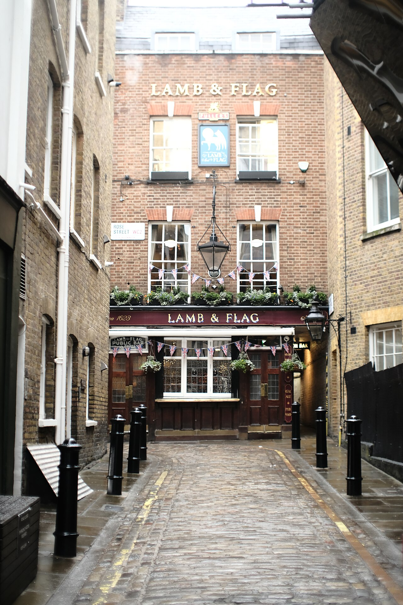

# 兰姆与旗

科文特花园的玫瑰街（Rose Street）并不宽，兰姆与旗（The Lamb & Flag）的门面就夹在几条小巷之间。它没有大橱窗，也没有把历史写成广告牌；第一次来的人往往从 Lazenby Court 或 Rose Street 绕到门口，才发现这间看起来不大的酒馆，背后连着科文特花园最粗粝的一段过去：赤手拳赛、文学恩怨、市场搬运工与剧院演员，都曾在这几条街里进出。

图：科文特花园玫瑰街的兰姆与旗；1958 年砖立面包着可能为 18 世纪早期的木构，原屋可追溯到 1638 年。图片：Tanja Müller，CC BY 2.0，via Wikimedia Commons（[原图页面](https://commons.wikimedia.org/wiki/File:Lamb_and_Flag,_Covent_Garden_2025-02-08.jpg)）。

## 1772 年：兰姆与旗的关键起点
官方记载这个地点最早出现酒馆是在 1772 年，当时叫 The Coopers Arms，1833 年才改成现在的名字。今天看到的砖立面约是 1958 年重做的，里面包着可能是 18 世纪早期的木构架，而原屋可追溯到 1638 年；因此“1623 年就有酒馆”的说法并不可靠。19 世纪早期，楼上房间举办赤手拳赛，酒馆因此得到“血桶”（Bucket of Blood）的绰号。1679 年，诗人约翰·德莱顿在酒馆旁的巷子里被雇来的打手袭击，这件事发生在酒馆有明确记载之前，但今天的楼上餐厅仍以“Dryden Room”命名。狄更斯在附近工作时也是常客；20 世纪 60 年代，隔壁上演《奥利弗！》的剧组也常来。

名字的来历也值得拆开：CAMRA 指出 Lamb 来自《约翰福音》的“上帝的羔羊”，Flag 是圣乔治旗，两者合起来是宗教与英格兰守护圣人的组合，而不是“羊与旗”的乡村酒馆图腾。19 世纪拳赛多在楼上房间举行，观众与赌客把 Rose Street 一带变成科文特花园的灰色地带；这也是“血桶”绰号的来源。20 世纪 60 年代，隔壁上演《奥利弗！》的剧组常来，澳大利亚喜剧演员 Barry Humphries 在这里结识 Peter Cook 与 Dudley Moore，后来一起做出 Barry McKenzie 漫画。2011 年 Fuller's 承租、2013 年完全拥有后，酒馆做过一次温和的整修，但保留了无音乐、无游戏机与两个小酒吧的格局；楼上 Dryden Room 的木梁上仍有纪念 1679 年袭击的拉丁文铭文。

## 空间与酒单

地面层由两个小房间组成，深色木饰、低梁、壁炉与旧地板把空间压得很紧凑；墙上零星挂着纪念常客的黄铜牌，有些位置至今仍被老客人认领。楼上是以德莱顿命名的餐厅，正餐主要在那里供应，且实行桌边服务。这里没有背景音乐，也没有游戏机，和科文特花园许多更“热闹”的酒吧不同。酒单以 Fuller's 系的 cask ale 为主，常见 London Pride、ESB 一类；因为酒馆从 2011 年起由 Fuller's 承租、2013 年完全拥有，客座酒的比例不会像自由酒馆那样高，但吧台通常仍愿意让客人先试一口。

“血桶”绰号来自 19 世纪的赤手拳赛，今天墙上仍挂着与拳击、文学相关的旧物；空间不大，啤酒与酒吧食物是主要消费。

## 怎么喝

建议先从一款中规中矩的英式苦啤或淡色艾尔开始，再试一款酒花更明显的版本；这里的 cask ale 不需要加冰，温度通常在 cellar 温度附近，喝的是柔和气泡与麦芽甜感。想吃饭就直接问楼上还有没有位子，不要端着酒杯在楼梯口堵住通道。工作日傍晚前相对安静，周末与剧院散场后会非常拥挤。官方营业时间是周一至周六 12:00–23:00、周日 12:00–22:30，节假日会调整；若只想喝一杯，避开开演前与散场后的半小时最舒服。

## 兰姆与旗的地址与营业安排
地址是 33 Rose Street, Covent Garden, London WC2E 9EB。最近的地铁站是 Covent Garden，步行约 200 米；Leicester Square 与 Charing Cross 也在可走范围内。酒馆没有停车场，科文特花园本身也不适合开车，建议步行或坐地铁。地面层空间小，轮椅进入与转身都不宽裕，行动不便者最好先电话询问动线。楼上餐厅建议订位；只喝饮料通常可以直接进。营业时间、菜单与订位规则以官网为准。

## 礼仪与常见误区

第一，“血桶”是 19 世纪拳赛留下的历史绰号，不是说今天这里治安不好；把它当成猎奇标签会显得轻浮。第二，德莱顿遇袭发生在酒馆旁的巷子，且时间早于酒馆的明确记载，不能写成“他在酒馆里被打”。第三，“1623 年伦敦最老酒馆”的说法与官方、CAMRA 的记载冲突，写作时应以 1772 年首次记载和 1958 年立面为准。第四，楼上餐厅是正式用餐区，不要只点一杯酒占整张桌；地面层吧台也不适合长时间铺开电脑办公。

## 从兰姆与旗延伸到伦敦经典酒吧步行路线
从酒馆步行几分钟就是科文特花园市场、皇家歌剧院与 Neal's Yard；往西可到 Seven Dials，往南可到 Covent Garden 地铁站。把这里安排在[伦敦经典酒吧步行路线](ref:london-route)的中段很合适：先在科文特花园逛一圈，再到这里喝半品脱，之后往北去[老主教冠](ref:ye-olde)/[老主教冠酒馆](ref:ye-olde)，或坐地铁去 Hampstead 的[西班牙人客栈](ref:spaniards)。若想先理解这类酒馆在城市中的位置，可读[认识一座城，从一间酒馆开始](ref:pub-city)与[酒馆史](ref:taverns)。

**关键事实。**

| 项目 | 内容 |
| --- | --- |
| 一句话定位 | 伦敦科文特花园玫瑰街的历史酒馆，1772 年首次见于记载，19 世纪以赤手拳赛得名“血桶”，也是狄更斯与德莱顿故事的交汇点 |
| 地址 | 33 Rose Street, Covent Garden, London WC2E 9EB, United Kingdom |
| 城市/国家 | 伦敦 / 英国 |
| 营业状态 | 已核验营业 |
| 官网 | lambandflagcoventgarden.co.uk |

**来源与边界。** 本页关于「兰姆与旗」的关键事实，主要由以下来源交叉核对：The Lamb & Flag（地址、营业时间与订座入口；1772 年 Coopers Arms、1833 年改名、1958 年砖立面、拳赛与 1679 年德莱顿遇袭）、CAMRA（Grade II、木构年代、Dryden Room 与“血桶”别名的历史解释）、London Region CAMRA（Fuller's 租约与所有权、楼上餐厅、无音乐/游戏机与常客传统）等 5 条来源。产品、地址或营业状态变化较快时，以 lambandflagcoventgarden.co.uk 的最新页面为准；价格、批次与状态会变，涉及这些字段时以页面所列来源的最新版本为准。正文为项目自写，来源只作核验，不复制原文。

## 参考资料
- [认识一座城，从一间酒馆开始](ref:pub-city)
- [酒馆史：从酒肆、客栈到酒吧](ref:taverns)
- [伦敦经典酒吧步行路线](ref:london-route)
- [老主教冠酒馆](ref:ye-olde)
- [西班牙人客栈](ref:spaniards)

本页于 2026-11-21 核对 Lamb & Flag 官方页面。酒馆周一至周六 12:00–23:00、周日 12:00–22:30，节假日会调整；楼上餐厅建议订位，地面层只喝饮料通常可直接进。1623 年“伦敦最老”的说法与 1772 年首次记载、1958 年立面之间的差异，正文已保留限定；“血桶”是 19 世纪拳赛绰号，不是今天的治安描述。本页图片是兰姆与旗酒馆的玫瑰街门面，不是店内或菜品；图注已逐张署名，图片许可见来源页。订位与菜单以官网当日信息为准。

对照阅读：[认识一座城，从一间酒馆开始](ref:pub-city)、[伦敦经典酒吧步行路线](ref:london-route)。
